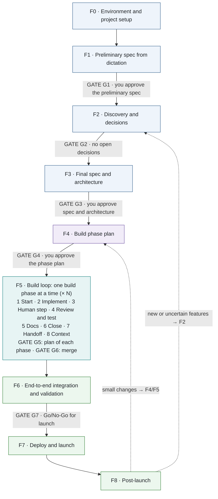
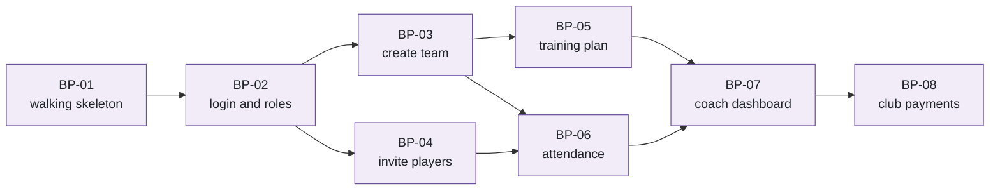
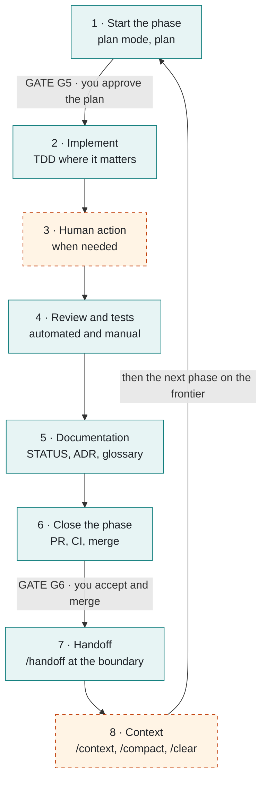
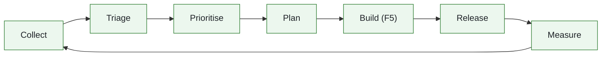

# The AI-Assisted Build Playbook

**A repeatable system for taking any digital product from idea to production with Claude.**

*Operational playbook · Version 1.0 · November 2026*

**What's inside.** Nine phases from idea to post-launch · an eight-step build loop · 15 ready-to-use templates and prompts · a verified toolkit (Claude Code, Matt Pocock's skills, integrations) · a master checklist · a one-page quick reference.

Primary sources: the official Claude Code documentation (code.claude.com) and the `mattpocock/skills` repository, checked on 11–12 November 2026. Prices and limits of third-party services were checked on the same dates: they change often, so check them again before you buy.

> [!NOTE]
> **Markdown version**
>
> Same content as the PDF. Diagrams are in Mermaid, boxes are GitHub-style callouts (NOTE, WARNING, TIP, CAUTION) and footnotes are numbered notes.

## Contents
- [Before you start · How to use this playbook](#before-you-start--how-to-use-this-playbook)
- **[Part I · The method](#part-i--the-method)**
  - [Chapter 1 · Executive overview](#chapter-1--executive-overview)
  - [Chapter 2 · The visual workflow](#chapter-2--the-visual-workflow)
  - [Chapter 3 · Who does what: Claude, you and permissions](#chapter-3--who-does-what-claude-you-and-permissions)
- **[Part II · The nine phases](#part-ii--the-nine-phases)**
  - [Phase 0 · Project and environment setup](#phase-0--project-and-environment-setup)
  - [Phase 1 · Preliminary spec from dictation](#phase-1--preliminary-spec-from-dictation)
  - [Phase 2 · Discovery and decisions with /wayfinder](#phase-2--discovery-and-decisions-with-wayfinder)
  - [Phase 3 · Final spec and technical architecture](#phase-3--final-spec-and-technical-architecture)
  - [Phase 4 · Split the project into build phases](#phase-4--split-the-project-into-build-phases)
  - [Phase 5 · The build loop](#phase-5--the-build-loop)
  - [Phase 6 · End-to-end integration and validation](#phase-6--end-to-end-integration-and-validation)
  - [Phase 7 · Deploy and launch](#phase-7--deploy-and-launch)
  - [Phase 8 · Post-launch: improve without breaking](#phase-8--post-launch-improve-without-breaking)
- **[Part III · Templates and SOPs](#part-iii--templates-and-sops)**
  - [Template · How to use the templates](#template--how-to-use-the-templates)
- **[Part IV · Toolkit and skills](#part-iv--toolkit-and-skills)**
  - [Toolkit · Tools by function](#toolkit--tools-by-function)
  - [Toolkit · Matt Pocock's skills](#toolkit--matt-pococks-skills)
  - [Toolkit · Claude Code commands and integrations](#toolkit--claude-code-commands-and-integrations)
- **[Part V · Checklist and quick reference](#part-v--checklist-and-quick-reference)**
  - [Checklist · Master project checklist](#checklist--master-project-checklist)
  - [Reference · Quick reference: the exact sequence](#reference--quick-reference-the-exact-sequence)
- **[Appendices](#appendices)**
  - [Appendix A · Minimal glossary](#appendix-a--minimal-glossary)
  - [Appendix B · Sources and verification date](#appendix-b--sources-and-verification-date)

## Before you start · How to use this playbook

This playbook is an operating system for building digital products with Claude as your main development partner: websites, web apps, mobile apps, SaaS, internal tools, dashboards and applications with AI components. It does not build one specific application: it defines *how* to work every time, which tools to use, which commands to run, which documents to produce, and when it is your turn to decide.

It is written for people who are good with AI tools but do not have a software engineering background. Every technical concept is explained in a numbered note the first time it appears; the final glossary collects them all.

### How it is organised

- **Part I — The method.** Executive overview, visual workflow, who does what between you and Claude.
- **Part II — The nine phases (F0–F8).** For each phase: a summary card (goal, input, output, tools, gate, typical time), step-by-step actions with the exact commands, expected outputs, the *Definition of Done* and the most common mistakes.
- **Part III — Templates and SOPs.** The 15 core templates (T1–T15) plus the project `CLAUDE.md` (T0) and four bonus files (ADR, STATUS, pull request, bug report).
- **Part IV — Toolkit and skills.** Tools by function, Matt Pocock's skills one by one, Claude Code's native commands and external integrations, with a clear line between what is included and what you need to install.
- **Part V — Checklist and quick reference.** The master checklist and the one-page quick reference.
- **Appendices.** Minimal glossary and sources with their verification date.

### Conventions

| Symbol | Meaning |
|---|---|
| **[CLAUDE]** | Claude does this on its own, without asking you. |
| **[YOU]** | You do this: a decision, credential, account, payment, manual action or final test. |
| **[GATE Gn]** | Approval point: Claude stops and waits for your explicit yes before going on. |
| **[BUILT-IN]** | Native Claude Code command (e.g. `/compact`, `/clear`, `/context`). |
| **[BUNDLED SKILL]** | Skill bundled with Claude Code, already available (e.g. `/code-review`, `/run`, `/verify`). |
| **[MATT POCOCK SKILL]** | Skill from the `mattpocock/skills` repository: you need to install it (Phase 0). |
| **[INTEGRATION]** | External tool: command line, MCP connector, cloud service. |
| `<project-name>` | Placeholder: replace all the text between angle brackets. |
| Blue (NOTE), orange (WARNING), green (TIP), red (CAUTION) callouts | Note, caution or limitation, Definition of Done, approval gate. |

### Language: why prompts and templates are in English

Prompts, templates and repository files are in English, whatever language you speak, for three reasons. First: code, commits, issues and technical documentation live in the repository and will be read by developers, technical partners and automated tools. Second: Matt Pocock's skills and the Claude Code documentation are in English, so the terminology stays consistent end to end. Third: many technical terms are unambiguous in English and not in other languages.

You can still talk to Claude in your own language at any time. The project `CLAUDE.md` (template T0) asks Claude to reply to you in plain English and to write files in English: replace "English" in the reply rule with your language and Claude will answer you in it, while the files stay in English.

### Operating system and prerequisites

The commands are written for Windows (PowerShell); where something differs you will find the macOS and Linux equivalent. Minimum prerequisites: a Claude Pro or Max subscription (Claude Code is not included in the free plan) and a GitHub account. Everything else is installed in Phase 0.

### What was verified and what is a heuristic

- **Verified on 11–12 November 2026.** Claude Code commands and behaviour, from the official documentation (<https://code.claude.com/docs>); names, purpose and behaviour of Matt Pocock's skills, from the README and the `SKILL.md` files of the `mattpocock/skills` repository (about 307,000 stars on GitHub at that date); prices and limits of the services mentioned, from the official pricing pages or the sources listed in the appendix.
- **Heuristics of this playbook.** The context-usage zones, the number of build phases per project type, the indicative timings and the default stack. They are flagged as such: adapt them after your first projects.

> [!WARNING]
> **The tools change fast**
>
> Claude Code ships new versions very often, and Matt Pocock's skills changed several times in 2026. In older guides you will find `/to-prd`, `/to-issues`, `CONTEXT.md` and `decision-mapping`: in the current repository their role is played by `/to-spec`, `/to-tickets` (introduced with version 1.1 in July 2026), `GLOSSARY.md` (since 1.3 in October 2026) and `/wayfinder`. If a command does not respond: type `/` to see the available commands, `/release-notes` for what's new, `/doctor` to diagnose the installation.

### How to read it the first time

1. Read Part I (about 15 minutes): it gives you the full map.
2. Do Phase 0 once on your computer (1–2 hours the first time).
3. On your first project, follow the phases in order, with the [quick reference](#reference--quick-reference-the-exact-sequence) and the [master checklist](#checklist--master-project-checklist) open next to you.
4. From the second project on, work from the quick reference and the templates; go back to the chapters only when you need the detail.

# Part I · The method

*Executive overview, visual workflow, roles and rules of the game.*

## Chapter 1 · Executive overview

**The method in one sentence.** You turn a vague idea into a product in production through nine phases that clearly separate four activities: *define* (F0–F3), *plan* (F4), *build* (F5) and *deliver* (F6–F8). Claude does almost all of the work; you make the decisions at seven points of no return, the *gates*.

### Why you need a method

Working with a coding agent without a method produces four recurring failures. The first three match problems that Matt Pocock cites as the motivation for his skills (his list also includes agent verbosity, which the playbook tackles with the domain glossary); the fourth is specific to long sessions with a language model.

| Risk | Symptom | Countermeasure in the playbook | Phase |
|---|---|---|---|
| Misalignment | Claude builds something different from what you had in mind. | Structured discovery with `/wayfinder`: one question at a time, decisions recorded before any code is written. | F1–F3 |
| Code that doesn't work | Features that look finished but break on first real use. | Strong feedback loops: types, tests written before the code where it matters, CI, review, preview deploys. | F5–F6 |
| Ball of mud | Every change gets slower and riskier: entropy speeds up with AI. | Documented architecture, ADRs, domain glossary, small vertical slices, periodic architecture reviews. | F3, F8 |
| Context loss | Claude forgets decisions, repeats mistakes, gets worse towards the end of a session. | The repository as memory, `STATUS.md`, `/handoff` between sessions, a 200,000-token context budget. | F5 |

### The seven principles

1. **The repository is the memory.** What matters lives in Git and GitHub[^1], not in the chat: spec, decisions, plan, status. A conversation can be lost; a versioned file cannot.
2. **Decide before you build.** No line of code until product and architecture decisions are made and written down. It costs hours at the start and saves weeks later.
3. **Small vertical slices.** Every *build phase* cuts through all the layers[^2] (data, logic, interface, tests), produces a demonstrable result and fits in one session, one branch, one pull request.
4. **Strong feedback loops.** Claude works well only if it can check its own work: type checking, automated tests, build, review and a clickable preview[^3].
5. **The human at the points of no return.** Claude proposes, you decide: scope, priorities, costs, credentials, merges and launch always go through you.
6. **Context hygiene.** One session, one goal. A cautious budget of 200,000 tokens, `/handoff` and `/clear` between one piece of work and the next.
7. **Boring, well-documented technology.** Standard stacks the model knows very well and that are well documented, unless there are strong reasons written down in an ADR.

### The nine phases in one table

| Phase | Goal | Main output | Key tools | Gate | Typical time\* |
|---|---|---|---|---|---|
| F0 Setup | Environment ready, repo created | GitHub repo, `CLAUDE.md`, skills configured | winget, Claude Code, gh, skills plugin | — | 1–2 h the first time, then 15 min |
| F1 Preliminary spec | Capture the idea unfiltered | `docs/01-preliminary-spec.md` | Wispr Flow, T1, T2 | G1 | 30–90 min |
| F2 Discovery | Make and record the decisions | Closed `/wayfinder` map, ADRs, glossary | `/wayfinder` | G2 | 3–15 sessions |
| F3 Final spec | A single source of truth | `02-product-spec.md`, `03-architecture.md` | `/to-spec`, T4, T5 | G3 | 2–4 h |
| F4 Build phases | An ordered, executable plan | 10–50 BP-NN issues | `/to-tickets`, T6, T7 | G4 | 1–2 h |
| F5 Build loop | Build one phase at a time | Merged pull requests, green tests | plan mode, `/implement`, `/tdd`, `/handoff` | G5, G6 | 1–3 h of your time per phase |
| F6 Integration | A coherent product that matches the spec | Integration review, Go/No-Go | T13, `/security-review` | G7 | 0.5–2 days |
| F7 Deploy | Stable, monitored production | App online, monitoring, rollback | Vercel, Supabase, T14 | G7 | 0.5–1 day |
| F8 Post-launch | Improve without breaking | Releases, changelog, new issues | `/triage`, T15 | G5–G6 | Ongoing |

\* Playbook heuristic for a medium-complexity MVP; your first projects will take longer.

### The four core artefacts

The whole method revolves around four artefacts. If they are up to date, anyone (you, Claude in a new session, a collaborator) can pick up the work in a few minutes.

- `docs/02-product-spec.md` — **what** we are building. It is the product's source of truth.
- `docs/03-architecture.md` and `docs/adr/` — **how** we are building it and **why** we chose that way.
- **GitHub Issues** — the **work**: the decision map (Phase 2) and the `BP-NN` build phases (Phase 4).
- `docs/STATUS.md` — **where we are right now**. It is the first thing Claude reads in every session.

### The seven approval gates

| Gate | When | What you approve | If you say no |
|---|---|---|---|
| **[GATE G1]** | End of F1 | The preliminary spec really captures your idea. | You correct it by voice or in writing; Claude updates it. |
| **[GATE G2]** | End of F2 | The map has no open decisions left; scope and destination are clear. | New decision tickets are created. |
| **[GATE G3]** | End of F3 | Final spec, stack, MVP scope and exclusions. | The spec is revised before planning. |
| **[GATE G4]** | F4, before publishing | Number, order and dependencies of the build phases. | Claude reworks the split. |
| **[GATE G5]** | Start of every build phase | The phase's implementation plan. | Claude re-plans; no file is touched. |
| **[GATE G6]** | End of every build phase | Definition of Done met, merge into `main`. | The phase stays open until it complies. |
| **[GATE G7]** | End of F6 | Go/No-Go for the production launch. | Serious problems are fixed and the check is repeated. |

[^1]: **Git** is the system that records the history of every change to a project's files. **GitHub** is the online service that hosts Git projects and adds issues, pull requests and automation.

[^2]: The typical layers of an application: the interface (**frontend**, what the user sees in the browser or the app), the logic on the server (**backend**) exposed through **APIs**, the "doors" two programs use to exchange data, the **database** and the tests.

[^3]: **Deploy**: publishing a version of the application to a server. A **preview deployment** is a temporary deploy with its own web address, created automatically for every pull request: you can try the change before it reaches users.

## Chapter 2 · The visual workflow

The diagram below shows the nine phases, the main outputs, the gates and the return loop after launch. The arrows show dependencies: a phase starts only when the previous one has reached its Definition of Done.

### How to read the dependencies

- **F0 → F1.** The dictation already lands in a file in the repository: that is why the project has to be created first.
- **F1 → F2.** `/wayfinder` needs a destination and raw material to start from: the preliminary spec.
- **F2 → F3.** `/to-spec` synthesises decisions already made; it does not interview. Without closed decisions, the spec would make things up.
- **F3 → F4.** `/to-tickets` splits the approved spec: every build phase must point back to written requirements.
- **F4 → F5.** Dependencies between issues (*blocked by*) set the order: you always work on a phase whose blockers are closed.
- **F5 → F6 → F7.** You integrate when all the phases of the milestone are closed; you launch only after the Go at gate G7.
- **F8 → F2/F4/F5.** After launch the cycle restarts from the right point depending on the size of the change (see Phase 8).



| Phase | Main tools | Main outputs |
|---|---|---|
| F0 · Environment and project setup | winget · Claude Code · gh · `/setup-matt-pocock-skills` | Private GitHub repo · `CLAUDE.md` · `docs/` structure · labels · skills configured |
| F1 · Preliminary spec from dictation | Wispr Flow, Win+H or `/voice` · prompt T1 · template T2 | `docs/00-brain-dump.md`<br>`docs/01-preliminary-spec.md` |
| F2 · Discovery and decisions | `/wayfinder` (grilling, prototype, research) · GitHub Issues | Closed wayfinder map · resolved decision tickets · ADRs · `GLOSSARY.md` |
| F3 · Final spec and architecture | `/to-spec` · T4 · T5 · ADR · critical review | `docs/02-product-spec.md`<br>`docs/03-architecture.md` · spec issue |
| F4 · Build phase plan | `/to-tickets` · prompt T6 · issue template T7 | 10–50 BP-NN issues with dependencies<br>`docs/04-build-plan.md` |
| F5 · Build loop (× N) | plan mode · `/implement` · `/tdd` · `/handoff` · `/compact` | For every build phase: branch → pull request with green tests → merge into main<br>`STATUS.md` updated · issue closed with a summary |
| F6 · End-to-end integration and validation | T13 · `/security-review` · `/code-review` · user acceptance testing | Integration review · traceability matrix · Go/No-Go |
| F7 · Deploy and launch | Vercel · Supabase · GitHub Actions · Sentry · PostHog · T14 | Production online · domain · monitoring · rollback runbook |
| F8 · Post-launch | `/triage` · `/diagnosing-bugs` · `/improve-codebase-architecture` · T15 | Release vX.Y.Z · CHANGELOG · new prioritised issues |

**Legend.** Phase colours: Define (F0–F3), Plan (F4), Build (F5), Deliver (F6–F8). **GATE** = Claude stops: your explicit approval is needed. The dashed arrows are the return loop after launch: small changes → F4/F5; new or uncertain features → F2.

## Chapter 3 · Who does what: Claude, you and permissions

The general rule: **Claude executes, proposes and checks; you decide, authorise and accept**. The table turns the rule into concrete activities.

| Activity | Claude on its own | Needs your OK | Only you |
|---|---|---|---|
| Read code and documents, search, analyse | **[CLAUDE]** |  |  |
| Propose plans, options and trade-offs | **[CLAUDE]** |  |  |
| Write code and tests within the scope of the issue | **[CLAUDE]** after G5 | **[GATE G5]** |  |
| Run tests, type checks, lint and build locally | **[CLAUDE]** |  |  |
| Commit on the phase branch, open the pull request | **[CLAUDE]** |  |  |
| Update documentation, ADRs, `STATUS.md`, issue comments | **[CLAUDE]** |  |  |
| Product decisions: scope, UX, pricing, key copy | proposes |  | **[YOU]** decide |
| New dependencies, new services, any cost | proposes | **[YOU]** |  |
| Production database migrations, deleting data | prepares | **[YOU]** |  |
| Merge into `main` | prepares | **[GATE G6]** |  |
| Production deploy and launch | prepares | **[GATE G7]** |  |
| Create accounts, enter cards, API keys and secrets, configure DNS | guides you step by step |  | **[YOU]** |
| Final testing and acceptance | helps |  | **[YOU]** |
| Legal terms, privacy policy, cookies | drafts |  | **[YOU]** (with a lawyer if needed) |

### Claude Code's permission modes

Claude Code asks for permission before acting, based on the active *permission mode*[^4]. In the terminal, `Shift+Tab` cycles through the modes `default` → `acceptEdits` → `plan`; the `auto` mode appears only if your account meets the requirements.

| Mode | What it does | When to use it in the playbook |
|---|---|---|
| `default` (asks first) | Asks for confirmation for file edits and commands that are not read-only. | First build phases, until you know how Claude behaves. |
| `plan` (plan mode) | Claude reads, explores and writes a plan without changing the code. | Always at the start of every build phase (gate G5) and before wide-ranging changes. |
| `acceptEdits` | Automatically approves file edits and common filesystem commands. | After 3–5 phases that went well; then review the changes in the pull request. |
| `auto` | Replaces confirmation prompts with a safety classifier. | Only once you have experience and solid tests; not required. |
| `bypassPermissions` | Skips permission checks entirely. | Never, in this playbook. |

### Five rules for staying in control

1. **Nothing reaches production without a gate.** You always authorise merges (G6) and the launch (G7).
2. **Only you touch secrets.** API keys and passwords go in `.env.local` files or in the services' dashboards, never pasted into the chat. The project `.claude/settings.json` stops Claude from reading those files (Phase 0).
3. **One build phase per branch and per session.** Mixing two phases is the fastest way to lose control and context.
4. **If something goes wrong, go back.** `/rewind` (or pressing `Esc` twice) takes the conversation and the files back to a checkpoint[^5]; for everything else there is Git.
5. **When you don't understand, ask for it again.** Write "explain it to me as you would to a non-technical person" or use the `/wait-what` skill: approving what you don't understand cancels out the value of the gates.

[^4]: **Permission mode**: the setting that decides what Claude can do without asking you (read, edit files, run commands). In the terminal you change it with `Shift+Tab`, which cycles through `default`, `acceptEdits` and `plan`.

[^5]: **Checkpoint**: a restore point that Claude Code creates automatically while it works. Checkpoints cover changes made with Claude's file-editing tools, not the effects of commands run in the terminal: for those, the safety net is Git.

# Part II · The nine phases

*From environment setup to post-launch: input, actions, commands, output and Definition of Done for every phase.*

## Phase 0 · Project and environment setup

| Item | Detail |
|---|---|
| **Goal** | Have your computer, accounts and repository ready: Claude Code installed and connected to GitHub, Matt Pocock's skills configured, standard folder structure. |
| **Input** | Just the working name of the project. |
| **Output** | Tools installed; private GitHub repository with the standard structure; `CLAUDE.md`; `.claude/settings.json`; skills configured; GitHub labels. |
| **Tools** | winget, Git, GitHub CLI (`gh`), Node.js, VS Code, Claude Code, `mattpocock-skills` plugin. |
| **Gate** | None. |
| **Typical time** | 1–2 hours the first time on your computer; 10–15 minutes for every new project. |

### 0.1 Claude chat or Claude Code?

They are two different ways of working with the same model. There is only one practical rule: **if the output has to live in the repository, use Claude Code**.

|  | Claude (chat: web, desktop, mobile) | Claude Code |
|---|---|---|
| What it is | Conversational assistant with Projects, artifacts, research, design, documents and voice mode. | Coding agent: reads and edits the project files, runs commands, uses Git and GitHub. |
| Where it runs | claude.ai and the Claude apps. | Terminal (CLI), VS Code and JetBrains extensions, desktop app (Code section), web at claude.ai/code with cloud sessions, mobile to start and follow sessions. |
| File access | Manual upload or connectors. | Direct access to the project folder, within the permissions you grant. |
| Use it for | Exploring the idea, market and competitor research, naming, visual mockups, learning a concept, reviewing a document. | Everything that becomes a file, issue, commit or pull request: spec, plan, code, tests, deploy. |
| Output | Conversation or artifact. | Files in the repository, commits, issues, pull requests. |

**Which Claude Code interface to use.** I recommend the CLI[^6] inside the integrated terminal of VS Code[^7]: you see the files on the left, Claude at the bottom, and you have every command described in this playbook. The desktop app (Code section) is a valid alternative, more visual for diffs and previews; if a command is not available in a graphical interface, use it from the CLI. Claude Code on the web (claude.ai/code) runs sessions in the cloud on your GitHub repositories: useful for kicking off work from your phone, not as your main environment at the start.

### 0.2 Accounts and starting costs

| Service | Recommended plan | Cost | Notes |
|---|---|---|---|
| Claude | Pro; move to Max if you often hit the limits | Pro 20 USD/month (17 USD/month billed annually at 200 USD); Max from 100 USD/month | Claude Code is included in Pro and Max, not in the free plan. Check usage with `/usage`. |
| GitHub | Free | 0 | Private repositories; 2,000 GitHub Actions minutes per month for private repositories, free on standard runners for public ones. |
| Wispr Flow (opt.) | Flow Basic, then Pro if you dictate a lot | Basic free (2,000 words per week on Mac/Windows); Pro 15 USD/month, 12 billed annually | Free alternatives: Windows dictation (`Win+H`) and `/voice` in Claude Code. |
| Vercel, Supabase, Sentry, PostHog | Free plans during development | 0 until launch | Production costs are analysed in Phase 7. |

### 0.3 Install the tools (once per computer)

Open PowerShell as a normal user and run one command at a time. `winget`[^8] installs Git[^9], the GitHub CLI, Node.js[^10] and VS Code; the last command installs Claude Code with the native installer, which updates itself.

**PowerShell · install**
```powershell
winget install --id Git.Git -e
winget install --id GitHub.cli -e
winget install --id OpenJS.NodeJS.LTS -e
winget install --id Microsoft.VisualStudioCode -e
irm https://claude.ai/install.ps1 | iex
```

Close and reopen the terminal (needed for the new programs to enter the PATH[^11]), then check: every command must print a version number.

**PowerShell · check**
```powershell
git --version
gh --version
node --version
npm --version
claude --version
```

> [!NOTE]
> **On macOS or Linux**
>
> With Homebrew: `brew install git gh node` and `brew install --cask visual-studio-code`; Claude Code with `curl -fsSL https://claude.ai/install.sh | bash`. As an alternative to PowerShell, on Windows Claude Code can also be installed with `winget install Anthropic.ClaudeCode`: in that case it does not update itself and you update it with `winget upgrade Anthropic.ClaudeCode`.

> [!WARNING]
> **If something doesn't work**
>
> If `claude` is not found, the terminal cannot see the PATH yet: reopen it or follow the *Troubleshoot installation* page of the documentation. If PowerShell blocks scripts (*running scripts is disabled on this system*), the same page gives the fix. Once inside Claude Code, `/doctor` runs a full check of the installation.

### 0.4 Configure Git and connect GitHub

**PowerShell · Git and GitHub**
```powershell
git config --global user.name "<First Last>"
git config --global user.email "<your-github-account-email>"
git config --global init.defaultBranch main
gh auth login      # GitHub.com -> HTTPS -> Login with a web browser
gh auth status     # should say "Logged in"
```

**How Claude Code connects to GitHub.** No dedicated integration is needed: Claude Code uses `git` and `gh` from your terminal, with your credentials. That way it can create repositories, issues[^12], branches[^13], commits[^14] and pull requests[^15]. Matt Pocock's skills use the same `gh`. Two optional integrations: `/install-github-app` installs the Claude GitHub app and, if you want, the GitHub Actions workflows to mention `@claude` in issues and pull requests; `/web-setup` connects your GitHub account to Claude Code cloud sessions using the `gh` credentials.

### 0.5 First run of Claude Code and recommended settings

Open a terminal in any folder, type `claude` and complete the login in the browser with your Claude account. Then, inside Claude Code:

**Claude Code · one-off settings**
```text
/doctor
/statusline show the model, the current git branch and context window usage as a percentage
/autocompact 200k
```

- `/doctor` **[BUNDLED SKILL]** checks installation, settings, extensions and `CLAUDE.md`; it proposes fixes that Claude applies after you confirm.
- `/statusline` **[BUILT-IN]** configures the status line: describe in words what you want to see. Always having the percentage of context used in front of you is the basis of context management (Phase 5, step 8).
- `/autocompact 200k` **[BUILT-IN]** sets the automatic compaction threshold at 200,000 tokens: it is the safety net for this playbook's cautious budget. The value is saved in your user settings; to go back to the default use `/autocompact auto`.

In VS Code also install the *Claude Code* extension from the extensions marketplace: it gives you the graphical panel and the diff view, but keep using the CLI in the integrated terminal when you need a specific command.

### 0.6 Install Matt Pocock's skills (once per computer)

Matt Pocock's skills[^16] are an open-source set (MIT licence) of engineering procedures: discovery, specification, splitting the work, TDD, review, handoff. For Claude Code the method recommended by the README is the plugin, which updates itself:

**PowerShell · install the plugin**
```powershell
claude plugin install mattpocock-skills@claude-plugins-official
```

Alternatively, inside a session: `/plugin install mattpocock-skills@claude-plugins-official`. If Claude Code replies that the marketplace does not exist, add it with `/plugin marketplace add anthropics/claude-plugins-official` and try again. Check with `/skills`: among others you should see `wayfinder`, `handoff`, `to-spec`, `to-tickets`, `tdd`.

> [!WARNING]
> **Three details that avoid trouble**
>
> - **Skill names.** A plugin's skills carry the plugin prefix: `/mattpocock-skills:wayfinder`. The short name (`/wayfinder`) also works if no other command already uses it.
> - **Clash on `code-review`.** Claude Code already has a bundled `/code-review`: the short name starts that one. Matt Pocock's review is called with `/mattpocock-skills:code-review`.
> - **Only one install method.** The alternative `npx skills@latest add mattpocock/skills` copies the skills into the project as editable files, which you update by hand with `npx skills@latest update`. Don't use both methods: you would have every skill twice.

### 0.7 Create the project and the repository (every new project)

#### Step 1 — Folder and local repository

Create your projects in a folder outside OneDrive, for example `C:\dev`: cloud sync clashes with the thousands of files a JavaScript project generates.

**PowerShell · new project**
```powershell
mkdir C:\dev\<project-name>
cd C:\dev\<project-name>
git init
claude
```

#### Step 2 — Standard structure and CLAUDE.md

Inside Claude Code, paste the scaffolding prompt below. Claude creates the folders and files of the standard structure (section 0.8), the project `CLAUDE.md` from template T0, and the permissions file.

**Prompt · initial scaffolding**
```text
Set up this empty repository with the standard structure of my AI-Assisted Build Playbook.
Create, with short placeholder content where relevant:
- CLAUDE.md using the template I paste below (keep it under 120 lines)
- README.md (project name, one-line purpose, "how to run" section to fill later)
- docs/00-brain-dump.md, docs/STATUS.md (status template), docs/adr/ (empty, with .gitkeep),
  docs/testing/, docs/runbooks/, docs/research/
- .github/ISSUE_TEMPLATE/build-phase.md, .github/ISSUE_TEMPLATE/bug-report.md,
  .github/pull_request_template.md (templates I paste below)
- .gitignore suitable for a Node.js/Next.js project, including .env, .env.local, .env.*.local
- .env.example (empty for now, with a comment explaining its purpose)
- CHANGELOG.md in "Keep a Changelog" format with an [Unreleased] section
- .claude/settings.json with the permissions block I paste below
Do not install any dependency and do not create application code yet.
When done, list the files you created and stop.

<paste here: T0 CLAUDE.md, B2 STATUS.md, T7 issue template, B4 bug report, B3 PR template,
 and the settings.json block from section 0.7 of the playbook>
```

The permissions block to paste into the prompt stops Claude from reading the files that hold secrets and from force-rewriting Git history:

**.claude/settings.json**
```json
{
  "permissions": {
    "defaultMode": "default",
    "deny": [
      "Read(./.env)",
      "Read(./.env.local)",
      "Read(./.env.production)",
      "Bash(git push --force *)",
      "Bash(git push -f *)"
    ]
  }
}
```

#### Step 3 — First commit and GitHub repository

**PowerShell (or the ! command in Claude Code)**
```powershell
git add -A
git commit -m "chore: project scaffold"
gh repo create <project-name> --private --source=. --remote=origin --push
```

Inside Claude Code you can run a terminal command by prefixing it with `!` (for example `!git status`): the command and its result enter the conversation's context. Or simply ask Claude to do it. Keep the repository **private**: the Phase 2 decision issues contain business reasoning.

#### Step 4 — Configure the skills for this repository

**Claude Code**
```text
/setup-matt-pocock-skills
```

`/setup-matt-pocock-skills` **[MATT POCOCK SKILL]** explores the repository, shows you what it found and asks you three questions, one at a time, proposing the recommended answer:

1. **Issue tracker**: answer *GitHub* (the default if the remote points to GitHub). Alternatives: GitLab, local Markdown[^17] files, or another tool described in words.
2. **Triage labels**: accept the five defaults (`needs-triage`, `needs-info`, `ready-for-agent`, `ready-for-human`, `wontfix`). The question appears only if the `triage` skill is installed, as it is with the plugin.
3. **Domain documents**: accept *single-context*, i.e. one `GLOSSARY.md` and one `docs/adr/` folder at the root.

It shows you the drafts before writing them. At the end it adds an `## Agent skills` section to `CLAUDE.md` and creates `docs/agents/issue-tracker.md`, `docs/agents/domain.md`, `docs/agents/triage-labels.md`; it creates any missing labels on GitHub. Run it once per repository.

#### Step 5 — Extra labels

**PowerShell**
```powershell
gh label create build-phase --color 0E7C7B --description "Vertical slice of the product, one PR"
gh label create tech-debt --color 6B4FA0 --description "Technical debt to pay down"
```

### 0.8 Standard folder structure

The same structure for every project: you and Claude always know where to look. The code folders (`src/`, `tests/`, `supabase/`) appear with the first build phase.

**Repository structure**
```text
<project-name>/
├── CLAUDE.md                  # permanent instructions for Claude (T0), < 200 lines
├── GLOSSARY.md                # domain language (created and updated by the skills)
├── README.md                  # what it is and how to run it
├── CHANGELOG.md               # version history
├── .env.example               # NAMES of the environment variables, never the values
├── .gitignore                 # excludes .env, .env.local, node_modules, build
├── .claude/
│   └── settings.json          # shared project permissions
├── .github/
│   ├── ISSUE_TEMPLATE/
│   │   ├── build-phase.md     # template T7
│   │   └── bug-report.md      # template B4
│   ├── pull_request_template.md   # template B3
│   └── workflows/ci.yml       # automated checks (created in BP-01)
├── docs/
│   ├── 00-brain-dump.md       # raw transcript of the dictation (F1)
│   ├── 01-preliminary-spec.md # preliminary spec (F1)
│   ├── 02-product-spec.md     # FINAL SPEC = source of truth (F3)
│   ├── 03-architecture.md     # technical architecture (F3)
│   ├── 04-build-plan.md       # build phase index + dependency graph (F4)
│   ├── STATUS.md              # current status: the first thing Claude reads
│   ├── adr/                   # Architecture Decision Records: 0001-title.md
│   ├── agents/                # created by /setup-matt-pocock-skills
│   ├── research/              # research and analysis (F1-F2)
│   ├── testing/               # QA checklists, traceability, integration review
│   ├── runbooks/              # deploy, rollback, incidents (F7)
│   └── ops/                   # weekly operational reviews (F8)
├── src/                       # application code (from BP-01)
├── tests/                     # unit/, integration/, e2e/ (from BP-01)
└── supabase/migrations/       # database migrations, if you use Supabase
```

| Document | Who creates it | Phase | Rule |
|---|---|---|---|
| `CLAUDE.md` | Claude from T0 | F0 | Short, under 200 lines: only rules that always apply. |
| `docs/01-preliminary-spec.md` | Claude from T1 and T2 | F1 | Draft: not binding. |
| `GLOSSARY.md`, `docs/adr/` | Grilling and domain-modelling skills | F2–F8 | One term, one meaning; ADRs are only added, never rewritten. |
| `docs/02-product-spec.md` | Claude from `/to-spec` and T4 | F3 | Source of truth: changed only through pull requests. |
| `docs/03-architecture.md` | Claude from T5 | F3 | Every important choice points to an ADR. |
| `docs/04-build-plan.md` | Claude from T6 | F4 | Index; the detail lives in the issues. |
| `docs/STATUS.md` | Claude | F0–F8 | Updated at the end of every build phase. |

### 0.9 Optional integrations

- **Supabase and Vercel connectors** **[INTEGRATION]**. If you have already connected them on claude.ai, Claude Code can use them when you log in with the same account; check with `/mcp`. They are MCP servers[^18]: they let Claude read tables, logs and deploys without you copying anything by hand.
- **Claude in Chrome** **[INTEGRATION]**. With `/chrome` or by starting `claude --chrome`, Claude can open your app in the browser, click around and read the console: very useful for assisted manual testing.
- **Supabase skills** **[INTEGRATION]**. Supabase publishes agent instructions on development and security: `npx skills add supabase/agent-skills`. Worth considering when you choose Supabase in Phase 2.

### Checklist: everything ready before you start

- [ ] Claude Pro or Max active; login completed in Claude Code.
- [ ] `git`, `gh`, `node`, `npm`, `claude` reply with a version number.
- [ ] `gh auth status` shows you are connected to your account.
- [ ] Status line with context percentage; `/autocompact 200k` set.
- [ ] `mattpocock-skills` plugin installed and visible in `/skills`.
- [ ] Project folder outside OneDrive; private GitHub repository created and connected.
- [ ] Standard structure, `CLAUDE.md` and `.claude/settings.json` present in the first commit.
- [ ] `/setup-matt-pocock-skills` run; `build-phase` and `tech-debt` labels created.

> [!TIP]
> **Definition of Done · Phase 0**
>
> From a new terminal, `claude` starts in the project folder, `/skills` shows Matt Pocock's skills, `gh repo view --web` opens the private repository with the standard structure, and `CLAUDE.md` contains the `Agent skills` section.

#### Common mistakes

- Working in a folder synced with OneDrive or Dropbox.
- Installing the skills with both methods (plugin and `npx`) and ending up with every skill twice.
- Forgetting `gh auth login`: the skills cannot create issues.
- Adding a `.env` file with real values to the first commit.
- Not reopening the terminal after the installs and concluding that something "doesn't work".

[^6]: **CLI** (*command-line interface*): a program you use by typing commands in a **terminal**, the operating system's text window. On Windows the standard terminal is **PowerShell**.

[^7]: **VS Code** (Visual Studio Code) is a free code editor from Microsoft: on the left you see the project files, at the bottom an integrated terminal. An editor of this kind is also called an **IDE**.

[^8]: **winget** is the Windows package manager: it installs and updates programs from the command line, without downloading installers by hand.

[^9]: On Windows the *Git for Windows* package also includes **Git Bash**, a Linux-style terminal. Claude Code uses it to run Bash commands; without it, it falls back to PowerShell.

[^10]: **Node.js** runs JavaScript outside the browser and is the foundation of most modern web apps. It includes **npm**, the manager of a project's libraries (*dependencies*), and **npx**, which runs a tool without installing it permanently.

[^11]: **PATH**: the list of folders where the system looks for programs when you type a command. A terminal opened before the installation cannot see the new programs.

[^12]: **Issue**: a work card on GitHub (bug, task, decision) with a title, description, *labels*, assignee and comments. In this playbook issues hold both the decisions (Phase 2) and the build phases (Phase 4).

[^13]: **Branch**: a parallel line of development. You work on a separate branch and bring the work back to the main branch (`main`) only when it is ready.

[^14]: **Commit**: a permanent, described save of a set of changes. The sequence of commits is the project's history and lets you go back to any earlier point.

[^15]: **Pull request (PR)**: the request to *merge* a branch into `main`. It shows the differences, runs the automated checks and collects the review before integration.

[^16]: **Skill**: a package of instructions (a `SKILL.md` file plus any supporting files) that teaches Claude a procedure. You invoke it by typing `/skill-name`; Claude also uses some of them on its own when the task calls for it. A **plugin** is a package that distributes skills and other extensions, installed from a *marketplace*.

[^17]: **Markdown**: a plain-text format in which a few symbols mark headings (`#`), lists (`-`) and checkboxes (`- [ ]`). GitHub shows it formatted. All the playbook's documents are Markdown files (`.md`).

[^18]: **MCP** (*Model Context Protocol*): the standard Claude uses to connect to external tools and data (databases, cloud services, applications). A **connector** or **MCP server** exposes a service's actions to Claude.

## Phase 1 · Preliminary spec from dictation

| Item | Detail |
|---|---|
| **Goal** | Capture the idea completely and without technical filters, then turn it into a first structured draft. |
| **Input** | Your voice: 10–20 minutes of free dictation. |
| **Output** | `docs/00-brain-dump.md` (raw transcript) and `docs/01-preliminary-spec.md` (structured draft with assumptions and open questions). |
| **Tools** | Wispr Flow, Windows dictation or `/voice`; Claude Code; templates T1 and T2. |
| **Gate** | **[GATE G1]** you approve the preliminary spec. |
| **Typical time** | 30–90 minutes. |

### Why start with your voice

When you talk, you give context, motivations and examples that you cut when you write. No technical term is needed in this phase: we will decide architecture, frameworks and databases later. Your job is to describe the *problem*, the *people* and the *experience*; Claude's job is to give it structure and flag what is missing.

### Step 1 — Get ready to dictate

- **Wispr Flow** **[INTEGRATION]**: you turn it on with a key and it types into any application, cleaning up filler words and repetitions. The free plan (2,000 words per week on Windows and Mac) is enough for one or two 10–15 minute sessions.
- **Windows dictation**: `Win+H`, free and already installed.
- **`/voice`** **[BUILT-IN]**: dictation inside Claude Code (requires a claude.ai account).

Open `docs/00-brain-dump.md` in VS Code, place the cursor and dictate. You can speak in your own language: Claude handles the translation in the next steps.

### Step 2 — Dictate following the script

Follow the script in template T1 (part A): thirteen prompts, from "what I want to build" to "the doubts I have". The order doesn't matter. Tell concrete stories ("on a Tuesday evening the coach opens the app and…"), say what you *don't* want, mention products you admire and why. Repetitions and contradictions are perfectly fine: Claude will bring them to the surface.

### Step 3 — Turn the transcript into a preliminary spec

Save the file, open Claude Code in the project folder and paste the prompt from template T1 (part B). Claude:

1. reads `docs/00-brain-dump.md`;
2. writes `docs/01-preliminary-spec.md` with the structure of template T2;
3. marks what it infers as `[ASSUMPTION]` and what it proposes as `[SUGGESTION]`, keeping it apart from what you said;
4. lists contradictions and open questions, ordered by impact;
5. gives you back a ten-line summary and the five most important questions.

### Step 4 — Review, answer, approve

Read the draft (15 minutes). Answer the open questions directly in the chat, by voice if you like; ask Claude to update the document. Two or three rounds are enough: don't aim for perfection, Phase 2 will dig into every point. Then commit: `docs: preliminary spec v0.1`.

> [!NOTE]
> **When to use Claude chat in this phase**
>
> For market research, competitor analysis, naming or a first exploration of the idea, use a Project on claude.ai dedicated to the product. Save the useful conclusions in `docs/research/` (one file per topic) so they enter the repository and Claude Code can use them in Phase 2.

> [!CAUTION]
> **GATE G1 · You approve the preliminary spec**
>
> Approve when, rereading the draft, you recognise your idea: problem, users, experience and differentiation are described in your words and every assumption Claude made is marked. It doesn't need to be complete.

> [!TIP]
> **Definition of Done · Phase 1**
>
> - [ ] `docs/00-brain-dump.md` contains the raw transcript.
> - [ ] `docs/01-preliminary-spec.md` follows template T2, with the *Assumptions*, *Contradictions* and *Open questions* sections filled in.
> - [ ] The five most important open questions have an answer or are explicitly deferred to Phase 2.
> - [ ] Commit done and gate G1 passed.

#### Common mistakes

- Describing technical solutions ("we need a Postgres database") instead of problems and behaviours.
- Dictating for two minutes: without stories and details, the draft will be generic.
- Silently accepting the assumptions marked `[ASSUMPTION]`: they are exactly the points to check.
- Trying to close every decision here: that is Phase 2's job.

## Phase 2 · Discovery and decisions with /wayfinder

| Item | Detail |
|---|---|
| **Goal** | Turn the preliminary spec into a clearly defined project, making and recording every decision needed before building. |
| **Input** | `docs/01-preliminary-spec.md`; repository configured with `/setup-matt-pocock-skills` on GitHub. |
| **Output** | A *map* (an issue with the `wayfinder:map` label) with all decision tickets closed; ADRs in `docs/adr/`; `GLOSSARY.md`; linked prototypes and research. |
| **Tools** | `/wayfinder` **[MATT POCOCK SKILL]**, which in turn uses the `grilling`, `domain-modeling`, `prototype` and `research` skills; GitHub Issues. |
| **Gate** | **[GATE G2]** no open decisions, clear scope. |
| **Typical time** | 3–15 short sessions, usually 1–5 calendar days. |

### What /wayfinder is, in plain words

`/wayfinder` is for planning a piece of work that is too big for one session and still shrouded in fog: you know where you want to get to, but you can't see the road yet. Instead of attempting a complete plan in one conversation, it draws a **shared map** on your issue tracker and resolves it one decision at a time. Matt Pocock presents it as the evolution of `/grill-me`, designed for projects where you can't decide everything at the start.

**The key concepts**

- **Destination**: where the map must lead (for us: an MVP spec ready for `/to-spec`). It is decided first, because it sets the scope.
- **Map**: a single issue with the `wayfinder:map` label. It is an *index*, not an archive: it contains Destination, Notes, Decisions so far (one line per decision with a link), Not yet specified (the fog) and Out of scope.
- **Decision ticket**: child issues of the map. Each one holds a *question* whose answer is a decision, never a piece of product to build.
- **Fog** (*fog of war*): decisions you sense but can't yet phrase precisely. They stay in the *Not yet specified* section until an answer makes them phraseable; then they become tickets.
- **Frontier**: the open tickets that are neither blocked nor assigned. It is the edge of what is known, visible directly in the GitHub interface thanks to the native *blocked by* links.
- **Golden rule**: it plans, it doesn't build. When the fog is gone, it hands over to `/to-spec`.

Every ticket has one of four types and is HITL or AFK[^19]; research tickets are resolved by a subagent[^20].

| Ticket type | Mode | When it is used | How it is resolved |
|---|---|---|---|
| `grilling` | HITL | The default case: the question is closed by discussing it. | Conversation with you, using the `grilling` and `domain-modeling` skills. |
| `prototype` | HITL | "How should it look" or "how should it behave": talking is not enough. | A quick, rough artefact (a sketch, an HTML file, interface variants) you react to; the choice is yours. |
| `research` | AFK | A fact from outside the project is needed: documentation, third-party APIs, a service's limits. | A subagent works in parallel and saves the results with sources on a `research/<n>` branch, never merged into the code. |
| `task` | HITL or AFK | Nothing to decide, but a manual action unblocks a decision (signing up to a service to evaluate its API, getting access). | The agent does it if it can; otherwise it gives you a precise checklist. |

### When to use it (and when not to)

Matt Pocock's criterion is the number of sessions, not the size of the project.

| Situation | What to use |
|---|---|
| New product, unclear road, several planning sessions | `/wayfinder` (this playbook's default) |
| A well-bounded feature you can close in one sitting | `/grill-with-docs` (with existing code) or `/grill-me` |
| The decisions have already been made in the conversation | `/to-spec` directly |
| Map completed | `/to-spec`, then `/to-tickets` (Phases 3 and 4) |
| A conversation has grown too long | `/handoff` towards `/wayfinder` |

For small projects (a landing page, an internal tool with two screens) skip the map: one `/grill-with-docs` session followed by `/to-spec` is faster.

### Prerequisites

- [ ] Repository on GitHub, `gh` authenticated, `/setup-matt-pocock-skills` run with GitHub as the tracker. The setup also writes the operating instructions `/wayfinder` uses to represent the map, child tickets and blockers on GitHub, and links them from `CLAUDE.md`.
- [ ] `docs/01-preliminary-spec.md` in the repository.
- [ ] Private repository: business decisions end up in the issues.

**Why GitHub Issues as the tracker.** It is free, sits next to the code and the pull requests, is driven from `gh` and natively supports sub-issues and dependencies (*blocked by*): you can see the map's frontier without opening it. According to the skill's documentation it is the best-supported tracker. Pick an alternative only if there is a strong reason: Linear if the team already uses it; local Markdown files if you work alone without a remote (with the caveat that material in the repository tends to stay there forever).

### Session 1 — Draw the map

1. Start `claude` in the project folder and type `/wayfinder` followed by the text of template T3: destination and standing preferences (one question at a time, options with trade-offs, explanations in plain language).
2. **Destination.** `/wayfinder` defines it with you through grilling. Don't move on until it is clear and bounded: "an MVP v1 spec", not "the whole product".
3. **Frontier.** A second round of questions, broad rather than deep, brings out the open decisions and the first possible steps. If no fog emerges, the skill stops and tells you the map isn't needed: move on to `/to-spec`.
4. **Creation.** It creates the map issue and the tickets that can already be phrased as child issues, then, in a second pass, the blocking links.
5. **Parallel research.** For every `research` ticket it starts a subagent that works on its own.
6. **Stop.** The first session only draws the map: it doesn't resolve tickets.

Open the map in the browser (`gh issue view <number> --web`) and check that every ticket is phrased as a *question*.

### Sessions 2…N — One ticket per session

**Claude Code · discovery loop**
```text
/clear
/wayfinder <map URL or number>
```

1. `/clear` opens a clean conversation: every ticket deserves a fresh context.
2. `/wayfinder` loads the map at low resolution, picks the first ticket on the frontier (or the one you point to) and assigns it to itself, so other sessions don't take it.
3. It resolves it according to its type: questions to you, a prototype to evaluate, research, a manual action.
4. It records the resolution as a comment, closes the ticket, adds a line to *Decisions so far*.
5. It turns the fog that has become phraseable into new tickets, moves what goes beyond the destination to *Out of scope*, and updates the tickets invalidated by the decision.
6. Decisions that are hard to reverse become ADRs[^21] in `docs/adr/`; domain terms go into `GLOSSARY.md`.

One session resolves only one ticket; the exception is research tickets, handled in parallel by subagents. Repeat until no tickets are left open and the *Not yet specified* section is empty.

### How to answer the questions well

- Answer with the *why*, not just the choice: Claude will use it for later decisions.
- "I don't know" is a legitimate answer: ask for options, consequences and a recommendation.
- For decisions that are hard to reverse, ask for a prototype or research before choosing.
- If a question is too long or technical, use `/wait-what`: Claude rephrases it in plain words.
- Don't accept defaults out of inertia: this is the cheapest moment to change your mind.

### Decision tickets and build phases: two different things

|  | Decision ticket (Phase 2) | Build phase (Phase 4) |
|---|---|---|
| Purpose | Resolve a question. | Build a working slice of the product. |
| Example | "Which login methods do we support in the MVP?" | "BP-07 · The coach creates a training plan". |
| Labels | `wayfinder:map` on the map; `wayfinder:grilling`, `prototype`, `research`, `task` on the tickets. Never triage labels. | `build-phase` and `ready-for-agent` (or `ready-for-human`). |
| Created by | `/wayfinder` | `/to-tickets` |
| Closed when | The decision is recorded (comment, ADR, glossary). | The pull request is merged and the Definition of Done is met. |
| Output | A decision. | Working, tested software. |
| Who works on it | Mostly you, with Claude (HITL). | Claude implements, you approve the plan and the result. |
| Contains code | Never (at most a linked throwaway prototype). | Always, with tests. |

If a map ticket says "build X", it is misclassified: it belongs to Phase 4.

### The decisions every project must close

Use this list to check that the map is complete before gate G2.

- [ ] Users and roles (who uses it, who pays, who administers).
- [ ] MVP scope: in, out, later.
- [ ] Main user journeys.
- [ ] Platforms: web, mobile, PWA.
- [ ] Main data entities.
- [ ] Authentication and permissions per role.
- [ ] External integrations.
- [ ] Payments and pricing model.
- [ ] Tech stack and hosting (ADR).
- [ ] Privacy, GDPR, where the data lives.
- [ ] Success metrics and tracking.
- [ ] Monthly running-cost ceiling.
- [ ] Languages and content.
- [ ] Visual direction (with a prototype).

### Expected outputs

**Example · map issue (label wayfinder:map)**
```markdown
Title: Map · MVP v1 of TeamPulse
## Destination
A product spec for TeamPulse MVP v1 (training planning for amateur sports clubs),
ready for /to-spec. Web app only, Spain and Italy, launch in Q2.
## Notes
Owner is a non-engineer: one question at a time, options with trade-offs, plain English.
Skills to consult: grilling, domain-modeling, prototype, research. Planning only.
## Decisions so far
- [Who pays?](link): the club pays per team per month; players use it free.
- [Login methods for v1](link): email magic link + Google; no passwords. ADR-0003.
## Not yet specified
- Offline use on the pitch (depends on the "device used during training" decision).
## Out of scope
- Native iOS/Android apps: v1 is a responsive web app (budget and time).
```

**Example · resolved decision ticket (label wayfinder:grilling)**
```markdown
Title: Which login methods does v1 support?
## Question
Coaches are 35-60 years old and log in weekly. Which authentication methods do we offer
at launch, given cost, support burden and GDPR?
--- resolution comment ---
Decision: email magic link + Google sign-in. No passwords in v1.
Why: lowest support burden; Google covers most coaches; magic link covers the rest.
Consequences: depends on reliable transactional email (see "Email provider" ticket).
Recorded in docs/adr/0003-authentication.md
```

### Known limits and problems

> [!WARNING]
> **What can go wrong with /wayfinder, and how to avoid it**
>
> - **Long, tiring questions.** It is the most frequent criticism of the skill. Add "max 120 words per question" to the map's Notes and, if needed, lower the effort with `/effort`.
> - **Code written during the map.** The default is "plan, don't build", but the Notes can override it and the agent writes them itself: reread them and keep implementation out of the map.
> - **Too many tickets planned up front.** With vague destinations the map becomes a waterfall that goes stale. Bound the destination (the MVP) and prefer quick prototypes to long discussions.
> - **Tickets in parallel.** Two simultaneous grilling sessions may ask you the same question: work one ticket at a time.
> - **The prototype chooses on its own.** The choice between variants is yours: if the agent closes the ticket by choosing, reopen it.
> - **A wrong decision discovered later.** Tell `/wayfinder` clearly what has changed: it updates the map and the tickets and comments on the closed ones.

> [!CAUTION]
> **GATE G2 · The road is clear**
>
> Approve when the map has no open tickets, *Not yet specified* is empty (or its content has been explicitly moved to *Out of scope*), the decisions in the list above are closed and the hard-to-reverse ones have an ADR.

> [!TIP]
> **Definition of Done · Phase 2**
>
> - [ ] Map with an approved destination and all decision tickets closed with a resolution comment.
> - [ ] ADRs for stack, hosting, authentication, main data model and payments (if any).
> - [ ] `GLOSSARY.md` with the main domain terms.
> - [ ] Prototypes and research linked to their tickets.
> - [ ] Not a single line of product code written.

[^19]: **HITL** (*human in the loop*): work that can only be resolved with you present, answering in person. **AFK** (*away from keyboard*): work the agent carries on by itself.

[^20]: **Subagent**: a separate instance of Claude with its own context window, to which Claude delegates a task. It works without filling the main conversation's context and returns only the result.

[^21]: **ADR** (*Architecture Decision Record*): a short document that records an important decision: context, options considered, choice and consequences. It is never rewritten: if the decision changes, you write a new one that supersedes the previous one.

## Phase 3 · Final spec and technical architecture

| Item | Detail |
|---|---|
| **Goal** | Turn decisions and the preliminary spec into a single source of truth: what we build, how, within which limits and what stays out. |
| **Input** | Closed `/wayfinder` map, ADRs, `GLOSSARY.md`, `docs/01-preliminary-spec.md`, prototypes and research. |
| **Output** | `docs/02-product-spec.md` (v1.0), `docs/03-architecture.md`, complete ADRs, spec issue on GitHub, updated `README.md`. |
| **Tools** | `/to-spec` **[MATT POCOCK SKILL]**, templates T4 and T5, a subagent for the critical review, Claude Design or `/prototype` for the interface. |
| **Gate** | **[GATE G3]** you approve spec and architecture. |
| **Typical time** | 2–4 hours, plus reading time. |

### The documents of this phase and where they live

| Document | Path | Content | Created with |
|---|---|---|---|
| Spec issue (epic) | GitHub issue with the `ready-for-agent` label | Synthesis of the decisions in the `/to-spec` format; it becomes the parent issue of the build phases. | `/to-spec` |
| Product spec | `docs/02-product-spec.md` | Complete spec (template T4). **Source of truth.** | Prompt T4 |
| Architecture | `docs/03-architecture.md` | Technical architecture (template T5). | Prompt T5 |
| ADR | `docs/adr/NNNN-title.md` | One hard-to-reverse decision per file. | Grilling skills, template B1 |
| Glossary | `GLOSSARY.md` | Domain terms and their meaning. | `domain-modeling` |
| README | `README.md` | What the project is and how to run it. | Claude |

**Why the source of truth is a file and not the issue.** A file in the repository is versioned together with the code, Claude reads it without calling GitHub, every change goes through a pull request with its history, and it survives any change of tool. The spec issue created by `/to-spec` stays useful as the parent issue and points to the file.

### Step 1 — Synthesise the decisions with /to-spec

**Claude Code**
```text
/clear
/to-spec <wayfinder map URL>
```

`/to-spec` **[MATT POCOCK SKILL]** doesn't interview: it synthesises what has already been decided (the map and the linked tickets). In order:

1. it explores the repository and uses the vocabulary of `GLOSSARY.md`, respecting the ADRs;
2. it identifies the *seams* where features will be tested[^22] and asks you to confirm them;
3. it writes the spec with fixed sections: *Problem Statement*, *Solution*, *User Stories* (a long, numbered list), *Implementation Decisions* (without file paths, which go stale quickly), *Testing Decisions*, *Out of Scope*, *Further Notes*;
4. it publishes it as an issue with the `ready-for-agent` label.

### Step 2 — Expand into the complete spec

The `/to-spec` format is excellent for agents but doesn't cover everything a product needs: goals, non-functional requirements, interface, security, success criteria. Paste the prompt from template T4: Claude writes `docs/02-product-spec.md` by combining the spec issue, the map, the ADRs and the preliminary spec, with stable identifiers (`US-001` for user stories[^23], `FR-001` for functional requirements) that we will use for traceability all the way to the tests.

### Step 3 — Write the technical architecture

Paste the prompt from template T5. Claude writes `docs/03-architecture.md` with Mermaid text diagrams[^24], the list of technologies with a pointer to each one's ADR, the data model, the authentication flows, the environments, the testing strategy and the cost limits.

#### This playbook's default stack

If you are not an engineer, a boring, widespread stack that Claude knows well is the best choice. It is a starting point to confirm (or overturn) with an ADR in Phase 2, not an obligation. The two pillars are Next.js[^25] for the application and Supabase[^26] for data and access.

| Need | Default | Alternative | When to choose the alternative |
|---|---|---|---|
| Web app or SaaS | Next.js + TypeScript + Tailwind CSS + shadcn/ui | Astro | Content site or showcase with few interactive parts. |
| Backend | Next.js server functions + Supabase | FastAPI (Python) | Heavy data or AI logic written in Python. |
| Database, login, files | Supabase (Postgres, Auth, Storage) | Neon + a dedicated authentication service | A database that scales to zero when idle, or enterprise authentication requirements. |
| Hosting | Vercel | Netlify, Cloudflare, Railway, Render, Fly.io | Always-on processes, containers, Python backends. |
| Mobile app | Expo (React Native) + Supabase | Flutter | A team that already knows Flutter. |
| Payments | Stripe | *Merchant of record* platforms | You want to hand off international VAT handling. |
| Transactional email | Resend | Postmark | — |
| AI features | Anthropic SDK or Vercel AI SDK | — | — |
| Tests | Vitest + Playwright | Jest | An existing project already on Jest. |
| Monitoring | Sentry + PostHog + Vercel Analytics | — | — |

### Step 4 — Interface: mockups and prototypes (when needed)

If the look or behaviour of the interface is still uncertain, settle it before gate G3:

- **Visual mockups**: `/design <brief>` **[BUNDLED SKILL]** in Claude Code (or the Design feature in the Claude app) creates screens and flows as editable boards, exportable to PNG or PDF. It requires a session where artifacts are available.
- **Behaviour prototypes**: `/prototype` **[MATT POCOCK SKILL]** builds a throwaway prototype, either a single HTML file for state and logic questions or very different interface variants you can switch between from one page (this last mode requires the app's code to exist already).

Attach the results to the spec (UI/UX section) or to the relevant issue.

### Step 5 — Independent critical review

Before approving, have the spec criticised by a reviewer who hasn't followed the conversations: a subagent with a clean context sees what the author takes for granted.

**Prompt · spec red team**
```text
Use a fresh subagent that has not seen our conversation to review docs/02-product-spec.md and
docs/03-architecture.md. It must answer, in three separate sections:
1. As a skeptical senior engineer: what is infeasible, underspecified, risky or missing
   (non-functional requirements, security, data migration, failure modes, costs)?
2. As the target user (<persona>): what is confusing, missing or not worth paying for?
3. As an early-stage investor: is the MVP scope the smallest that tests the core hypothesis?
Return a ranked list of issues (critical / important / minor) with a proposed fix for each.
Then, in plain English, summarise for me the 5 most important changes and wait for my decision.
```

### Step 6 — Approve and freeze version 1.0

Apply the fixes you accept, then ask Claude to set the spec status to `APPROVED` with the date, commit (`docs: product spec v1.0`) and update `docs/STATUS.md`. From here on the spec changes only through pull requests, with a line in its *change log*.

> [!CAUTION]
> **GATE G3 · You approve spec and architecture**
>
> Approve when: every user story has testable criteria; non-functional requirements, security and privacy are explicit; the stack is justified by ADRs; the *Out of scope* section lists what you are knowingly not doing; the critical review left no critical problems open.

> [!TIP]
> **Definition of Done · Phase 3**
>
> - [ ] Spec issue published by `/to-spec`, with a link to the file.
> - [ ] `docs/02-product-spec.md` complete according to T4, status `APPROVED v1.0`.
> - [ ] `docs/03-architecture.md` complete according to T5, with Mermaid diagrams.
> - [ ] One ADR for every stack, hosting, authentication, data and payments choice.
> - [ ] Critical review done and critical problems resolved; commit done.

#### Common mistakes

- Letting the spec "decide" things that were never discussed: if `/to-spec` makes things up, a decision ticket is missing.
- A spec full of file paths and code: they go stale immediately. Modules and interfaces are enough.
- No *Out of scope* section: it is the main defence against scope creep.
- Approving without reading the non-functional requirements (performance, privacy, accessibility, costs).

[^22]: **Seam**: a boundary in the code from which a feature can be tested from the outside, without looking at the internal details. A few well-chosen seams, as high up as possible, keep tests stable even when the code changes.

[^23]: **User story**: a requirement written from the point of view of the person using the product, in the form "As a *role*, I want *capability*, so that *benefit*". The identifiers (US-001…) let you link every requirement to tests and build phases.

[^24]: **Mermaid**: a language that describes diagrams (flows, components, database schemas) as text. GitHub draws them automatically in Markdown files, so they stay versioned with the code.

[^25]: **Next.js** is a *framework* (a code scaffold with ready-made rules and tools) for building web apps with React. **TypeScript** is JavaScript with *types*: it declares the shape of the data and lets you catch many errors before running the code. **Tailwind CSS** and **shadcn/ui** provide ready-made styling and UI components.

[^26]: **Database**: where the application stores data in a structured way. **Postgres** is the most widespread open-source relational database. **Supabase** offers managed Postgres plus authentication (*Auth*) and file storage (*Storage*).

## Phase 4 · Split the project into build phases

| Item | Detail |
|---|---|
| **Goal** | Turn the approved spec into 10–50 sequential build phases, each an independent GitHub issue, ordered and with explicit dependencies. |
| **Input** | `docs/02-product-spec.md` v1.0, `docs/03-architecture.md`, the issue template (T7) in the repository. |
| **Output** | Issues `BP-01`…`BP-NN` with the `build-phase` label, native *blocked by* links, `docs/04-build-plan.md` with a dependency graph. |
| **Tools** | `/to-tickets` **[MATT POCOCK SKILL]**, prompt T6, `gh`. |
| **Gate** | **[GATE G4]** you approve the plan before it is published. |
| **Typical time** | 1–2 hours. |

### What a build phase is

A build phase is a ticket in the `/to-tickets` sense: a **vertical tracer-bullet slice**[^27]: a narrow but complete path through data, logic, interface and tests, demonstrable or verifiable on its own and sized for one clean-context session. In the playbook this equation holds:

**1 build phase = 1 issue = 1 branch = 1 session = 1 pull request = 1 demonstrable result**

| Layer | Horizontal slice: "the whole interface" | Vertical slice: one complete capability |
|---|---|---|
| Interface | ✅ the whole interface, for every feature | ✅ only this capability's |
| Logic and API | — | ✅ |
| Data and schema | — | ✅ |
| Tests | — | ✅ |
| **Result** | nothing works until everything is finished | it works, can be tested and shown straight away |

### How many build phases, and how big

| Project type | Typical build phases\* | Notes |
|---|---|---|
| Landing page or showcase site with a form | 8–12 | Many content and SEO phases. |
| Internal tool or dashboard | 12–20 | Data, permissions and exports weigh most. |
| Web app or SaaS MVP | 20–35 | Authentication, roles, payments, email. |
| Multi-role marketplace, app with mobile and payments | 35–50 | Consider splitting into several milestones. |

\* The playbook's heuristic. Beyond 50, the milestone is too broad: split it (MVP, v1.1, v1.2…).

| Signs a phase is too big | Signs a phase is too small |
|---|---|
| More than 6–8 acceptance criteria. | No result that is visible or verifiable on its own. |
| It touches more than one main user journey. | It can't be tested without the next phase. |
| The title contains two capabilities joined by "and". | It is a horizontal layer ("create all the tables"). |
| It can't be closed in one session without filling the context. | It is a one-line change that doesn't deserve a pull request. |
| The resulting pull request is hard to review in 15 minutes. | It exists only to "prepare" something not yet decided. |

**Quick test**: a build phase is right if the result can be shown to a user in two minutes or verified with an end-to-end test. Exception: large mechanical refactorings (renaming a concept everywhere) don't fit in a vertical slice; `/to-tickets` handles them with the *expand–contract* sequence: first add the new form next to the old one, then migrate the usages in batches, finally remove the old one.

### The standard order

1. **BP-01 · Walking skeleton**: app scaffolding, type checking, lint[^28], test tooling, CI and the deploy of a "hello world" page to a preview URL. From here on every phase can be verified online.
2. **Authentication and roles.**
3. **First slice of the main journey**, thin but complete: data, logic, interface, tests.
4. **Thickening the main journey**: edge cases, empty states, errors.
5. **Secondary journeys.**
6. **Administration, settings, notifications and email.**
7. **Payments**, if any.
8. **Robustness**: accessibility, performance, security, analytics and monitoring.
9. **Launch readiness**: legal pages, SEO, onboarding, demo data.



*Example dependency graph: BP-03 and BP-04 can be worked on in any order after BP-02.*

### Step 1 — Check the issue template

The file `.github/ISSUE_TEMPLATE/build-phase.md` (template T7) was created in Phase 0. It contains every field each phase needs: number and title, goal, features and components, dependencies, tasks, expected modules and files, acceptance criteria, test requirements, human actions and Definition of Done.

> [!NOTE]
> **A deliberate difference from /to-tickets**
>
> `/to-tickets` deliberately avoids file paths and code snippets in tickets, because they go stale quickly. Template T7 keeps an "expected modules and files" section, but declares it *indicative*: it helps you understand the impact, and Claude confirms or corrects it in each phase's plan (gate G5).

### Step 2 — Generate the proposal with /to-tickets

**Claude Code**
```text
/clear
/to-tickets docs/02-product-spec.md
<paste the constraints from template T6 here>
```

`/to-tickets` **[MATT POCOCK SKILL]**:

1. gathers the context (spec, linked issues) and explores the code, if any;
2. looks for *prefactoring* opportunities, i.e. preparing the code so the change becomes simple;
3. designs the vertical slices and, for each one, the dependencies that block it;
4. **presents you the numbered list** (title, blocked by, what it delivers) and asks whether the granularity is right, whether the dependencies are correct, whether anything should be merged or split. It iterates until you approve;
5. only after your approval does it publish the issues in dependency order, with GitHub's native *blocked by* links and the `ready-for-agent` label, without changing the parent issue.

### Step 3 — Review the plan (gate G4)

Before saying yes, ask Claude for a coverage table and check:

**Prompt · coverage check**
```text
Before publishing, show me a coverage table: every US-xxx and FR-xxx in docs/02-product-spec.md
-> the build phase(s) that implement it. Flag any requirement not covered and any build phase
that implements something not in the spec. Then list all phases that need a human action.
```

- [ ] BP-01 is the walking skeleton with CI and preview deploy.
- [ ] Every phase has a visible or verifiable result and 2–6 acceptance criteria.
- [ ] Every requirement in the spec is covered; no phase does things outside the spec.
- [ ] The dependencies are only the real ones (fewer blockers = more flexibility).
- [ ] Human actions (accounts, keys, payments, DNS) are explicit and carry the `ready-for-human` label.
- [ ] The total count is consistent with the sizing table.

### Step 4 — Publish and index

After your yes, Claude publishes the issues and writes `docs/04-build-plan.md` (an ordered table with links and a Mermaid dependency graph). Useful commands:

**PowerShell or Claude Code**
```powershell
gh issue list --label build-phase --state open
gh issue view <numero> --web
```

Optional: create an "MVP v1" milestone or a GitHub Projects board to see progress at a glance.

> [!CAUTION]
> **GATE G4 · You approve the build phase plan**
>
> Approve when the coverage table is complete, the order follows the standard scheme, dependencies are minimal and every phase passes the quick sizing test. Not a line of code has been written until you approve.

> [!TIP]
> **Definition of Done · Phase 4**
>
> - [ ] 10–50 `BP-NN` issues published with a complete T7 template.
> - [ ] Native *blocked by* links set; initial frontier = BP-01.
> - [ ] `docs/04-build-plan.md` with table and graph; `docs/STATUS.md` updated.
> - [ ] Coverage table with no gaps; human actions labelled.

#### Common mistakes

- Horizontal phases ("database", "all the APIs", "the whole UI"): nothing can be tried until the end.
- Huge phases ("complete dashboard") that don't fit in one session.
- Excessive dependencies that make everything sequential for no reason.
- Forgetting BP-01: without CI and preview, every phase can only be verified on your PC.

[^27]: **Tracer bullet**: a minimal but complete slice that crosses every layer of the system and really works end to end. It shows straight away whether the road is right, as opposed to building one layer at a time and discovering the problems only at the end.

[^28]: **Scaffolding**: the project's initial skeleton (folders, configuration files, starting page) generated by a tool. **Lint**: an automated check that flags common errors and style inconsistencies in the code, without running it.

## Phase 5 · The build loop

| Item | Detail |
|---|---|
| **Goal** | Implement the build phases one at a time, each verified, documented and merged into `main`, without losing quality or context. |
| **Input** | A `BP-NN` issue on the frontier (dependencies closed), spec, architecture, ADRs, `docs/STATUS.md`. |
| **Output** | For each phase: a merged pull request with green tests, the issue closed with a summary, documentation and `STATUS.md` updated. |
| **Tools** | Plan mode, `/implement`, `/tdd`, review (`/mattpocock-skills:code-review`, `/code-review`), `/handoff`, `/compact`, `/context`, `gh`. |
| **Gate** | **[GATE G5]** each phase's plan; **[GATE G6]** acceptance and merge. |
| **Typical time** | 1–3 hours of your time per phase; Claude works longer on its own. |



*At the centre of the loop is a build phase: **BP-NN** = 1 issue · 1 branch · 1 session · 1 pull request; then you move on to the next phase on the frontier. Dashed border = cross-cutting steps (3 and 8), which may be needed at any time.*

> [!NOTE]
> **Why the order of the eight steps differs from the brief**
>
> The brief had: start, implementation, human action, documentation, handoff, `/compact`, review and tests, close. In the playbook **review and tests come right after implementation** (step 4), because there is no point documenting or handing over unverified code; documentation and closing follow (5 and 6); **handoff and context management** (7 and 8) are boundary operations, between one phase and the next or when the context fills up. Human action (3) and context control (8) are *cross-cutting*: they can kick in at any moment.

### Before every session: the preflight

**PowerShell · session start**
```powershell
cd C:\dev\<project-name>
git switch main
git pull
claude
```

Inside Claude Code: `/context` to see the starting point, then ask which phase is ready:

**Prompt · which phase now**
```text
Read docs/STATUS.md and list the open build-phase issues whose blockers are all closed
(gh issue list --label build-phase --state open). Recommend the next one and explain why, in plain English.
```

### Step 1 — Start the build phase (gate G5)

1. Press `Shift+Tab` until the status line shows *plan mode on* (or start the message with `/plan`).
2. Paste the prompt from template T8 with the phase number: "Proceed with Build Phase 07 (issue \#23)".
3. Claude reads the issue with its comments, `STATUS.md`, the referenced spec sections, the ADRs, the glossary and the code involved; it checks that the dependencies are closed and that `main` is green.
4. It presents the plan: what the user will be able to do at the end, approach and modules touched, seams and tests to write first, risks and out-of-scope things noticed, human actions needed, final checks.

**How to review the plan.** Ask questions until it is clear; press `Ctrl+G` to edit its text in the editor. Don't approve plans that touch areas outside the issue, add dependencies without saying so, skip tests or leave human actions unanswered. When you approve, choose *approve and manually review each edit* for the first 3–5 phases, *approve and accept edits* once you trust the process.

### Step 2 — Implement (TDD where it matters)

After approval Claude:

- creates the `bp-07-<slug>` branch from an up-to-date `main`;
- for business logic, permissions, payments and data transformations uses `/tdd` **[MATT POCOCK SKILL]**, which follows the red-green-refactor cycle[^29] one vertical slice at a time;
- runs the type check and individual test files often, the full suite at the end;
- makes small commits with messages in Conventional Commits format[^30];
- touches nothing outside the scope: whatever it notices it lists as "out of scope", and it will become a new issue.

This is exactly the discipline of the `/implement` **[MATT POCOCK SKILL]** skill, which prompt T8 builds on. For small, very clear phases you can skip plan mode and type `/implement #<number>` directly on a branch you have already created.

**While Claude works** you can watch, interrupt with `Esc` and correct the direction, ask side questions with `/btw` without cluttering the conversation, or go back with `/rewind`.

### Step 3 — Human action (when needed)

Claude must stop every time something is needed that only you can do or decide:

- a product decision;
- a credential or API key;
- creating an account;
- a payment or a paid plan;
- an external configuration (DNS, OAuth app, webhook[^31]);
- a legal text;
- a test on a real device.

**The protocol.** Claude prints a `HUMAN ACTION REQUIRED` block (template T9) with what is needed, why, the exact steps, how to verify, time and cost, and what it will do in the meantime. You carry it out and reply "done" (or choose an option); Claude verifies and carries on. It doesn't make up values and doesn't carry on with silent placeholders.

> [!WARNING]
> **Secrets: the rule with no exceptions**
>
> Never paste keys or passwords into the chat. Enter them yourself in the `.env.local` file (open in VS Code) or in the service's dashboard. Claude knows only the variable *names*, from `.env.example`; the `deny` rules in `.claude/settings.json` stop it from reading the files with the values.

**Useful tools in this step**

- `/wizard` **[MATT POCOCK SKILL]**: for long configurations it generates an interactive Bash walkthrough that guides you step by step (credentials, CI secrets, external service dashboards). On Windows run it in Git Bash.
- `/to-questionnaire` **[MATT POCOCK SKILL]**: turns a decision you can't take on your own (partner, client, advisor) into a Markdown questionnaire to send.
- `/wait-what` **[MATT POCOCK SKILL]** and `/teach` **[MATT POCOCK SKILL]**: the first re-explains in plain words a message you didn't understand; the second teaches you a concept over several sessions.
- If the action can't be done right away, Claude labels the issue `ready-for-human`, comments on what is missing and moves to another unblocked phase.

### Step 4 — Review and tests

Tests are not optional for critical features. Every phase closes only with all checks green.

| Level | What it checks | Tool | Typical command | When |
|---|---|---|---|---|
| Types | Data consistency in the code | TypeScript | `npm run typecheck` | Always, before every commit |
| Lint | Common errors and style | ESLint | `npm run lint` | Always |
| Unit | One isolated function or module | Vitest | `npm test` | Rules, calculations, transformations |
| Integration | Modules working together: API and database | Vitest + test database | `npm test` | Every phase that touches data |
| End-to-end | A real user journey in the browser | Playwright | `npm run test:e2e` | Critical journeys |
| Build | That the app compiles for production | Next.js | `npm run build` | Before the pull request |
| Manual | Experience, copy, look, mobile | You, with Claude's help | `npm run dev`, preview URL | Every phase |

The three main automated levels form the so-called test pyramid[^32]. BP-01 fixes the exact commands and they go into `CLAUDE.md`.

#### Regressions

A regression[^33] is found by running the *whole* suite, not just the new tests: Claude runs it at the end of every phase, and CI repeats it on every pull request. For every bug fixed, a test that reproduces it is added first.

#### Code review: complementary tools

- `/mattpocock-skills:code-review` **[MATT POCOCK SKILL]**: a review on two axes, *standards* (the repository's rules and a classic list of code smells) and *spec* (does it faithfully implement the issue?), with two parallel subagents. It is the one `/implement` calls at the end of the work.
- `/code-review` **[BUNDLED SKILL]**: looks for correctness bugs in the current diff; it accepts an effort level and `--fix` to apply the fixes. The `ultra` level starts a multi-agent review in the cloud (3 free runs with Pro and Max, then credits).
- `/simplify` **[BUNDLED SKILL]**: four agents in parallel look for simplifications and reuse; it doesn't look for bugs.
- `/security-review` **[BUILT-IN]**: analyses the branch's changes against the remote's main branch looking for vulnerabilities. Mandatory in phases that touch login, permissions, payments or personal data.

#### Manual testing

Start the app locally (`npm run dev`, then <http://localhost:3000>) or open the preview URL Vercel generates for every pull request. You can get help:

- `/run` **[BUNDLED SKILL]** starts and uses the app to show the change working; `/verify` **[BUNDLED SKILL]** builds it, runs it and observes the result to confirm the change does what it should. Run `/run-skill-generator` once to teach both of them how your project starts.
- Claude in Chrome: "Open http://localhost:3000, sign in as the test coach, create a training plan and report any console error".

Always try: the happy path, three edge cases (empty data, invalid data, slow network), the mobile layout, keyboard-only navigation, the readability of error messages.

#### Checking the acceptance criteria

In the pull request Claude fills in the *criterion → evidence* table (test name or screenshot) required by template T10. A criterion without evidence is not met.

#### Test level by project type

| Project type | Mandatory minimum | Recommended |
|---|---|---|
| Showcase site, landing page | Types, lint, build, basic E2E (home, contact form). | Lighthouse, link checking. |
| Internal tool, dashboard | Plus: unit tests on calculations, integration tests on data access. | E2E on the main flows, tests with realistic data. |
| SaaS with login and payments | TDD on authentication, permissions, payments and data integrity; integration on API and database; E2E from sign-up to payment to key action; `/security-review`. | `/code-review ultra` before launch. |
| Mobile app (Expo) | Unit tests on the logic; E2E on the main flows with a mobile tool. | Tests on real iOS and Android devices. |
| App with AI features | Tests with a mocked model; an evaluation set (*eval*) for the prompts. | `/claude-api build-eval` to build the evaluation set. |

**TDD yes**: business rules, calculations, permissions, payments, data transformations, bug fixes. **TDD optional**: purely visual layouts, prototypes, throwaway scripts.

### Step 5 — Update the documentation

Claude, on its own and within the same pull request:

- [ ] updates `docs/STATUS.md` (phase completed, next, blockers);
- [ ] writes an ADR if the phase introduced a hard-to-reverse decision;
- [ ] adds the new domain terms to `GLOSSARY.md`;
- [ ] updates `README.md` if installation or commands changed;
- [ ] adds a line to `CHANGELOG.md` under `[Unreleased]`;
- [ ] adds the new environment variables to `.env.example` (names only);
- [ ] updates `docs/04-build-plan.md` if the phase generated new issues.

You check these changes in the pull request, along with the rest.

### Step 6 — Close the phase (gate G6)

**Claude Code (or PowerShell) · closing the phase**
```powershell
git push -u origin bp-07-<slug>
gh pr create --fill          # Claude fills in the body with template B3
gh pr checks --watch         # waits for CI
gh pr merge --squash --delete-branch
git switch main
git pull
```

1. Claude opens the pull request with template B3: what changes and why, evidence (tests, screenshots), criteria table, merge "risk" (reversible or not, how much impact) and `Closes #<number>` to close the issue automatically.
2. CI must be green; Vercel publishes a preview.
3. **[YOU]** Read the summary (you don't need to read every line of code), try the preview, tick the issue's Definition of Done.
4. Merge with *squash*[^34] and delete the branch.
5. Claude comments on the issue with a final summary: what was done, tests run, link to the pull request, any new issues.

### Step 7 — Handoff with /handoff

`/handoff` **[MATT POCOCK SKILL]** compresses the conversation into a handover document, so that a new agent, with a clean context, can continue the work. From the skill's documentation:

- it saves the document in the **system's temporary folder** (on Windows `%TEMP%`), not in the repository;
- it includes a *suggested skills* section for the next session;
- it doesn't duplicate what is already in other artefacts (specs, plans, ADRs, issues, commits, diffs): it references them by path or URL;
- it redacts sensitive information (keys, passwords, personal data);
- it accepts an optional argument: what the next session will be for, and it adapts the document accordingly.

**When to use it**

1. at the end of a phase, if you carry on with the next one in a new session;
2. mid-phase, when the context enters the red zone (see step 8);
3. before stopping for the day or switching computers;
4. when Claude starts repeating itself or getting confused;
5. before leaving work to run on its own in another session;
6. when a conversation has turned into a project: "hand off to /wayfinder" turns it into a map.

**How**: use template T11. In short: (1) Claude commits the work in progress and pushes it to the branch; (2) it comments the status on the issue and updates `STATUS.md`; (3) you run `/handoff` with the description of the next session; (4) you note the path of the file created; (5) `/clear`; (6) in the new conversation you paste the resume prompt with that path.

> [!NOTE]
> **The handoff document is a bridge, not an archive**
>
> Temporary files can be deleted by the system. Durable memory stays in the repository and on GitHub: commits, the issue comment, `STATUS.md`, ADRs. That is why the playbook updates them *before* the handoff: if the temporary file disappears, you lose nothing important.

### Step 8 — Manage the context

#### The problem

Claude works inside a context window[^35]: everything it reads and writes fills it, even what you see in the terminal as a single line (the content of a file it read, the test output). The more it fills with old or irrelevant material, the more noise grows. Some recent models have a 1-million-token window, others 200,000; the point where automatic compaction kicks in depends on the model and configuration. That is why the playbook adopts a **cautious budget of 200,000 tokens per session**, whatever the model.

#### How to check consumption

- `/context` **[BUILT-IN]**: a coloured grid of the context by category (instructions, CLAUDE.md, memory, skills, MCP tools, conversation) with optimisation tips.
- Status line: the percentage set up in Phase 0. Careful: it is relative to the model's window; with a 1-million model, 200,000 tokens are 20%. Think in tokens, which `/context` shows.
- `/usage` **[BUILT-IN]** shows something else: consumption against your plan's limits.

#### The zones (the playbook's heuristic)

| Zone | Tokens used | What to do |
|---|---|---|
| Green | under 100,000 | Work normally. The best sessions end here: Matt Pocock sizes `/wayfinder` tickets for a 100,000-token session. |
| Yellow | 100,000–150,000 | Finish the current step and don't start big new work. If you stay on the same phase: `/compact` with an explicit focus. |
| Red | 150,000–200,000 | At the first stable point: commit, `/handoff`, `/clear`. |
| Beyond | over 200,000 | The `/autocompact 200k` safety net kicks in. Check that decisions and status are in files; a handoff and a new conversation are still better. |

#### Which tool to use

| Tool | What it does | What you keep | When |
|---|---|---|---|
| `/compact [focus]` **[BUILT-IN]** | Replaces the conversation with a structured summary, in the same session. | Instructions and memory; the summary; some recent files; the invoked skills. Full outputs and intermediate reasoning are lost. | Same phase, yellow zone. Example: `/compact focus on BP-07 plan, test results and open issues`. |
| `/handoff [focus]` **[MATT POCOCK SKILL]** | Writes a document for a new agent in the temporary folder. | What the next session needs, with pointers to issues, commits, ADRs; secrets redacted. | End of phase, red zone, change of focus, end of day. |
| `/clear` **[BUILT-IN]** | New empty conversation; the previous one stays available with `/resume`. | `CLAUDE.md` and project memory are reloaded. | Between unrelated pieces of work; right after a handoff. |
| New session (`/exit` and `claude`) | Also restarts the process. | Same as `/clear`. | After Claude Code or plugin updates, or if the session behaves oddly. |
| `/rewind` **[BUILT-IN]** | Goes back to a code and conversation checkpoint, or summarises only part of the conversation. | You choose the point. | A direction turned out to be wrong. |
| `/btw` **[BUILT-IN]** | A side question that doesn't enter the history. | — | Quick clarifications during the work. |
| Subagent | Delegates reading and research to a separate context; only the result comes back. | Your context stays clean. | "Use a subagent to research…" for broad searches in the code or on the web. |

#### What survives compaction

According to the Claude Code documentation, after a compaction (manual or automatic):

- the system prompt, the root `CLAUDE.md`, rules without a path and automatic memory are reloaded from disk; so is the plan written in plan mode;
- the Git status is read again from scratch;
- up to five files, the most recently modified, are read again;
- the text of invoked skills is re-inserted, up to 5,000 tokens per skill and 25,000 in total, dropping the oldest;
- path-scoped rules and nested `CLAUDE.md` files come back only when Claude reads files in those folders again;
- everything else (command output, reasoning, conversation details) becomes a summary.

**The lesson**: whatever must survive has to be written to a file (`CLAUDE.md`, `STATUS.md`, issues, ADRs), not left in the conversation.

#### How to use less context

- One session, one goal: one build phase, or one map ticket.
- Be specific about files and folders ("fix the bug in the attendance module"), so Claude reads less.
- Delegate broad research to a subagent.
- Paste the error and the 20 lines around it, not whole logs.
- Keep `CLAUDE.md` under 200 lines; move long procedures into skills.
- Turn off MCP servers and skills you don't use (`/mcp`, `/skill-doctor`).

### After the last build phase

When all the milestone's issues are closed, `STATUS.md` says so and you move on to Phase 6.

> [!TIP]
> **Definition of Done · every build phase**
>
> - [ ] All acceptance criteria verified, with evidence in the pull request.
> - [ ] Tests written and green locally and in CI; no regressions.
> - [ ] Type check and lint clean; the production build succeeds.
> - [ ] Review done (standards and spec); findings resolved; `/security-review` if the phase touches sensitive data.
> - [ ] Preview tried by you.
> - [ ] Documentation updated: `STATUS.md`, ADRs, glossary, README, CHANGELOG, `.env.example`.
> - [ ] Pull request merged into `main`, branch deleted, issue closed with a summary comment.

#### Common mistakes

- Approving the plan without reading it: gate G5 is the cheapest point to correct course.
- Two build phases in the same session or on the same branch.
- Letting the context reach automatic compaction instead of doing a handoff.
- Not trying the preview: green tests don't guarantee a good experience.
- Accepting new dependencies or services without an ADR.
- "Tidying up" unrelated code during a phase: it goes in a separate issue.

### Advanced modes (after two or three projects)

- `/implement-spec` **[MATT POCOCK SKILL]**: implements a whole spec on an integration branch, running all the ready issues on the frontier in parallel with subagents, and finishes with a review. It requires a mature test suite.
- `/batch` **[BUNDLED SKILL]**: for large mechanical changes across the codebase, split into independent units run in parallel in separate worktrees[^36].
- `/goal` **[BUILT-IN]**: Claude keeps working over several turns until a condition is met (for example "all tests in tests/e2e pass").
- Claude Code on the web and `/remote-control`: start or follow a session from your phone; `/teleport` brings a cloud session back into the terminal.

[^29]: **TDD** (*test-driven development*): first you write a test that describes the expected behaviour and fails (*red*), then the minimum code to make it pass (*green*), finally you improve the code while keeping the tests green (*refactor*). It gives Claude an objective "it works" signal.

[^30]: **Conventional Commits**: a convention for commit messages with a prefix that states the type of change: `feat:` (feature), `fix:` (fix), `docs:`, `test:`, `refactor:`, `chore:` (maintenance). It makes the history readable and lets you generate the changelog.

[^31]: **Webhook**: an automatic notification that an external service (for example Stripe after a payment) sends to your application by calling one of its web addresses.

[^32]: **Unit test**: checks a small isolated piece, and is fast. **Integration test**: checks that several pieces work together (for example API and database). **End-to-end (E2E)**: simulates a real user in the browser from start to finish. You need many unit tests, a good number of integration tests and a few E2E tests on the critical journeys.

[^33]: **Regression**: a defect in something that used to work, introduced by a later change.

[^34]: **Squash merge**: combines all the pull request's commits into a single commit on `main`. The main history stays clean: one commit per build phase.

[^35]: **Token**: the unit the model uses to measure text (on average about three quarters of a word in English). **Context window**: how many tokens the model can consider at once: instructions, files read, command output, conversation. When it fills up, old details are summarised and precision is lost.

[^36]: **Worktree**: a second working folder linked to the same repository, with its own branch. It lets several sessions work in parallel without stepping on each other's toes.

## Phase 6 · Integration and end-to-end validation

| Item | Detail |
|---|---|
| **Goal** | Check that the product works as a coherent whole and meets the spec: complete journeys, integrations, security, quality. |
| **Input** | All the milestone's build phases closed; `main` green; spec and architecture. |
| **Output** | `docs/testing/traceability.md`, `docs/testing/integration-review.md`, an issue for every serious problem, a Go/No-Go decision. |
| **Tools** | Prompt T13, E2E tests, `/security-review`, `/code-review`, Supabase advisors, acceptance testing with real users. |
| **Gate** | **[GATE G7]** Go/No-Go for launch. |
| **Typical time** | Half a day to two days. |

### What you check and why

Every build phase was tested on its own. Integration looks for the problems that only appear when the pieces come together: a journey that crosses five phases, data created by one role and read by another, an external service that responds slowly, a migration that works on your database but not on an empty one.

### Step 1 — Freeze the scope

No new features until gate G7 is passed. `main` must be green in CI. New ideas become issues with the `needs-triage` label for after launch.

### Step 2 — Integration review with Claude

**Claude Code**
```text
/clear
<paste the T13 prompt>
```

Claude works in plan mode first and shows you the verification plan; then it produces:

- a **traceability matrix**[^37] in `docs/testing/traceability.md`;
- the missing E2E tests for every user journey in the spec;
- the `docs/testing/integration-review.md` report with problems ranked by severity S1–S4 and a Go/No-Go recommendation;
- an issue for every S1 and S2 problem (labels `bug` and `ready-for-agent`). No fixes before your approval: fixes go through the build loop.

| Severity | Definition | Example | Effect on launch |
|---|---|---|---|
| S1 | Blocks a critical journey, loses data or exposes data. | A user sees another club's data. | Blocks. Fix immediately. |
| S2 | An important feature is broken, with no reasonable workaround. | Resetting the training plan doesn't save. | Blocks, unless explicitly accepted. |
| S3 | A real problem with a workaround or limited impact. | Wrong sort order in a list. | Next release. |
| S4 | Cosmetic. | Uneven spacing on a button. | Backlog. |

### Step 3 — Security

- [ ] `/security-review` on the release branch (an `origin` remote is needed).
- [ ] Authorisation tests with two users and different roles: nobody sees or changes other people's data.
- [ ] If you use Supabase: Row Level Security[^38] on for every table; check the security and performance warnings (*advisors*) from the dashboard or through the MCP connector.
- [ ] `npm audit` for known vulnerabilities in dependencies; no secrets in the code or the Git history.
- [ ] The ten OWASP Top 10[^39] risk categories reviewed with Claude.
- [ ] Server-side input validation, rate limits on login and public forms.

### Step 4 — Deep review (recommended for SaaS)

`/code-review ultra` **[BUNDLED SKILL]** starts a multi-agent review in a cloud environment, on a pull request or a branch. With Pro and Max it includes 3 free runs, then it requires usage credits: use it once before launch, on the release pull request.

### Step 5 — User acceptance testing (UAT)

1. Prepare realistic demo data on the preview (never real personal data).
2. **[YOU]** Walk through every journey in the spec yourself, on desktop and smartphone.
3. Have 2–3 people from the target audience try the product, each with one task and no instructions ("organise Thursday's training session"). Watch where they get stuck.
4. An hour-long *bug bash*: everyone hunts for problems, Claude turns them into issues with a severity.

### Final test and validation checklist

Every item must be ticked before gate G7. For accessibility the reference is WCAG 2.2 level AA[^40].

##### Functional

- [ ] Every *Must* requirement in the spec is implemented and tested.
- [ ] All user journeys pass in E2E.
- [ ] Empty, error and loading states handled.
- [ ] Emails and notifications arrive and are correct.

##### Data and integrations

- [ ] Migrations apply from an empty database; sample data works.
- [ ] External APIs: errors, timeouts and limits handled.
- [ ] Webhooks verified, even when received twice.

##### Security

- [ ] `/security-review` with no open findings.
- [ ] Authorisation tested with two roles.
- [ ] RLS on; secrets only in dashboards.

##### Quality

- [ ] Accessibility: keyboard, contrast, labels (WCAG 2.2 AA).
- [ ] Performance: Lighthouse on the key pages; LCP under 2.5 seconds.
- [ ] Mobile layouts checked on real devices.
- [ ] Copy reviewed; no "lorem ipsum".

##### Regressions and process

- [ ] Full suite green from a clean install.
- [ ] Acceptance criteria of closed phases still valid.
- [ ] No S1 or S2 problems open without explicit acceptance.
- [ ] Traceability matrix with no gaps.

> [!CAUTION]
> **GATE G7 · Go/No-Go**
>
> **Go** if: zero S1; zero open S2 (or accepted in writing with a plan); all *Must* requirements verified; E2E green; clean security review; monitoring and rollback plan ready (Phase 7, steps 7 and 8). Otherwise **No-Go**: the problems are fixed in the build loop and this phase is repeated in a reduced form.

> [!TIP]
> **Definition of Done · Phase 6**
>
> - [ ] Traceability matrix and integration review in the repository.
> - [ ] All S1/S2 issues closed or explicitly accepted.
> - [ ] User acceptance testing done and problems recorded.
> - [ ] Gate G7 passed and the decision noted in `STATUS.md`.

[^37]: **Traceability matrix**: a table that links every requirement (US-xxx, FR-xxx) to the code that implements it, the test that verifies it and its status. It shows at once what is missing.

[^38]: **Row Level Security (RLS)**: rules in the database that determine which rows of a table each user can read or change. In Supabase it is the main protection for data: a table without RLS may be readable by anyone who has the app's public key.

[^39]: **OWASP Top 10**: the list, maintained by the OWASP foundation, of the ten most common categories of vulnerability in web applications (access control, injection, insecure configuration and others). It is the reference checklist for a first security review.

[^40]: **WCAG**: the international guidelines for the accessibility of web content. Level AA is the reference standard required by many regulations.

## Phase 7 · Deploy and launch

| Item | Detail |
|---|---|
| **Goal** | Take the product from the local environment to production in a safe, observable and reversible way. |
| **Input** | Gate G7 passed; repository on GitHub; service accounts. |
| **Output** | Application online on the domain; production database with backups; CI/CD active; monitoring and alerts; deploy and rollback runbooks. |
| **Tools** | Vercel, Supabase, GitHub Actions, domain registrar, Sentry, PostHog, template T14, the `/wizard` skill. |
| **Gate** | **[GATE G7]** (already passed) plus your confirmation of the move to production. |
| **Typical time** | Half a day to a full day. |

### The environments

| Environment | Where | What it is for | Data |
|---|---|---|---|
| Local | Your PC (`npm run dev`) | Development and Claude's tests. | Fake or sample. |
| Preview | A Vercel URL for every pull request | Trying every build phase before the merge. | Sample, development database. |
| Staging (optional) | A fixed environment identical to production | Final tests with the real configuration. | Anonymised copy. |
| Production | The public domain | Real users. | Real, with backups. |

For an MVP, local, preview and production are enough. With Supabase use **two separate projects** (development and production): never develop on the production database.

### Choosing hosting

| Service | Ideal for | Free plan | Watch out |
|---|---|---|---|
| Vercel | Next.js apps and serverless functions; automatic previews for every pull request. | Hobby: free but only for personal, non-commercial use. | A commercial product requires Pro: 20 USD per user per month. |
| Supabase | Managed Postgres with Auth, Storage, RLS. | Free: 2 active projects; the project is paused after a week of inactivity. | Pro from 25 USD per month: no pausing, daily backups kept for 7 days. |
| Netlify, Cloudflare | Static sites and lightweight web apps. | Available. | Check the limits and commercial use. |
| Railway, Render, Fly.io | Always-on servers, containers, Python backends, background jobs. | Varies. | Costs tied to always-on resources. |
| Expo EAS | Building and publishing mobile apps to the stores. | Available. | Apple and Google developer accounts are needed. |

**The playbook's rule**: free plans during development; at the launch of a commercial product, Vercel Pro and Supabase Pro (about 45 USD per month base, plus usage). Prices checked in November 2026.

### Step 1 — Production accounts and projects

**[YOU]** These are human actions: Claude guides you with a `HUMAN ACTION REQUIRED` block or with `/wizard`.

1. **Vercel**: create the account, import the GitHub repository. From then on every pull request has a preview and every merge to `main` goes to production.
2. **Supabase**: create the production project in a European Union region (data close to users and simpler GDPR).
3. **Sentry** and **PostHog**: create the projects and note the names of the variables to configure.

### Step 2 — Environment variables and secrets

Environment variables[^41] separate configuration from code.

| Where | What it holds | Who changes it |
|---|---|---|
| `.env.example` (in the repository) | Only the variable names, with a comment. | Claude. |
| `.env.local` (only on your PC, excluded from Git) | The development values. | You. |
| Vercel, Environment Variables | Separate values for Development, Preview and Production. | You. |
| GitHub, Settings, Secrets and variables, Actions | Secrets used by CI. | You. |

Rules: variables with the `NEXT_PUBLIC_` prefix end up in the browser, so never put secrets under that prefix; the Supabase service key (full database access) only on the server side; if a secret ends up in a commit or in the chat by mistake, rotate it immediately, i.e. revoke and replace it.

### Step 3 — Production database

**PowerShell · migrations with the Supabase CLI (example)**
```powershell
npx supabase login
npx supabase link --project-ref <production-project-id>
npx supabase db push        # applies the migrations in the supabase/migrations folder
```

- The schema changes only through versioned migrations[^42], never by hand from the dashboard.
- Before every risky migration (deleting or renaming columns) check that you have a recent backup: it is an action you approve.
- Supabase's Pro plan includes daily backups kept for 7 days; point-in-time recovery is an add-on. Try a restore at least once.

### Step 4 — CI/CD

The CI[^43] created in BP-01 runs the checks on every pull request; Vercel publishes previews and production. Example workflow:

**.github/workflows/ci.yml**
```yaml
name: CI
on:
  pull_request:
  push:
    branches: [main]
jobs:
  checks:
    runs-on: ubuntu-latest
    steps:
      - uses: actions/checkout@v5
      - uses: actions/setup-node@v5
        with:
          node-version: lts/*
          cache: npm
      - run: npm ci
      - run: npm run lint
      - run: npm run typecheck
      - run: npm test
      - run: npm run build
```

Ask Claude to use the current versions of the actions and to add the E2E tests once they are stable. Then **[YOU]** protect `main` from GitHub (Settings, Rules): merge only through a pull request and only with green CI. The flow becomes: pull request → CI and preview → your review → merge → automatic deploy to production.

### Step 5 — Domain and DNS

1. **[YOU]** Buy the domain from a registrar (for example Cloudflare Registrar or Namecheap) or directly from Vercel.
2. Add the domain to the Vercel project and set the DNS records[^44] Vercel tells you; the HTTPS certificate is automatic.
3. Redirect `www` to the main domain (or the other way round).
4. If the app sends email, configure SPF, DKIM and DMARC with the email provider: without them, messages end up in spam.

### Step 6 — Security and compliance before launch

- [ ] Every security item from Phase 6 closed.
- [ ] HTTP security headers and CORS configured; rate limits on login and forms.
- [ ] Email confirmation and the authentication service's access policies switched on.
- [ ] Privacy policy, terms of use and, if you use non-essential cookies or analytics that require them, a consent banner. Data processing agreements (DPAs) with suppliers (Vercel, Supabase, Sentry, PostHog). Claude can prepare the drafts; for the final version, talk to a lawyer.

### Step 7 — Monitoring, analytics and uptime

| Tool | What it does | Free plan | Set up |
|---|---|---|---|
| Sentry | Captures frontend and backend errors with their context. | Developer: 1 user, 5,000 errors a month (checked from a third-party source on 3/11/2026). | An email alert for every new error. |
| PostHog | Product analytics, session recordings, feature flags, error tracking. | 1 million events, 5,000 recordings, 1 million feature flag requests, 100,000 exceptions a month; no credit card. | A funnel for the main journey. |
| Vercel Analytics, Speed Insights | Real traffic and performance (Core Web Vitals). | Included, with limits by plan. | Target LCP under 2.5 s. |
| Uptime monitor | Checks every few minutes that the site responds. | Available (UptimeRobot, Better Stack). | Alerts by email and phone. |

### Step 8 — Backups, rollback and incidents

- **App rollback**: Vercel lets you put a previous deploy back into production in a few seconds. Write the procedure in `docs/runbooks/rollback.md` and try it once before launch.
- **Data rollback**: database backups (step 3) and migrations written so they can be undone where possible.
- **Incidents**: `docs/runbooks/incident.md` with who to alert, how to communicate with users, how to gather the information for Claude (Sentry error, Vercel logs, time).

### Step 9 — Launch day

Follow checklist T14. In short: last merge to `main`, automatic deploy, smoke tests in production (sign-up, main journey, email, test payment if there is one), two hours watching Sentry and the logs, then the announcement. Over the following 24–72 hours check errors and metrics twice a day.

> [!TIP]
> **Definition of Done · Phase 7**
>
> - [ ] App online on the domain with HTTPS; previews and automatic deploys active.
> - [ ] Separate production database, RLS on, backups verified.
> - [ ] Secrets only in dashboards; `.env.example` complete.
> - [ ] Sentry, PostHog and uptime monitor active with alerts.
> - [ ] Deploy, rollback and incident runbooks in the repository; rollback tried.
> - [ ] Legal pages online; checklist T14 completed; version `v1.0.0` tagged.

[^41]: **Environment variable**: a configuration value (database address, a service's key) given to the app from outside instead of being written in the code. The `.env.local` file holds them on your PC; the Vercel or GitHub dashboards hold them online. A **secret** is a variable that must never be public.

[^42]: **Migration**: a file that describes a change to the database structure (a new table, a new column). Applied in order, migrations rebuild the same database everywhere, from your PC to production.

[^43]: **CI/CD** (*continuous integration / continuous delivery*): automated checks run on every change (CI) and automatic publishing when the checks pass (CD). With GitHub Actions and Vercel you get both.

[^44]: **DNS**: the system that translates a domain name (`teampulse.app`) into the server's address. A and CNAME *records* say where the domain points. The **SSL/TLS** certificate enables `https`: Vercel generates it automatically.

## Phase 8 · Post-launch: improve without breaking

| Item | Detail |
|---|---|
| **Goal** | Turn bugs, feedback and requests into continuous improvements, while protecting architecture and quality. |
| **Input** | Product in production, monitoring, feedback channels. |
| **Output** | Versioned releases, CHANGELOG, prioritised issues, technical debt under control, weekly operational reviews. |
| **Tools** | `/triage`, `/diagnosing-bugs`, `/improve-codebase-architecture`, `/retro`, `/grill-with-docs`, `/wayfinder` (Matt Pocock skills); template T15; `gh`. |
| **Gate** | **[GATE G5]** and **[GATE G6]** for every change; G3–G4 in a reduced form for new features. |
| **Typical time** | Ongoing: 30–45 minutes of review a week plus the development work. |

### The weekly cycle



### Collecting bugs, feedback and requests

- **GitHub issue forms** for bugs and requests (template B4), for external testers too.
- **A "Send feedback" link in the app** to a form or an email address; Claude turns them into issues.
- **Automatic errors**: Sentry can open issues on GitHub; PostHog shows where users drop off.
- **User interviews**: record them with a meeting-notes tool; Claude can read the transcripts through a connector and propose issues.

### Triage with /triage

`/triage` **[MATT POCOCK SKILL]** moves issues through a state machine of triage roles, using the labels set up in Phase 0:

`needs-triage` → `needs-info` | `ready-for-agent` | `ready-for-human` | `wontfix`

Run it once a week. For bugs also assign a severity with response times (heuristic): S1 the same day, S2 within two days, S3 in the next release, S4 in the backlog.

### Prioritising

Use the RICE score[^45] to compare requests and ask Claude to calculate it in the weekly review (T15). Indicative split of capacity per release (heuristic): 60% features, 20% bugs, 20% technical debt.

### From feedback to build phase without breaking the architecture

| Type of change | Route | Restarts from |
|---|---|---|
| Bug | `/diagnosing-bugs`: reproduce with a failing test, minimise, hypothesise, instrument, fix, add the regression test. One pull request with the `bug` label. | F5 (build loop) |
| Small change (one session, no new decisions) | A `ready-for-agent` issue with a reduced T7 template. | F5 |
| Medium feature (decisions to take, plannable in one sitting) | `/grill-with-docs` → `/to-spec` → `/to-tickets` with a new milestone (e.g. v1.1). | F3 and F4 in a reduced form |
| Large or uncertain feature | `/wayfinder` with a bounded destination (e.g. "spec for payments module v2"). | F2 |

**Protecting the architecture**

- Every new build phase cites the ADRs it touches; if it contradicts one, a new ADR that supersedes it is written first.
- The spec is updated with a pull request and a line in its change log, before building.
- `/improve-codebase-architecture` **[MATT POCOCK SKILL]**: analyses the code looking for opportunities to make modules "deeper" (a lot of behaviour behind a simple interface), produces an HTML report and explores with you the candidate you choose. Matt Pocock recommends running it every few days during active development; at the post-launch pace, at least every two weeks.
- `/retro` **[MATT POCOCK SKILL]**: after a difficult session, it proposes improvements to the agent's environment (instructions, automated checks, standards), most serious first.

### Technical debt

Technical debt[^46] is kept visible: issues with the `tech-debt` label, a fixed share of capacity per release, and the rule quoted by `/to-tickets`: first make the change easy, then make the easy change. Preparatory refactorings become build phases of their own, before the feature.

### Performance

Measure first, then optimise: Speed Insights and Lighthouse for the frontend (Core Web Vitals targets: LCP under 2.5 s, INP under 200 ms, CLS under 0.1), Sentry for slow operations, Supabase advisors for queries and indexes. Every optimisation is a build phase with a before-and-after metric.

### Versions and releases

- **Semantic Versioning**[^47]: `v1.0.0` at launch, `v1.1.0` for new features, `v1.1.1` for fixes.
- `CHANGELOG.md` in *Keep a Changelog* format: Claude moves the entries from `[Unreleased]` to the new version.
- A GitHub release with notes generated from the commits:

**PowerShell or Claude Code**
```powershell
git tag v1.1.0
git push origin v1.1.0
gh release create v1.1.0 --generate-notes
```

For risky features use a *feature flag*[^48] (PostHog offers them): release to a few users first, then to everyone. Recommended cadence: one release every one or two weeks, always through the build loop.

### The operating rhythm

| Frequency | Activity |
|---|---|
| Weekly | Operational review with template T15 (health, usage, feedback, triage, priorities, release). |
| Every two weeks | `/improve-codebase-architecture`; backlog clean-up. |
| Monthly | Dependency updates, `npm audit`, `/security-review` on the month's changes, a check of service costs. |
| Quarterly | Roadmap review; a new milestone with `/wayfinder` if needed. |

> [!TIP]
> **Definition of Done · Phase 8 (every cycle)**
>
> - [ ] No issue in `needs-triage` older than a week.
> - [ ] Every change went through the build loop with gates G5 and G6.
> - [ ] Release tagged, CHANGELOG updated, notes published.
> - [ ] Weekly operational review saved in `docs/ops/`.

[^45]: **RICE**: *Reach* (how many users it touches in a period) × *Impact* (how much it changes their experience, for example from 0.25 to 3) × *Confidence* (how sure you are of the estimates, as a percentage) ÷ *Effort* (how many weeks of work). The higher the score, the sooner it gets done.

[^46]: **Technical debt**: the shortcuts taken to go faster (duplicated code, missing tests, temporary solutions) that make future changes slower and riskier, like interest that accrues.

[^47]: **Semantic Versioning (SemVer)**: version numbers in the form MAJOR.MINOR.PATCH. You increase the first number for incompatible changes, the second for new compatible features, the third for bug fixes.

[^48]: **Feature flag**: a switch that turns a feature on only for some users, or off without a new deploy. It allows gradual releases and instant rollbacks.

# Part III · Templates and SOPs

*Fifteen reusable templates and prompts, plus four bonus files to copy into every new project.*

## Template · How to use the templates

Every template has a usage card (when, what you provide, where the output goes) and the text to copy. Prompts are written in English because Claude Code, its skills and its documentation work in English. Replace the parts in `<angle brackets>`.

| ID | Template | Phase | Type |
|---|---|---|---|
| T0 | Project `CLAUDE.md` | F0 | Repository file |
| T1 | Dictation script and conversion prompt | F1 | Script + prompt |
| T2 | Preliminary spec | F1 | Repository file |
| T3 | Interview instructions for `/wayfinder` | F2 | Text for the skill + prompt |
| T4 | Final product spec | F3 | Prompt + file |
| T5 | Technical architecture document | F3 | Prompt + file |
| T6 | Build phase planning | F4 | Prompt for `/to-tickets` |
| T7 | Build phase GitHub issue | F4–F5 | Repository file |
| T8 | Running a build phase | F5 | Prompt |
| T9 | Human intervention instructions | F5–F7 | Format + rules |
| T10 | Test and quality checklist | F5–F6 | Checklist (in the PR) |
| T11 | Handoff: prompt and checklist | F5 | Argument + prompt + checklist |
| T12 | Context management checklist | F2–F8 | Personal checklist |
| T13 | Final integration review | F6 | Prompt |
| T14 | Deploy and launch checklist | F7 | Runbook |
| T15 | Post-launch maintenance | F8 | Weekly template |
| B1–B4 | ADR, STATUS, pull request, bug report | All | Repository files |

### T0 · Project CLAUDE.md

| Item | Detail |
|---|---|
| **When** | When you create each project (Phase 0); update it after BP-01 with the real commands. |
| **What you provide** | The product name; later, the final commands. |
| **Output and location** | `CLAUDE.md` at the repository root. Claude loads it in every session: keep it under 200 lines. |

**CLAUDE.md**
```markdown
# CLAUDE.md — <Product name>

## Working with me
- I am the product owner, not a software engineer. Reply to me in plain language;
  explain each technical term in one sentence the first time you use it.
- Write code, comments, commits, issues, PRs and docs in English.
- Never take product, pricing, scope or UX decisions silently: propose options and ask.

## Read first (sources of truth)
1. docs/STATUS.md            current state, active build phase, blockers
2. docs/02-product-spec.md   WHAT we build (single source of truth)
3. docs/03-architecture.md and docs/adr/   HOW we build it and WHY
4. GLOSSARY.md               domain vocabulary: use these exact terms in code and docs
5. GitHub issues             build phases: label `build-phase`, title "BP-NN · <outcome>"

## Commands (confirm after BP-01)
- Install: npm install            - Dev server: npm run dev (http://localhost:3000)
- Type check: npm run typecheck   - Lint: npm run lint
- Unit + integration: npm test    - End-to-end: npm run test:e2e
- Production build: npm run build

## Workflow rules
1. One build phase = one issue = one branch (bp-NN-short-name) = one PR.
2. Start every build phase in plan mode; do not edit files before my approval.
3. Stay inside the issue scope. List anything else under "Out of scope noticed".
4. Use /tdd for business rules, permissions, payments and data changes.
5. Run typecheck, lint and relevant tests before every commit; full suite before the PR.
   Never commit failing tests. Never weaken or delete a test to make it pass.
6. Never add dependencies, external services or paid features without asking.
7. Conventional Commits: feat:, fix:, docs:, test:, refactor:, chore:.
8. Before the PR: update docs/STATUS.md, CHANGELOG.md [Unreleased], .env.example, GLOSSARY.md,
   and write an ADR in docs/adr/ for any hard-to-reverse decision.
9. PR body follows .github/pull_request_template.md and ends with "Closes #<issue>".

## Secrets
Never read, print or ask me to paste secrets. Use variable NAMES from .env.example only.
I put the values in .env.local or in the service dashboards myself.

## Human actions
When you need a decision, credential, account, payment, external configuration, legal text or
a manual test: STOP and print this block, then wait for my reply. Never continue with placeholders.
### HUMAN ACTION REQUIRED ###
What: <one line> | Type: decision/credential/account/payment/config/legal/manual test
Why: <what is blocked and why only I can do it>
Options (decisions only): A) ... B) ... Recommended: ... (reversible? cost?)
Steps: 1. <exact clicks or commands> 2. ... (secrets go in .env.local, never in chat)
Verify: <command or check> | Time: ~<n> min | Cost: <amount or none>
Meanwhile I will: <safe parallel work or "nothing, blocked">

## Context hygiene
One goal per session. If the conversation gets long, or you notice you are repeating yourself,
say so and propose /handoff before continuing.

## Agent skills
<!-- /setup-matt-pocock-skills writes this section -->
```

### T1 · Dictation script and conversion prompt

| Item | Detail |
|---|---|
| **When** | Phase 1, once per project (repeatable for large features after launch). |
| **What you provide** | 10–20 minutes of free dictation following the script (part A). |
| **Output and location** | `docs/00-brain-dump.md` (transcript) and `docs/01-preliminary-spec.md` (produced by the part B prompt). |

#### Part A — Dictation script (in your own language)

**Dictation script · talk for 10–20 minutes, in any order**
```text
1.  In one sentence: what I want to build.
2.  The problem: who has it, when, how they solve it today, what it costs them
    (time, money, frustration).
3.  The users: roles, how many there are, how comfortable they are with technology; who uses it and who pays.
4.  A story: a typical user, from first sign-in to the moment they say "wow".
    Tell the steps one by one.
5.  What they must be able to do: concrete actions with verbs (create, invite, pay, export...).
6.  How it should look and "feel": style, tone, devices (phone, computer), languages.
7.  Products I admire and what I take from each; products I do NOT want to resemble.
8.  What makes my idea different; why a user should change their habits.
9.  The data: what users enter, what they see, which tools it comes from or goes to.
10. The business model: who pays, how much, when (even just hypotheses).
11. Constraints: budget, deadlines, privacy and GDPR, what it must NOT do.
12. Success: three numbers that, three months after launch, would tell me it works.
13. Doubts, risks and things I don't know.
```

#### Part B — Conversion prompt

**Prompt · from transcript to preliminary spec**
```text
You are my product strategist. docs/00-brain-dump.md contains a raw voice transcript in which
I describe a product idea. It is messy, may mix languages, and contains repetitions
and contradictions.

Turn it into a PRELIMINARY product spec at docs/01-preliminary-spec.md, using the template
in section T2 of my playbook (pasted below). Rules:
1. Do not invent facts. Anything you infer is marked [ASSUMPTION].
2. Keep my wording for vision, problem and differentiation: tidy it, do not dilute it.
3. Separate what I said from what you propose: mark proposals [SUGGESTION].
4. Turn vague wishes into concrete user capabilities: "As a <persona>, I can <action>...".
5. List every contradiction you notice and every important question I did not answer,
   ranked by impact on what we would build.
6. No technical architecture. Mention a technology only if I explicitly required it.
7. Write the document in English. Then reply to me in plain English with a 10-line summary and
   the 5 most important open questions, one per line.

<paste template T2 here>
```

### T2 · Preliminary spec

| Item | Detail |
|---|---|
| **When** | Phase 1, as the structure for prompt T1. |
| **What you provide** | Nothing: Claude fills it in from the transcript. |
| **Output and location** | `docs/01-preliminary-spec.md`, status DRAFT. Input to Phase 2. |

**docs/01-preliminary-spec.md**
```markdown
# <Product name> — Preliminary Spec
Version 0.1 · YYYY-MM-DD · Status: DRAFT (input for discovery, not a technical spec)

## 1. One-liner
## 2. Problem
- Who has it / when / current workaround / cost of the problem today
## 3. Target users
| Persona | Role | Goal | Main pain | Tech savviness | Pays? |
## 4. Value proposition and differentiation
## 5. Core user capabilities
- U1: As a <persona>, I can <action> so that <benefit>.
## 6. Key user journey (narrative, step by step)
## 7. Look and feel
- Platforms and devices · style and tone · languages · accessibility needs
- Reference products and what we borrow from each
## 8. Data and integrations (what comes in, what goes out, from/to which tools)
## 9. Business model (hypotheses)
## 10. Constraints (budget, deadline, legal/GDPR, must / must-not)
## 11. Success metrics (3-5, measurable, with a time horizon)
## 12. MVP candidate scope / Not now
## 13. Assumptions ([ASSUMPTION] items, numbered)
## 14. Contradictions found
## 15. Open questions (ranked by impact)
```

### T3 · Interview instructions for /wayfinder

| Item | Detail |
|---|---|
| **When** | Phase 2: at the first session (drawing the map), at every following session (one ticket), at the final check. |
| **What you provide** | The map's URL or number after the first session; your answers, one at a time. |
| **Output and location** | A `wayfinder:map` on GitHub, closed decision tickets, ADRs in `docs/adr/`, `GLOSSARY.md`. |

#### Before session 1 (checklist)

- [ ] `/setup-matt-pocock-skills` run with GitHub as the tracker; `gh auth status` ok.
- [ ] `docs/01-preliminary-spec.md` approved (gate G1) and in the repository.
- [ ] Private repository; 60–90 free minutes for the first session.

#### Session 1 — draw the map

**Claude Code · text to paste after /wayfinder**
```text
/wayfinder
Destination: a product spec for the MVP (v1) of <Product>, ready for /to-spec.
Starting material: docs/01-preliminary-spec.md and docs/research/.

Standing preferences for this map (write them into the map's Notes):
- I am the product owner, not an engineer. Ask ONE question at a time, max ~120 words.
- For each question: why it matters, 2-3 options with pros and cons, cost and reversibility
  (one-way or two-way door), and your recommendation.
- Explain technical terms in plain English the first time you use them.
- Challenge my assumptions and flag any contradiction with the preliminary spec.
- Prefer boring, well-documented technology. Evaluate (do not assume) this default stack:
  Next.js + TypeScript, Supabase, Vercel.
- Record hard-to-reverse decisions as ADRs in docs/adr/ and domain terms in GLOSSARY.md.
- This map plans only: it never builds product code. Prototypes are throwaway.
- The map must cover: users and roles, MVP scope, core journeys, platforms, core data,
  authentication and permissions, integrations, payments and pricing, stack and hosting,
  privacy/GDPR and data location, success metrics, monthly cost ceiling, languages,
  visual direction.
```

#### Sessions 2…N — one ticket per session

**Claude Code**
```text
/clear
/wayfinder <map URL or number>
# or, for a specific ticket:
/wayfinder <map URL> <ticket title>
```

#### Final check of the map (before gate G2)

**Prompt · is the map complete?**
```text
Check whether the map <map URL> is complete. List: open tickets; anything still in
"Not yet specified"; items of the coverage list in the map's Notes without a closed ticket;
closed decisions that should have an ADR but do not. If nothing is missing, answer
"Map clear" and give me the exact /to-spec command to run next.
```

#### How to answer (a reminder for you)

Answer with the why; say "I don't know, give me options and a recommendation" when you need to; ask for a prototype or some research for irreversible choices; use `/wait-what` if a question is unclear; choose between a prototype's variants yourself.

### T4 · Final product spec

| Item | Detail |
|---|---|
| **When** | Phase 3, after `/to-spec`. Again, in a reduced form, for every new milestone after launch. |
| **What you provide** | The URLs of the spec issue and the map. |
| **Output and location** | `docs/02-product-spec.md`: the source of truth, changed only through pull requests. |

#### Prompt

**Prompt · write the final spec**
```text
Write docs/02-product-spec.md using the template below.
Inputs: the spec issue created by /to-spec (<URL>), the wayfinder map (<URL>) and its closed
tickets with their resolution comments, docs/adr/, GLOSSARY.md, docs/01-preliminary-spec.md,
and any prototype or research linked from the tickets.
Rules:
- Do not invent. Every statement must trace to a decision, an ADR or my own words.
  Mark anything else [OPEN QUESTION] and list it in section 22.
- Stable IDs: US-001 (user stories), FR-001 (functional), NFR-001 (non-functional),
  J1 (journeys). Every FR references the US it serves.
- Acceptance criteria in Given/When/Then form for every user story.
- Use GLOSSARY.md terms exactly. No file paths and no code.
- Status line: DRAFT v0.9. Link the spec issue and the map at the top.
Then reply in plain English: open questions, assumptions you had to make, and the 5 points
I should read most carefully.
```

#### Template

**docs/02-product-spec.md**
```markdown
# <Product> — Product Specification
Version 1.0 · Status: DRAFT | APPROVED (YYYY-MM-DD, by <owner>) · Single source of truth
Links: spec issue <URL> · wayfinder map <URL> · architecture docs/03-architecture.md

## 1. Vision and objectives (vision statement; 3-5 objectives with target dates)
## 2. Problem statement (user perspective)
## 3. Target users and personas (persona cards: goals, pains, context, tech savviness)
## 4. Use cases (who, when, why; frequency)
## 5. Solution overview (user perspective)
## 6. Core functionalities (MVP)
| ID | Capability | Priority (Must/Should/Could) | Notes |
## 7. User stories
US-001 As a <persona>, I want <capability>, so that <benefit>.
  - Given <context>, when <action>, then <outcome>.
## 8. User journeys
### J1 <name>: steps, happy path, edge cases, empty / loading / error states
## 9. Functional requirements
FR-001 The system shall ... (serves US-00x)
## 10. Non-functional requirements
Performance (e.g. LCP < 2.5 s) · availability · security · privacy/GDPR · accessibility
(WCAG 2.2 AA) · languages · browsers/devices · scalability · monthly cost ceiling
## 11. UI/UX requirements
Design principles · key screens (links to mockups) · navigation map · design system ·
responsive rules · tone of copy · empty, loading and error states
## 12. Technical architecture (summary; details in docs/03-architecture.md)
## 13. Data model (core entities and relationships; summary)
## 14. APIs and external integrations (service, purpose, data exchanged)
## 15. Authentication and authorisation (methods; roles x permissions matrix)
## 16. Security and privacy (personal data inventory, retention, data location, consents)
## 17. Technology stack (choice -> ADR link)
## 18. Deployment and hosting (environments, providers, regions)
## 19. Testing decisions (seams, what is tested at which level, critical journeys for E2E)
## 20. Analytics and success criteria (metrics, targets, events to track)
## 21. Out of scope / explicit exclusions (and why)
## 22. Risks and open questions
## 23. Change log of this spec (date, change, PR link)
```

### T5 · Technical architecture document

| Item | Detail |
|---|---|
| **When** | Phase 3, right after T4; updated when an ADR changes the architecture. |
| **What you provide** | Nothing beyond the existing documents; your answers if Claude finds missing decisions. |
| **Output and location** | `docs/03-architecture.md`, with Mermaid diagrams. |

#### Prompt

**Prompt · write the architecture**
```text
Write docs/03-architecture.md using the template below, based on docs/02-product-spec.md,
docs/adr/ and GLOSSARY.md. Rules:
- Every technology choice links to its ADR. If a choice has no ADR, stop and ask me.
- Include Mermaid diagrams: system context, containers, entity-relationship, auth flow.
- Prefer few, deep modules with small interfaces; name modules with GLOSSARY.md terms.
- Environment variables: names only, never values.
- State the monthly running cost estimate per environment, with assumptions.
Then explain the architecture to me in plain English in 15 lines, as to a non-engineer.
```

#### Template

**docs/03-architecture.md**
```markdown
# <Product> — Technical Architecture
Version 1.0 · YYYY-MM-DD · Related: docs/02-product-spec.md, docs/adr/

## 1. System context (who uses it, which external systems) — Mermaid diagram
## 2. Containers (frontend, backend/API, database, storage, auth, third parties) — Mermaid
## 3. Technology stack
| Layer | Choice | Why (one line) | ADR |
## 4. Repository structure (top-level folders and what lives where)
## 5. Frontend (routing, state, components, design system, forms and validation)
## 6. Backend (API style, business modules, background jobs, webhooks)
## 7. Data (entity-relationship diagram, tables, constraints, migrations policy,
##    seed data, Row Level Security policies)
## 8. Authentication and authorisation (provider, flows, sessions, roles -> policies)
## 9. Integrations
| Service | Purpose | Auth | Limits | Failure mode | Cost |
## 10. Environments (local, preview, production): URLs, env var names, secrets location
## 11. Security (top risks and mitigations, OWASP checklist, secrets, dependency policy)
## 12. Observability (logging, error tracking, analytics, alerts)
## 13. Testing strategy (unit / integration / E2E, tools, seams, CI gates)
## 14. Performance and scalability budget
## 15. Deployment and CI/CD pipeline
## 16. Backup and recovery (RPO / RTO targets, restore procedure)
## 17. Monthly running cost estimate
## 18. Known trade-offs and accepted technical debt
```

### T6 · Build phase planning

| Item | Detail |
|---|---|
| **When** | Phase 4, once per milestone (MVP, v1.1, …). |
| **What you provide** | The path of the approved spec; any ordering constraints (for example "payments last"). |
| **Output and location** | `BP-NN` issues on GitHub after your approval; `docs/04-build-plan.md`. |

**Claude Code · /to-tickets with constraints**
```text
/to-tickets docs/02-product-spec.md

Constraints for this breakdown:
- Produce between 10 and 50 build phases (BP), sized to this project. Explain the number.
- Each BP is a tracer-bullet vertical slice: a narrow but complete path through data,
  logic/API, UI and tests; demoable or verifiable on its own; doable in ONE fresh agent
  session (well under 100k tokens of work) and ONE pull request reviewable in 15 minutes.
- Order: BP-01 walking skeleton (scaffold, typecheck, lint, test tooling, CI, hello-world
  deployed to a preview URL); then authentication and roles; then the thinnest end-to-end
  slice of the core journey; then thicken it; then secondary journeys; admin and emails;
  payments; hardening (accessibility, performance, security, analytics, monitoring);
  launch readiness (legal pages, SEO, onboarding, demo data).
- Prefactoring first; wide refactors as expand-contract.
- Title: "BP-NN · <user-visible outcome>"; labels: build-phase + ready-for-agent. Body: every
  section of .github/ISSUE_TEMPLATE/build-phase.md (expected modules/files are indicative).
- Blocking edges: only true blockers, as native GitHub "blocked by" links.
- Phases needing a human action (accounts, keys, payments, DNS, legal) list it under
  "Human actions" and get the label ready-for-human instead of ready-for-agent.
- BEFORE publishing: show me the numbered list (title, blocked by, what it delivers,
  human actions) and a coverage table US/FR -> BP. Wait for my explicit approval.
- AFTER publishing: write docs/04-build-plan.md (ordered table, issue links, Mermaid
  dependency graph) and update docs/STATUS.md.
```

### T7 · Build phase GitHub issue

| Item | Detail |
|---|---|
| **When** | Created in Phase 0; used by `/to-tickets` in Phase 4 and for every new phase after launch. |
| **What you provide** | Nothing: it is a repository file. For issues created by hand, fill in every section. |
| **Output and location** | `.github/ISSUE_TEMPLATE/build-phase.md`. |

**.github/ISSUE\_TEMPLATE/build-phase.md**
```markdown
---
name: Build phase
about: One vertical slice of the product, shippable in one pull request
title: "BP-NN · <user-visible outcome>"
labels: ["build-phase", "ready-for-agent"]
---

## Objective
<What the user can do when this phase is done, in one or two sentences.>

## Spec references
- Spec: docs/02-product-spec.md — US-..., FR-..., J...
- ADRs: docs/adr/...
- Parent: #<spec issue>

## Scope — features and components
- ...
## Out of scope for this phase
- ...

## Dependencies
- Blocked by: BP-.. (set as native "blocked by" links)
- External: <service, credential or decision this phase needs>

## Implementation tasks
- [ ] ...
- [ ] ...

## Expected modules / files (indicative — confirm in the plan)
- ...

## Acceptance criteria
- [ ] Given <context>, when <action>, then <outcome>
- [ ] ...

## Testing requirements
- Unit: ...
- Integration: ...
- E2E: <journey and steps>
- Manual check by the owner: ...

## Human actions
- [ ] None | <action, why, by whom>

## Definition of Done
- [ ] All acceptance criteria verified, with evidence in the PR
- [ ] Tests written first where required (/tdd); all tests green locally and in CI
- [ ] Typecheck and lint clean; production build succeeds; no regressions
- [ ] Review done (standards + spec); findings resolved; /security-review if sensitive
- [ ] Preview deployment checked by the owner
- [ ] Docs updated: STATUS.md, ADR, GLOSSARY, README, CHANGELOG, .env.example
- [ ] PR merged into main, branch deleted, issue closed with a summary comment
```

### T8 · Running a build phase

| Item | Detail |
|---|---|
| **When** | Phase 5, at the start of every build phase, in plan mode (`Shift+Tab` until *plan mode on*). |
| **What you provide** | The phase number and the issue number. |
| **Output and location** | A plan to approve (gate G5); then branch, commits, pull request. |

**Prompt · Proceed with Build Phase NN**
```text
Proceed with Build Phase <NN> (issue #<n>).

Before writing any code:
1. Read the issue with its comments (gh issue view <n> --comments), docs/STATUS.md, the spec
   sections it references, the relevant ADRs, GLOSSARY.md and the code areas involved.
2. Check that every blocking issue is closed and that main is green. If not, stop and tell me.
3. Present your plan in plain English (explain technical terms briefly):
   a. what the user will be able to do at the end;
   b. approach, modules touched and why; confirm or correct the "expected modules" list;
   c. test seams and the tests you will write first (/tdd), mapped to acceptance criteria;
   d. risks, assumptions, anything out of scope you noticed (list it, do not fix it);
   e. human actions you need from me, as HUMAN ACTION REQUIRED blocks;
   f. the Definition of Done checks you will run.
Wait for my approval.

After approval, follow the /implement discipline:
- Create branch bp-<NN>-<slug> from an up-to-date main.
- Use /tdd at the agreed seams. Small commits (Conventional Commits). Run typecheck and single
  test files often; the full suite, lint and build at the end.
- Touch nothing outside the issue scope. No new dependency without asking.
- Run the code review (/mattpocock-skills:code-review) and fix the findings; run
  /security-review if this phase touches auth, permissions, payments or personal data.
- Update the docs required by CLAUDE.md, push, open the PR with the template, and report:
  acceptance criteria -> evidence table, what I must test manually on the preview, and any
  new issue you created.
```

**Short variant** for small, very clear phases, on a branch you have already created: `/implement #<n>`.

### T9 · Human intervention instructions

| Item | Detail |
|---|---|
| **When** | Every time Claude needs you (Phases 5–7). The format is already in `CLAUDE.md` (T0). |
| **What you provide** | Your action or decision, then a reply: "done", an option or a question. |
| **Output and location** | The block in the chat; if the action is delayed, a comment on the issue and the `ready-for-human` label. |

**Format · HUMAN ACTION REQUIRED**
```text
### HUMAN ACTION REQUIRED ###
What:   <one line: e.g. "Create a Stripe test account and add the test keys">
Type:   decision | credential | account | payment | configuration | legal | manual test
Why:    <what is blocked and why only you can do it>
Options (decisions only):
        A) <option> — pros / cons / cost / reversible?
        B) <option> — pros / cons / cost / reversible?
        Recommended: <A or B, one-line reason>
Steps:  1. Go to <URL> -> <menu> -> <button>
        2. <next exact step>
        3. Put the value in .env.local as STRIPE_SECRET_KEY=...   (never paste it in chat)
Verify: <command or check that proves it worked, e.g. "npm run dev, then open /billing">
Time:   ~<n> min        Cost: <amount per month, or "none">
Meanwhile I will: <safe parallel work, or "nothing: this phase is blocked">
Reply with: "done" | your choice (A/B) | your questions
```

**Rules for Claude** (already in `CLAUDE.md`): don't make up values; don't carry on with placeholders; don't ask for secrets in the chat; if the action can't be done right away, comment on the issue, apply `ready-for-human` and move to another unblocked phase. For long procedures, propose `/wizard`.

### T10 · Test and quality checklist

| Item | Detail |
|---|---|
| **When** | Phase 5 at the end of every build phase (Claude fills it in in the pull request); Phase 6 on the whole product. |
| **What you provide** | The manual check on the preview. |
| **Output and location** | The pull request body, or `docs/testing/qa-checklist.md`. |

**QA checklist · to paste into the pull request**
```markdown
## Automated checks
- [ ] Typecheck clean            (npm run typecheck)
- [ ] Lint clean                 (npm run lint)
- [ ] Unit + integration green   (npm test)
- [ ] E2E for touched journeys   (npm run test:e2e)
- [ ] Full suite green (regression) and production build OK (npm run build)
- [ ] CI green on this PR; preview deployment available

## Test-first evidence
- [ ] Tests written before the code for business rules / permissions / payments / data

## Acceptance criteria -> evidence
| Criterion | Evidence (test name, screenshot, recording) | Status |
|-----------|---------------------------------------------|--------|

## Manual check by the owner (on the preview URL)
- [ ] Happy path works end to end
- [ ] Edge cases: empty data, invalid input, slow network
- [ ] Mobile viewport; keyboard-only navigation; readable error messages
- [ ] No errors in the browser console

## Security quick check
- [ ] User A cannot read or change user B's data (authorisation tested)
- [ ] Server-side validation of inputs; no secrets in code, logs or commits
- [ ] RLS enabled on new tables; /security-review run if auth, payments or personal data

## Data
- [ ] Migrations apply on an empty database; seed data works

## Review
- [ ] Code review findings resolved (standards + spec)
```

### T11 · Handoff: prompt and checklist

| Item | Detail |
|---|---|
| **When** | End of a phase if you continue in a new session; context in the red zone; end of the day; change of focus; Claude confused. |
| **What you provide** | One sentence on what the next session will do. |
| **Output and location** | A Markdown file in the temporary folder (`%TEMP%` on Windows), plus commits, the issue comment and `STATUS.md` updated beforehand. |

#### 1. Before the handoff

**Prompt · secure the state**
```text
Before the handoff: commit the work in progress on this branch (prefix "wip:" if incomplete)
and push it; add a short progress comment on issue #<n> (done / in progress / next / blockers);
update docs/STATUS.md. Then tell me when it is done.
```

#### 2. The handoff

**Claude Code · /handoff with the argument**
```text
/handoff Next session: continue BP-<NN> (issue #<n>) from "<where we are>". Cover, by reference
where an artifact already holds it: project status and current build phase; what is implemented
(commits); files touched; decisions taken (ADR links); tests run and results; open problems and
blockers; exact next steps; relevant docs and GitHub links; suggested skills. Redact secrets.
```

Note the path of the file Claude prints at the end.

#### 3. Resuming

**Claude Code · new conversation**
```text
/clear
Read the handoff document at <path>. Then read docs/STATUS.md and issue #<n> with its comments.
Summarise in plain English, in 5 lines, where we are and what you will do next. Wait for my go.
```

#### Handoff quality checklist

- [ ] The work is committed and pushed to the branch; the issue has a progress comment.
- [ ] The document references issues, pull requests, commits and ADRs instead of copying them.
- [ ] It contains the exact next steps and the suggested skills.
- [ ] It contains no secrets.
- [ ] Claude's resume summary matches what you know: if not, correct it straight away.

### T12 · Context management checklist

| Item | Detail |
|---|---|
| **When** | Always: at the start of a session, every time you change zone, before `/clear`. |
| **What you provide** | Nothing: it is a personal routine. |
| **Output and location** | No file: it is your working discipline. |

> [!TIP]
> **Session start**
>
> - [ ] A single goal for the session (one build phase, one map ticket).
> - [ ] Status line visible; `/context` for the starting point.
> - [ ] Claude has read `docs/STATUS.md` (or the handoff document).

> [!WARNING]
> **During (zone heuristic, 200,000-token budget)**
>
> - [ ] **Under 100,000**: work normally.
> - [ ] **100,000–150,000**: finish the step; no big new work; if you continue on the same phase, `/compact focus on <phase, decisions, tests, next steps>`.
> - [ ] **150,000–200,000**: at the first stable point run T11 (handoff) and `/clear`.
> - [ ] **Over 200,000**: `/autocompact 200k` kicks in; check that the state is in files.
> - [ ] Side questions with `/btw`; broad research to a subagent; errors pasted with 20 lines of context, not whole logs.

> [!CAUTION]
> **Before /clear or closing the session**
>
> - [ ] Decisions taken are in an ADR, an issue comment or the spec.
> - [ ] The work is committed and pushed; `STATUS.md` is updated.
> - [ ] If the work continues: handoff done and the file path noted.
> - [ ] If the work is unrelated to the previous one: `/clear` is enough.

### T13 · Final integration review

| Item | Detail |
|---|---|
| **When** | Phase 6, when all the milestone's build phases are closed. |
| **What you provide** | The milestone name; the critical user journeys if you want to highlight them. |
| **Output and location** | `docs/testing/traceability.md`, `docs/testing/integration-review.md`, issues for S1/S2 problems. |

**Prompt · integration review**
```text
All build phases of milestone <MVP v1> are closed. Run a full integration review before launch.
Start in plan mode and show me the review plan first. Then:
1. Spec compliance: build docs/testing/traceability.md mapping every US/FR/NFR -> implementation
   -> test -> status. Flag anything missing or partial.
2. User journeys: run every journey J1..Jn end to end; add the missing E2E tests.
3. Full checks from a clean install: typecheck, lint, full test suite, production build.
4. Integration points: frontend <-> backend, migrations from an empty database + seed,
   Row Level Security with two users of different roles, external APIs (errors, timeouts,
   rate limits), webhooks (including duplicates), emails.
5. Security: /security-review; authorisation per role; secrets; npm audit; OWASP Top 10.
6. Quality: accessibility (keyboard, contrast, labels), performance (Lighthouse on key pages),
   mobile layouts, empty/error/loading states, copy.
7. Regressions: re-check the acceptance criteria of all closed build phases.
Output: docs/testing/integration-review.md with findings ranked S1-S4 and a Go/No-Go
recommendation; one GitHub issue per S1/S2 finding (labels: bug, ready-for-agent).
Do not fix anything until I approve the list. Summarise the result for me in plain English.
```

### T14 · Deploy and launch checklist

| Item | Detail |
|---|---|
| **When** | Phase 7, once before launch; then as a runbook for every major release. |
| **What you provide** | Access to the Vercel, Supabase, registrar, Sentry and PostHog dashboards. |
| **Output and location** | `docs/runbooks/launch-checklist.md`. |

**docs/runbooks/launch-checklist.md**
```markdown
# Launch checklist — <Product> v1.0.0

## Accounts and plans
- [ ] Vercel plan suitable for commercial use (Pro); Supabase Pro on the production project
- [ ] Billing alerts / spend limits set on every paid service

## Environments
- [ ] Separate development and production databases; production in an EU region
- [ ] Preview deployments working for every PR

## Domain and DNS
- [ ] Domain added to Vercel; DNS records set; HTTPS active; www redirect
- [ ] Email DNS (SPF, DKIM, DMARC) set if the app sends email; test email lands in inbox

## Environment variables and secrets
- [ ] All variables in .env.example exist in Vercel Production (and Preview)
- [ ] No NEXT_PUBLIC_ variable contains a secret; service keys server-side only
- [ ] CI secrets in GitHub Actions; no secret in the repository history

## Database
- [ ] Migrations applied to production via CLI; schema matches the repository
- [ ] Row Level Security enabled on every table; advisors show no critical warnings
- [ ] Backups active; one restore tested

## CI/CD
- [ ] main protected: PR required, CI must pass
- [ ] Production deploy happens automatically from main

## Security and compliance
- [ ] Integration review: no open S1/S2; /security-review clean
- [ ] Rate limits on login and public forms; security headers set
- [ ] Privacy policy, terms of use, cookie consent where required; DPAs with vendors

## Monitoring
- [ ] Sentry receiving errors from frontend and backend; alert to owner
- [ ] PostHog events for the core funnel; dashboards created
- [ ] Uptime monitor on the home page and one API endpoint

## Recovery
- [ ] docs/runbooks/rollback.md written and rollback rehearsed once
- [ ] docs/runbooks/incident.md written (who, how, where to look)

## Launch day
- [ ] Final merge to main; production deploy succeeded
- [ ] Smoke test in production: sign-up, core journey, email, test payment (if any)
- [ ] Watch Sentry and logs for 2 hours; then announce
- [ ] Tag v1.0.0, GitHub release, CHANGELOG updated; STATUS.md says "Live"

## Next 72 hours
- [ ] Errors and key metrics checked twice a day; hotfixes through the build loop
```

### T15 · Post-launch maintenance

| Item | Detail |
|---|---|
| **When** | Phase 8, every week (30–45 minutes), with Claude gathering the data and you deciding. |
| **What you provide** | Access to the connectors or dashboards (Sentry, PostHog, Vercel); your impressions from the feedback. |
| **Output and location** | `docs/ops/YYYY-WW.md` (one file per week). |

**Prompt · weekly ops review**
```text
Prepare this week's ops review in docs/ops/<YYYY-WW>.md using the template below. Gather data
from GitHub issues/PRs, and from Sentry, PostHog and Vercel if their connectors are available
(otherwise leave the fields for me to fill). Run /triage on issues labelled needs-triage first.
Compute RICE for the top 10 candidate items. Summarise in plain English the 3 decisions I need to take.
```

**docs/ops/YYYY-WW.md**
```markdown
# Weekly ops review — <Product> — week <YYYY-WW>

## 1. Health
Uptime: ...  Errors (new / total): ...  p75 LCP: ...  Incidents: ...
## 2. Usage
Active users: ...  Core funnel conversion: ...  Retention: ...
## 3. Feedback
New issues by type (bug / feature / question): ...  Top 3 themes (with quotes): ...
## 4. Triage
Count per label: needs-triage / needs-info / ready-for-agent / ready-for-human / wontfix
Open S1 / S2 and age: ...
## 5. Priorities (RICE)
| Item | Reach | Impact | Confidence | Effort | Score | Decision |
## 6. Technical debt
Paid this week: ...  Added: ...  Next /improve-codebase-architecture candidate: ...
## 7. Dependencies and security
Updates pending: ...  Advisories: ...
## 8. Release
Version: ...  Date: ...  Changelog entries: ...
## 9. Decisions and next week
Decisions taken: ...  Focus next week: ...
```

### B1–B4 · Bonus files

#### B1 · Architecture Decision Record

**docs/adr/NNNN-\<title>.md**
```markdown
# ADR-NNNN: <Decision title>
Date: YYYY-MM-DD · Status: Accepted | Superseded by ADR-XXXX
Source: <decision ticket or PR link>

## Context
<What forces the decision: requirements, constraints, facts from research.>
## Options considered
1. <Option A> — pros / cons / cost / reversibility
2. <Option B> — pros / cons / cost / reversibility
## Decision
<What we chose, in one or two sentences.>
## Consequences
Positive: ...   Negative: ...   What would make us revisit it: ...
```

#### B2 · STATUS.md

**docs/STATUS.md**
```markdown
# Project status — <Product>
Last updated: YYYY-MM-DD by <Claude | owner>

Phase of the playbook: F<n> — <name>
Milestone: <MVP v1> — <done>/<total> build phases closed
Active build phase: BP-NN · <title> (#<issue>) — planning | in progress | in review | blocked
Last completed: BP-NN (PR #<n>) — <one line>
Waiting on human: <action or "none">
Next on the frontier: BP-.., BP-..
Environments: preview <URL> · production <URL or "not live">
Known issues / tech debt: <links>
```

#### B3 · Pull request template

**.github/pull\_request\_template.md**
```markdown
## What and why
BP-NN · <title> — Closes #<issue>
<Smallest visual that makes the change clear: screenshot, diagram, or 3 bullets.>

## Evidence it works
- Before / after: <screenshots or recording>
- Tests added or updated: <list>; CI: <status>
- Acceptance criteria:
  - [ ] <criterion> -> <evidence>

## Merge danger
- Door: two-way (easy to undo) | one-way (hard to undo: migrations, data, public API)
- Blast radius: <who or what is affected if this is wrong>

## Docs updated
- [ ] STATUS.md  - [ ] ADR  - [ ] GLOSSARY  - [ ] CHANGELOG  - [ ] .env.example

## Out of scope noticed
- <items, each with a new issue link>
```

#### B4 · Bug report template

**.github/ISSUE\_TEMPLATE/bug-report.md**
```markdown
---
name: Bug report
about: Something does not work as expected
title: "Bug: <short description>"
labels: ["bug", "needs-triage"]
---
## What happened
## What you expected
## Steps to reproduce
1. ...
## Where
URL / screen: ...   Device and browser: ...   Account role: ...
## Evidence
Screenshot, Sentry link or error message (no personal data, no secrets).
## Severity (owner fills in)
S1 critical | S2 major | S3 minor | S4 cosmetic
```

# Part IV · Toolkit and skills

*Tools by function, Matt Pocock's skills, Claude Code's built-in commands and external integrations.*

## Toolkit · Tools by function

The right tool for each function, with its role in the playbook and costs verified in November 2026. The default choice is in bold.

| Function | Tools | Role in the playbook | Cost and limits |
|---|---|---|---|
| Dictation and capturing ideas | **Wispr Flow**; Windows dictation (`Win+H`); `/voice` in Claude Code; the Claude app's voice mode; meeting notes via a connector | Phase 1 brain dump; quick answers in the interviews; transcripts of user interviews. | Wispr Flow Basic free (2,000 words a week on desktop), Pro 15 USD a month (12 billed annually). |
| Discovery and specification | **`/wayfinder`**, `/grill-me`, `/grill-with-docs`, `/prototype`, `/research`, `/to-spec`; Claude Chat Projects and research; `/design` | Phases 1–3: decisions, research, prototypes, spec. | Included in the Claude subscription; the skills are open source (MIT). |
| Planning and issue tracking | **GitHub Issues** (sub-issues, *blocked by*, labels, milestones), GitHub Projects, `gh`, `/to-tickets`, `/triage`; alternative: Linear | Decision map, build phases, post-launch triage. | GitHub Free is enough. |
| AI development | **Claude Code** (CLI, VS Code, desktop app, web), Matt Pocock's skills, bundled skills, subagents, plan mode | The whole build loop. | Pro 20 USD a month (17 billed annually); Max from 100 USD a month. |
| Version control | **Git** + **GitHub**; GitHub Desktop as an optional graphical interface | Project history, one branch per phase, pull requests. | Free. |
| Database | **Supabase** (Postgres, Auth, Storage, RLS), Supabase CLI for migrations, MCP connector; alternative: Neon | Data, sign-in, files; versioned migrations. | Free: 2 active projects, paused after a week of inactivity. Pro from 25 USD a month with daily backups (7 days). |
| UI/UX and prototypes | **`/design`** (Claude Design), `/prototype`, shadcn/ui + Tailwind CSS; Figma optional | Mockups in Phase 3, interface variants, component system. | Included or open source. |
| Testing and debugging | **Vitest**, **Playwright**, Testing Library; Claude in Chrome; `/run`, `/verify`, `/debug`, `/diagnosing-bugs`; Lighthouse, axe DevTools | Test pyramid, assisted manual testing, bug diagnosis, accessibility. | Open source or included. |
| Deploy and hosting | **Vercel**, **GitHub Actions**, registrar (Cloudflare, Namecheap), Expo EAS for mobile | Previews per pull request, production, CI/CD, domain. | Vercel Hobby free for non-commercial use only; Pro 20 USD per user a month. GitHub Actions: 2,000 minutes a month on private repositories (Free). |
| Monitoring and analytics | **Sentry**, **PostHog**, Vercel Analytics and Speed Insights, UptimeRobot or Better Stack | Errors, funnels, session recordings, feature flags, performance, uptime. | Sentry Developer: 1 user, 5,000 errors a month. PostHog free every month: 1 million events, 5,000 recordings, 1 million flag requests, 100,000 exceptions. |

## Toolkit · Matt Pocock's skills

**What they are.** The `mattpocock/skills` repository (MIT licence, about 307,000 stars on GitHub in November 2026) collects the skills that Matt Pocock, author of Total TypeScript and AI Hero, uses every day for "real engineering, not vibe coding". They are small, composable and adaptable, and they work with any model. They are not included in Claude Code: you have to install them (Phase 0, section 0.6).

**Who invokes them.** The README splits them into two groups. *User-invoked* skills start only when you type them (`/name`) and orchestrate a workflow; *model-invoked* skills can be invoked by you, but Claude also uses them on its own when the task calls for it: they hold the reusable discipline.

> [!NOTE]
> **How names are written with the plugin**
>
> With the plugin every skill has the full name `/mattpocock-skills:<name>`; the short name `/<name>` works as long as no other command uses it. The only relevant collision: `code-review`, which in Claude Code is also a bundled skill. For Matt Pocock's version, type `/mattpocock-skills:code-review`.

| Skill | Who | What it is for | When in the playbook | Phase |
|---|---|---|---|---|
| **Engineering · invoked by you** |  |  |  |  |
| `setup-matt-pocock-skills` ★ | You | Configures the repository's issue tracker, triage labels and the location of domain documents. | Once per repository, before the other engineering skills. | F0 |
| `ask-matt` | You | Tells you which skill or workflow to use in your situation. | When you don't know where to start. | All |
| `wayfinder` ★ | You | Plans work bigger than one session as a map of decision tickets on the tracker and resolves them one at a time. | Discovery of a new product; large features after launch. | F2, F8 |
| `grill-with-docs` | You | An alignment interview that also builds the domain model: it updates `GLOSSARY.md` and the ADRs. | Planning in a single sitting, with existing code. | F2, F8 |
| `to-spec` ★ | You | Turns the conversation or the map into a spec published on the tracker, without an interview. | After the map. | F3 |
| `to-tickets` ★ | You | Breaks a plan, spec or conversation into tracer-bullet tickets with dependencies, to approve before publishing. | Build phase plan. | F4 |
| `implement` ★ | You | Implements a spec or ticket: `/tdd` at the agreed seams, frequent checks, review, commits. | Small, clear phases; its discipline is reused by prompt T8. | F5 |
| `implement-spec` | You | Implements a whole spec on an integration branch, with parallel subagents on the frontier, and finishes with a review. | Advanced mode, with mature tests. | F5 |
| `triage` ★ | You | Moves issues through the state machine of triage roles. | Weekly review after launch. | F8 |
| `improve-codebase-architecture` | You | Looks for opportunities to "deepen" modules, produces an HTML report and explores the chosen candidate with you. | Every few days in active development; every two weeks after launch. | F5, F8 |
| `retro` | You | After a session, suggests improvements to the agent's environment: navigation, automated checks, standards, instruction files, tools. | After difficult sessions. | F5, F8 |
| **Engineering · invoked by you or by Claude** |  |  |  |  |
| `tdd` ★ | You or Claude | Test-driven development with a red-green-refactor cycle, one vertical slice at a time. | Logic, permissions, payments, data, bugs. | F5 |
| `code-review` ★ | You or Claude | A review along two axes in parallel: repository standards and faithfulness to the spec. | End of every build phase (`/mattpocock-skills:code-review`). | F5 |
| `diagnosing-bugs` ★ | You or Claude | A disciplined loop for hard bugs and performance regressions: reproduce, minimise, hypothesise, instrument, fix, regression test. | Every non-trivial bug. | F5, F8 |
| `prototype` | You or Claude | A throwaway prototype for a design question: an HTML file for state and logic, or switchable interface variants. | `prototype` tickets on the map; interface doubts. | F2, F3 |
| `research` | You or Claude | Investigates a question against trustworthy primary sources and saves a Markdown file with citations, as a background agent. | `research` tickets on the map. | F2 |
| `domain-modeling` | You or Claude | Builds the domain model: checks terms, tries edge-case scenarios, updates the glossary and ADRs. | During grilling and discovery. | F2, F3 |
| `codebase-design` | You or Claude | Vocabulary and discipline for designing deep modules behind small, testable interfaces. | Architecture; refactoring. | F3, F5 |
| `pr` | You or Claude | The shape of a pull request body: visual summary, before-and-after evidence, merge danger. | Opening every pull request (template B3). | F5 |
| `wizard` | You or Claude | Generates an interactive Bash procedure for the steps only a human can do: infrastructure, credentials, CI secrets, third-party dashboards, one-off migrations. | Long configurations; on Windows in Git Bash. | F5–F7 |
| **Productivity · invoked by you** |  |  |  |  |
| `handoff` ★ | You | Compacts the conversation into a handoff document for another agent, in the temporary folder. | Session and phase boundaries (T11). | F5 |
| `grill-me` | You | A relentless interview about a plan or an idea until every branch is resolved; for uses not tied to code. | Stress-testing an idea; business decisions. | F1, F2 |
| `wait-what` | You | Rephrases a message you didn't understand in plain language, with the context you're missing. | Whenever an answer is obscure. | All |
| `teach` | You | Teaches you a concept over several sessions, using the folder as a teaching space. | Learning Git, testing, databases. | All |
| `to-questionnaire` | You | Turns a decision you can't take alone into a Markdown questionnaire for the right person. | Partners, clients, advisers. | F2, F5 |
| **Productivity · invoked by you or by Claude** |  |  |  |  |
| `grilling` | You or Claude | The interview primitive used by `grill-me`, `grill-with-docs`, `triage`, `wayfinder` and `improve-codebase-architecture`. | Indirectly, through the others. | F2 |
| `writing-for-agents` | You or Claude | How to write documents for agents: skills, `CLAUDE.md`, documents loaded through a reference. | When you edit `CLAUDE.md` or create your own skills. | All |

★ = skills used in the playbook's main flow. List matches the repository README as of 11 November 2026: 27 skills.

### The main flow, in one line

`/setup-matt-pocock-skills` → `/wayfinder` → `/to-spec` → `/to-tickets` → [`/implement` + `/tdd` + `code-review`] × N → `/triage`\
with `/handoff` between sessions, and `/diagnosing-bugs` and `/improve-codebase-architecture` when needed

## Toolkit · Claude Code commands and integrations

### Four kinds of command: how to recognise them

| Kind | What it is | Examples | How to check it is there |
|---|---|---|---|
| **[BUILT-IN]** | A native command with fixed logic in the CLI. | `/compact`, `/clear`, `/context`, `/rewind`, `/plan` | Type `/`: it appears in the menu. |
| **[BUNDLED SKILL]** | A skill included in Claude Code: instructions Claude carries out with its own tools. | `/code-review`, `/simplify`, `/run`, `/verify`, `/debug`, `/design` | The `/` menu and `/skills`; can be turned off in settings. |
| **[MATT POCOCK SKILL]** | A skill from the `mattpocock-skills` plugin, to install. | `/wayfinder`, `/handoff`, `/to-spec`, `/tdd` | `/skills` and `/plugin`. |
| **[INTEGRATION]** | An external tool: CLI, MCP connector, service. | `gh`, the Supabase and Vercel connectors, Claude in Chrome, Playwright | `gh --version`, `/mcp`, `/chrome`. |

### The built-in and bundled commands used in the playbook

| Command | What it does | Where in the playbook |
|---|---|---|
| **Session and context** |  |  |
| `/clear` (aliases `/reset`, `/new`) | A new, empty conversation; the previous one stays in `/resume`. | Between unrelated pieces of work |
| `/compact [instructions]` | Summarises the conversation to free up context, with an optional focus. | F5, step 8 |
| `/context` | A grid of the context in use, with suggestions. | Start of and during every session |
| `/autocompact <tokens>\|auto` | Sets the automatic compaction threshold (e.g. `200k`). | F0 |
| `/resume` (alias `/continue`) | Reopens a previous conversation. | Resuming work |
| `/rewind` (aliases `/checkpoint`, `/undo`) | Takes code and conversation back to a checkpoint, or summarises part of the conversation. | When a path turns out wrong |
| `/branch`, `/fork` | Branches the conversation; `/fork` copies it into a background session. | Exploring alternatives |
| `/btw <question>` | A side question that doesn't enter the history. | During the work |
| `/recap`, `/rename`, `/export` | One-line summary, rename, export the conversation. | As you like |
| **Planning, model, permissions** |  |  |
| `/plan [description]` and `Shift+Tab` | Plan mode: Claude plans without changing files. `Shift+Tab` cycles through the permission modes. | Every build phase (G5) |
| `/model`, `/effort` | Change the model and the reasoning level. | When needed |
| `/permissions`, `/fewer-permission-prompts` | Manage the permission rules; the second proposes a list of read-only commands to approve. | F0 and after the first phases |
| `/goal <condition>` | Claude keeps going over several turns until the condition is met. | Advanced mode |
| **Project and configuration** |  |  |
| `/init`, `/memory` | Create an initial `CLAUDE.md`; edit `CLAUDE.md` and the automatic memory. | F0, after BP-01 |
| `/statusline`, `/config` | Configure the status line and settings. | F0 |
| `/mcp`, `/plugin`, `/reload-plugins` | Manage MCP servers and plugins. | F0 |
| `/skills`, `/reload-skills`, `/skill-doctor` | List skills, reload them, show their context cost and usage. | F0 and maintenance |
| `/doctor` | A full check of the installation, with suggested fixes. | F0 and problems |
| `/usage` (aliases `/cost`, `/stats`) | Session costs and usage against the plan's limits. | Keeping an eye on limits |
| `/voice`, `/chrome` | Voice dictation; Claude in Chrome settings. | F1, manual tests |
| **Quality** |  |  |
| `/diff` | Shows the current changes, including Claude's. | Before the PR |
| `/code-review [level] [--fix]` (alias `/review`) | Looks for correctness bugs in the changes or in a PR; `ultra` = multi-agent review in the cloud. | F5, F6 |
| `/simplify` | Four agents look for simplifications and reuse (not bugs). | F5 |
| `/security-review` | Vulnerabilities in the branch's changes compared with the remote's main branch. | F5, F6, F8 |
| `/run`, `/verify`, `/run-skill-generator` | Launch and use the app to verify a change; the third records the project's launch recipe. | F5 |
| `/debug` | Turns on debug logging and analyses Claude Code problems. | Technical problems |
| **GitHub, cloud and more** |  |  |
| `/install-github-app` | Installs Claude's GitHub app and, if you want, the GitHub Actions workflows (`@claude`). | F0, optional |
| `/web-setup`, `/teleport`, `/remote-control` | Connect GitHub to cloud sessions; bring a cloud session into the terminal; control from another device. | Working on the move |
| `/design`, `/batch`, `/loop`, `/schedule` | Mockups as design artifacts; large changes in parallel; repeated prompts; scheduled tasks in the cloud. | F3; advanced |

### Shortcuts and terminal commands

| Shortcut or command | Effect |
|---|---|
| `Shift+Tab` | Cycles through the permission modes: `default`, `acceptEdits`, `plan`. |
| `Esc` / `Esc` twice | Interrupts Claude while keeping the work done / opens the rewind menu. |
| `Ctrl+G` | In plan mode, opens the plan in the editor so you can change it before approving. |
| `!<command>` | Runs a command in the terminal and puts the command and its output into the context. |
| `@<file>` | Pulls a file or folder into the message. |
| `claude`, `claude "<task>"` | Starts the interactive session, with or without a first task. |
| `claude -c`, `claude -r` | Continues the folder's last conversation / picks a conversation to resume. |
| `claude -p "<question>"` | Runs a single request and exits (useful in scripts). |
| `claude --permission-mode plan` | Starts directly in plan mode. |
| `claude --chrome`, `claude doctor`, `claude --version` | Enables Claude in Chrome; diagnostics without opening the session; installed version. |

### External integrations

| Integration | What it is for | How to turn it on |
|---|---|---|
| GitHub CLI (`gh`) | Repositories, issues, labels, pull requests, releases: it is the link between Claude Code and GitHub. | `winget install --id GitHub.cli -e`, then `gh auth login`. |
| Claude's GitHub app | `@claude` mentions in issues and pull requests through GitHub Actions. | `/install-github-app` (repositories on github.com only). |
| Supabase and Vercel MCP connectors | Claude reads tables, logs, advisories, deployments and environment variables. | Connectors on claude.ai with the same account; check with `/mcp`. |
| Claude in Chrome | Claude uses your browser: opens the app, clicks, reads the console. | `/chrome` or `claude --chrome`; Chrome extension. |
| Playwright | Automated E2E tests in the browser. | Installed in BP-01 as a development dependency. |
| Supabase agent skills | Supabase development and security guidelines for the agent. | `npx skills add supabase/agent-skills` |

> [!WARNING]
> **Limits that depend on the environment**
>
> - Not every command shows up for everyone: it depends on platform, plan and environment. Examples: `/desktop` only on macOS and Windows x64 with a subscription; `/design` only where artifacts are available; `auto` mode only for eligible accounts; cloud sessions offer only some permission modes.
> - `/code-review ultra` runs in the cloud: 3 free runs with Pro and Max, then usage credits.
> - `/security-review` needs an `origin` remote.
> - Matt Pocock's skills need `/setup-matt-pocock-skills` in every repository; `/wizard` generates Bash scripts (on Windows you need Git Bash); `/handoff` writes to `%TEMP%`.
> - Personal skills in `~/.claude/skills` are not available in cloud sessions: there you need repository skills or skills enabled on the claude.ai account.
> - Claude Code is updated often: `/release-notes` shows what is new in each version.

# Part V · Checklist and quick reference

*The master checklist to follow on every project and the exact sequence of commands on one page.*

## Checklist · Master project checklist

Print it or copy it into `docs/STATUS.md` at the start of every project. Each block matches a phase; the gates are in bold.

##### F0 · Setup (once per PC)

- [ ] Claude Pro or Max active; GitHub account.
- [ ] Git, GitHub CLI, Node.js LTS, VS Code, Claude Code installed and checked.
- [ ] `gh auth login` completed.
- [ ] `mattpocock-skills` plugin installed; `/skills` shows it.
- [ ] Status line with context; `/autocompact 200k`.

##### F0 · Setup (every project)

- [ ] Folder outside OneDrive; `git init`.
- [ ] Scaffolding: `CLAUDE.md` (T0), `docs/`, GitHub templates, `.gitignore`, `.env.example`, `.claude/settings.json`.
- [ ] Private repository created and pushed.
- [ ] `/setup-matt-pocock-skills`: GitHub, default labels, single-context.
- [ ] `build-phase` and `tech-debt` labels.

##### F1 · Preliminary spec

- [ ] 10–20 minutes of dictation with script T1-A.
- [ ] `docs/00-brain-dump.md` saved.
- [ ] Prompt T1-B run; `docs/01-preliminary-spec.md` created.
- [ ] Assumptions and contradictions reviewed; 5 main questions answered or postponed.
- [ ] **G1** preliminary spec approved; commit.

##### F2 · Discovery

- [ ] Session 1: `/wayfinder` + T3; a clear, bounded destination.
- [ ] Map and decision tickets checked on GitHub (they are questions, not tasks).
- [ ] One ticket per session: `/clear` → `/wayfinder <map>`.
- [ ] Choices between prototypes made by you.
- [ ] ADRs for stack, hosting, authentication, data, payments; `GLOSSARY.md`.
- [ ] Final check: "Map clear".
- [ ] **G2** no open decisions.

##### F3 · Final spec and architecture

- [ ] `/to-spec <map>`; test seams confirmed.
- [ ] T4: `docs/02-product-spec.md` with US/FR/NFR IDs and Given/When/Then criteria.
- [ ] T5: `docs/03-architecture.md` with diagrams and costs.
- [ ] Mockups or prototypes for uncertain screens.
- [ ] Critical review with a subagent; critical problems fixed.
- [ ] **G3** spec v1.0 approved; commit.

##### F4 · Build phases

- [ ] `/to-tickets` with the T6 constraints.
- [ ] Proposal reviewed: size, order, dependencies, human actions.
- [ ] US/FR → BP coverage table with no gaps.
- [ ] **G4** approval; issues published.
- [ ] `docs/04-build-plan.md` and `STATUS.md` updated.

##### F5 · For every build phase

- [ ] Preflight: `main` up to date, `/context`.
- [ ] Plan mode + T8; **G5** plan approved.
- [ ] Branch `bp-NN-slug`; TDD at the seams; small commits.
- [ ] Human actions handled with T9; no secrets in the chat.
- [ ] Types, lint, tests, E2E, build green; review done; `/security-review` if needed.
- [ ] Preview tried by you; T10 filled in in the PR.
- [ ] Documentation updated.
- [ ] **G6** squash merge; issue closed with a summary.
- [ ] Handoff (T11) and `/clear` before the next phase.

##### F6 · Integration

- [ ] Scope frozen; `main` green.
- [ ] T13: traceability and integration review.
- [ ] Security: `/security-review`, authorisation, RLS, `npm audit`.
- [ ] `/code-review ultra` on the release PR (SaaS).
- [ ] Acceptance testing with 2–3 real users; bug bash.
- [ ] **G7** Go: zero S1, S2 closed or accepted.

##### F7 · Deploy and launch

- [ ] Production Vercel and Supabase (commercial plans); EU region.
- [ ] Variables and secrets in the dashboards; `.env.example` complete.
- [ ] Migrations applied; RLS; backup and restore tested.
- [ ] CI and protection of `main`; automatic deploy.
- [ ] Domain, HTTPS, DNS for email.
- [ ] Sentry, PostHog, uptime monitor with alerts.
- [ ] Rollback and incident runbooks; rollback rehearsed.
- [ ] Legal pages; T14 checklist; `v1.0.0` tag.

##### F8 · Post-launch (every week)

- [ ] `/triage` of new issues; severity on bugs.
- [ ] T15 ops review in `docs/ops/`.
- [ ] RICE priorities; choice of path by size of change.
- [ ] Every change goes through the build loop (G5, G6).
- [ ] Tagged release, CHANGELOG and notes.
- [ ] Every two weeks: `/improve-codebase-architecture`; every month: dependencies and security.

## Reference · Quick reference: the exact sequence

*Key:* Windows/PowerShell · `<...>` = replace · **G** = gate

| Phase | Action | Command or prompt | Output · gate |
|---|---|---|---|
| **F0** | Install (once) | `winget install --id Git.Git -e · ... GitHub.cli · OpenJS.NodeJS.LTS · Microsoft.VisualStudioCode; irm https://claude.ai/install.ps1 \| iex` | `claude --version` ok |
|  | Connect GitHub | `gh auth login` | gh auth status |
|  | Skills (once) | `claude plugin install mattpocock-skills@claude-plugins-official` | /skills |
|  | Context (once) | `/statusline show model, branch and context % · /autocompact 200k` | status line |
|  | New project | `mkdir C:\dev\<name> · cd · git init · claude · scaffolding prompt (0.7)` | CLAUDE.md, docs/ |
|  | Publish | `git add -A · git commit -m "chore: project scaffold" · gh repo create <name> --private --source=. --remote=origin --push` | private repo |
|  | Configure skills | `/setup-matt-pocock-skills · gh label create build-phase` | docs/agents/ |
| **F1** | Dictate 10–20 min | `Wispr Flow / Win+H / /voice → docs/00-brain-dump.md (script T1-A)` | transcript |
|  | Structure | `prompt T1-B` | 01-preliminary-spec · **G1** |
| **F2** | Draw the map | `/wayfinder + T3 text` | wayfinder:map issue |
|  | One ticket per session | `/clear · /wayfinder <map URL>` | decisions, ADRs, glossary |
|  | Check | `prompt "map complete?" (T3)` | "Map clear" · **G2** |
| **F3** | Synthesis | `/clear · /to-spec <map URL>` | spec issue |
|  | Spec and architecture | `prompt T4 · prompt T5 · red team with a subagent` | 02-spec, 03-architecture · **G3** |
| **F4** | Plan | `/clear · /to-tickets docs/02-product-spec.md + T6 constraints` | numbered proposal |
|  | Approve | `US/FR → BP coverage table · "approved"` | BP-NN issues · **G4** |
| **F5** | Preflight | `git switch main · git pull · claude · /context` | — |
| **×N** | 1 Start | `Shift+Tab → plan mode · prompt T8 "Proceed with Build Phase NN"` | plan · **G5** |
|  | 2 Implement | `approve → branch bp-NN-slug · /tdd · commits (or /implement #<n>)` | code + tests |
|  | 3 Human | `HUMAN ACTION REQUIRED block (T9) → you do it → "done"` | unblocked |
|  | 4 Review and test | `npm run typecheck · lint · test · test:e2e · build · /mattpocock-skills:code-review · /security-review` | T10 in the PR |
|  | 5 Documentation | `STATUS.md · ADR · GLOSSARY.md · CHANGELOG.md · .env.example` | — |
|  | 6 Close | `git push -u origin <branch> · gh pr create --fill · gh pr checks --watch · gh pr merge --squash --delete-branch` | **G6** |
|  | 7 Handoff | `/handoff Next session: <focus> (T11) → /clear → resume prompt` | file in %TEMP% |
|  | 8 Context | `/context · /compact focus on <...> · /clear (T12 zones)` | under 100k tokens |
| **F6** | Integration | `/clear · prompt T13 · /security-review · /code-review ultra` | review · **G7** |
| **F7** | Launch | `T14 checklist · npx supabase db push · domain · Sentry · PostHog` | v1.0.0 live |
| **F8** | Every week | `/triage · prompt T15 · /improve-codebase-architecture (every 2 weeks)` | docs/ops/\<YYYY-WW>.md |
|  | Bug | `/diagnosing-bugs → build loop` | fix + regression test |
|  | Release | `git tag vX.Y.Z · git push origin vX.Y.Z · gh release create vX.Y.Z --generate-notes` | CHANGELOG |

> [!WARNING]
> **Emergencies and shortcuts** — `Esc` interrupt · `Esc Esc` or `/rewind` go back · `/btw` side question · `/wait-what` explain again · `/doctor` diagnostics · `/usage` plan limits · `!cmd` terminal · `@file` pull in a file · `/resume` resume · **Never**: secrets in the chat, `bypassPermissions`, two phases in the same session, merging without green CI.

# Appendices

*A minimal glossary and sources with their verification date.*

## Appendix A · Minimal glossary

The playbook's technical terms in one line each. The numbered notes explain them in more depth the first time they appear.

- **ADR** — Architecture Decision Record: a short document that records an important decision and its reasoning.
- **AFK / HITL** — Work the agent does on its own / work that needs you present.
- **API** — The set of "doors" through which two programs exchange data.
- **Authentication / authorisation** — Who you are (sign-in) / what you can do (permissions by role).
- **Branch** — A parallel line of development; it joins `main` through a pull request.
- **Build phase (BP)** — A vertical slice of the product: one issue, one branch, one pull request.
- **CI/CD** — Automated checks on every change and automated publishing.
- **CLAUDE.md** — A file of permanent instructions that Claude Code loads at every session.
- **CLI / terminal** — Programs you use by typing commands in a text window.
- **Commit** — A described save of a set of changes in the Git history.
- **Compaction** — Summarising the conversation to free up context (`/compact`).
- **Context window** — How many tokens the model considers at once.
- **Conventional Commits** — Commit messages with a prefix: `feat:`, `fix:`, `docs:`…
- **Database** — The structured store of the application's data (here, Postgres).
- **Decision ticket** — An issue on the `/wayfinder` map that holds a question to decide.
- **Dependency** — An external library the project uses, installed with npm.
- **Deploy** — Publishing a version of the app to a server.
- **DNS** — The system that links a domain name to a server.
- **E2E (end-to-end)** — A test that simulates a real user in the browser.
- **Environment variable** — Configuration given to the app from outside the code.
- **Feature flag** — A switch that turns a feature on only for some users.
- **Framework** — A scaffold of code with ready-made rules and tools (e.g. Next.js).
- **Frontend / backend** — What the user sees / the code that runs on the server.
- **Gate** — A point where Claude stops and waits for your approval.
- **Git / GitHub** — The history of changes / the online service that hosts Git projects.
- **Handoff** — A document passed from one session to the next (`/handoff`).
- **Integration test** — A test of several modules together (e.g. API and database).
- **Issue** — A work card on GitHub with labels, an assignee and comments.
- **Label** — A tag on an issue (e.g. `build-phase`, `ready-for-agent`).
- **Lint** — An automated check for common mistakes and code style.
- **Map** — The `wayfinder:map` issue that indexes a project's decisions.
- **Markdown** — A text format with simple symbols for headings and lists (`.md`).
- **MCP** — The standard Claude uses to connect to external tools and services.
- **Merge** — Joining one branch into another, usually into `main`.
- **Migration** — A versioned file that changes the database structure.
- **Node.js / npm / npx** — JavaScript runtime / library manager / tool runner.
- **OWASP Top 10** — The ten most common categories of web vulnerability.
- **PATH** — The folders where the system looks for programs.
- **Permission mode** — What Claude can do without asking (`default`, `acceptEdits`, `plan`…).
- **Plan mode** — Claude plans without changing files until you approve.
- **Plugin** — A package that distributes skills and other Claude Code extensions.
- **Preview** — A preview URL created for every pull request.
- **Pull request (PR)** — A request to merge a branch, with checks and review.
- **Regression** — A defect in something that used to work.
- **Repository** — A project folder with its whole Git history.
- **RICE** — A priority score: Reach × Impact × Confidence ÷ Effort.
- **RLS** — Row Level Security: database rules on who sees which rows.
- **Seam** — A boundary from which a feature is tested from the outside.
- **Secret** — A confidential value (key, password) that must never be published.
- **SemVer** — Versions in the form MAJOR.MINOR.PATCH.
- **Skill** — A package of instructions that teaches Claude a procedure (`/name`).
- **Squash merge** — Merging a PR as a single commit on `main`.
- **Subagent** — A Claude instance with a separate context, to which you delegate a task.
- **TDD** — First the failing test, then the code, then the improvement.
- **Technical debt** — Shortcuts that make future changes more expensive.
- **Token** — The unit the model uses to measure text.
- **Tracer bullet** — A minimal but complete slice that goes through every layer.
- **TypeScript** — JavaScript with types, to catch errors before the code runs.
- **Unit test** — A test of a single function or module in isolation.
- **User story** — A requirement in the form "As a… I want… so that…".
- **WCAG** — International guidelines for web accessibility.
- **Webhook** — An automatic notification that a service sends to your app.
- **winget** — The Windows package manager.
- **Worktree** — A second working folder of the same repository, for working in parallel.

## Appendix B · Sources and verification date

All sources were consulted on 11–12 November 2026. Pricing pages and documentation change often: check again before buying, or if a command doesn't behave as described.

| Source | Used for |
|---|---|
| **Matt Pocock's skills** |  |
| `mattpocock/skills` README<br><https://github.com/mattpocock/skills> | List and classification of the 27 skills, installation (plugin and skills.sh), `/setup-matt-pocock-skills`, rationale. |
| `skills/engineering/wayfinder/SKILL.md` (same repository) | Map, decision tickets, types, fog, frontier, session rules. |
| `skills/productivity/handoff/SKILL.md` | Content and location of the handoff document. |
| `skills/engineering/to-spec/SKILL.md`, `to-tickets/SKILL.md`, `implement/SKILL.md`, `setup-matt-pocock-skills/SKILL.md` | Spec sections, vertical slices, approval before publishing, implementation discipline, triage labels. |
| AI Hero, "The /wayfinder Skill" page<br><https://www.aihero.dev/skills-wayfinder> | When to use `/wayfinder` rather than `/grill-with-docs`; known problems and mitigations. |
| AI Hero, skills index and changelog<br><https://www.aihero.dev/skills.md> | Versions 1.1 (July 2026), 1.2 (August 2026), 1.3 (October 2026) and renames. |
| **Claude Code (official documentation)** |  |
| Quickstart<br><https://code.claude.com/docs/en/quickstart> | Installation on Windows, macOS and Linux; accounts; essential commands. |
| Commands<br><https://code.claude.com/docs/en/commands> | Built-in commands and bundled skills, aliases, requirements. |
| Context window<br><https://code.claude.com/docs/en/context-window> | What survives compaction; `/context`; `/autocompact`; 1-million-token windows. |
| Skills<br><https://code.claude.com/docs/en/skills> | Skill locations and names, plugin prefix, name conflicts, `disable-model-invocation`. |
| Permission modes<br><https://code.claude.com/docs/en/permission-modes> | Permission modes, plan mode, `Shift+Tab`, plan approval. |
| Documentation map<br><https://code.claude.com/docs/en/claude_code_docs_map.md> | Overall structure: GitHub Actions, MCP, memory, sessions. |
| **Service pricing and limits** |  |
| Claude <https://claude.com/pricing> | Pro 20 USD a month (17 billed annually), Max from 100 USD; Claude Code included. |
| GitHub <https://docs.github.com/en/get-started/learning-about-github/githubs-plans> | 2,000 Actions minutes a month on private repositories (Free). |
| Wispr Flow <https://wisprflow.ai/pricing> and the support page on the free plan | 2,000 words a week free on desktop; Pro 15 USD a month (12 billed annually, from consistent third-party sources). |
| Vercel <https://vercel.com/pricing> | Hobby for personal, non-commercial use only; Pro 20 USD per user a month. |
| Supabase <https://supabase.com/pricing> | Free: 2 active projects, paused after a week of inactivity; Pro from 25 USD with daily backups (7 days). |
| PostHog <https://posthog.com/pricing> | Monthly free quotas; no credit card. |
| Sentry, via Activepieces, "Sentry Pricing 2026" (data checked on 3 November 2026) | Developer plan: 1 user, 5,000 errors a month. Third-party source: check on sentry.io. |

> [!NOTE]
> **How to keep the playbook up to date**
>
> Once a quarter: (1) compare the skills list with the `mattpocock/skills` README and read the changelog on aihero.dev; (2) skim `/release-notes` in Claude Code; (3) check the pricing pages again; (4) update the templates and the quick reference. You can ask Claude to do it for you with a scheduled task.
