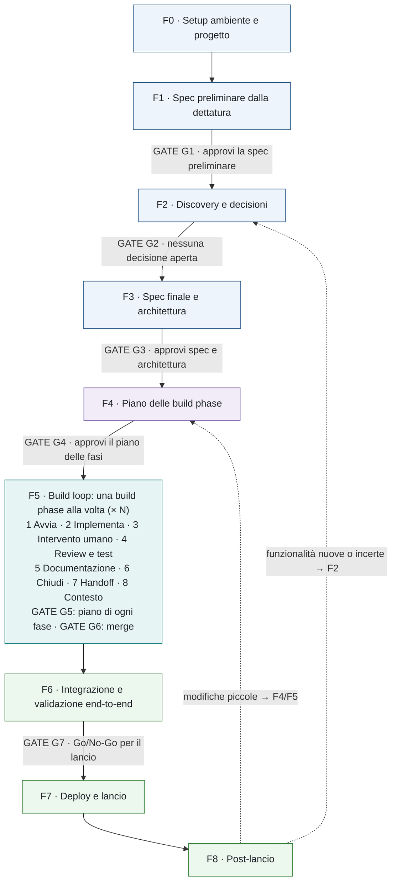
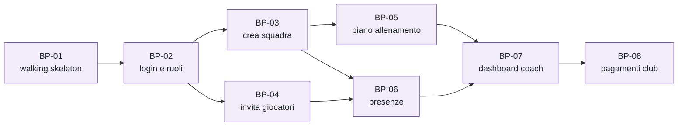
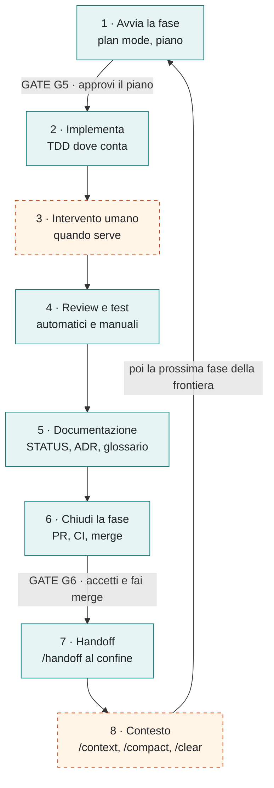
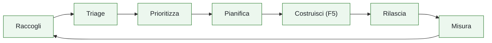

# The AI-Assisted Build Playbook

**Un sistema ripetibile per portare qualsiasi prodotto digitale dall'idea alla produzione usando Claude.**

*Playbook operativo · Versione 1.0 · Novembre 2026*

**Cosa contiene.** Nove fasi dall'idea al post-lancio · un build loop in otto passi · 15 template e prompt pronti all'uso · toolkit verificato (Claude Code, skill di Matt Pocock, integrazioni) · master checklist · quick reference di una pagina.

Fonti primarie: documentazione ufficiale di Claude Code (code.claude.com) e repository `mattpocock/skills`, verificati l'11–12 novembre 2026. Prezzi e limiti dei servizi di terze parti verificati alla stessa data: cambiano spesso, ricontrollali prima di acquistare.

> [!NOTE]
> **Versione Markdown**
>
> Stesso contenuto del PDF. I diagrammi sono in Mermaid, i box sono callout in stile GitHub (NOTE, WARNING, TIP, CAUTION) e le note a piè di pagina sono note numerate.

## Indice
- [Prima di iniziare · Come usare questo playbook](#prima-di-iniziare--come-usare-questo-playbook)
- **[Parte I · Il metodo](#parte-i--il-metodo)**
  - [Capitolo 1 · Executive overview](#capitolo-1--executive-overview)
  - [Capitolo 2 · Il workflow visivo](#capitolo-2--il-workflow-visivo)
  - [Capitolo 3 · Chi fa cosa: Claude, tu e i permessi](#capitolo-3--chi-fa-cosa-claude-tu-e-i-permessi)
- **[Parte II · Le nove fasi](#parte-ii--le-nove-fasi)**
  - [Fase 0 · Setup del progetto e dell'ambiente](#fase-0--setup-del-progetto-e-dellambiente)
  - [Fase 1 · Spec preliminare dalla dettatura](#fase-1--spec-preliminare-dalla-dettatura)
  - [Fase 2 · Discovery e decisioni con /wayfinder](#fase-2--discovery-e-decisioni-con-wayfinder)
  - [Fase 3 · Specifica finale e architettura tecnica](#fase-3--specifica-finale-e-architettura-tecnica)
  - [Fase 4 · Suddividi il progetto in build phase](#fase-4--suddividi-il-progetto-in-build-phase)
  - [Fase 5 · Il build loop](#fase-5--il-build-loop)
  - [Fase 6 · Integrazione e validazione end-to-end](#fase-6--integrazione-e-validazione-end-to-end)
  - [Fase 7 · Deploy e lancio](#fase-7--deploy-e-lancio)
  - [Fase 8 · Post-lancio: migliorare senza rompere](#fase-8--post-lancio-migliorare-senza-rompere)
- **[Parte III · Template e SOP](#parte-iii--template-e-sop)**
  - [Template · Come usare i template](#template--come-usare-i-template)
- **[Parte IV · Toolkit e skill](#parte-iv--toolkit-e-skill)**
  - [Toolkit · Strumenti per funzione](#toolkit--strumenti-per-funzione)
  - [Toolkit · Le skill di Matt Pocock](#toolkit--le-skill-di-matt-pocock)
  - [Toolkit · Comandi di Claude Code e integrazioni](#toolkit--comandi-di-claude-code-e-integrazioni)
- **[Parte V · Checklist e riferimento rapido](#parte-v--checklist-e-riferimento-rapido)**
  - [Checklist · Master checklist di progetto](#checklist--master-checklist-di-progetto)
  - [Riferimento · Quick reference: la sequenza esatta](#riferimento--quick-reference-la-sequenza-esatta)
- **[Appendici](#appendici)**
  - [Appendice A · Glossario minimo](#appendice-a--glossario-minimo)
  - [Appendice B · Fonti e data di verifica](#appendice-b--fonti-e-data-di-verifica)

## Prima di iniziare · Come usare questo playbook

Questo playbook è un sistema operativo per costruire prodotti digitali con Claude come partner principale di sviluppo: siti, web app, app mobile, SaaS, strumenti interni, dashboard e applicazioni con componenti di intelligenza artificiale. Non costruisce un'applicazione specifica: definisce *come* lavorare ogni volta, quali strumenti usare, quali comandi eseguire, quali documenti produrre e quando tocca a te decidere.

È scritto per chi usa bene gli strumenti di AI ma non ha un background da ingegnere del software. Ogni concetto tecnico è spiegato in una nota numerata la prima volta che compare; il glossario finale le raccoglie.

### Come è organizzato

- **Parte I — Il metodo.** Executive overview, workflow visivo, chi fa cosa tra te e Claude.
- **Parte II — Le nove fasi (F0–F8).** Per ogni fase: una scheda riassuntiva (obiettivo, input, output, strumenti, gate, tempo tipico), le azioni passo per passo con i comandi esatti, gli output attesi, la *Definition of Done* e gli errori più comuni.
- **Parte III — Template e SOP.** I 15 template richiesti (T1–T15) più il `CLAUDE.md` di progetto (T0) e quattro file bonus (ADR, STATUS, pull request, segnalazione bug).
- **Parte IV — Toolkit e skill.** Strumenti per funzione, le skill di Matt Pocock una per una, i comandi nativi di Claude Code e le integrazioni esterne, con la distinzione tra ciò che è incluso e ciò che va installato.
- **Parte V — Checklist e riferimento rapido.** La master checklist e la quick reference di una pagina.
- **Appendici.** Glossario minimo e fonti con data di verifica.

### Convenzioni

| Simbolo | Significato |
|---|---|
| **[CLAUDE]** | Claude lo fa in autonomia, senza chiederti nulla. |
| **[TU]** | Lo fai tu: decisione, credenziale, account, pagamento, azione manuale o test finale. |
| **[GATE Gn]** | Punto di approvazione: Claude si ferma e aspetta il tuo sì esplicito prima di proseguire. |
| **[BUILT-IN]** | Comando nativo di Claude Code (es. `/compact`, `/clear`, `/context`). |
| **[BUNDLED SKILL]** | Skill inclusa in Claude Code, già disponibile (es. `/code-review`, `/run`, `/verify`). |
| **[SKILL MATT POCOCK]** | Skill del repository `mattpocock/skills`: va installata (Fase 0). |
| **[INTEGRAZIONE]** | Strumento esterno: riga di comando, connettore MCP, servizio cloud. |
| `<nome-progetto>` | Segnaposto: sostituisci tutto il testo tra parentesi angolari. |
| Callout blu (NOTE), arancione (WARNING), verde (TIP), rosso (CAUTION) | Nota, attenzione o limite, Definition of Done, gate di approvazione. |

### Lingua: perché prompt e template sono in inglese

Il testo del playbook è in italiano. Prompt, template e file del repository sono invece in inglese, per tre ragioni. Primo: codice, commit, issue e documentazione tecnica vivono nel repository e verranno letti da sviluppatori, partner tecnici e strumenti automatici. Secondo: le skill di Matt Pocock e la documentazione di Claude Code sono in inglese, quindi la terminologia resta coerente da un capo all'altro. Terzo: molti termini tecnici in inglese sono univoci, in italiano no.

Puoi comunque parlare con Claude in italiano in ogni momento: il `CLAUDE.md` di progetto (template T0) gli chiede di risponderti in italiano e di scrivere i file in inglese.

### Sistema operativo e prerequisiti

I comandi sono scritti per Windows (PowerShell); dove qualcosa cambia trovi l'equivalente per macOS e Linux. Prerequisiti minimi: un abbonamento Claude Pro o Max (Claude Code non è incluso nel piano gratuito) e un account GitHub. Tutto il resto si installa nella Fase 0.

### Cosa è stato verificato e cosa è euristica

- **Verificato l'11–12 novembre 2026.** Comandi e comportamento di Claude Code, dalla documentazione ufficiale (<https://code.claude.com/docs>); nomi, scopo e funzionamento delle skill di Matt Pocock, dal README e dai file `SKILL.md` del repository `mattpocock/skills` (circa 307.000 stelle su GitHub a quella data); prezzi e limiti dei servizi citati, dalle pagine prezzi ufficiali o dalle fonti indicate in appendice.
- **Euristiche di questo playbook.** Le zone di consumo del contesto, il numero di build phase per tipo di progetto, i tempi indicativi e lo stack di default. Sono segnalate come tali: adattale dopo i primi progetti.

> [!WARNING]
> **Gli strumenti cambiano in fretta**
>
> Claude Code rilascia nuove versioni molto spesso e le skill di Matt Pocock sono cambiate più volte nel 2026. Nelle guide meno recenti trovi `/to-prd`, `/to-issues`, `CONTEXT.md` e `decision-mapping`: nel repository attuale il loro ruolo è svolto da `/to-spec`, `/to-tickets` (introdotte con la versione 1.1 di luglio 2026), `GLOSSARY.md` (dalla 1.3 di ottobre 2026) e `/wayfinder`. Se un comando non risponde: digita `/` per vedere i comandi disponibili, `/release-notes` per le novità, `/doctor` per diagnosticare l'installazione.

### Come leggerlo la prima volta

1. Leggi la Parte I (circa 15 minuti): ti dà la mappa completa.
2. Esegui la Fase 0 una volta sul tuo PC (1–2 ore la prima volta).
3. Al primo progetto segui le fasi in ordine, con la [quick reference](#riferimento--quick-reference-la-sequenza-esatta) e la [master checklist](#checklist--master-checklist-di-progetto) aperte accanto.
4. Dal secondo progetto in poi lavora con quick reference e template; torna ai capitoli solo quando ti serve il dettaglio.

# Parte I · Il metodo

*Executive overview, workflow visivo, ruoli e regole del gioco.*

## Capitolo 1 · Executive overview

**Il metodo in una frase.** Trasformi un'idea vaga in un prodotto in produzione attraverso nove fasi che separano nettamente quattro attività: *definire* (F0–F3), *pianificare* (F4), *costruire* (F5) e *consegnare* (F6–F8). Claude esegue quasi tutto il lavoro; tu prendi le decisioni in sette punti di non ritorno, i *gate*.

### Perché serve un metodo

Lavorare con un agente di coding senza metodo produce quattro fallimenti ricorrenti. I primi tre coincidono con problemi che Matt Pocock indica come motivazione delle sue skill (il suo elenco include anche la verbosità dell'agente, che il playbook affronta con il glossario di dominio); il quarto è specifico delle sessioni lunghe con un modello linguistico.

| Rischio | Sintomo | Contromisura nel playbook | Fase |
|---|---|---|---|
| Disallineamento | Claude costruisce qualcosa di diverso da quello che avevi in mente. | Discovery strutturata con `/wayfinder`: domande una alla volta, decisioni registrate prima di scrivere codice. | F1–F3 |
| Codice che non funziona | Funzionalità che sembrano finite ma si rompono al primo uso reale. | Feedback loop forti: tipi, test scritti prima del codice dove conta, CI, review, preview deploy. | F5–F6 |
| Palla di fango | Ogni modifica diventa più lenta e rischiosa: l'entropia accelera con l'AI. | Architettura documentata, ADR, glossario di dominio, fette verticali piccole, revisioni periodiche dell'architettura. | F3, F8 |
| Perdita di contesto | Claude dimentica decisioni prese, ripete errori, peggiora a fine sessione. | Il repository come memoria, `STATUS.md`, `/handoff` tra sessioni, budget di contesto a 200.000 token. | F5 |

### I sette principi

1. **Il repository è la memoria.** Ciò che conta vive in Git e GitHub[^1], non nella chat: spec, decisioni, piano, stato. Una conversazione si può perdere; un file versionato no.
2. **Decidere prima di costruire.** Nessuna riga di codice finché le decisioni di prodotto e di architettura non sono prese e scritte. Costa ore all'inizio, risparmia settimane dopo.
3. **Fette verticali piccole.** Ogni *build phase* attraversa tutti gli strati[^2] (dati, logica, interfaccia, test), produce un risultato dimostrabile e sta in una sessione, un branch, una pull request.
4. **Feedback loop forti.** Claude lavora bene solo se può verificare da solo il proprio lavoro: controllo dei tipi, test automatici, build, review e un'anteprima navigabile[^3].
5. **L'umano nei punti di non ritorno.** Claude propone, tu decidi: scope, priorità, costi, credenziali, merge e lancio passano sempre da te.
6. **Igiene del contesto.** Una sessione, un obiettivo. Budget prudente di 200.000 token, `/handoff` e `/clear` tra un lavoro e l'altro.
7. **Tecnologia noiosa e documentata.** Stack standard, molto conosciuti dal modello e ben documentati, salvo ragioni forti scritte in un ADR.

### Le nove fasi in una tabella

| Fase | Obiettivo | Output principale | Strumenti chiave | Gate | Tempo tipico\* |
|---|---|---|---|---|---|
| F0 Setup | Ambiente pronto, repo creato | Repo GitHub, `CLAUDE.md`, skill configurate | winget, Claude Code, gh, plugin skill | — | 1–2 h la prima volta, poi 15 min |
| F1 Spec preliminare | Catturare l'idea senza filtri | `docs/01-preliminary-spec.md` | Wispr Flow, T1, T2 | G1 | 30–90 min |
| F2 Discovery | Prendere e registrare le decisioni | Mappa `/wayfinder` chiusa, ADR, glossario | `/wayfinder` | G2 | 3–15 sessioni |
| F3 Spec finale | Una sola fonte di verità | `02-product-spec.md`, `03-architecture.md` | `/to-spec`, T4, T5 | G3 | 2–4 h |
| F4 Build phase | Piano eseguibile e ordinato | 10–50 issue BP-NN | `/to-tickets`, T6, T7 | G4 | 1–2 h |
| F5 Build loop | Costruire una fase alla volta | Pull request integrate, test verdi | plan mode, `/implement`, `/tdd`, `/handoff` | G5, G6 | 1–3 h del tuo tempo per fase |
| F6 Integrazione | Prodotto coerente e conforme alla spec | Integration review, Go/No-Go | T13, `/security-review` | G7 | 0,5–2 giorni |
| F7 Deploy | Produzione stabile e monitorata | App online, monitoring, rollback | Vercel, Supabase, T14 | G7 | 0,5–1 giorno |
| F8 Post-lancio | Migliorare senza rompere | Release, changelog, nuove issue | `/triage`, T15 | G5–G6 | Continuo |

\* Euristica del playbook per un MVP di complessità media; i primi progetti richiedono più tempo.

### I quattro artefatti cardine

Tutto il metodo ruota attorno a quattro artefatti. Se sono aggiornati, chiunque (tu, Claude in una nuova sessione, un collaboratore) può riprendere il lavoro in pochi minuti.

- `docs/02-product-spec.md` — **cosa** costruiamo. È la fonte di verità del prodotto.
- `docs/03-architecture.md` e `docs/adr/` — **come** lo costruiamo e **perché** abbiamo scelto così.
- **GitHub Issues** — il **lavoro**: la mappa delle decisioni (Fase 2) e le build phase `BP-NN` (Fase 4).
- `docs/STATUS.md` — **dove siamo adesso**. È la prima cosa che Claude legge a ogni sessione.

### I sette gate di approvazione

| Gate | Quando | Cosa approvi | Se dici no |
|---|---|---|---|
| **[GATE G1]** | Fine F1 | La spec preliminare rappresenta davvero la tua idea. | Correggi a voce o per iscritto; Claude aggiorna. |
| **[GATE G2]** | Fine F2 | La mappa non ha più decisioni aperte; scope e destinazione sono chiari. | Nascono nuovi decision ticket. |
| **[GATE G3]** | Fine F3 | Spec finale, stack, scope dell'MVP ed esclusioni. | Revisione della spec prima di pianificare. |
| **[GATE G4]** | F4, prima di pubblicare | Numero, ordine e dipendenze delle build phase. | Claude rivede la suddivisione. |
| **[GATE G5]** | Inizio di ogni build phase | Il piano di implementazione della fase. | Claude ripianifica; nessun file viene toccato. |
| **[GATE G6]** | Fine di ogni build phase | Definition of Done soddisfatta, merge su `main`. | La fase resta aperta finché non è conforme. |
| **[GATE G7]** | Fine F6 | Go/No-Go per il lancio in produzione. | Si correggono i problemi gravi e si ripete la verifica. |

[^1]: **Git** è il sistema che registra la storia di ogni modifica ai file di un progetto. **GitHub** è il servizio online che ospita i progetti Git e aggiunge issue, pull request e automazioni.

[^2]: Gli strati tipici di un'applicazione: l'interfaccia (**frontend**, ciò che l'utente vede nel browser o nell'app), la logica sul server (**backend**) esposta tramite **API**, cioè le «porte» con cui due programmi si scambiano dati, il **database** e i test.

[^3]: **Deploy**: la pubblicazione di una versione dell'applicazione su un server. Un **preview deployment** (anteprima) è un deploy temporaneo, con un indirizzo web proprio, creato automaticamente per ogni pull request: puoi provare la modifica prima che arrivi agli utenti.

## Capitolo 2 · Il workflow visivo

Il diagramma qui sotto mostra le nove fasi, gli output principali, i gate e il ciclo di ritorno dopo il lancio. Le frecce indicano le dipendenze: una fase parte solo quando la precedente ha raggiunto la sua Definition of Done.

### Come leggere le dipendenze

- **F0 → F1.** La dettatura finisce già in un file del repository: per questo il progetto va creato prima.
- **F1 → F2.** `/wayfinder` ha bisogno di una destinazione e di materiale grezzo da cui partire: la spec preliminare.
- **F2 → F3.** `/to-spec` sintetizza le decisioni già prese; non intervista. Senza decisioni chiuse, la spec inventerebbe.
- **F3 → F4.** `/to-tickets` suddivide la spec approvata: ogni build phase deve rimandare a requisiti scritti.
- **F4 → F5.** Le dipendenze tra issue (*blocked by*) decidono l'ordine: lavori sempre su una fase il cui blocco è chiuso.
- **F5 → F6 → F7.** Si integra quando tutte le fasi del traguardo sono chiuse; si lancia solo dopo il Go del gate G7.
- **F8 → F2/F4/F5.** Dopo il lancio il ciclo riparte dal punto giusto in base alla dimensione della modifica (vedi Fase 8).



| Fase | Strumenti principali | Output principali |
|---|---|---|
| F0 · Setup ambiente e progetto | winget · Claude Code · gh · `/setup-matt-pocock-skills` | Repo GitHub privato · `CLAUDE.md` · struttura `docs/` · label · skill configurate |
| F1 · Spec preliminare dalla dettatura | Wispr Flow, Win+H o `/voice` · prompt T1 · template T2 | `docs/00-brain-dump.md`<br>`docs/01-preliminary-spec.md` |
| F2 · Discovery e decisioni | `/wayfinder` (grilling, prototype, research) · GitHub Issues | Mappa wayfinder chiusa · decision ticket risolti · ADR · `GLOSSARY.md` |
| F3 · Spec finale e architettura | `/to-spec` · T4 · T5 · ADR · revisione critica | `docs/02-product-spec.md`<br>`docs/03-architecture.md` · spec issue |
| F4 · Piano delle build phase | `/to-tickets` · prompt T6 · issue template T7 | 10–50 issue BP-NN con dipendenze<br>`docs/04-build-plan.md` |
| F5 · Build loop (× N) | plan mode · `/implement` · `/tdd` · `/handoff` · `/compact` | Per ogni build phase: branch → pull request con test verdi → merge su main<br>`STATUS.md` aggiornato · issue chiusa con riepilogo |
| F6 · Integrazione e validazione end-to-end | T13 · `/security-review` · `/code-review` · collaudo utenti | Integration review · matrice di tracciabilità · Go/No-Go |
| F7 · Deploy e lancio | Vercel · Supabase · GitHub Actions · Sentry · PostHog · T14 | Produzione online · dominio · monitoring · runbook di rollback |
| F8 · Post-lancio | `/triage` · `/diagnosing-bugs` · `/improve-codebase-architecture` · T15 | Release vX.Y.Z · CHANGELOG · nuove issue prioritizzate |

**Legenda.** Colori delle fasi: Definire (F0–F3), Pianificare (F4), Costruire (F5), Consegnare (F6–F8). **GATE** = Claude si ferma: serve la tua approvazione esplicita. Le frecce tratteggiate sono il ritorno dopo il lancio: modifiche piccole → F4/F5; funzionalità nuove o incerte → F2.

## Capitolo 3 · Chi fa cosa: Claude, tu e i permessi

La regola generale: **Claude esegue, propone e verifica; tu decidi, autorizzi e collaudi**. La tabella traduce la regola in attività concrete.

| Attività | Claude in autonomia | Serve il tuo ok | Solo tu |
|---|---|---|---|
| Leggere codice e documenti, cercare, analizzare | **[CLAUDE]** |  |  |
| Proporre piani, opzioni e trade-off | **[CLAUDE]** |  |  |
| Scrivere codice e test dentro lo scope della issue | **[CLAUDE]** dopo G5 | **[GATE G5]** |  |
| Eseguire test, controllo dei tipi, lint e build in locale | **[CLAUDE]** |  |  |
| Fare commit sul branch della fase, aprire la pull request | **[CLAUDE]** |  |  |
| Aggiornare documentazione, ADR, `STATUS.md`, commenti alle issue | **[CLAUDE]** |  |  |
| Decisioni di prodotto: scope, UX, prezzi, testi importanti | propone |  | **[TU]** decide |
| Nuove dipendenze, nuovi servizi, qualsiasi costo | propone | **[TU]** |  |
| Migrazioni del database di produzione, cancellazione di dati | prepara | **[TU]** |  |
| Merge su `main` | prepara | **[GATE G6]** |  |
| Deploy e lancio in produzione | prepara | **[GATE G7]** |  |
| Creare account, inserire carte, chiavi API e segreti, configurare DNS | guida passo passo |  | **[TU]** |
| Collaudo finale e accettazione | aiuta |  | **[TU]** |
| Termini legali, privacy policy, cookie | bozza |  | **[TU]** (con un legale se serve) |

### Le modalità di permesso di Claude Code

Claude Code chiede il permesso prima di agire in base alla *permission mode* attiva[^4]. Nel terminale `Shift+Tab` fa scorrere le modalità `default` → `acceptEdits` → `plan`; la modalità `auto` compare solo se il tuo account soddisfa i requisiti.

| Modalità | Cosa fa | Quando usarla nel playbook |
|---|---|---|
| `default` (chiede prima) | Chiede conferma per modifiche ai file e comandi non di sola lettura. | Prime build phase, finché non conosci il comportamento di Claude. |
| `plan` (plan mode) | Claude legge, esplora e scrive un piano senza modificare il codice. | Sempre all'inizio di ogni build phase (gate G5) e prima di modifiche ampie. |
| `acceptEdits` | Approva in automatico modifiche ai file e comandi comuni sul filesystem. | Dopo 3–5 fasi andate bene; rivedi poi le modifiche nella pull request. |
| `auto` | Sostituisce le richieste di conferma con un classificatore di sicurezza. | Solo quando hai esperienza e test solidi; non necessaria. |
| `bypassPermissions` | Salta del tutto i controlli dei permessi. | Mai, in questo playbook. |

### Cinque regole per non perdere il controllo

1. **Nessun passaggio in produzione senza un gate.** Merge (G6) e lancio (G7) li autorizzi sempre tu.
2. **I segreti li tocchi solo tu.** Chiavi API e password vanno nei file `.env.local` o nei pannelli dei servizi, mai incollate in chat. Il `.claude/settings.json` di progetto impedisce a Claude di leggere quei file (Fase 0).
3. **Una build phase per branch e per sessione.** Mescolare due fasi è il modo più rapido per perdere controllo e contesto.
4. **Se qualcosa va storto, torna indietro.** `/rewind` (oppure `Esc` premuto due volte) riporta conversazione e file a un checkpoint[^5]; per tutto il resto c'è Git.
5. **Quando non capisci, chiedi di rispiegare.** Scrivi «spiegamelo come a un non tecnico» oppure usa la skill `/wait-what`: approvare ciò che non capisci annulla il valore dei gate.

[^4]: **Permission mode**: l'impostazione che stabilisce cosa Claude può fare senza chiederti conferma (leggere, modificare file, eseguire comandi). Nel terminale si cambia con `Shift+Tab`, che fa scorrere `default`, `acceptEdits` e `plan`.

[^5]: **Checkpoint**: un punto di ripristino che Claude Code crea automaticamente mentre lavora. I checkpoint coprono le modifiche fatte con gli strumenti di modifica file di Claude, non gli effetti dei comandi eseguiti nel terminale: per quelli la rete di sicurezza è Git.

# Parte II · Le nove fasi

*Dalla configurazione dell'ambiente al post-lancio: input, azioni, comandi, output e Definition of Done per ogni fase.*

## Fase 0 · Setup del progetto e dell'ambiente

| Voce | Dettaglio |
|---|---|
| **Obiettivo** | Avere PC, account e repository pronti: Claude Code installato e collegato a GitHub, skill di Matt Pocock configurate, struttura standard delle cartelle. |
| **Input** | Solo il nome provvisorio del progetto. |
| **Output** | Strumenti installati; repository GitHub privato con struttura standard; `CLAUDE.md`; `.claude/settings.json`; skill configurate; label GitHub. |
| **Strumenti** | winget, Git, GitHub CLI (`gh`), Node.js, VS Code, Claude Code, plugin `mattpocock-skills`. |
| **Gate** | Nessuno. |
| **Tempo tipico** | 1–2 ore la prima volta sul PC; 10–15 minuti per ogni nuovo progetto. |

### 0.1 Claude Chat o Claude Code?

Sono due modi diversi di lavorare con lo stesso modello. La regola pratica è una sola: **se l'output deve vivere nel repository, usa Claude Code**.

|  | Claude (chat: web, desktop, mobile) | Claude Code |
|---|---|---|
| Cos'è | Assistente conversazionale con Projects, artifact, ricerca, design, documenti e modalità vocale. | Agente di coding: legge e modifica i file del progetto, esegue comandi, usa Git e GitHub. |
| Dove gira | claude.ai e app Claude. | Terminale (CLI), estensione per VS Code e JetBrains, app desktop (sezione Code), web su claude.ai/code con sessioni in cloud, mobile per avviare e seguire le sessioni. |
| Accesso ai file | Upload manuale o connettori. | Accesso diretto alla cartella del progetto, entro i permessi che concedi. |
| Usalo per | Esplorare l'idea, ricerca di mercato e competitor, naming, mockup visivi, imparare un concetto, rivedere un documento. | Tutto ciò che diventa file, issue, commit o pull request: spec, piano, codice, test, deploy. |
| Output | Conversazione o artifact. | File nel repository, commit, issue, pull request. |

**Quale interfaccia di Claude Code usare.** Consiglio la CLI[^6] dentro il terminale integrato di VS Code[^7]: vedi i file a sinistra, Claude in basso, e hai a disposizione tutti i comandi descritti in questo playbook. L'app desktop (sezione Code) è un'alternativa valida, più visuale per diff e anteprime; se un comando non è disponibile in un'interfaccia grafica, usalo dalla CLI. Claude Code sul web (claude.ai/code) esegue le sessioni in cloud sui tuoi repository GitHub: utile per lanciare lavoro dal telefono, non come ambiente principale all'inizio.

### 0.2 Account e costi di partenza

| Servizio | Piano consigliato | Costo | Note |
|---|---|---|---|
| Claude | Pro; passa a Max se esaurisci spesso i limiti | Pro 20 USD/mese (17 USD/mese con pagamento annuale di 200 USD); Max da 100 USD/mese | Claude Code è incluso in Pro e Max, non nel piano gratuito. Controlla i consumi con `/usage`. |
| GitHub | Free | 0 | Repository privati; 2.000 minuti al mese di GitHub Actions per i repository privati, gratis sui runner standard per quelli pubblici. |
| Wispr Flow (opz.) | Flow Basic, poi Pro se detti molto | Basic gratis (2.000 parole a settimana su Mac/Windows); Pro 15 USD/mese, 12 con pagamento annuale | Alternative gratuite: dettatura di Windows (`Win+H`) e `/voice` in Claude Code. |
| Vercel, Supabase, Sentry, PostHog | Piani gratuiti in sviluppo | 0 fino al lancio | I costi di produzione sono analizzati nella Fase 7. |

### 0.3 Installa gli strumenti (una volta per PC)

Apri PowerShell come utente normale ed esegui un comando alla volta. `winget`[^8] installa Git[^9], la GitHub CLI, Node.js[^10] e VS Code; l'ultimo comando installa Claude Code con l'installer nativo, che si aggiorna da solo.

**PowerShell · installazione**
```powershell
winget install --id Git.Git -e
winget install --id GitHub.cli -e
winget install --id OpenJS.NodeJS.LTS -e
winget install --id Microsoft.VisualStudioCode -e
irm https://claude.ai/install.ps1 | iex
```

Chiudi e riapri il terminale (serve perché i nuovi programmi entrino nel PATH[^11]), poi verifica: ogni comando deve stampare un numero di versione.

**PowerShell · verifica**
```powershell
git --version
gh --version
node --version
npm --version
claude --version
```

> [!NOTE]
> **Su macOS o Linux**
>
> Con Homebrew: `brew install git gh node` e `brew install --cask visual-studio-code`; Claude Code con `curl -fsSL https://claude.ai/install.sh | bash`. In alternativa a PowerShell, su Windows Claude Code si installa anche con `winget install Anthropic.ClaudeCode`: in quel caso non si aggiorna da solo e va aggiornato con `winget upgrade Anthropic.ClaudeCode`.

> [!WARNING]
> **Se qualcosa non funziona**
>
> Se `claude` non viene trovato, il terminale non vede ancora il PATH: riaprilo o segui la pagina *Troubleshoot installation* della documentazione. Se PowerShell blocca gli script (*running scripts is disabled on this system*), la stessa pagina indica la correzione. Una volta dentro Claude Code, `/doctor` esegue un controllo completo dell'installazione.

### 0.4 Configura Git e collega GitHub

**PowerShell · Git e GitHub**
```powershell
git config --global user.name "<Nome Cognome>"
git config --global user.email "<email-del-tuo-account-github>"
git config --global init.defaultBranch main
gh auth login      # GitHub.com -> HTTPS -> Login with a web browser
gh auth status     # deve risultare "Logged in"
```

**Come Claude Code si collega a GitHub.** Non serve un'integrazione dedicata: Claude Code usa `git` e `gh` dal tuo terminale, con le tue credenziali. Così può creare repository, issue[^12], branch[^13], commit[^14] e pull request[^15]. Le skill di Matt Pocock usano lo stesso `gh`. Due integrazioni opzionali: `/install-github-app` installa l'app GitHub di Claude e, se vuoi, i workflow di GitHub Actions per menzionare `@claude` in issue e pull request; `/web-setup` collega il tuo account GitHub alle sessioni cloud di Claude Code usando le credenziali di `gh`.

### 0.5 Primo avvio di Claude Code e impostazioni consigliate

Apri un terminale in qualsiasi cartella, scrivi `claude` e completa il login nel browser con il tuo account Claude. Poi, dentro Claude Code:

**Claude Code · impostazioni una tantum**
```text
/doctor
/statusline show the model, the current git branch and context window usage as a percentage
/autocompact 200k
```

- `/doctor` **[BUNDLED SKILL]** controlla installazione, impostazioni, estensioni e `CLAUDE.md`; propone correzioni che Claude applica dopo la tua conferma.
- `/statusline` **[BUILT-IN]** configura la riga di stato: descrivi a parole cosa vuoi vedere. Avere sempre sotto gli occhi la percentuale di contesto usato è la base della gestione del contesto (Fase 5, passo 8).
- `/autocompact 200k` **[BUILT-IN]** fissa a 200.000 token la soglia di compattazione automatica: è la rete di sicurezza del budget prudente di questo playbook. Il valore viene salvato nelle impostazioni utente; per tornare al default usa `/autocompact auto`.

In VS Code installa anche l'estensione *Claude Code* dal marketplace delle estensioni: ti dà il pannello grafico e la visualizzazione delle differenze, ma continua a usare la CLI nel terminale integrato quando ti serve un comando specifico.

### 0.6 Installa le skill di Matt Pocock (una volta per PC)

Le skill[^16] di Matt Pocock sono un insieme open source (licenza MIT) di procedure di ingegneria: discovery, specifica, suddivisione del lavoro, TDD, review, handoff. Per Claude Code il metodo consigliato dal README è il plugin, che si aggiorna da solo:

**PowerShell · installazione del plugin**
```powershell
claude plugin install mattpocock-skills@claude-plugins-official
```

In alternativa, dentro una sessione: `/plugin install mattpocock-skills@claude-plugins-official`. Se Claude Code risponde che il marketplace non esiste, aggiungilo con `/plugin marketplace add anthropics/claude-plugins-official` e ripeti. Verifica con `/skills`: devi vedere, tra le altre, `wayfinder`, `handoff`, `to-spec`, `to-tickets`, `tdd`.

> [!WARNING]
> **Tre dettagli che evitano problemi**
>
> - **Nomi delle skill.** Le skill di un plugin hanno il prefisso del plugin: `/mattpocock-skills:wayfinder`. Funziona anche il nome breve (`/wayfinder`) se nessun altro comando lo usa già.
> - **Conflitto su `code-review`.** Claude Code ha già un `/code-review` incluso: il nome breve avvia quello. La review di Matt Pocock si richiama con `/mattpocock-skills:code-review`.
> - **Un solo metodo di installazione.** L'alternativa `npx skills@latest add mattpocock/skills` copia le skill come file modificabili nel progetto, da aggiornare a mano con `npx skills@latest update`. Non usare entrambi i metodi: avresti ogni skill due volte.

### 0.7 Crea il progetto e il repository (ogni nuovo progetto)

#### Passo 1 — Cartella e repository locale

Crea i progetti in una cartella fuori da OneDrive, per esempio `C:\dev`: la sincronizzazione cloud entra in conflitto con le migliaia di file che un progetto JavaScript genera.

**PowerShell · nuovo progetto**
```powershell
mkdir C:\dev\<nome-progetto>
cd C:\dev\<nome-progetto>
git init
claude
```

#### Passo 2 — Struttura standard e CLAUDE.md

Dentro Claude Code incolla il prompt di scaffolding qui sotto. Claude crea cartelle e file della struttura standard (sezione 0.8), il `CLAUDE.md` di progetto dal template T0 e il file dei permessi.

**Prompt (EN) · scaffolding iniziale**
```text
Set up this empty repository with the standard structure of my AI-Assisted Build Playbook.
Create, with short placeholder content where relevant:
- CLAUDE.md using the template I paste below (keep it under 120 lines)
- README.md (project name, one-line purpose, "how to run" section to fill later)
- docs/00-brain-dump.md, docs/STATUS.md (status template), docs/adr/ (empty, with .gitkeep),
  docs/testing/, docs/runbooks/, docs/research/
- .github/ISSUE_TEMPLATE/build-phase.md, .github/ISSUE_TEMPLATE/bug-report.md,
  .github/pull_request_template.md (templates I paste below)
- .gitignore suitable for a Node.js/Next.js project, including .env, .env.local, .env.*.local
- .env.example (empty for now, with a comment explaining its purpose)
- CHANGELOG.md in "Keep a Changelog" format with an [Unreleased] section
- .claude/settings.json with the permissions block I paste below
Do not install any dependency and do not create application code yet.
When done, list the files you created and stop.

<paste here: T0 CLAUDE.md, B2 STATUS.md, T7 issue template, B4 bug report, B3 PR template,
 and the settings.json block from section 0.7 of the playbook>
```

Il blocco dei permessi da incollare nel prompt impedisce a Claude di leggere i file con i segreti e di forzare la storia di Git:

**.claude/settings.json**
```json
{
  "permissions": {
    "defaultMode": "default",
    "deny": [
      "Read(./.env)",
      "Read(./.env.local)",
      "Read(./.env.production)",
      "Bash(git push --force *)",
      "Bash(git push -f *)"
    ]
  }
}
```

#### Passo 3 — Primo commit e repository su GitHub

**PowerShell (o comando ! in Claude Code)**
```powershell
git add -A
git commit -m "chore: project scaffold"
gh repo create <nome-progetto> --private --source=. --remote=origin --push
```

Dentro Claude Code puoi eseguire un comando di terminale anteponendo `!` (per esempio `!git status`): comando e risultato entrano nel contesto della conversazione. Oppure chiedi semplicemente a Claude di farlo. Tieni il repository **privato**: le issue di decisione della Fase 2 contengono ragionamenti di business.

#### Passo 4 — Configura le skill per questo repository

**Claude Code**
```text
/setup-matt-pocock-skills
```

`/setup-matt-pocock-skills` **[SKILL MATT POCOCK]** esplora il repository, ti mostra cosa ha trovato e ti fa tre domande, una alla volta, proponendo la risposta consigliata:

1. **Issue tracker**: rispondi *GitHub* (default se il remote punta a GitHub). Alternative: GitLab, file Markdown[^17] locali, oppure un altro strumento descritto a parole.
2. **Label di triage**: accetta le cinque predefinite (`needs-triage`, `needs-info`, `ready-for-agent`, `ready-for-human`, `wontfix`). La domanda compare solo se la skill `triage` è installata, come avviene con il plugin.
3. **Documenti di dominio**: accetta *single-context*, cioè un `GLOSSARY.md` e una cartella `docs/adr/` alla radice.

Ti mostra le bozze prima di scriverle. Alla fine aggiunge al `CLAUDE.md` una sezione `## Agent skills` e crea `docs/agents/issue-tracker.md`, `docs/agents/domain.md`, `docs/agents/triage-labels.md`; crea su GitHub le label mancanti. Va eseguita una volta per repository.

#### Passo 5 — Label aggiuntive

**PowerShell**
```powershell
gh label create build-phase --color 0E7C7B --description "Vertical slice of the product, one PR"
gh label create tech-debt --color 6B4FA0 --description "Technical debt to pay down"
```

### 0.8 Struttura standard delle cartelle

La stessa struttura per ogni progetto: tu e Claude sapete sempre dove cercare. Le cartelle del codice (`src/`, `tests/`, `supabase/`) nascono con la prima build phase.

**Struttura del repository**
```text
<nome-progetto>/
├── CLAUDE.md                  # istruzioni permanenti per Claude (T0), < 200 righe
├── GLOSSARY.md                # lingua del dominio (creato e aggiornato dalle skill)
├── README.md                  # cos'è e come si avvia
├── CHANGELOG.md               # storia delle versioni
├── .env.example               # NOMI delle variabili d'ambiente, mai i valori
├── .gitignore                 # esclude .env, .env.local, node_modules, build
├── .claude/
│   └── settings.json          # permessi condivisi del progetto
├── .github/
│   ├── ISSUE_TEMPLATE/
│   │   ├── build-phase.md     # template T7
│   │   └── bug-report.md      # template B4
│   ├── pull_request_template.md   # template B3
│   └── workflows/ci.yml       # controlli automatici (nasce in BP-01)
├── docs/
│   ├── 00-brain-dump.md       # trascrizione grezza della dettatura (F1)
│   ├── 01-preliminary-spec.md # spec preliminare (F1)
│   ├── 02-product-spec.md     # SPEC FINALE = fonte di verità (F3)
│   ├── 03-architecture.md     # architettura tecnica (F3)
│   ├── 04-build-plan.md       # indice delle build phase + grafo dipendenze (F4)
│   ├── STATUS.md              # stato corrente: la prima cosa che Claude legge
│   ├── adr/                   # Architecture Decision Records: 0001-titolo.md
│   ├── agents/                # creati da /setup-matt-pocock-skills
│   ├── research/              # ricerche e analisi (F1-F2)
│   ├── testing/               # checklist QA, tracciabilità, integration review
│   ├── runbooks/              # deploy, rollback, incidenti (F7)
│   └── ops/                   # review operative settimanali (F8)
├── src/                       # codice dell'applicazione (da BP-01)
├── tests/                     # unit/, integration/, e2e/ (da BP-01)
└── supabase/migrations/       # migrazioni del database, se usi Supabase
```

| Documento | Chi lo crea | Fase | Regola |
|---|---|---|---|
| `CLAUDE.md` | Claude da T0 | F0 | Breve, sotto le 200 righe: solo regole sempre valide. |
| `docs/01-preliminary-spec.md` | Claude da T1 e T2 | F1 | Bozza: non è vincolante. |
| `GLOSSARY.md`, `docs/adr/` | Skill di grilling e domain modeling | F2–F8 | Un termine, un significato; ADR solo in aggiunta, mai riscritti. |
| `docs/02-product-spec.md` | Claude da `/to-spec` e T4 | F3 | Fonte di verità: si modifica solo con pull request. |
| `docs/03-architecture.md` | Claude da T5 | F3 | Ogni scelta importante rimanda a un ADR. |
| `docs/04-build-plan.md` | Claude da T6 | F4 | Indice; il dettaglio vive nelle issue. |
| `docs/STATUS.md` | Claude | F0–F8 | Aggiornato alla fine di ogni build phase. |

### 0.9 Integrazioni opzionali

- **Connettori Supabase e Vercel** **[INTEGRAZIONE]**. Se li hai già collegati su claude.ai, Claude Code può usarli quando accedi con lo stesso account; controlla con `/mcp`. Sono server MCP[^18]: permettono a Claude di leggere tabelle, log e deploy senza che tu copi nulla a mano.
- **Claude in Chrome** **[INTEGRAZIONE]**. Con `/chrome` o avviando `claude --chrome`, Claude può aprire la tua app nel browser, cliccare e leggere la console: utilissimo per il test manuale assistito.
- **Skill di Supabase** **[INTEGRAZIONE]**. Supabase pubblica istruzioni per agenti su sviluppo e sicurezza: `npx skills add supabase/agent-skills`. Da valutare quando scegli Supabase in Fase 2.

### Checklist: tutto pronto prima di iniziare

- [ ] Claude Pro o Max attivo; login completato in Claude Code.
- [ ] `git`, `gh`, `node`, `npm`, `claude` rispondono con un numero di versione.
- [ ] `gh auth status` risulta collegato al tuo account.
- [ ] Riga di stato con percentuale di contesto; `/autocompact 200k` impostato.
- [ ] Plugin `mattpocock-skills` installato e visibile in `/skills`.
- [ ] Cartella del progetto fuori da OneDrive; repository GitHub privato creato e collegato.
- [ ] Struttura standard, `CLAUDE.md` e `.claude/settings.json` presenti nel primo commit.
- [ ] `/setup-matt-pocock-skills` eseguito; label `build-phase` e `tech-debt` create.

> [!TIP]
> **Definition of Done · Fase 0**
>
> Da un terminale nuovo, `claude` si avvia nella cartella del progetto, `/skills` mostra le skill di Matt Pocock, `gh repo view --web` apre il repository privato con la struttura standard e il `CLAUDE.md` contiene la sezione `Agent skills`.

#### Errori comuni

- Lavorare in una cartella sincronizzata con OneDrive o Dropbox.
- Installare le skill con entrambi i metodi (plugin e `npx`), ritrovandosi ogni skill doppia.
- Dimenticare `gh auth login`: le skill non riescono a creare issue.
- Aggiungere al primo commit un file `.env` con valori reali.
- Non riaprire il terminale dopo le installazioni e concludere che qualcosa «non funziona».

[^6]: **CLI** (*command-line interface*): un programma che si usa scrivendo comandi in un **terminale**, la finestra di testo del sistema operativo. Su Windows il terminale standard è **PowerShell**.

[^7]: **VS Code** (Visual Studio Code) è un editor di codice gratuito di Microsoft: a sinistra vedi i file del progetto, in basso un terminale integrato. Un editor di questo tipo si chiama anche **IDE**.

[^8]: **winget** è il gestore di pacchetti di Windows: installa e aggiorna programmi da riga di comando, senza scaricare installer a mano.

[^9]: Su Windows il pacchetto *Git for Windows* include anche **Git Bash**, un terminale in stile Linux. Claude Code lo usa per eseguire comandi Bash; senza, ripiega su PowerShell.

[^10]: **Node.js** esegue JavaScript fuori dal browser ed è la base della maggior parte delle web app moderne. Include **npm**, il gestore delle librerie (*dipendenze*) di un progetto, e **npx**, che esegue uno strumento senza installarlo in modo permanente.

[^11]: **PATH**: l'elenco delle cartelle in cui il sistema cerca i programmi quando scrivi un comando. Un terminale aperto prima dell'installazione non vede i nuovi programmi.

[^12]: **Issue**: una scheda di lavoro su GitHub (bug, attività, decisione) con titolo, descrizione, etichette (*label*), assegnatario e commenti. In questo playbook le issue contengono sia le decisioni (Fase 2) sia le build phase (Fase 4).

[^13]: **Branch**: una linea di sviluppo parallela. Si lavora su un branch separato e si riporta il lavoro sul branch principale (`main`) solo quando è pronto.

[^14]: **Commit**: un salvataggio permanente e descritto di un insieme di modifiche. La sequenza dei commit è la storia del progetto e permette di tornare a qualsiasi punto precedente.

[^15]: **Pull request (PR)**: la richiesta di unire (*merge*) un branch in `main`. Mostra le differenze, esegue i controlli automatici e raccoglie la revisione prima dell'integrazione.

[^16]: **Skill**: un pacchetto di istruzioni (un file `SKILL.md` più eventuali file di supporto) che insegna a Claude una procedura. Si invoca scrivendo `/nome-skill`; alcune Claude le usa anche da solo quando il compito lo richiede. Un **plugin** è un pacchetto che distribuisce skill e altre estensioni, installato da un *marketplace*.

[^17]: **Markdown**: un formato di testo semplice in cui pochi simboli indicano titoli (`#`), elenchi (`-`) e caselle da spuntare (`- [ ]`). GitHub lo mostra formattato. Tutti i documenti del playbook sono file Markdown (`.md`).

[^18]: **MCP** (*Model Context Protocol*): lo standard con cui Claude si collega a strumenti e dati esterni (database, servizi cloud, applicazioni). Un **connettore** o **server MCP** espone a Claude le azioni di un servizio.

## Fase 1 · Spec preliminare dalla dettatura

| Voce | Dettaglio |
|---|---|
| **Obiettivo** | Catturare l'idea in modo completo e senza filtri tecnici, poi trasformarla in una prima bozza strutturata. |
| **Input** | La tua voce: 10–20 minuti di dettatura libera. |
| **Output** | `docs/00-brain-dump.md` (trascrizione grezza) e `docs/01-preliminary-spec.md` (bozza strutturata con assunzioni e domande aperte). |
| **Strumenti** | Wispr Flow, dettatura di Windows o `/voice`; Claude Code; template T1 e T2. |
| **Gate** | **[GATE G1]** approvi la spec preliminare. |
| **Tempo tipico** | 30–90 minuti. |

### Perché partire dalla voce

Parlando racconti contesto, motivazioni ed esempi che scrivendo tagli. In questa fase non serve alcun termine tecnico: architettura, framework e database li decideremo dopo. Il tuo compito è descrivere il *problema*, le *persone* e l'*esperienza*; il compito di Claude è dare struttura e segnalare ciò che manca.

### Passo 1 — Prepara la dettatura

- **Wispr Flow** **[INTEGRAZIONE]**: si attiva con un tasto e scrive in qualsiasi applicazione, ripulendo intercalari e ripetizioni. Il piano gratuito (2.000 parole a settimana su Windows e Mac) basta per una o due sessioni di 10–15 minuti.
- **Dettatura di Windows**: `Win+H`, gratuita e già installata.
- **`/voice`** **[BUILT-IN]**: dettatura dentro Claude Code (richiede l'account claude.ai).

Apri `docs/00-brain-dump.md` in VS Code, posiziona il cursore e detta. Puoi parlare in italiano: Claude gestisce la traduzione nei passi successivi.

### Passo 2 — Detta seguendo il copione

Segui il copione del template T1 (parte A): tredici spunti, dal «cosa voglio costruire» ai «dubbi che ho». Non serve l'ordine. Racconta storie concrete («un martedì sera l'allenatore apre l'app e…»), di' cosa *non* vuoi, cita prodotti che ammiri e perché. Ripetizioni e contraddizioni vanno benissimo: Claude le farà emergere.

### Passo 3 — Trasforma la trascrizione in spec preliminare

Salva il file, apri Claude Code nella cartella del progetto e incolla il prompt del template T1 (parte B). Claude:

1. legge `docs/00-brain-dump.md`;
2. scrive `docs/01-preliminary-spec.md` con la struttura del template T2;
3. marca `[ASSUMPTION]` ciò che deduce e `[SUGGESTION]` ciò che propone, separandolo da ciò che hai detto;
4. elenca contraddizioni e domande aperte, ordinate per impatto;
5. ti restituisce in italiano un riassunto di dieci righe e le cinque domande più importanti.

### Passo 4 — Rivedi, rispondi, approva

Leggi la bozza (15 minuti). Rispondi alle domande aperte direttamente in chat, anche a voce; chiedi a Claude di aggiornare il documento. Due o tre giri bastano: non cercare la perfezione, la Fase 2 interrogherà a fondo ogni punto. Poi fai il commit: `docs: preliminary spec v0.1`.

> [!NOTE]
> **Quando usare Claude Chat in questa fase**
>
> Per ricerca di mercato, analisi dei competitor, naming o una prima esplorazione dell'idea, usa un Project su claude.ai dedicato al prodotto. Salva le conclusioni utili in `docs/research/` (un file per tema) così entrano nel repository e Claude Code può usarle in Fase 2.

> [!CAUTION]
> **GATE G1 · Approvi la spec preliminare**
>
> Approva quando, rileggendo la bozza, riconosci la tua idea: problema, utenti, esperienza e differenziazione sono descritti con parole tue e ogni assunzione di Claude è marcata. Non serve che sia completa.

> [!TIP]
> **Definition of Done · Fase 1**
>
> - [ ] `docs/00-brain-dump.md` contiene la trascrizione grezza.
> - [ ] `docs/01-preliminary-spec.md` segue il template T2, con sezioni *Assumptions*, *Contradictions* e *Open questions* compilate.
> - [ ] Le cinque domande aperte più importanti hanno una risposta o sono esplicitamente rimandate alla Fase 2.
> - [ ] Commit eseguito e gate G1 superato.

#### Errori comuni

- Descrivere soluzioni tecniche («serve un database Postgres») invece di problemi e comportamenti.
- Dettare due minuti: senza storie e dettagli, la bozza sarà generica.
- Accettare in silenzio le assunzioni marcate `[ASSUMPTION]`: sono proprio i punti da verificare.
- Cercare di chiudere qui ogni decisione: è il lavoro della Fase 2.

## Fase 2 · Discovery e decisioni con /wayfinder

| Voce | Dettaglio |
|---|---|
| **Obiettivo** | Trasformare la spec preliminare in un progetto definito con chiarezza, prendendo e registrando ogni decisione necessaria prima di costruire. |
| **Input** | `docs/01-preliminary-spec.md`; repository configurato con `/setup-matt-pocock-skills` su GitHub. |
| **Output** | Una *mappa* (issue con label `wayfinder:map`) con tutti i decision ticket chiusi; ADR in `docs/adr/`; `GLOSSARY.md`; prototipi e ricerche collegati. |
| **Strumenti** | `/wayfinder` **[SKILL MATT POCOCK]**, che a sua volta usa le skill `grilling`, `domain-modeling`, `prototype` e `research`; GitHub Issues. |
| **Gate** | **[GATE G2]** nessuna decisione aperta, scope chiaro. |
| **Tempo tipico** | 3–15 sessioni brevi, di solito 1–5 giorni di calendario. |

### Cos'è /wayfinder, in parole semplici

`/wayfinder` serve a pianificare un lavoro troppo grande per una sola sessione e ancora avvolto nella nebbia: sai dove vuoi arrivare, non vedi ancora la strada. Invece di tentare un piano completo in una conversazione, disegna una **mappa condivisa** sul tuo issue tracker e la risolve una decisione alla volta. Matt Pocock la presenta come l'evoluzione di `/grill-me`, pensata per i progetti in cui non si può decidere tutto all'inizio.

**I concetti chiave**

- **Destinazione**: dove deve portare la mappa (per noi: una spec dell'MVP pronta per `/to-spec`). Si decide per prima, perché fissa lo scope.
- **Mappa**: una singola issue con label `wayfinder:map`. È un *indice*, non un archivio: contiene Destination, Notes, Decisions so far (una riga per decisione con link), Not yet specified (la nebbia) e Out of scope.
- **Decision ticket**: issue figlie della mappa. Ognuna contiene una *domanda* la cui risposta è una decisione, mai una porzione di prodotto da costruire.
- **Nebbia** (*fog of war*): decisioni che intuisci ma non sai ancora formulare con precisione. Restano nella sezione *Not yet specified* finché una risposta non le rende formulabili; allora diventano ticket.
- **Frontiera**: i ticket aperti, non bloccati e non assegnati. È il confine del noto, visibile direttamente nell'interfaccia di GitHub grazie ai collegamenti nativi *blocked by*.
- **Regola d'oro**: pianifica, non costruisce. Quando la nebbia è sparita, passa il testimone a `/to-spec`.

Ogni ticket ha uno di quattro tipi ed è HITL o AFK[^19]; i ticket di ricerca li risolve un subagent[^20].

| Tipo di ticket | Modalità | Quando si usa | Come si risolve |
|---|---|---|---|
| `grilling` | HITL | Il caso predefinito: la domanda si chiude discutendone. | Conversazione con te, con le skill `grilling` e `domain-modeling`. |
| `prototype` | HITL | «Come deve apparire» o «come deve comportarsi»: parlarne non basta. | Un artefatto rapido e grezzo (una bozza, un HTML, varianti di interfaccia) su cui reagisci; la scelta è tua. |
| `research` | AFK | Serve un fatto esterno al progetto: documentazione, API di terzi, limiti di un servizio. | Un subagent lavora in parallelo e salva i risultati con le fonti su un branch `research/<n>`, mai unito al codice. |
| `task` | HITL o AFK | Nulla da decidere, ma un'azione manuale sblocca una decisione (iscriversi a un servizio per valutarne l'API, ottenere un accesso). | L'agente la esegue se può; altrimenti ti dà una checklist precisa. |

### Quando usarla (e quando no)

Il criterio di Matt Pocock è il numero di sessioni, non la dimensione del progetto.

| Situazione | Cosa usare |
|---|---|
| Nuovo prodotto, strada poco chiara, più sessioni di pianificazione | `/wayfinder` (default di questo playbook) |
| Funzionalità ben delimitata che chiudi in una seduta | `/grill-with-docs` (con codice esistente) o `/grill-me` |
| Le decisioni sono già prese nella conversazione | `/to-spec` direttamente |
| Mappa completata | `/to-spec`, poi `/to-tickets` (Fasi 3 e 4) |
| Una conversazione è cresciuta troppo | `/handoff` verso `/wayfinder` |

Per progetti piccoli (una landing page, uno strumento interno con due schermate) salta la mappa: una sessione di `/grill-with-docs` seguita da `/to-spec` è più rapida.

### Prerequisiti

- [ ] Repository su GitHub, `gh` autenticato, `/setup-matt-pocock-skills` eseguito con GitHub come tracker. La configurazione scrive anche le istruzioni operative che `/wayfinder` usa per rappresentare mappa, ticket figli e blocchi su GitHub, e le collega dal `CLAUDE.md`.
- [ ] `docs/01-preliminary-spec.md` nel repository.
- [ ] Repository privato: le decisioni di business finiscono nelle issue.

**Perché GitHub Issues come tracker.** È gratuito, sta accanto al codice e alle pull request, si comanda da `gh` e supporta in modo nativo sotto-issue e dipendenze (*blocked by*): la frontiera della mappa si vede senza aprirla. Secondo la documentazione della skill è il tracker meglio supportato. Scegli un'alternativa solo se c'è una ragione forte: Linear se il team lo usa già; file Markdown locali se lavori da solo senza remote (con l'avvertenza che il materiale nel repository tende a restarci per sempre).

### Sessione 1 — Traccia la mappa

1. Avvia `claude` nella cartella del progetto e scrivi `/wayfinder` seguito dal testo del template T3: destinazione e preferenze permanenti (una domanda alla volta, opzioni con trade-off, spiegazioni in italiano semplice).
2. **Destinazione.** `/wayfinder` la definisce con te attraverso il grilling. Fermati finché non è chiara e delimitata: «una spec dell'MVP v1», non «tutto il prodotto».
3. **Frontiera.** Un secondo giro di domande, in ampiezza invece che in profondità, fa emergere le decisioni aperte e i primi passi possibili. Se non emerge nebbia, la skill si ferma e ti dice che la mappa non serve: passa a `/to-spec`.
4. **Creazione.** Crea l'issue mappa e i ticket già formulabili come issue figlie, poi, in un secondo passaggio, i collegamenti di blocco.
5. **Ricerche in parallelo.** Per ogni ticket `research` avvia un subagent che lavora da solo.
6. **Stop.** La prima sessione traccia soltanto: non risolve ticket.

Apri la mappa nel browser (`gh issue view <numero> --web`) e controlla che ogni ticket sia formulato come una *domanda*.

### Sessioni 2…N — Un ticket per sessione

**Claude Code · ciclo di discovery**
```text
/clear
/wayfinder <URL o numero della mappa>
```

1. `/clear` apre una conversazione pulita: ogni ticket merita un contesto fresco.
2. `/wayfinder` carica la mappa a bassa risoluzione, sceglie il primo ticket della frontiera (o quello che indichi) e se lo assegna, così altre sessioni non lo prendono.
3. Lo risolve secondo il tipo: domande a te, prototipo da valutare, ricerca, azione manuale.
4. Registra la risoluzione come commento, chiude il ticket, aggiunge una riga a *Decisions so far*.
5. Trasforma in nuovi ticket la nebbia diventata formulabile, sposta in *Out of scope* ciò che va oltre la destinazione, aggiorna i ticket invalidati dalla decisione.
6. Le decisioni difficili da invertire diventano ADR[^21] in `docs/adr/`; i termini di dominio entrano in `GLOSSARY.md`.

Una sessione risolve un solo ticket; fanno eccezione i ticket di ricerca, gestiti in parallelo dai subagent. Ripeti finché non restano ticket aperti e la sezione *Not yet specified* è vuota.

### Come rispondere bene alle domande

- Rispondi con il *perché*, non solo con la scelta: Claude lo userà per le decisioni successive.
- «Non lo so» è una risposta legittima: chiedi opzioni, conseguenze e una raccomandazione.
- Per le decisioni difficili da invertire chiedi un prototipo o una ricerca prima di scegliere.
- Se una domanda è troppo lunga o tecnica, usa `/wait-what`: Claude la riformula in parole semplici.
- Non accettare i default per inerzia: è il momento più economico per cambiare idea.

### Decision ticket e build phase: due cose diverse

|  | Decision ticket (Fase 2) | Build phase (Fase 4) |
|---|---|---|
| Scopo | Risolvere una domanda. | Costruire una porzione funzionante del prodotto. |
| Esempio | «Quali metodi di login supportiamo nell'MVP?» | «BP-07 · L'allenatore crea un piano di allenamento». |
| Label | `wayfinder:map` sulla mappa; `wayfinder:grilling`, `prototype`, `research`, `task` sui ticket. Mai label di triage. | `build-phase` e `ready-for-agent` (o `ready-for-human`). |
| Creato da | `/wayfinder` | `/to-tickets` |
| Si chiude quando | La decisione è registrata (commento, ADR, glossario). | La pull request è unita e la Definition of Done è soddisfatta. |
| Output | Una decisione. | Software funzionante e testato. |
| Chi lo lavora | Soprattutto tu, con Claude (HITL). | Claude implementa, tu approvi piano e risultato. |
| Contiene codice | Mai (al massimo un prototipo usa-e-getta collegato). | Sempre, con i test. |

Se un ticket della mappa dice «costruisci X», è classificato male: appartiene alla Fase 4.

### Le decisioni che ogni progetto deve chiudere

Usa questo elenco per verificare che la mappa sia completa prima del gate G2.

- [ ] Utenti e ruoli (chi usa, chi paga, chi amministra).
- [ ] Scope dell'MVP: dentro, fuori, dopo.
- [ ] Percorsi utente principali.
- [ ] Piattaforme: web, mobile, PWA.
- [ ] Entità principali dei dati.
- [ ] Autenticazione e permessi per ruolo.
- [ ] Integrazioni esterne.
- [ ] Pagamenti e modello di prezzo.
- [ ] Stack tecnologico e hosting (ADR).
- [ ] Privacy, GDPR, dove risiedono i dati.
- [ ] Metriche di successo e tracciamento.
- [ ] Tetto di costo mensile di esercizio.
- [ ] Lingue e contenuti.
- [ ] Direzione visiva (con prototipo).

### Output attesi

**Esempio · issue mappa (label wayfinder:map)**
```markdown
Title: Map · MVP v1 of TeamPulse
## Destination
A product spec for TeamPulse MVP v1 (training planning for amateur sports clubs),
ready for /to-spec. Web app only, Spain and Italy, launch in Q2.
## Notes
Owner is a non-engineer: one question at a time, options with trade-offs, plain Italian.
Skills to consult: grilling, domain-modeling, prototype, research. Planning only.
## Decisions so far
- [Who pays?](link): the club pays per team per month; players use it free.
- [Login methods for v1](link): email magic link + Google; no passwords. ADR-0003.
## Not yet specified
- Offline use on the pitch (depends on the "device used during training" decision).
## Out of scope
- Native iOS/Android apps: v1 is a responsive web app (budget and time).
```

**Esempio · decision ticket risolto (label wayfinder:grilling)**
```markdown
Title: Which login methods does v1 support?
## Question
Coaches are 35-60 years old and log in weekly. Which authentication methods do we offer
at launch, given cost, support burden and GDPR?
--- resolution comment ---
Decision: email magic link + Google sign-in. No passwords in v1.
Why: lowest support burden; Google covers most coaches; magic link covers the rest.
Consequences: depends on reliable transactional email (see "Email provider" ticket).
Recorded in docs/adr/0003-authentication.md
```

### Limiti e problemi noti

> [!WARNING]
> **Cosa può andare storto con /wayfinder, e come evitarlo**
>
> - **Domande lunghe e faticose.** È la critica più frequente alla skill. Aggiungi nelle Notes della mappa «max 120 words per question» e, se serve, abbassa l'effort con `/effort`.
> - **Codice scritto durante la mappa.** Il default è «pianifica, non costruire», ma le Notes possono sovrascriverlo e le scrive l'agente stesso: rileggile e tieni l'implementazione fuori dalla mappa.
> - **Troppi ticket pianificati in anticipo.** Con destinazioni vaghe la mappa diventa una cascata che invecchia. Delimita la destinazione (l'MVP) e preferisci prototipi rapidi a lunghe discussioni.
> - **Ticket in parallelo.** Due sessioni di grilling simultanee possono farti la stessa domanda: lavora un ticket alla volta.
> - **Il prototipo sceglie da solo.** La scelta tra varianti è tua: se l'agente chiude il ticket scegliendo, riaprilo.
> - **Decisione sbagliata scoperta dopo.** Di' chiaramente a `/wayfinder` cosa è cambiato: aggiorna mappa e ticket e commenta quelli chiusi.

> [!CAUTION]
> **GATE G2 · La strada è chiara**
>
> Approva quando la mappa non ha ticket aperti, *Not yet specified* è vuota (o il contenuto è stato spostato esplicitamente in *Out of scope*), le decisioni dell'elenco qui sopra sono chiuse e quelle difficili da invertire hanno un ADR.

> [!TIP]
> **Definition of Done · Fase 2**
>
> - [ ] Mappa con destinazione approvata e tutti i decision ticket chiusi con commento di risoluzione.
> - [ ] ADR per stack, hosting, autenticazione, modello dati principale e pagamenti (se previsti).
> - [ ] `GLOSSARY.md` con i termini di dominio principali.
> - [ ] Prototipi e ricerche collegati ai rispettivi ticket.
> - [ ] Nessuna riga di codice di prodotto scritta.

[^19]: **HITL** (*human in the loop*): lavoro che si risolve solo con te presente, che rispondi in prima persona. **AFK** (*away from keyboard*): lavoro che l'agente porta avanti da solo.

[^20]: **Subagent**: un'istanza separata di Claude con una propria finestra di contesto, a cui Claude delega un compito. Lavora senza riempire il contesto della conversazione principale e restituisce solo il risultato.

[^21]: **ADR** (*Architecture Decision Record*): un breve documento che registra una decisione importante: contesto, opzioni considerate, scelta e conseguenze. Non si riscrive: se la decisione cambia, se ne scrive uno nuovo che sostituisce il precedente.

## Fase 3 · Specifica finale e architettura tecnica

| Voce | Dettaglio |
|---|---|
| **Obiettivo** | Trasformare decisioni e spec preliminare in un'unica fonte di verità: cosa costruiamo, come, con quali limiti e cosa resta fuori. |
| **Input** | Mappa `/wayfinder` chiusa, ADR, `GLOSSARY.md`, `docs/01-preliminary-spec.md`, prototipi e ricerche. |
| **Output** | `docs/02-product-spec.md` (v1.0), `docs/03-architecture.md`, ADR completi, spec issue su GitHub, `README.md` aggiornato. |
| **Strumenti** | `/to-spec` **[SKILL MATT POCOCK]**, template T4 e T5, subagent per la revisione critica, Claude Design o `/prototype` per l'interfaccia. |
| **Gate** | **[GATE G3]** approvi spec e architettura. |
| **Tempo tipico** | 2–4 ore, più il tempo di lettura. |

### I documenti di questa fase e dove vivono

| Documento | Percorso | Contenuto | Creato con |
|---|---|---|---|
| Spec issue (epic) | Issue GitHub con label `ready-for-agent` | Sintesi delle decisioni nel formato di `/to-spec`; diventa la issue madre delle build phase. | `/to-spec` |
| Product spec | `docs/02-product-spec.md` | Spec completa (template T4). **Fonte di verità.** | Prompt T4 |
| Architettura | `docs/03-architecture.md` | Architettura tecnica (template T5). | Prompt T5 |
| ADR | `docs/adr/NNNN-titolo.md` | Una decisione difficile da invertire per file. | Skill di grilling, template B1 |
| Glossario | `GLOSSARY.md` | Termini del dominio e loro significato. | `domain-modeling` |
| README | `README.md` | Cos'è il progetto e come si avvia. | Claude |

**Perché la fonte di verità è un file e non la issue.** Un file nel repository è versionato insieme al codice, Claude lo legge senza chiamate a GitHub, ogni modifica passa da una pull request con la sua storia, e sopravvive a qualsiasi cambio di strumento. La spec issue creata da `/to-spec` resta utile come issue madre e rimanda al file.

### Passo 1 — Sintetizza le decisioni con /to-spec

**Claude Code**
```text
/clear
/to-spec <URL della mappa wayfinder>
```

`/to-spec` **[SKILL MATT POCOCK]** non fa interviste: sintetizza ciò che è già stato deciso (la mappa e i ticket collegati). In ordine:

1. esplora il repository e usa il vocabolario di `GLOSSARY.md`, rispettando gli ADR;
2. individua i *seam* in cui verranno testate le funzionalità[^22] e ti chiede di confermarli;
3. scrive la spec con sezioni fisse: *Problem Statement*, *Solution*, *User Stories* (un elenco lungo e numerato), *Implementation Decisions* (senza percorsi di file, che invecchiano in fretta), *Testing Decisions*, *Out of Scope*, *Further Notes*;
4. la pubblica come issue con la label `ready-for-agent`.

### Passo 2 — Espandi nella spec completa

Il formato di `/to-spec` è eccellente per gli agenti ma non copre tutto ciò che serve a un prodotto: obiettivi, requisiti non funzionali, interfaccia, sicurezza, criteri di successo. Incolla il prompt del template T4: Claude scrive `docs/02-product-spec.md` unendo la spec issue, la mappa, gli ADR e la spec preliminare, con identificativi stabili (`US-001` per le user story[^23], `FR-001` per i requisiti funzionali) che useremo per la tracciabilità fino ai test.

### Passo 3 — Scrivi l'architettura tecnica

Incolla il prompt del template T5. Claude scrive `docs/03-architecture.md` con diagrammi testuali Mermaid[^24], l'elenco delle tecnologie con il rimando all'ADR di ciascuna, il modello dei dati, i flussi di autenticazione, gli ambienti, la strategia di test e i limiti di costo.

#### Lo stack di default di questo playbook

Per chi non è ingegnere conviene uno stack noioso, molto diffuso e ben conosciuto da Claude. È un punto di partenza da confermare (o smentire) con un ADR in Fase 2, non un obbligo. I due pilastri sono Next.js[^25] per l'applicazione e Supabase[^26] per dati e accessi.

| Esigenza | Default | Alternativa | Quando scegliere l'alternativa |
|---|---|---|---|
| Web app o SaaS | Next.js + TypeScript + Tailwind CSS + shadcn/ui | Astro | Sito di contenuti o vetrina con poche parti interattive. |
| Backend | Funzioni server di Next.js + Supabase | FastAPI (Python) | Logica pesante di dati o AI scritta in Python. |
| Database, login, file | Supabase (Postgres, Auth, Storage) | Neon + un servizio di autenticazione dedicato | Database che si spegne quando inattivo, o requisiti di autenticazione aziendali. |
| Hosting | Vercel | Netlify, Cloudflare, Railway, Render, Fly.io | Processi sempre attivi, container, backend Python. |
| App mobile | Expo (React Native) + Supabase | Flutter | Team che conosce già Flutter. |
| Pagamenti | Stripe | Piattaforme *merchant of record* | Vuoi delegare la gestione dell'IVA internazionale. |
| Email transazionali | Resend | Postmark | — |
| Funzioni AI | SDK di Anthropic o Vercel AI SDK | — | — |
| Test | Vitest + Playwright | Jest | Progetto esistente già su Jest. |
| Monitoring | Sentry + PostHog + Vercel Analytics | — | — |

### Passo 4 — Interfaccia: mockup e prototipi (quando servono)

Se l'aspetto o il comportamento dell'interfaccia sono ancora incerti, chiudili prima del gate G3:

- **Mockup visivi**: `/design <brief>` **[BUNDLED SKILL]** in Claude Code (o la funzione Design nell'app Claude) crea schermate e flussi come tavole modificabili, esportabili in PNG o PDF. Richiede una sessione in cui gli artifact sono disponibili.
- **Prototipi di comportamento**: `/prototype` **[SKILL MATT POCOCK]** costruisce un prototipo usa-e-getta, un singolo file HTML per domande di stato e logica oppure varianti di interfaccia molto diverse tra loro, alternabili da una sola pagina (quest'ultima modalità richiede che esista già il codice dell'app).

Allega i risultati alla spec (sezione UI/UX) o alla issue pertinente.

### Passo 5 — Revisione critica indipendente

Prima di approvare, fai criticare la spec da un revisore che non ha seguito le conversazioni: un subagent con contesto pulito vede ciò che chi ha scritto dà per scontato.

**Prompt (EN) · red team della spec**
```text
Use a fresh subagent that has not seen our conversation to review docs/02-product-spec.md and
docs/03-architecture.md. It must answer, in three separate sections:
1. As a skeptical senior engineer: what is infeasible, underspecified, risky or missing
   (non-functional requirements, security, data migration, failure modes, costs)?
2. As the target user (<persona>): what is confusing, missing or not worth paying for?
3. As an early-stage investor: is the MVP scope the smallest that tests the core hypothesis?
Return a ranked list of issues (critical / important / minor) with a proposed fix for each.
Then, in Italian, summarise for me the 5 most important changes and wait for my decision.
```

### Passo 6 — Approva e congela la versione 1.0

Applica le correzioni che accetti, poi chiedi a Claude di impostare lo stato della spec su `APPROVED` con la data, fare il commit (`docs: product spec v1.0`) e aggiornare `docs/STATUS.md`. Da qui in avanti la spec cambia solo tramite pull request, con una riga nel suo *change log*.

> [!CAUTION]
> **GATE G3 · Approvi spec e architettura**
>
> Approva quando: ogni user story ha criteri verificabili; requisiti non funzionali, sicurezza e privacy sono espliciti; lo stack è motivato da ADR; la sezione *Out of scope* elenca ciò che consapevolmente non farai; la revisione critica non ha lasciato problemi critici aperti.

> [!TIP]
> **Definition of Done · Fase 3**
>
> - [ ] Spec issue pubblicata da `/to-spec`, con link al file.
> - [ ] `docs/02-product-spec.md` completo secondo T4, stato `APPROVED v1.0`.
> - [ ] `docs/03-architecture.md` completo secondo T5, con diagrammi Mermaid.
> - [ ] Un ADR per ogni scelta di stack, hosting, autenticazione, dati e pagamenti.
> - [ ] Revisione critica eseguita e problemi critici risolti; commit fatto.

#### Errori comuni

- Lasciare che la spec «decida» cose mai discusse: se `/to-spec` inventa, manca un decision ticket.
- Spec piena di percorsi di file e codice: invecchiano subito. Bastano moduli e interfacce.
- Nessuna sezione *Out of scope*: è la principale difesa contro lo scope creep.
- Approvare senza leggere i requisiti non funzionali (prestazioni, privacy, accessibilità, costi).

[^22]: **Seam** (punto di aggancio): un confine nel codice da cui una funzionalità si può testare dall'esterno, senza guardare i dettagli interni. Pochi seam ben scelti, il più in alto possibile, rendono i test stabili anche quando il codice cambia.

[^23]: **User story**: un requisito scritto dal punto di vista di chi usa il prodotto, nella forma «Come *ruolo*, voglio *capacità*, così che *beneficio*». Gli identificativi (US-001…) permettono di collegare ogni requisito ai test e alle build phase.

[^24]: **Mermaid**: un linguaggio che descrive diagrammi (flussi, componenti, schemi del database) come testo. GitHub li disegna automaticamente nei file Markdown, quindi restano versionati con il codice.

[^25]: **Next.js** è un *framework* (un'impalcatura di codice con regole e strumenti già pronti) per costruire web app con React. **TypeScript** è JavaScript con i *tipi*: dichiara la forma dei dati e permette di trovare molti errori prima di eseguire il codice. **Tailwind CSS** e **shadcn/ui** forniscono stile e componenti grafici pronti.

[^26]: **Database**: dove l'applicazione salva i dati in modo strutturato. **Postgres** è il database relazionale open source più diffuso. **Supabase** offre Postgres gestito più autenticazione (*Auth*) e archiviazione di file (*Storage*).

## Fase 4 · Suddividi il progetto in build phase

| Voce | Dettaglio |
|---|---|
| **Obiettivo** | Trasformare la spec approvata in 10–50 build phase sequenziali, ognuna una issue GitHub indipendente, ordinata e con dipendenze esplicite. |
| **Input** | `docs/02-product-spec.md` v1.0, `docs/03-architecture.md`, template della issue (T7) nel repository. |
| **Output** | Issue `BP-01`…`BP-NN` con label `build-phase`, collegamenti *blocked by* nativi, `docs/04-build-plan.md` con grafo delle dipendenze. |
| **Strumenti** | `/to-tickets` **[SKILL MATT POCOCK]**, prompt T6, `gh`. |
| **Gate** | **[GATE G4]** approvi il piano prima che venga pubblicato. |
| **Tempo tipico** | 1–2 ore. |

### Cos'è una build phase

Una build phase è un ticket nel senso di `/to-tickets`: una **fetta verticale a proiettile tracciante**[^27]: un percorso stretto ma completo attraverso dati, logica, interfaccia e test, dimostrabile o verificabile da solo e dimensionato per una sessione di contesto pulita. Nel playbook vale l'equazione:

**1 build phase = 1 issue = 1 branch = 1 sessione = 1 pull request = 1 risultato dimostrabile**

| Strato | Fetta orizzontale: «tutta l'interfaccia» | Fetta verticale: una capacità completa |
|---|---|---|
| Interfaccia | ✅ tutta l'interfaccia, di tutte le funzionalità | ✅ solo quella di questa capacità |
| Logica e API | — | ✅ |
| Dati e schema | — | ✅ |
| Test | — | ✅ |
| **Risultato** | nulla funziona finché tutto non è finito | funziona, si testa e si mostra subito |

### Quante build phase e quanto grandi

| Tipo di progetto | Build phase tipiche\* | Note |
|---|---|---|
| Landing page o sito vetrina con form | 8–12 | Molte fasi di contenuto e SEO. |
| Strumento interno o dashboard | 12–20 | Pesano dati, permessi, export. |
| Web app o SaaS MVP | 20–35 | Autenticazione, ruoli, pagamenti, email. |
| Marketplace multi-ruolo, app con mobile e pagamenti | 35–50 | Valuta di dividere in più traguardi. |

\* Euristica del playbook. Oltre 50, il traguardo è troppo ampio: spezzalo (MVP, v1.1, v1.2…).

| Segnali di fase troppo grande | Segnali di fase troppo piccola |
|---|---|
| Più di 6–8 criteri di accettazione. | Nessun risultato visibile o verificabile da solo. |
| Tocca più di un percorso utente principale. | Non si può testare senza la fase successiva. |
| Il titolo contiene due capacità unite da «e». | È uno strato orizzontale («crea tutte le tabelle»). |
| Non si chiude in una sessione senza riempire il contesto. | È una modifica di una riga che non merita una pull request. |
| La pull request risultante è difficile da rivedere in 15 minuti. | Esiste solo per «preparare» qualcosa che non è ancora deciso. |

**Test rapido**: una build phase è giusta se il risultato si può mostrare a un utente in due minuti oppure verificare con un test end-to-end. Eccezione: i grandi refactoring meccanici (rinominare un concetto ovunque) non stanno in una fetta verticale; `/to-tickets` li gestisce con la sequenza *expand–contract*: prima si aggiunge la forma nuova accanto alla vecchia, poi si migrano gli usi a lotti, infine si rimuove la vecchia.

### L'ordine standard

1. **BP-01 · Walking skeleton**: scaffolding dell'app, controllo dei tipi, lint[^28], strumenti di test, CI e deploy di una pagina «hello world» su un URL di anteprima. Da qui in poi ogni fase è verificabile online.
2. **Autenticazione e ruoli.**
3. **Prima fetta del percorso principale**, sottile ma completa: dati, logica, interfaccia, test.
4. **Ispessimento del percorso principale**: casi limite, stati vuoti, errori.
5. **Percorsi secondari.**
6. **Amministrazione, impostazioni, notifiche ed email.**
7. **Pagamenti**, se previsti.
8. **Robustezza**: accessibilità, prestazioni, sicurezza, analytics e monitoring.
9. **Prontezza al lancio**: pagine legali, SEO, onboarding, dati dimostrativi.



*Esempio di grafo delle dipendenze: BP-03 e BP-04 si possono lavorare in qualsiasi ordine dopo BP-02.*

### Passo 1 — Verifica il template della issue

Il file `.github/ISSUE_TEMPLATE/build-phase.md` (template T7) è stato creato in Fase 0. Contiene tutti i campi richiesti per ogni fase: numero e titolo, obiettivo, funzionalità e componenti, dipendenze, attività, moduli e file previsti, criteri di accettazione, requisiti di test, azioni umane e Definition of Done.

> [!NOTE]
> **Una differenza voluta rispetto a /to-tickets**
>
> `/to-tickets` evita di proposito percorsi di file e frammenti di codice nei ticket, perché invecchiano presto. Il template T7 mantiene una sezione «moduli e file previsti», ma la dichiara *indicativa*: serve a te per capire l'impatto, e Claude la conferma o corregge nel piano di ogni fase (gate G5).

### Passo 2 — Genera la proposta con /to-tickets

**Claude Code**
```text
/clear
/to-tickets docs/02-product-spec.md
<incolla qui i vincoli del template T6>
```

`/to-tickets` **[SKILL MATT POCOCK]**:

1. raccoglie il contesto (spec, issue collegate) ed esplora il codice, se esiste;
2. cerca occasioni di *prefactoring*, cioè preparare il codice perché la modifica diventi semplice;
3. disegna le fette verticali e, per ciascuna, le dipendenze che la bloccano;
4. **ti presenta l'elenco numerato** (titolo, bloccata da, cosa consegna) e ti chiede se la granularità è giusta, se le dipendenze sono corrette, se qualcosa va unito o diviso. Itera finché non approvi;
5. solo dopo l'approvazione pubblica le issue in ordine di dipendenza, con i collegamenti nativi *blocked by* di GitHub e la label `ready-for-agent`, senza modificare la issue madre.

### Passo 3 — Rivedi il piano (gate G4)

Prima di dire sì, chiedi a Claude una tabella di copertura e controlla:

**Prompt (EN) · verifica di copertura**
```text
Before publishing, show me a coverage table: every US-xxx and FR-xxx in docs/02-product-spec.md
-> the build phase(s) that implement it. Flag any requirement not covered and any build phase
that implements something not in the spec. Then list all phases that need a human action.
```

- [ ] BP-01 è il walking skeleton con CI e deploy di anteprima.
- [ ] Ogni fase ha un risultato visibile o verificabile e 2–6 criteri di accettazione.
- [ ] Ogni requisito della spec è coperto; nessuna fase fa cose fuori spec.
- [ ] Le dipendenze sono solo quelle reali (meno blocchi = più flessibilità).
- [ ] Le azioni umane (account, chiavi, pagamenti, DNS) sono esplicite e hanno la label `ready-for-human`.
- [ ] Il numero totale è coerente con la tabella delle dimensioni.

### Passo 4 — Pubblica e indicizza

Dopo il tuo sì, Claude pubblica le issue e scrive `docs/04-build-plan.md` (tabella ordinata con link e grafo Mermaid delle dipendenze). Comandi utili:

**PowerShell o Claude Code**
```powershell
gh issue list --label build-phase --state open
gh issue view <numero> --web
```

Facoltativo: crea un milestone «MVP v1» o una board GitHub Projects per vedere l'avanzamento a colpo d'occhio.

> [!CAUTION]
> **GATE G4 · Approvi il piano delle build phase**
>
> Approva quando la tabella di copertura è completa, l'ordine segue lo schema standard, le dipendenze sono minime e ogni fase supera il test rapido della dimensione. Nessuna riga di codice è stata scritta finché non hai approvato.

> [!TIP]
> **Definition of Done · Fase 4**
>
> - [ ] 10–50 issue `BP-NN` pubblicate con template T7 completo.
> - [ ] Collegamenti *blocked by* nativi impostati; frontiera iniziale = BP-01.
> - [ ] `docs/04-build-plan.md` con tabella e grafo; `docs/STATUS.md` aggiornato.
> - [ ] Tabella di copertura senza buchi; azioni umane etichettate.

#### Errori comuni

- Fasi orizzontali («database», «tutte le API», «tutta la UI»): niente si può provare fino alla fine.
- Fasi enormi («dashboard completa») che non stanno in una sessione.
- Dipendenze eccessive che rendono tutto sequenziale senza motivo.
- Dimenticare BP-01: senza CI e anteprima, ogni fase si verifica solo sul tuo PC.

[^27]: **Tracer bullet** (proiettile tracciante): una porzione minima ma completa che attraversa tutti gli strati del sistema e funziona davvero dall'inizio alla fine. Mostra subito se la strada è giusta, al contrario di costruire uno strato alla volta e scoprire i problemi solo alla fine.

[^28]: **Scaffolding**: lo scheletro iniziale del progetto (cartelle, file di configurazione, pagina di partenza) generato da uno strumento. **Lint**: un controllo automatico che segnala errori comuni e incoerenze di stile nel codice, senza eseguirlo.

## Fase 5 · Il build loop

| Voce | Dettaglio |
|---|---|
| **Obiettivo** | Implementare le build phase una alla volta, ciascuna verificata, documentata e integrata in `main`, senza perdere qualità né contesto. |
| **Input** | Una issue `BP-NN` sulla frontiera (dipendenze chiuse), spec, architettura, ADR, `docs/STATUS.md`. |
| **Output** | Per ogni fase: pull request unita con test verdi, issue chiusa con riepilogo, documentazione e `STATUS.md` aggiornati. |
| **Strumenti** | Plan mode, `/implement`, `/tdd`, review (`/mattpocock-skills:code-review`, `/code-review`), `/handoff`, `/compact`, `/context`, `gh`. |
| **Gate** | **[GATE G5]** piano di ogni fase; **[GATE G6]** accettazione e merge. |
| **Tempo tipico** | 1–3 ore del tuo tempo per fase; Claude lavora più a lungo in autonomia. |



*Al centro del ciclo c'è una build phase: **BP-NN** = 1 issue · 1 branch · 1 sessione · 1 pull request; poi si passa alla prossima fase della frontiera. Bordo tratteggiato = passi trasversali (3 e 8), che possono servire in qualsiasi momento.*

> [!NOTE]
> **Perché l'ordine degli otto passi è diverso dal brief**
>
> Il brief prevedeva: avvio, implementazione, intervento umano, documentazione, handoff, `/compact`, review e test, chiusura. Nel playbook **review e test vengono subito dopo l'implementazione** (passo 4), perché non ha senso documentare o passare il testimone su codice non verificato; documentazione e chiusura seguono (5 e 6); **handoff e gestione del contesto** (7 e 8) sono operazioni di confine, tra una fase e l'altra o quando il contesto si riempie. L'intervento umano (3) e il controllo del contesto (8) sono *trasversali*: possono scattare in qualsiasi momento.

### Prima di ogni sessione: il preflight

**PowerShell · inizio sessione**
```powershell
cd C:\dev\<nome-progetto>
git switch main
git pull
claude
```

Dentro Claude Code: `/context` per vedere il punto di partenza, poi chiedi quale fase è pronta:

**Prompt (EN) · quale fase adesso**
```text
Read docs/STATUS.md and list the open build-phase issues whose blockers are all closed
(gh issue list --label build-phase --state open). Recommend the next one and explain why, in Italian.
```

### Passo 1 — Avvia la build phase (gate G5)

1. Premi `Shift+Tab` finché la riga di stato mostra *plan mode on* (oppure inizia il messaggio con `/plan`).
2. Incolla il prompt del template T8 con il numero della fase: «Proceed with Build Phase 07 (issue \#23)».
3. Claude legge la issue con i commenti, `STATUS.md`, le sezioni della spec citate, gli ADR, il glossario e il codice coinvolto; verifica che le dipendenze siano chiuse e che `main` sia verde.
4. Ti presenta il piano in italiano: cosa potrà fare l'utente alla fine, approccio e moduli toccati, seam e test da scrivere per primi, rischi e cose fuori scope notate, azioni umane necessarie, controlli finali.

**Come rivedere il piano.** Fai domande finché non è chiaro; premi `Ctrl+G` per modificarne il testo nell'editor. Non approvare piani che toccano aree fuori dalla issue, aggiungono dipendenze senza dirlo, saltano i test o lasciano azioni umane senza risposta. Quando approvi, scegli *approve and manually review each edit* per le prime 3–5 fasi, *approve and accept edits* quando hai fiducia nel processo.

### Passo 2 — Implementa (TDD dove conta)

Dopo l'approvazione Claude:

- crea il branch `bp-07-<slug>` da un `main` aggiornato;
- per logica di business, permessi, pagamenti e trasformazioni di dati usa `/tdd` **[SKILL MATT POCOCK]**, che segue il ciclo red-green-refactor[^29] una fetta verticale alla volta;
- esegue spesso il controllo dei tipi e i singoli file di test, l'intera suite alla fine;
- fa commit piccoli con messaggi in formato Conventional Commits[^30];
- non tocca nulla fuori dallo scope: ciò che nota lo elenca come «fuori scope» e diventerà una nuova issue.

È esattamente la disciplina della skill `/implement` **[SKILL MATT POCOCK]**, che il prompt T8 riprende. Per fasi piccole e chiarissime puoi saltare il plan mode e scrivere direttamente `/implement #<numero>` su un branch già creato.

**Mentre Claude lavora** puoi osservare, interrompere con `Esc` e correggere la direzione, fare domande laterali con `/btw` senza sporcare la conversazione, oppure tornare indietro con `/rewind`.

### Passo 3 — Intervento umano (quando serve)

Claude deve fermarsi ogni volta che serve qualcosa che solo tu puoi fare o decidere:

- una decisione di prodotto;
- una credenziale o chiave API;
- la creazione di un account;
- un pagamento o un piano a pagamento;
- una configurazione esterna (DNS, app OAuth, webhook[^31]);
- un testo legale;
- un test su un dispositivo reale.

**Il protocollo.** Claude stampa un blocco `HUMAN ACTION REQUIRED` (template T9) con cosa serve, perché, i passi esatti, come verificare, tempo e costo, cosa farà nel frattempo. Tu esegui e rispondi «done» (o scegli un'opzione); Claude verifica e prosegue. Non inventa valori e non prosegue con segnaposto silenziosi.

> [!WARNING]
> **Segreti: la regola senza eccezioni**
>
> Non incollare mai chiavi o password nella chat. Inseriscile tu nel file `.env.local` (aperto in VS Code) o nel pannello del servizio. Claude conosce solo i *nomi* delle variabili, da `.env.example`; le regole `deny` di `.claude/settings.json` gli impediscono di leggere i file con i valori.

**Strumenti utili in questo passo**

- `/wizard` **[SKILL MATT POCOCK]**: per configurazioni lunghe genera una procedura guidata interattiva in Bash che ti accompagna passo per passo (credenziali, segreti della CI, pannelli di servizi esterni). Su Windows eseguila in Git Bash.
- `/to-questionnaire` **[SKILL MATT POCOCK]**: trasforma una decisione che non puoi prendere da solo (socio, cliente, consulente) in un questionario Markdown da inviare.
- `/wait-what` **[SKILL MATT POCOCK]** e `/teach` **[SKILL MATT POCOCK]**: il primo rispiega in parole semplici un messaggio che non hai capito; il secondo ti insegna un concetto in più sessioni.
- Se l'azione non si può fare subito, Claude etichetta la issue `ready-for-human`, commenta cosa manca e passa a un'altra fase sbloccata.

### Passo 4 — Review e test

I test non sono opzionali per le funzionalità critiche. Ogni fase si chiude solo con tutti i controlli verdi.

| Livello | Cosa verifica | Strumento | Comando tipico | Quando |
|---|---|---|---|---|
| Tipi | Coerenza dei dati nel codice | TypeScript | `npm run typecheck` | Sempre, prima di ogni commit |
| Lint | Errori comuni e stile | ESLint | `npm run lint` | Sempre |
| Unit | Una funzione o un modulo isolato | Vitest | `npm test` | Regole, calcoli, trasformazioni |
| Integrazione | Moduli che collaborano: API e database | Vitest + database di test | `npm test` | Ogni fase che tocca i dati |
| End-to-end | Un percorso utente reale nel browser | Playwright | `npm run test:e2e` | Percorsi critici |
| Build | Che l'app si compili per la produzione | Next.js | `npm run build` | Prima della pull request |
| Manuale | Esperienza, testi, aspetto, mobile | Tu, con l'aiuto di Claude | `npm run dev`, URL di anteprima | Ogni fase |

I tre livelli automatici principali formano la cosiddetta piramide dei test[^32]. I comandi esatti li fissa BP-01 e finiscono nel `CLAUDE.md`.

#### Regressioni

Una regressione[^33] si scopre eseguendo *tutta* la suite, non solo i test nuovi: Claude la esegue alla fine di ogni fase, e la CI la ripete su ogni pull request. Per ogni bug corretto si aggiunge prima un test che lo riproduce.

#### Code review: due strumenti complementari

- `/mattpocock-skills:code-review` **[SKILL MATT POCOCK]**: revisione su due assi, *standard* (regole del repository e un elenco classico di code smell) e *spec* (implementa fedelmente la issue?), con due subagent paralleli. È quella che `/implement` richiama a fine lavoro.
- `/code-review` **[BUNDLED SKILL]**: cerca bug di correttezza nelle differenze correnti; accetta un livello di effort e `--fix` per applicare le correzioni. Il livello `ultra` avvia una review multi-agente in cloud (3 esecuzioni gratuite con Pro e Max, poi a crediti).
- `/simplify` **[BUNDLED SKILL]**: quattro agenti in parallelo cercano semplificazioni e riuso; non cerca bug.
- `/security-review` **[BUILT-IN]**: analizza le modifiche del branch rispetto al branch principale del remote alla ricerca di vulnerabilità. Obbligatoria nelle fasi che toccano login, permessi, pagamenti o dati personali.

#### Test manuale

Avvia l'app in locale (`npm run dev`, poi <http://localhost:3000>) oppure apri l'URL di anteprima che Vercel genera per ogni pull request. Puoi farti aiutare:

- `/run` **[BUNDLED SKILL]** avvia e usa l'app per mostrare la modifica funzionante; `/verify` **[BUNDLED SKILL]** la costruisce, la esegue e osserva il risultato per confermare che la modifica faccia ciò che deve. Esegui una volta `/run-skill-generator` per insegnare a entrambi come si avvia il tuo progetto.
- Claude in Chrome: «Open http://localhost:3000, sign in as the test coach, create a training plan and report any console error».

Prova sempre: il percorso felice, tre casi limite (dato vuoto, dato non valido, rete lenta), il formato mobile, la navigazione solo da tastiera, la leggibilità dei messaggi di errore.

#### Verifica dei criteri di accettazione

Claude compila nella pull request la tabella *criterio → evidenza* (nome del test o screenshot) prevista dal template T10. Un criterio senza evidenza non è soddisfatto.

#### Livello di test per tipo di progetto

| Tipo di progetto | Minimo obbligatorio | Consigliato |
|---|---|---|
| Sito vetrina, landing | Tipi, lint, build, E2E di base (home, form di contatto). | Lighthouse, controllo dei link. |
| Strumento interno, dashboard | Più: unit sui calcoli, integrazione sugli accessi ai dati. | E2E sui flussi principali, test con dati realistici. |
| SaaS con login e pagamenti | TDD su autenticazione, permessi, pagamenti e integrità dei dati; integrazione su API e database; E2E da registrazione a pagamento ad azione chiave; `/security-review`. | `/code-review ultra` prima del lancio. |
| App mobile (Expo) | Unit sulla logica; E2E sui flussi principali con uno strumento per mobile. | Test su dispositivi reali iOS e Android. |
| App con funzioni AI | Test con il modello simulato; un set di valutazione (*eval*) per i prompt. | `/claude-api build-eval` per costruire il set di valutazione. |

**TDD sì**: regole di business, calcoli, permessi, pagamenti, trasformazioni di dati, correzione di bug. **TDD facoltativo**: layout puramente visivi, prototipi, script usa-e-getta.

### Passo 5 — Aggiorna la documentazione

Claude, in autonomia e dentro la stessa pull request:

- [ ] aggiorna `docs/STATUS.md` (fase completata, prossima, blocchi);
- [ ] scrive un ADR se la fase ha introdotto una decisione difficile da invertire;
- [ ] aggiunge a `GLOSSARY.md` i nuovi termini di dominio;
- [ ] aggiorna `README.md` se sono cambiati installazione o comandi;
- [ ] aggiunge una riga a `CHANGELOG.md` nella sezione `[Unreleased]`;
- [ ] aggiunge a `.env.example` le nuove variabili d'ambiente (solo i nomi);
- [ ] aggiorna `docs/04-build-plan.md` se la fase ha generato nuove issue.

Tu controlli queste modifiche nella pull request, insieme al resto.

### Passo 6 — Chiudi la fase (gate G6)

**Claude Code (o PowerShell) · chiusura della fase**
```powershell
git push -u origin bp-07-<slug>
gh pr create --fill          # Claude compila il corpo con il template B3
gh pr checks --watch         # attende la CI
gh pr merge --squash --delete-branch
git switch main
git pull
```

1. Claude apre la pull request con il template B3: cosa cambia e perché, evidenze (test, screenshot), tabella dei criteri, «pericolosità» del merge (reversibile o no, quanto impatta) e `Closes #<numero>` per chiudere la issue in automatico.
2. La CI deve essere verde; Vercel pubblica un'anteprima.
3. **[TU]** Leggi il riepilogo (non serve leggere ogni riga di codice), prova l'anteprima, spunta la Definition of Done della issue.
4. Merge con *squash*[^34] ed eliminazione del branch.
5. Claude commenta la issue con un riepilogo finale: cosa è stato fatto, test eseguiti, link alla pull request, eventuali issue nuove.

### Passo 7 — Handoff con /handoff

`/handoff` **[SKILL MATT POCOCK]** comprime la conversazione in un documento di passaggio, perché un agente nuovo, con contesto pulito, possa continuare il lavoro. Dalla documentazione della skill:

- salva il documento nella **cartella temporanea del sistema** (su Windows `%TEMP%`), non nel repository;
- include una sezione di *skill suggerite* per la sessione successiva;
- non duplica ciò che è già in altri artefatti (spec, piani, ADR, issue, commit, diff): li cita per percorso o URL;
- oscura le informazioni sensibili (chiavi, password, dati personali);
- accetta un argomento opzionale: a cosa servirà la prossima sessione, e adatta il documento di conseguenza.

**Quando usarlo**

1. alla fine di una fase, se continui con la successiva in una nuova sessione;
2. a metà fase, quando il contesto entra in zona rossa (vedi passo 8);
3. prima di fermarti per la giornata o di cambiare computer;
4. quando Claude inizia a ripetersi o a confondersi;
5. prima di lasciare lavoro in autonomia a un'altra sessione;
6. quando una conversazione è diventata un progetto: «hand off to /wayfinder» la trasforma in una mappa.

**Come**: usa il template T11. In sintesi: (1) Claude fa commit del lavoro in corso e lo pubblica sul branch; (2) commenta lo stato sulla issue e aggiorna `STATUS.md`; (3) esegui `/handoff` con la descrizione della prossima sessione; (4) annoti il percorso del file creato; (5) `/clear`; (6) nella nuova conversazione incolli il prompt di ripresa con quel percorso.

> [!NOTE]
> **Il documento di handoff è un ponte, non un archivio**
>
> I file temporanei possono essere cancellati dal sistema. La memoria durevole resta nel repository e su GitHub: commit, commento sulla issue, `STATUS.md`, ADR. Per questo il playbook li aggiorna *prima* dell'handoff: se il file temporaneo sparisce, non perdi nulla di importante.

### Passo 8 — Gestisci il contesto

#### Il problema

Claude lavora dentro una finestra di contesto[^35]: tutto ciò che legge e scrive la riempie, anche ciò che nel terminale vedi come una sola riga (il contenuto di un file letto, l'output dei test). Più si riempie di materiale vecchio o irrilevante, più aumenta il rumore. Alcuni modelli recenti hanno una finestra da 1 milione di token, altri da 200.000; il punto in cui scatta la compattazione automatica dipende da modello e configurazione. Per questo il playbook adotta un **budget prudente di 200.000 token per sessione**, qualunque sia il modello.

#### Come controllare il consumo

- `/context` **[BUILT-IN]**: griglia colorata del contesto per categoria (istruzioni, CLAUDE.md, memoria, skill, strumenti MCP, conversazione) con suggerimenti di ottimizzazione.
- Riga di stato: la percentuale configurata in Fase 0. Attenzione: è relativa alla finestra del modello; con un modello da 1 milione, 200.000 token sono il 20%. Ragiona in token, che `/context` mostra.
- `/usage` **[BUILT-IN]** mostra un'altra cosa: i consumi rispetto ai limiti del tuo piano.

#### Le zone (euristica del playbook)

| Zona | Token usati | Cosa fare |
|---|---|---|
| Verde | meno di 100.000 | Lavora normalmente. Le sessioni migliori finiscono qui: Matt Pocock dimensiona i ticket di `/wayfinder` su una sessione da 100.000 token. |
| Gialla | 100.000–150.000 | Completa il passo in corso e non iniziare lavori nuovi grandi. Se resti sulla stessa fase: `/compact` con un focus esplicito. |
| Rossa | 150.000–200.000 | Al primo punto stabile: commit, `/handoff`, `/clear`. |
| Oltre | più di 200.000 | Scatta la rete di sicurezza `/autocompact 200k`. Verifica che decisioni e stato siano nei file; meglio comunque handoff e conversazione nuova. |

#### Quale strumento usare

| Strumento | Cosa fa | Cosa conservi | Quando |
|---|---|---|---|
| `/compact [focus]` **[BUILT-IN]** | Sostituisce la conversazione con un riassunto strutturato, nella stessa sessione. | Istruzioni e memoria; il riassunto; alcuni file recenti; le skill invocate. Si perdono output completi e ragionamenti intermedi. | Stessa fase, zona gialla. Esempio: `/compact focus on BP-07 plan, test results and open issues`. |
| `/handoff [focus]` **[SKILL MATT POCOCK]** | Scrive un documento per un agente nuovo nella cartella temporanea. | Ciò che serve alla prossima sessione, con rimandi a issue, commit, ADR; segreti oscurati. | Fine fase, zona rossa, cambio di focus, fine giornata. |
| `/clear` **[BUILT-IN]** | Nuova conversazione vuota; la precedente resta disponibile con `/resume`. | `CLAUDE.md` e memoria di progetto si ricaricano. | Tra lavori non collegati; subito dopo un handoff. |
| Nuova sessione (`/exit` e `claude`) | Riavvia anche il processo. | Come `/clear`. | Dopo aggiornamenti di Claude Code o dei plugin, o se la sessione si comporta in modo strano. |
| `/rewind` **[BUILT-IN]** | Torna a un checkpoint di codice e conversazione, oppure riassume solo una parte della conversazione. | Scegli tu il punto. | Una direzione si è rivelata sbagliata. |
| `/btw` **[BUILT-IN]** | Domanda laterale che non entra nella cronologia. | — | Chiarimenti rapidi durante il lavoro. |
| Subagent | Delega letture e ricerche in un contesto separato; torna solo il risultato. | Il tuo contesto resta pulito. | «Use a subagent to research…» per ricerche ampie nel codice o sul web. |

#### Cosa sopravvive alla compattazione

Secondo la documentazione di Claude Code, dopo una compattazione (manuale o automatica):

- system prompt, `CLAUDE.md` alla radice, regole senza percorso e memoria automatica vengono ricaricati dal disco; anche il piano scritto in plan mode;
- lo stato di Git viene riletto da zero;
- vengono riletti fino a cinque file, i più recentemente modificati;
- il testo delle skill invocate viene reinserito, fino a 5.000 token per skill e 25.000 in totale, sacrificando le più vecchie;
- regole legate a percorsi e `CLAUDE.md` annidati tornano solo quando Claude rilegge file di quelle cartelle;
- tutto il resto (output dei comandi, ragionamenti, dettagli della conversazione) diventa un riassunto.

**La lezione**: ciò che deve sopravvivere va scritto in un file (`CLAUDE.md`, `STATUS.md`, issue, ADR), non lasciato nella conversazione.

#### Come consumare meno contesto

- Una sessione, un obiettivo: una build phase, o un ticket della mappa.
- Sii specifico su file e cartelle («fix the bug in the attendance module»), così Claude legge meno.
- Delega le ricerche ampie a un subagent.
- Incolla l'errore e le 20 righe intorno, non log interi.
- Tieni `CLAUDE.md` sotto le 200 righe; sposta le procedure lunghe in skill.
- Disattiva server MCP e skill che non usi (`/mcp`, `/skill-doctor`).

### Dopo l'ultima build phase

Quando tutte le issue del traguardo sono chiuse, `STATUS.md` lo dichiara e si passa alla Fase 6.

> [!TIP]
> **Definition of Done · ogni build phase**
>
> - [ ] Tutti i criteri di accettazione verificati, con evidenza nella pull request.
> - [ ] Test scritti e verdi in locale e in CI; nessuna regressione.
> - [ ] Controllo dei tipi e lint puliti; la build di produzione riesce.
> - [ ] Review eseguita (standard e spec); rilievi risolti; `/security-review` se la fase tocca dati sensibili.
> - [ ] Anteprima provata da te.
> - [ ] Documentazione aggiornata: `STATUS.md`, ADR, glossario, README, CHANGELOG, `.env.example`.
> - [ ] Pull request unita in `main`, branch eliminato, issue chiusa con commento di riepilogo.

#### Errori comuni

- Approvare il piano senza leggerlo: il gate G5 è il punto più economico per correggere la rotta.
- Due build phase nella stessa sessione o nello stesso branch.
- Lasciare arrivare il contesto alla compattazione automatica invece di fare handoff.
- Non provare l'anteprima: i test verdi non garantiscono un'esperienza buona.
- Accettare dipendenze o servizi nuovi senza un ADR.
- «Sistemare» codice non correlato durante una fase: va in una issue separata.

### Modalità avanzate (dopo due o tre progetti)

- `/implement-spec` **[SKILL MATT POCOCK]**: implementa un'intera spec su un branch di integrazione, eseguendo in parallelo con subagent tutte le issue pronte della frontiera, e chiude con una review. Richiede una suite di test matura.
- `/batch` **[BUNDLED SKILL]**: per grandi modifiche meccaniche in tutto il codice, suddivise in unità indipendenti eseguite in parallelo in worktree[^36] separati.
- `/goal` **[BUILT-IN]**: Claude continua a lavorare su più turni finché una condizione non è soddisfatta (per esempio «all tests in tests/e2e pass»).
- Claude Code sul web e `/remote-control`: avviare o seguire una sessione dal telefono; `/teleport` riporta una sessione cloud nel terminale.

[^29]: **TDD** (*test-driven development*): prima si scrive un test che descrive il comportamento atteso e che fallisce (*red*), poi il codice minimo per farlo passare (*green*), infine si migliora il codice mantenendo i test verdi (*refactor*). Dà a Claude un segnale oggettivo di «funziona».

[^30]: **Conventional Commits**: una convenzione per i messaggi di commit con un prefisso che dice il tipo di modifica: `feat:` (funzionalità), `fix:` (correzione), `docs:`, `test:`, `refactor:`, `chore:` (manutenzione). Rende la storia leggibile e permette di generare il changelog.

[^31]: **Webhook**: una notifica automatica che un servizio esterno (per esempio Stripe dopo un pagamento) invia alla tua applicazione chiamando un suo indirizzo web.

[^32]: **Unit test**: verifica un pezzo piccolo isolato, è veloce. **Integration test**: verifica che più pezzi funzionino insieme (per esempio API e database). **End-to-end (E2E)**: simula un utente reale nel browser dall'inizio alla fine. Servono molti unit test, un buon numero di test di integrazione e pochi E2E sui percorsi critici.

[^33]: **Regressione**: un difetto in qualcosa che prima funzionava, introdotto da una modifica successiva.

[^34]: **Squash merge**: unisce tutti i commit della pull request in un unico commit su `main`. La storia principale resta pulita: un commit per build phase.

[^35]: **Token**: l'unità con cui il modello misura il testo (in media circa tre quarti di parola in inglese). **Finestra di contesto**: quanti token il modello può considerare insieme: istruzioni, file letti, output dei comandi, conversazione. Quando si riempie, i dettagli vecchi vengono riassunti e si perde precisione.

[^36]: **Worktree**: una seconda cartella di lavoro collegata allo stesso repository, con il proprio branch. Permette a più sessioni di lavorare in parallelo senza pestarsi i piedi.

## Fase 6 · Integrazione e validazione end-to-end

| Voce | Dettaglio |
|---|---|
| **Obiettivo** | Verificare che il prodotto funzioni come un tutto coerente e rispetti la spec: percorsi completi, integrazioni, sicurezza, qualità. |
| **Input** | Tutte le build phase del traguardo chiuse; `main` verde; spec e architettura. |
| **Output** | `docs/testing/traceability.md`, `docs/testing/integration-review.md`, issue per ogni problema grave, decisione Go/No-Go. |
| **Strumenti** | Prompt T13, test E2E, `/security-review`, `/code-review`, Supabase advisors, collaudo con utenti reali. |
| **Gate** | **[GATE G7]** Go/No-Go per il lancio. |
| **Tempo tipico** | Da mezza giornata a due giorni. |

### Cosa verifichi e perché

Ogni build phase è stata testata da sola. L'integrazione cerca i problemi che emergono solo mettendo insieme i pezzi: un percorso che attraversa cinque fasi, dati creati da un ruolo e letti da un altro, un servizio esterno che risponde lento, una migrazione che funziona sul tuo database ma non su uno vuoto.

### Passo 1 — Congela lo scope

Nessuna nuova funzionalità finché il gate G7 non è superato. `main` deve essere verde in CI. Le idee nuove diventano issue con label `needs-triage` per dopo il lancio.

### Passo 2 — Review di integrazione con Claude

**Claude Code**
```text
/clear
<incolla il prompt T13>
```

Claude lavora prima in plan mode e ti mostra il piano di verifica; poi produce:

- una **matrice di tracciabilità**[^37] in `docs/testing/traceability.md`;
- i test E2E mancanti per ogni percorso utente della spec;
- il rapporto `docs/testing/integration-review.md` con i problemi classificati per gravità S1–S4 e una raccomandazione Go/No-Go;
- una issue per ogni problema S1 e S2 (label `bug` e `ready-for-agent`). Nessuna correzione prima della tua approvazione: le correzioni passano dal build loop.

| Gravità | Definizione | Esempio | Effetto sul lancio |
|---|---|---|---|
| S1 | Blocca un percorso critico, perde dati o espone dati. | Un utente vede i dati di un altro club. | Blocca. Correggere subito. |
| S2 | Funzione importante rotta, senza alternativa ragionevole. | Il reset del piano di allenamento non salva. | Blocca, salvo accettazione esplicita. |
| S3 | Problema reale con alternativa o impatto limitato. | Ordinamento sbagliato in una lista. | Prossima release. |
| S4 | Cosmetico. | Spaziatura irregolare su un pulsante. | Backlog. |

### Passo 3 — Sicurezza

- [ ] `/security-review` sul branch di release (serve un remote `origin`).
- [ ] Test di autorizzazione con due utenti e ruoli diversi: nessuno vede o modifica dati altrui.
- [ ] Se usi Supabase: Row Level Security[^38] attiva su tutte le tabelle; controlla gli avvisi di sicurezza e prestazioni (*advisors*) dal pannello o tramite il connettore MCP.
- [ ] `npm audit` per le vulnerabilità note delle dipendenze; nessun segreto nel codice o nella storia Git.
- [ ] Le dieci categorie di rischio OWASP Top 10[^39] passate in rassegna con Claude.
- [ ] Validazione degli input lato server, limiti di frequenza su login e form pubblici.

### Passo 4 — Review profonda (consigliata per i SaaS)

`/code-review ultra` **[BUNDLED SKILL]** avvia una review multi-agente in un ambiente cloud, su una pull request o un branch. Con Pro e Max include 3 esecuzioni gratuite, poi richiede crediti di utilizzo: usala una volta prima del lancio, sulla pull request di release.

### Passo 5 — Collaudo con utenti (UAT)

1. Prepara dati dimostrativi realistici sull'anteprima (mai dati personali reali).
2. **[TU]** Percorri tu tutti i percorsi della spec su desktop e smartphone.
3. Fai provare il prodotto a 2–3 persone del target, con un compito per ciascuno e senza istruzioni («organizza l'allenamento di giovedì»). Osserva dove si bloccano.
4. Un'ora di *bug bash*: tutti cercano problemi, Claude li trasforma in issue con gravità.

### Checklist finale di test e validazione

Ogni voce va spuntata prima del gate G7. Per l'accessibilità il riferimento è WCAG 2.2 livello AA[^40].

##### Funzionale

- [ ] Ogni requisito *Must* della spec è implementato e testato.
- [ ] Tutti i percorsi utente passano in E2E.
- [ ] Stati vuoti, errori e caricamenti gestiti.
- [ ] Email e notifiche arrivano e sono corrette.

##### Dati e integrazioni

- [ ] Migrazioni applicabili da un database vuoto; dati di esempio funzionanti.
- [ ] API esterne: gestiti errori, timeout e limiti.
- [ ] Webhook verificati, anche se ricevuti due volte.

##### Sicurezza

- [ ] `/security-review` senza rilievi aperti.
- [ ] Autorizzazioni testate con due ruoli.
- [ ] RLS attiva; segreti solo nei pannelli.

##### Qualità

- [ ] Accessibilità: tastiera, contrasto, etichette (WCAG 2.2 AA).
- [ ] Prestazioni: Lighthouse sulle pagine chiave; LCP sotto 2,5 secondi.
- [ ] Layout mobile verificati su dispositivi reali.
- [ ] Testi rivisti; nessun «lorem ipsum».

##### Regressioni e processo

- [ ] Suite completa verde da installazione pulita.
- [ ] Criteri di accettazione delle fasi chiuse ancora validi.
- [ ] Nessun problema S1 o S2 aperto senza accettazione esplicita.
- [ ] Matrice di tracciabilità senza buchi.

> [!CAUTION]
> **GATE G7 · Go/No-Go**
>
> **Go** se: zero S1; zero S2 aperti (o accettati per iscritto con un piano); tutti i requisiti *Must* verificati; E2E verdi; review di sicurezza pulita; monitoring e piano di rollback pronti (Fase 7, passi 7 e 8). Altrimenti **No-Go**: si correggono i problemi nel build loop e si ripete questa fase in forma ridotta.

> [!TIP]
> **Definition of Done · Fase 6**
>
> - [ ] Matrice di tracciabilità e integration review nel repository.
> - [ ] Tutte le issue S1/S2 chiuse o accettate esplicitamente.
> - [ ] Collaudo con utenti svolto e problemi registrati.
> - [ ] Gate G7 superato e decisione annotata in `STATUS.md`.

[^37]: **Matrice di tracciabilità**: una tabella che collega ogni requisito (US-xxx, FR-xxx) al codice che lo implementa, al test che lo verifica e al suo stato. Mostra subito cosa manca.

[^38]: **Row Level Security (RLS)**: regole nel database che stabiliscono quali righe di una tabella ogni utente può leggere o modificare. In Supabase è la protezione principale dei dati: una tabella senza RLS può essere leggibile da chiunque abbia la chiave pubblica dell'app.

[^39]: **OWASP Top 10**: l'elenco, curato dalla fondazione OWASP, delle dieci categorie di vulnerabilità più diffuse nelle applicazioni web (controllo degli accessi, iniezioni, configurazioni insicure e altre). È la checklist di riferimento per una prima revisione di sicurezza.

[^40]: **WCAG**: le linee guida internazionali per l'accessibilità dei contenuti web. Il livello AA è lo standard di riferimento richiesto da molte normative.

## Fase 7 · Deploy e lancio

| Voce | Dettaglio |
|---|---|
| **Obiettivo** | Portare il prodotto dall'ambiente locale alla produzione in modo sicuro, osservabile e reversibile. |
| **Input** | Gate G7 superato; repository su GitHub; account dei servizi. |
| **Output** | Applicazione online sul dominio; database di produzione con backup; CI/CD attiva; monitoring e alert; runbook di deploy e rollback. |
| **Strumenti** | Vercel, Supabase, GitHub Actions, registrar del dominio, Sentry, PostHog, template T14, skill `/wizard`. |
| **Gate** | **[GATE G7]** (già superato) più la tua conferma del passaggio in produzione. |
| **Tempo tipico** | Da mezza giornata a una giornata. |

### Gli ambienti

| Ambiente | Dove | A cosa serve | Dati |
|---|---|---|---|
| Locale | Il tuo PC (`npm run dev`) | Sviluppo e test di Claude. | Finti o di esempio. |
| Anteprima (*preview*) | Un URL Vercel per ogni pull request | Provare ogni build phase prima del merge. | Di esempio, database di sviluppo. |
| Staging (opzionale) | Un ambiente fisso identico alla produzione | Prove finali con configurazione reale. | Copia anonimizzata. |
| Produzione | Il dominio pubblico | Gli utenti veri. | Reali, con backup. |

Per un MVP bastano locale, anteprima e produzione. Con Supabase usa **due progetti separati** (sviluppo e produzione): mai sviluppare sul database di produzione.

### Scegliere l'hosting

| Servizio | Ideale per | Piano gratuito | Attenzione |
|---|---|---|---|
| Vercel | App Next.js e funzioni serverless; anteprime automatiche per ogni pull request. | Hobby: gratis ma solo per uso personale e non commerciale. | Un prodotto commerciale richiede Pro: 20 USD per utente al mese. |
| Supabase | Postgres gestito con Auth, Storage, RLS. | Free: 2 progetti attivi; il progetto si mette in pausa dopo una settimana di inattività. | Pro da 25 USD al mese: niente pausa, backup giornalieri con 7 giorni di conservazione. |
| Netlify, Cloudflare | Siti statici e app web leggere. | Disponibili. | Verifica limiti e uso commerciale. |
| Railway, Render, Fly.io | Server sempre attivi, container, backend Python, lavori in background. | Variabili. | Costi legati alle risorse sempre accese. |
| Expo EAS | Build e pubblicazione delle app mobile negli store. | Disponibile. | Servono gli account sviluppatore Apple e Google. |

**Regola del playbook**: in sviluppo, piani gratuiti; al lancio di un prodotto commerciale, Vercel Pro e Supabase Pro (circa 45 USD al mese di base, più l'uso). Prezzi verificati a novembre 2026.

### Passo 1 — Account e progetti di produzione

**[TU]** Sono azioni umane: Claude ti guida con un blocco `HUMAN ACTION REQUIRED` o con `/wizard`.

1. **Vercel**: crea l'account, importa il repository GitHub. Da quel momento ogni pull request ha un'anteprima e ogni merge su `main` va in produzione.
2. **Supabase**: crea il progetto di produzione in una regione dell'Unione Europea (dati vicini agli utenti e semplificazione GDPR).
3. **Sentry** e **PostHog**: crea i progetti e annota i nomi delle variabili da configurare.

### Passo 2 — Variabili d'ambiente e segreti

Le variabili d'ambiente[^41] separano la configurazione dal codice.

| Dove | Cosa contiene | Chi la modifica |
|---|---|---|
| `.env.example` (nel repository) | Solo i nomi delle variabili, con un commento. | Claude. |
| `.env.local` (solo sul tuo PC, escluso da Git) | I valori di sviluppo. | Tu. |
| Vercel, Environment Variables | Valori separati per Development, Preview e Production. | Tu. |
| GitHub, Settings, Secrets and variables, Actions | Segreti usati dalla CI. | Tu. |

Regole: le variabili con prefisso `NEXT_PUBLIC_` finiscono nel browser, quindi mai segreti con quel prefisso; la chiave di servizio di Supabase (accesso completo al database) solo lato server; se un segreto finisce per errore in un commit o in chat, va ruotato subito, cioè revocato e sostituito.

### Passo 3 — Database di produzione

**PowerShell · migrazioni con la Supabase CLI (esempio)**
```powershell
npx supabase login
npx supabase link --project-ref <id-progetto-produzione>
npx supabase db push        # applica le migrazioni della cartella supabase/migrations
```

- Lo schema cambia solo tramite migrazioni[^42] versionate, mai a mano dal pannello.
- Prima di ogni migrazione rischiosa (cancellare o rinominare colonne) verifica di avere un backup recente: è un'azione che approvi tu.
- Il piano Pro di Supabase include backup giornalieri conservati 7 giorni; il ripristino a un istante preciso è un componente aggiuntivo. Prova almeno una volta un ripristino.

### Passo 4 — CI/CD

La CI[^43] creata in BP-01 esegue i controlli su ogni pull request; Vercel pubblica anteprime e produzione. Esempio di workflow:

**.github/workflows/ci.yml**
```yaml
name: CI
on:
  pull_request:
  push:
    branches: [main]
jobs:
  checks:
    runs-on: ubuntu-latest
    steps:
      - uses: actions/checkout@v5
      - uses: actions/setup-node@v5
        with:
          node-version: lts/*
          cache: npm
      - run: npm ci
      - run: npm run lint
      - run: npm run typecheck
      - run: npm test
      - run: npm run build
```

Chiedi a Claude di usare le versioni correnti delle action e di aggiungere i test E2E quando sono stabili. Poi **[TU]** proteggi `main` da GitHub (Settings, Rules): merge solo tramite pull request e solo con CI verde. Il flusso diventa: pull request → CI e anteprima → tua revisione → merge → deploy in produzione automatico.

### Passo 5 — Dominio e DNS

1. **[TU]** Compra il dominio da un registrar (per esempio Cloudflare Registrar o Namecheap) o direttamente da Vercel.
2. Aggiungi il dominio al progetto Vercel e imposta i record DNS[^44] che Vercel indica; il certificato HTTPS è automatico.
3. Reindirizza `www` sul dominio principale (o viceversa).
4. Se l'app invia email, configura SPF, DKIM e DMARC con il provider di email: senza, i messaggi finiscono nello spam.

### Passo 6 — Sicurezza e conformità prima del lancio

- [ ] Tutti i punti di sicurezza della Fase 6 chiusi.
- [ ] Intestazioni di sicurezza HTTP e CORS configurate; limiti di frequenza su login e form.
- [ ] Conferma email e politiche di accesso del servizio di autenticazione attive.
- [ ] Privacy policy, termini d'uso e, se usi cookie non essenziali o analytics che li richiedono, banner di consenso. Accordi sul trattamento dei dati (DPA) con i fornitori (Vercel, Supabase, Sentry, PostHog). Claude può preparare le bozze; per la versione finale rivolgiti a un legale.

### Passo 7 — Monitoring, analytics e uptime

| Strumento | Cosa fa | Piano gratuito | Imposta |
|---|---|---|---|
| Sentry | Cattura errori di frontend e backend con il contesto. | Developer: 1 utente, 5.000 errori al mese (verificato da fonte terza il 3/11/2026). | Alert email per ogni nuovo errore. |
| PostHog | Analytics di prodotto, registrazioni di sessione, feature flag, tracciamento errori. | 1 milione di eventi, 5.000 registrazioni, 1 milione di richieste di feature flag, 100.000 eccezioni al mese; senza carta di credito. | Funnel del percorso principale. |
| Vercel Analytics, Speed Insights | Traffico e prestazioni reali (Core Web Vitals). | Inclusi con limiti per piano. | Obiettivo LCP sotto 2,5 s. |
| Uptime monitor | Controlla ogni pochi minuti che il sito risponda. | Disponibili (UptimeRobot, Better Stack). | Avviso su email e telefono. |

### Passo 8 — Backup, rollback e incidenti

- **Rollback dell'app**: Vercel permette di riportare in produzione un deploy precedente in pochi secondi. Scrivi la procedura in `docs/runbooks/rollback.md` e provala una volta prima del lancio.
- **Rollback dei dati**: backup del database (passo 3) e migrazioni scritte in modo da poter essere annullate quando possibile.
- **Incidenti**: `docs/runbooks/incident.md` con chi avvisare, come comunicare con gli utenti, come raccogliere le informazioni per Claude (errore Sentry, log Vercel, ora).

### Passo 9 — Il giorno del lancio

Segui la checklist T14. In sintesi: ultimo merge su `main`, deploy automatico, test di fumo in produzione (registrazione, percorso principale, email, pagamento di prova se previsto), due ore di osservazione di Sentry e log, poi l'annuncio. Nelle 24–72 ore successive controlla errori e metriche due volte al giorno.

> [!TIP]
> **Definition of Done · Fase 7**
>
> - [ ] App online sul dominio con HTTPS; anteprime e deploy automatici attivi.
> - [ ] Database di produzione separato, RLS attiva, backup verificati.
> - [ ] Segreti solo nei pannelli; `.env.example` completo.
> - [ ] Sentry, PostHog e uptime monitor attivi con alert.
> - [ ] Runbook di deploy, rollback e incidenti nel repository; rollback provato.
> - [ ] Pagine legali online; checklist T14 completata; versione `v1.0.0` taggata.

[^41]: **Variabile d'ambiente**: un valore di configurazione (indirizzo del database, chiave di un servizio) fornito all'app dall'esterno invece che scritto nel codice. Il file `.env.local` le contiene sul tuo PC; i pannelli di Vercel o GitHub le contengono online. Un **segreto** è una variabile che non deve mai essere pubblica.

[^42]: **Migrazione**: un file che descrive una modifica alla struttura del database (nuova tabella, nuova colonna). Applicate in ordine, le migrazioni ricostruiscono lo stesso database ovunque, dal PC alla produzione.

[^43]: **CI/CD** (*continuous integration / continuous delivery*): controlli automatici eseguiti su ogni modifica (CI) e pubblicazione automatica quando i controlli passano (CD). Con GitHub Actions e Vercel ottieni entrambi.

[^44]: **DNS**: il sistema che traduce un nome di dominio (`teampulse.app`) nell'indirizzo del server. I *record* A e CNAME indicano dove punta il dominio. Il certificato **SSL/TLS** abilita `https`: Vercel lo genera in automatico.

## Fase 8 · Post-lancio: migliorare senza rompere

| Voce | Dettaglio |
|---|---|
| **Obiettivo** | Trasformare bug, feedback e richieste in miglioramenti continui, proteggendo architettura e qualità. |
| **Input** | Prodotto in produzione, monitoring, canali di feedback. |
| **Output** | Release versionate, CHANGELOG, issue prioritizzate, debito tecnico sotto controllo, review operative settimanali. |
| **Strumenti** | `/triage`, `/diagnosing-bugs`, `/improve-codebase-architecture`, `/retro`, `/grill-with-docs`, `/wayfinder` (skill di Matt Pocock); template T15; `gh`. |
| **Gate** | **[GATE G5]** e **[GATE G6]** per ogni modifica; G3–G4 in forma ridotta per le funzionalità nuove. |
| **Tempo tipico** | Continuo: 30–45 minuti a settimana di review più il lavoro di sviluppo. |

### Il ciclo settimanale



### Raccogliere bug, feedback e richieste

- **Issue form su GitHub** per bug e richieste (template B4), anche per i tester esterni.
- **Link «Invia feedback» nell'app** verso un form o una email; Claude li trasforma in issue.
- **Errori automatici**: Sentry può aprire issue su GitHub; PostHog mostra dove gli utenti abbandonano.
- **Interviste con gli utenti**: registrale con uno strumento di note per riunioni; Claude può leggerne le trascrizioni tramite connettore e proporre le issue.

### Triage con /triage

`/triage` **[SKILL MATT POCOCK]** porta le issue attraverso una macchina a stati di ruoli di triage, usando le label configurate in Fase 0:

`needs-triage` → `needs-info` | `ready-for-agent` | `ready-for-human` | `wontfix`

Eseguila una volta a settimana. Per i bug assegna anche una gravità con tempi di risposta (euristica): S1 in giornata, S2 entro due giorni, S3 alla prossima release, S4 nel backlog.

### Prioritizzare

Usa il punteggio RICE[^45] per confrontare le richieste e chiedi a Claude di calcolarlo nella review settimanale (T15). Ripartizione indicativa della capacità per release (euristica): 60% funzionalità, 20% bug, 20% debito tecnico.

### Da feedback a build phase senza rompere l'architettura

| Tipo di modifica | Percorso | Riparte da |
|---|---|---|
| Bug | `/diagnosing-bugs`: riproduci con un test che fallisce, minimizza, ipotizza, strumenta, correggi, aggiungi il test di regressione. Una pull request con label `bug`. | F5 (build loop) |
| Piccola modifica (una sessione, nessuna decisione nuova) | Issue `ready-for-agent` con il template T7 ridotto. | F5 |
| Funzionalità media (decisioni da prendere, pianificabile in una seduta) | `/grill-with-docs` → `/to-spec` → `/to-tickets` con un nuovo milestone (es. v1.1). | F3 e F4 in forma ridotta |
| Funzionalità grande o incerta | `/wayfinder` con una destinazione delimitata (es. «spec del modulo pagamenti v2»). | F2 |

**Protezioni dell'architettura**

- Ogni nuova build phase cita gli ADR che tocca; se ne contraddice uno, prima si scrive un ADR nuovo che lo sostituisce.
- La spec si aggiorna con una pull request e una riga nel suo change log, prima di costruire.
- `/improve-codebase-architecture` **[SKILL MATT POCOCK]**: analizza il codice alla ricerca di opportunità per rendere i moduli più «profondi» (molto comportamento dietro un'interfaccia semplice), produce un report HTML e approfondisce con te il candidato che scegli. Matt Pocock consiglia di eseguirla ogni pochi giorni durante lo sviluppo attivo; nel ritmo post-lancio, almeno ogni due settimane.
- `/retro` **[SKILL MATT POCOCK]**: dopo una sessione difficile, propone miglioramenti all'ambiente dell'agente (istruzioni, controlli automatici, standard), dai più gravi.

### Debito tecnico

Il debito tecnico[^46] si tiene visibile: issue con label `tech-debt`, una quota fissa di capacità per release, e la regola citata da `/to-tickets`: prima rendi semplice la modifica, poi fai la modifica semplice. Le rifattorizzazioni preparatorie diventano build phase a sé, prima della funzionalità.

### Prestazioni

Prima si misura, poi si ottimizza: Speed Insights e Lighthouse per il frontend (obiettivi Core Web Vitals: LCP sotto 2,5 s, INP sotto 200 ms, CLS sotto 0,1), Sentry per le operazioni lente, gli advisors di Supabase per query e indici. Ogni ottimizzazione è una build phase con una metrica prima e dopo.

### Versioni e rilasci

- **Semantic Versioning**[^47]: `v1.0.0` al lancio, `v1.1.0` per nuove funzionalità, `v1.1.1` per correzioni.
- `CHANGELOG.md` in formato *Keep a Changelog*: Claude sposta le voci da `[Unreleased]` alla nuova versione.
- Release su GitHub con note generate dai commit:

**PowerShell o Claude Code**
```powershell
git tag v1.1.0
git push origin v1.1.0
gh release create v1.1.0 --generate-notes
```

Per le funzionalità rischiose usa un *feature flag*[^48] (PostHog lo offre): rilasci prima a pochi utenti, poi a tutti. Cadenza consigliata: una release ogni una o due settimane, sempre attraverso il build loop.

### Il ritmo operativo

| Frequenza | Attività |
|---|---|
| Settimanale | Review operativa con il template T15 (salute, uso, feedback, triage, priorità, release). |
| Ogni due settimane | `/improve-codebase-architecture`; pulizia del backlog. |
| Mensile | Aggiornamento delle dipendenze, `npm audit`, `/security-review` sulle modifiche del mese, controllo dei costi dei servizi. |
| Trimestrale | Revisione della roadmap; nuovo traguardo con `/wayfinder` se necessario. |

> [!TIP]
> **Definition of Done · Fase 8 (ogni ciclo)**
>
> - [ ] Nessuna issue in `needs-triage` più vecchia di una settimana.
> - [ ] Ogni modifica è passata dal build loop con i gate G5 e G6.
> - [ ] Release taggata, CHANGELOG aggiornato, note pubblicate.
> - [ ] Review operativa settimanale salvata in `docs/ops/`.

[^45]: **RICE**: *Reach* (quanti utenti tocca in un periodo) × *Impact* (quanto cambia la loro esperienza, per esempio da 0,25 a 3) × *Confidence* (quanto sei sicuro delle stime, in percentuale) ÷ *Effort* (quante settimane di lavoro). Più è alto il punteggio, prima si fa.

[^46]: **Debito tecnico**: le scorciatoie prese per andare più veloci (codice duplicato, test mancanti, soluzioni provvisorie) che rendono più lente e rischiose le modifiche future, come un interesse che matura.

[^47]: **Semantic Versioning (SemVer)**: numeri di versione nella forma MAGGIORE.MINORE.CORREZIONE. Si incrementa la prima cifra per cambiamenti incompatibili, la seconda per nuove funzionalità compatibili, la terza per correzioni di bug.

[^48]: **Feature flag**: un interruttore che attiva una funzionalità solo per alcuni utenti o la spegne senza un nuovo deploy. Permette rilasci graduali e ritorni indietro immediati.

# Parte III · Template e SOP

*Quindici template e prompt riutilizzabili, più quattro file bonus da copiare in ogni nuovo progetto.*

## Template · Come usare i template

Ogni template ha una scheda d'uso (quando, cosa fornisci, dove finisce l'output) e il testo da copiare. I prompt sono in inglese per le ragioni spiegate all'inizio; le checklist personali sono in italiano. Le parti tra `<parentesi angolari>` vanno sostituite.

| ID | Template | Fase | Tipo |
|---|---|---|---|
| T0 | `CLAUDE.md` di progetto | F0 | File del repository |
| T1 | Copione di dettatura e prompt di conversione | F1 | Copione (IT) + prompt |
| T2 | Spec preliminare | F1 | File del repository |
| T3 | Istruzioni per l'intervista con `/wayfinder` | F2 | Testo per la skill + prompt |
| T4 | Spec finale di prodotto | F3 | Prompt + file |
| T5 | Documento di architettura tecnica | F3 | Prompt + file |
| T6 | Pianificazione delle build phase | F4 | Prompt per `/to-tickets` |
| T7 | Issue GitHub di build phase | F4–F5 | File del repository |
| T8 | Esecuzione di una build phase | F5 | Prompt |
| T9 | Istruzioni per l'intervento umano | F5–F7 | Formato + regole |
| T10 | Checklist di test e qualità | F5–F6 | Checklist (EN, nella PR) |
| T11 | Handoff: prompt e checklist | F5 | Argomento + prompt + checklist |
| T12 | Checklist di gestione del contesto | F2–F8 | Checklist personale (IT) |
| T13 | Review finale di integrazione | F6 | Prompt |
| T14 | Checklist di deploy e lancio | F7 | Runbook (EN) |
| T15 | Manutenzione post-lancio | F8 | Template settimanale (EN) |
| B1–B4 | ADR, STATUS, pull request, bug report | Tutte | File del repository |

### T0 · CLAUDE.md di progetto

| Voce | Dettaglio |
|---|---|
| **Quando** | Alla creazione di ogni progetto (Fase 0); aggiornalo dopo BP-01 con i comandi reali. |
| **Cosa fornisci** | Nome del prodotto; più avanti, i comandi definitivi. |
| **Output e posizione** | `CLAUDE.md` alla radice del repository. Claude lo carica a ogni sessione: tienilo sotto le 200 righe. |

**CLAUDE.md**
```markdown
# CLAUDE.md — <Product name>

## Working with me
- I am the product owner, not a software engineer. Reply to me in Italian, in plain language;
  keep technical terms in English and explain each one in one sentence the first time.
- Write code, comments, commits, issues, PRs and docs in English.
- Never take product, pricing, scope or UX decisions silently: propose options and ask.

## Read first (sources of truth)
1. docs/STATUS.md            current state, active build phase, blockers
2. docs/02-product-spec.md   WHAT we build (single source of truth)
3. docs/03-architecture.md and docs/adr/   HOW we build it and WHY
4. GLOSSARY.md               domain vocabulary: use these exact terms in code and docs
5. GitHub issues             build phases: label `build-phase`, title "BP-NN · <outcome>"

## Commands (confirm after BP-01)
- Install: npm install            - Dev server: npm run dev (http://localhost:3000)
- Type check: npm run typecheck   - Lint: npm run lint
- Unit + integration: npm test    - End-to-end: npm run test:e2e
- Production build: npm run build

## Workflow rules
1. One build phase = one issue = one branch (bp-NN-short-name) = one PR.
2. Start every build phase in plan mode; do not edit files before my approval.
3. Stay inside the issue scope. List anything else under "Out of scope noticed".
4. Use /tdd for business rules, permissions, payments and data changes.
5. Run typecheck, lint and relevant tests before every commit; full suite before the PR.
   Never commit failing tests. Never weaken or delete a test to make it pass.
6. Never add dependencies, external services or paid features without asking.
7. Conventional Commits: feat:, fix:, docs:, test:, refactor:, chore:.
8. Before the PR: update docs/STATUS.md, CHANGELOG.md [Unreleased], .env.example, GLOSSARY.md,
   and write an ADR in docs/adr/ for any hard-to-reverse decision.
9. PR body follows .github/pull_request_template.md and ends with "Closes #<issue>".

## Secrets
Never read, print or ask me to paste secrets. Use variable NAMES from .env.example only.
I put the values in .env.local or in the service dashboards myself.

## Human actions
When you need a decision, credential, account, payment, external configuration, legal text or
a manual test: STOP and print this block, then wait for my reply. Never continue with placeholders.
### HUMAN ACTION REQUIRED ###
What: <one line> | Type: decision/credential/account/payment/config/legal/manual test
Why: <what is blocked and why only I can do it>
Options (decisions only): A) ... B) ... Recommended: ... (reversible? cost?)
Steps: 1. <exact clicks or commands> 2. ... (secrets go in .env.local, never in chat)
Verify: <command or check> | Time: ~<n> min | Cost: <amount or none>
Meanwhile I will: <safe parallel work or "nothing, blocked">

## Context hygiene
One goal per session. If the conversation gets long, or you notice you are repeating yourself,
say so and propose /handoff before continuing.

## Agent skills
<!-- /setup-matt-pocock-skills writes this section -->
```

### T1 · Copione di dettatura e prompt di conversione

| Voce | Dettaglio |
|---|---|
| **Quando** | Fase 1, una volta per progetto (ripetibile per funzionalità grandi dopo il lancio). |
| **Cosa fornisci** | 10–20 minuti di dettatura libera seguendo il copione (parte A). |
| **Output e posizione** | `docs/00-brain-dump.md` (trascrizione) e `docs/01-preliminary-spec.md` (prodotto dal prompt della parte B). |

#### Parte A — Copione di dettatura (in italiano)

**Copione di dettatura · parla 10–20 minuti, in qualsiasi ordine**
```text
1.  In una frase: che cosa voglio costruire.
2.  Il problema: chi lo vive, quando, come lo risolve oggi, quanto gli costa
    (tempo, soldi, frustrazione).
3.  Gli utenti: ruoli, quanti sono, quanto sono pratici di tecnologia; chi usa e chi paga.
4.  Una storia: un utente tipo, dal primo accesso al momento in cui dice "wow".
    Racconta i passaggi uno per uno.
5.  Cosa devono poter fare: azioni concrete con verbi (creare, invitare, pagare, esportare...).
6.  Come deve apparire e "sentirsi": stile, tono, dispositivi (telefono, computer), lingue.
7.  Prodotti che ammiro e cosa prendo da ciascuno; prodotti a cui NON voglio somigliare.
8.  Cosa rende diversa la mia idea; perché un utente dovrebbe cambiare abitudine.
9.  I dati: cosa inseriscono gli utenti, cosa vedono, da quali strumenti arrivano o dove vanno.
10. Il modello di business: chi paga, quanto, quando (anche solo ipotesi).
11. Vincoli: budget, scadenze, privacy e GDPR, cosa NON deve fare.
12. Successo: tre numeri che a tre mesi dal lancio mi direbbero che funziona.
13. Dubbi, rischi e cose che non so.
```

#### Parte B — Prompt di conversione

**Prompt (EN) · da trascrizione a spec preliminare**
```text
You are my product strategist. docs/00-brain-dump.md contains a raw voice transcript in which
I describe a product idea. It is messy, may mix Italian and English, and contains repetitions
and contradictions.

Turn it into a PRELIMINARY product spec at docs/01-preliminary-spec.md, using the template
in section T2 of my playbook (pasted below). Rules:
1. Do not invent facts. Anything you infer is marked [ASSUMPTION].
2. Keep my wording for vision, problem and differentiation: tidy it, do not dilute it.
3. Separate what I said from what you propose: mark proposals [SUGGESTION].
4. Turn vague wishes into concrete user capabilities: "As a <persona>, I can <action>...".
5. List every contradiction you notice and every important question I did not answer,
   ranked by impact on what we would build.
6. No technical architecture. Mention a technology only if I explicitly required it.
7. Write the document in English. Then reply to me in Italian with a 10-line summary and
   the 5 most important open questions, one per line.

<paste template T2 here>
```

### T2 · Spec preliminare

| Voce | Dettaglio |
|---|---|
| **Quando** | Fase 1, come struttura per il prompt T1. |
| **Cosa fornisci** | Nulla: lo compila Claude dalla trascrizione. |
| **Output e posizione** | `docs/01-preliminary-spec.md`, stato DRAFT. Input della Fase 2. |

**docs/01-preliminary-spec.md**
```markdown
# <Product name> — Preliminary Spec
Version 0.1 · YYYY-MM-DD · Status: DRAFT (input for discovery, not a technical spec)

## 1. One-liner
## 2. Problem
- Who has it / when / current workaround / cost of the problem today
## 3. Target users
| Persona | Role | Goal | Main pain | Tech savviness | Pays? |
## 4. Value proposition and differentiation
## 5. Core user capabilities
- U1: As a <persona>, I can <action> so that <benefit>.
## 6. Key user journey (narrative, step by step)
## 7. Look and feel
- Platforms and devices · style and tone · languages · accessibility needs
- Reference products and what we borrow from each
## 8. Data and integrations (what comes in, what goes out, from/to which tools)
## 9. Business model (hypotheses)
## 10. Constraints (budget, deadline, legal/GDPR, must / must-not)
## 11. Success metrics (3-5, measurable, with a time horizon)
## 12. MVP candidate scope / Not now
## 13. Assumptions ([ASSUMPTION] items, numbered)
## 14. Contradictions found
## 15. Open questions (ranked by impact)
```

### T3 · Istruzioni per l'intervista con /wayfinder

| Voce | Dettaglio |
|---|---|
| **Quando** | Fase 2: alla prima sessione (tracciare la mappa), a ogni sessione successiva (un ticket), alla verifica finale. |
| **Cosa fornisci** | L'URL o il numero della mappa dopo la prima sessione; le tue risposte, una alla volta. |
| **Output e posizione** | Mappa `wayfinder:map` su GitHub, decision ticket chiusi, ADR in `docs/adr/`, `GLOSSARY.md`. |

#### Prima della sessione 1 (checklist)

- [ ] `/setup-matt-pocock-skills` eseguito con GitHub come tracker; `gh auth status` ok.
- [ ] `docs/01-preliminary-spec.md` approvata (gate G1) e nel repository.
- [ ] Repository privato; 60–90 minuti liberi per la prima sessione.

#### Sessione 1 — tracciare la mappa

**Claude Code · testo da incollare dopo /wayfinder**
```text
/wayfinder
Destination: a product spec for the MVP (v1) of <Product>, ready for /to-spec.
Starting material: docs/01-preliminary-spec.md and docs/research/.

Standing preferences for this map (write them into the map's Notes):
- I am the product owner, not an engineer. Ask ONE question at a time, max ~120 words.
- For each question: why it matters, 2-3 options with pros and cons, cost and reversibility
  (one-way or two-way door), and your recommendation.
- Explain technical terms in plain Italian the first time you use them.
- Challenge my assumptions and flag any contradiction with the preliminary spec.
- Prefer boring, well-documented technology. Evaluate (do not assume) this default stack:
  Next.js + TypeScript, Supabase, Vercel.
- Record hard-to-reverse decisions as ADRs in docs/adr/ and domain terms in GLOSSARY.md.
- This map plans only: it never builds product code. Prototypes are throwaway.
- The map must cover: users and roles, MVP scope, core journeys, platforms, core data,
  authentication and permissions, integrations, payments and pricing, stack and hosting,
  privacy/GDPR and data location, success metrics, monthly cost ceiling, languages,
  visual direction.
```

#### Sessioni 2…N — un ticket per sessione

**Claude Code**
```text
/clear
/wayfinder <map URL or number>
# oppure, per un ticket specifico:
/wayfinder <map URL> <ticket title>
```

#### Verifica finale della mappa (prima del gate G2)

**Prompt (EN) · la mappa è completa?**
```text
Check whether the map <map URL> is complete. List: open tickets; anything still in
"Not yet specified"; items of the coverage list in the map's Notes without a closed ticket;
closed decisions that should have an ADR but do not. If nothing is missing, answer
"Map clear" and give me the exact /to-spec command to run next.
```

#### Come rispondere (promemoria per te)

Rispondi con il perché; di' «non lo so, dammi opzioni e una raccomandazione» quando serve; chiedi un prototipo o una ricerca per le scelte irreversibili; usa `/wait-what` se una domanda è oscura; scegli tu tra le varianti di un prototipo.

### T4 · Spec finale di prodotto

| Voce | Dettaglio |
|---|---|
| **Quando** | Fase 3, dopo `/to-spec`. Di nuovo, in forma ridotta, per ogni nuovo traguardo dopo il lancio. |
| **Cosa fornisci** | URL della spec issue e della mappa. |
| **Output e posizione** | `docs/02-product-spec.md`: fonte di verità, modificabile solo via pull request. |

#### Prompt

**Prompt (EN) · scrivere la spec finale**
```text
Write docs/02-product-spec.md using the template below.
Inputs: the spec issue created by /to-spec (<URL>), the wayfinder map (<URL>) and its closed
tickets with their resolution comments, docs/adr/, GLOSSARY.md, docs/01-preliminary-spec.md,
and any prototype or research linked from the tickets.
Rules:
- Do not invent. Every statement must trace to a decision, an ADR or my own words.
  Mark anything else [OPEN QUESTION] and list it in section 22.
- Stable IDs: US-001 (user stories), FR-001 (functional), NFR-001 (non-functional),
  J1 (journeys). Every FR references the US it serves.
- Acceptance criteria in Given/When/Then form for every user story.
- Use GLOSSARY.md terms exactly. No file paths and no code.
- Status line: DRAFT v0.9. Link the spec issue and the map at the top.
Then reply in Italian: open questions, assumptions you had to make, and the 5 points
I should read most carefully.
```

#### Template

**docs/02-product-spec.md**
```markdown
# <Product> — Product Specification
Version 1.0 · Status: DRAFT | APPROVED (YYYY-MM-DD, by <owner>) · Single source of truth
Links: spec issue <URL> · wayfinder map <URL> · architecture docs/03-architecture.md

## 1. Vision and objectives (vision statement; 3-5 objectives with target dates)
## 2. Problem statement (user perspective)
## 3. Target users and personas (persona cards: goals, pains, context, tech savviness)
## 4. Use cases (who, when, why; frequency)
## 5. Solution overview (user perspective)
## 6. Core functionalities (MVP)
| ID | Capability | Priority (Must/Should/Could) | Notes |
## 7. User stories
US-001 As a <persona>, I want <capability>, so that <benefit>.
  - Given <context>, when <action>, then <outcome>.
## 8. User journeys
### J1 <name>: steps, happy path, edge cases, empty / loading / error states
## 9. Functional requirements
FR-001 The system shall ... (serves US-00x)
## 10. Non-functional requirements
Performance (e.g. LCP < 2.5 s) · availability · security · privacy/GDPR · accessibility
(WCAG 2.2 AA) · languages · browsers/devices · scalability · monthly cost ceiling
## 11. UI/UX requirements
Design principles · key screens (links to mockups) · navigation map · design system ·
responsive rules · tone of copy · empty, loading and error states
## 12. Technical architecture (summary; details in docs/03-architecture.md)
## 13. Data model (core entities and relationships; summary)
## 14. APIs and external integrations (service, purpose, data exchanged)
## 15. Authentication and authorisation (methods; roles x permissions matrix)
## 16. Security and privacy (personal data inventory, retention, data location, consents)
## 17. Technology stack (choice -> ADR link)
## 18. Deployment and hosting (environments, providers, regions)
## 19. Testing decisions (seams, what is tested at which level, critical journeys for E2E)
## 20. Analytics and success criteria (metrics, targets, events to track)
## 21. Out of scope / explicit exclusions (and why)
## 22. Risks and open questions
## 23. Change log of this spec (date, change, PR link)
```

### T5 · Documento di architettura tecnica

| Voce | Dettaglio |
|---|---|
| **Quando** | Fase 3, subito dopo T4; aggiornato quando un ADR cambia l'architettura. |
| **Cosa fornisci** | Nulla oltre ai documenti già esistenti; le tue risposte se Claude trova decisioni mancanti. |
| **Output e posizione** | `docs/03-architecture.md`, con diagrammi Mermaid. |

#### Prompt

**Prompt (EN) · scrivere l'architettura**
```text
Write docs/03-architecture.md using the template below, based on docs/02-product-spec.md,
docs/adr/ and GLOSSARY.md. Rules:
- Every technology choice links to its ADR. If a choice has no ADR, stop and ask me.
- Include Mermaid diagrams: system context, containers, entity-relationship, auth flow.
- Prefer few, deep modules with small interfaces; name modules with GLOSSARY.md terms.
- Environment variables: names only, never values.
- State the monthly running cost estimate per environment, with assumptions.
Then explain the architecture to me in Italian in 15 lines, as to a non-engineer.
```

#### Template

**docs/03-architecture.md**
```markdown
# <Product> — Technical Architecture
Version 1.0 · YYYY-MM-DD · Related: docs/02-product-spec.md, docs/adr/

## 1. System context (who uses it, which external systems) — Mermaid diagram
## 2. Containers (frontend, backend/API, database, storage, auth, third parties) — Mermaid
## 3. Technology stack
| Layer | Choice | Why (one line) | ADR |
## 4. Repository structure (top-level folders and what lives where)
## 5. Frontend (routing, state, components, design system, forms and validation)
## 6. Backend (API style, business modules, background jobs, webhooks)
## 7. Data (entity-relationship diagram, tables, constraints, migrations policy,
##    seed data, Row Level Security policies)
## 8. Authentication and authorisation (provider, flows, sessions, roles -> policies)
## 9. Integrations
| Service | Purpose | Auth | Limits | Failure mode | Cost |
## 10. Environments (local, preview, production): URLs, env var names, secrets location
## 11. Security (top risks and mitigations, OWASP checklist, secrets, dependency policy)
## 12. Observability (logging, error tracking, analytics, alerts)
## 13. Testing strategy (unit / integration / E2E, tools, seams, CI gates)
## 14. Performance and scalability budget
## 15. Deployment and CI/CD pipeline
## 16. Backup and recovery (RPO / RTO targets, restore procedure)
## 17. Monthly running cost estimate
## 18. Known trade-offs and accepted technical debt
```

### T6 · Pianificazione delle build phase

| Voce | Dettaglio |
|---|---|
| **Quando** | Fase 4, una volta per traguardo (MVP, v1.1, …). |
| **Cosa fornisci** | Il percorso della spec approvata; eventuali vincoli di ordine (per esempio «pagamenti per ultimi»). |
| **Output e posizione** | Issue `BP-NN` su GitHub dopo la tua approvazione; `docs/04-build-plan.md`. |

**Claude Code · /to-tickets con vincoli**
```text
/to-tickets docs/02-product-spec.md

Constraints for this breakdown:
- Produce between 10 and 50 build phases (BP), sized to this project. Explain the number.
- Each BP is a tracer-bullet vertical slice: a narrow but complete path through data,
  logic/API, UI and tests; demoable or verifiable on its own; doable in ONE fresh agent
  session (well under 100k tokens of work) and ONE pull request reviewable in 15 minutes.
- Order: BP-01 walking skeleton (scaffold, typecheck, lint, test tooling, CI, hello-world
  deployed to a preview URL); then authentication and roles; then the thinnest end-to-end
  slice of the core journey; then thicken it; then secondary journeys; admin and emails;
  payments; hardening (accessibility, performance, security, analytics, monitoring);
  launch readiness (legal pages, SEO, onboarding, demo data).
- Prefactoring first; wide refactors as expand-contract.
- Title: "BP-NN · <user-visible outcome>"; labels: build-phase + ready-for-agent. Body: every
  section of .github/ISSUE_TEMPLATE/build-phase.md (expected modules/files are indicative).
- Blocking edges: only true blockers, as native GitHub "blocked by" links.
- Phases needing a human action (accounts, keys, payments, DNS, legal) list it under
  "Human actions" and get the label ready-for-human instead of ready-for-agent.
- BEFORE publishing: show me the numbered list (title, blocked by, what it delivers,
  human actions) and a coverage table US/FR -> BP. Wait for my explicit approval.
- AFTER publishing: write docs/04-build-plan.md (ordered table, issue links, Mermaid
  dependency graph) and update docs/STATUS.md.
```

### T7 · Issue GitHub di build phase

| Voce | Dettaglio |
|---|---|
| **Quando** | Creato in Fase 0; usato da `/to-tickets` in Fase 4 e per ogni nuova fase dopo il lancio. |
| **Cosa fornisci** | Nulla: è un file del repository. Per issue create a mano, compila tutte le sezioni. |
| **Output e posizione** | `.github/ISSUE_TEMPLATE/build-phase.md`. |

**.github/ISSUE\_TEMPLATE/build-phase.md**
```markdown
---
name: Build phase
about: One vertical slice of the product, shippable in one pull request
title: "BP-NN · <user-visible outcome>"
labels: ["build-phase", "ready-for-agent"]
---

## Objective
<What the user can do when this phase is done, in one or two sentences.>

## Spec references
- Spec: docs/02-product-spec.md — US-..., FR-..., J...
- ADRs: docs/adr/...
- Parent: #<spec issue>

## Scope — features and components
- ...
## Out of scope for this phase
- ...

## Dependencies
- Blocked by: BP-.. (set as native "blocked by" links)
- External: <service, credential or decision this phase needs>

## Implementation tasks
- [ ] ...
- [ ] ...

## Expected modules / files (indicative — confirm in the plan)
- ...

## Acceptance criteria
- [ ] Given <context>, when <action>, then <outcome>
- [ ] ...

## Testing requirements
- Unit: ...
- Integration: ...
- E2E: <journey and steps>
- Manual check by the owner: ...

## Human actions
- [ ] None | <action, why, by whom>

## Definition of Done
- [ ] All acceptance criteria verified, with evidence in the PR
- [ ] Tests written first where required (/tdd); all tests green locally and in CI
- [ ] Typecheck and lint clean; production build succeeds; no regressions
- [ ] Review done (standards + spec); findings resolved; /security-review if sensitive
- [ ] Preview deployment checked by the owner
- [ ] Docs updated: STATUS.md, ADR, GLOSSARY, README, CHANGELOG, .env.example
- [ ] PR merged into main, branch deleted, issue closed with a summary comment
```

### T8 · Esecuzione di una build phase

| Voce | Dettaglio |
|---|---|
| **Quando** | Fase 5, all'inizio di ogni build phase, in plan mode (`Shift+Tab` fino a *plan mode on*). |
| **Cosa fornisci** | Numero della fase e numero della issue. |
| **Output e posizione** | Un piano da approvare (gate G5); poi branch, commit, pull request. |

**Prompt (EN) · Proceed with Build Phase NN**
```text
Proceed with Build Phase <NN> (issue #<n>).

Before writing any code:
1. Read the issue with its comments (gh issue view <n> --comments), docs/STATUS.md, the spec
   sections it references, the relevant ADRs, GLOSSARY.md and the code areas involved.
2. Check that every blocking issue is closed and that main is green. If not, stop and tell me.
3. Present your plan in Italian (technical terms in English):
   a. what the user will be able to do at the end;
   b. approach, modules touched and why; confirm or correct the "expected modules" list;
   c. test seams and the tests you will write first (/tdd), mapped to acceptance criteria;
   d. risks, assumptions, anything out of scope you noticed (list it, do not fix it);
   e. human actions you need from me, as HUMAN ACTION REQUIRED blocks;
   f. the Definition of Done checks you will run.
Wait for my approval.

After approval, follow the /implement discipline:
- Create branch bp-<NN>-<slug> from an up-to-date main.
- Use /tdd at the agreed seams. Small commits (Conventional Commits). Run typecheck and single
  test files often; the full suite, lint and build at the end.
- Touch nothing outside the issue scope. No new dependency without asking.
- Run the code review (/mattpocock-skills:code-review) and fix the findings; run
  /security-review if this phase touches auth, permissions, payments or personal data.
- Update the docs required by CLAUDE.md, push, open the PR with the template, and report:
  acceptance criteria -> evidence table, what I must test manually on the preview, and any
  new issue you created.
```

**Variante breve** per fasi piccole e chiarissime, su un branch già creato: `/implement #<n>`.

### T9 · Istruzioni per l'intervento umano

| Voce | Dettaglio |
|---|---|
| **Quando** | Ogni volta che Claude ha bisogno di te (Fasi 5–7). Il formato è già nel `CLAUDE.md` (T0). |
| **Cosa fornisci** | La tua azione o decisione, poi una risposta: «done», un'opzione o una domanda. |
| **Output e posizione** | Il blocco in chat; se l'azione slitta, un commento sulla issue e la label `ready-for-human`. |

**Formato · HUMAN ACTION REQUIRED**
```text
### HUMAN ACTION REQUIRED ###
What:   <one line: e.g. "Create a Stripe test account and add the test keys">
Type:   decision | credential | account | payment | configuration | legal | manual test
Why:    <what is blocked and why only you can do it>
Options (decisions only):
        A) <option> — pros / cons / cost / reversible?
        B) <option> — pros / cons / cost / reversible?
        Recommended: <A or B, one-line reason>
Steps:  1. Go to <URL> -> <menu> -> <button>
        2. <next exact step>
        3. Put the value in .env.local as STRIPE_SECRET_KEY=...   (never paste it in chat)
Verify: <command or check that proves it worked, e.g. "npm run dev, then open /billing">
Time:   ~<n> min        Cost: <amount per month, or "none">
Meanwhile I will: <safe parallel work, or "nothing: this phase is blocked">
Reply with: "done" | your choice (A/B) | your questions
```

**Regole per Claude** (già nel `CLAUDE.md`): non inventare valori; non proseguire con segnaposto; non chiedere segreti in chat; se l'azione non è possibile subito, commentare la issue, applicare `ready-for-human` e passare a un'altra fase sbloccata. Per procedure lunghe, proporre `/wizard`.

### T10 · Checklist di test e qualità

| Voce | Dettaglio |
|---|---|
| **Quando** | Fase 5 alla fine di ogni build phase (la compila Claude nella pull request); Fase 6 sull'intero prodotto. |
| **Cosa fornisci** | La verifica manuale sull'anteprima. |
| **Output e posizione** | Corpo della pull request, oppure `docs/testing/qa-checklist.md`. |

**QA checklist (EN) · da incollare nella pull request**
```markdown
## Automated checks
- [ ] Typecheck clean            (npm run typecheck)
- [ ] Lint clean                 (npm run lint)
- [ ] Unit + integration green   (npm test)
- [ ] E2E for touched journeys   (npm run test:e2e)
- [ ] Full suite green (regression) and production build OK (npm run build)
- [ ] CI green on this PR; preview deployment available

## Test-first evidence
- [ ] Tests written before the code for business rules / permissions / payments / data

## Acceptance criteria -> evidence
| Criterion | Evidence (test name, screenshot, recording) | Status |
|-----------|---------------------------------------------|--------|

## Manual check by the owner (on the preview URL)
- [ ] Happy path works end to end
- [ ] Edge cases: empty data, invalid input, slow network
- [ ] Mobile viewport; keyboard-only navigation; readable error messages
- [ ] No errors in the browser console

## Security quick check
- [ ] User A cannot read or change user B's data (authorisation tested)
- [ ] Server-side validation of inputs; no secrets in code, logs or commits
- [ ] RLS enabled on new tables; /security-review run if auth, payments or personal data

## Data
- [ ] Migrations apply on an empty database; seed data works

## Review
- [ ] Code review findings resolved (standards + spec)
```

### T11 · Handoff: prompt e checklist

| Voce | Dettaglio |
|---|---|
| **Quando** | Fine di una fase se continui in una nuova sessione; contesto in zona rossa; fine giornata; cambio di focus; Claude confuso. |
| **Cosa fornisci** | Una frase su cosa farà la prossima sessione. |
| **Output e posizione** | Un file Markdown nella cartella temporanea (`%TEMP%` su Windows), più commit, commento sulla issue e `STATUS.md` aggiornati prima. |

#### 1. Prima dell'handoff

**Prompt (EN) · mettere al sicuro lo stato**
```text
Before the handoff: commit the work in progress on this branch (prefix "wip:" if incomplete)
and push it; add a short progress comment on issue #<n> (done / in progress / next / blockers);
update docs/STATUS.md. Then tell me when it is done.
```

#### 2. L'handoff

**Claude Code · /handoff con l'argomento**
```text
/handoff Next session: continue BP-<NN> (issue #<n>) from "<where we are>". Cover, by reference
where an artifact already holds it: project status and current build phase; what is implemented
(commits); files touched; decisions taken (ADR links); tests run and results; open problems and
blockers; exact next steps; relevant docs and GitHub links; suggested skills. Redact secrets.
```

Annota il percorso del file che Claude stampa alla fine.

#### 3. La ripresa

**Claude Code · nuova conversazione**
```text
/clear
Read the handoff document at <path>. Then read docs/STATUS.md and issue #<n> with its comments.
Summarise in Italian, in 5 lines, where we are and what you will do next. Wait for my go.
```

#### Checklist di qualità dell'handoff

- [ ] Il lavoro è committato e pubblicato sul branch; la issue ha un commento di avanzamento.
- [ ] Il documento cita issue, pull request, commit e ADR invece di ricopiarli.
- [ ] Contiene i prossimi passi esatti e le skill suggerite.
- [ ] Non contiene segreti.
- [ ] Il riassunto di ripresa di Claude corrisponde a ciò che sai: se no, correggilo subito.

### T12 · Checklist di gestione del contesto

| Voce | Dettaglio |
|---|---|
| **Quando** | Sempre: a inizio sessione, ogni volta che cambi zona, prima di `/clear`. |
| **Cosa fornisci** | Nulla: è una routine personale. |
| **Output e posizione** | Nessun file: è la tua disciplina di lavoro. |

> [!TIP]
> **Inizio sessione**
>
> - [ ] Un solo obiettivo per la sessione (una build phase, un ticket della mappa).
> - [ ] Riga di stato visibile; `/context` per il punto di partenza.
> - [ ] Claude ha letto `docs/STATUS.md` (o il documento di handoff).

> [!WARNING]
> **Durante (euristica a zone, budget 200.000 token)**
>
> - [ ] **Sotto 100.000**: lavora normalmente.
> - [ ] **100.000–150.000**: finisci il passo; niente lavori nuovi grandi; se continui sulla stessa fase, `/compact focus on <fase, decisioni, test, prossimi passi>`.
> - [ ] **150.000–200.000**: al primo punto stabile esegui T11 (handoff) e `/clear`.
> - [ ] **Oltre 200.000**: interviene `/autocompact 200k`; verifica che lo stato sia nei file.
> - [ ] Domande laterali con `/btw`; ricerche ampie a un subagent; errori incollati con 20 righe di contesto, non log interi.

> [!CAUTION]
> **Prima di /clear o di chiudere la sessione**
>
> - [ ] Le decisioni prese sono in un ADR, in un commento di issue o nella spec.
> - [ ] Il lavoro è committato e pubblicato; `STATUS.md` è aggiornato.
> - [ ] Se il lavoro continua: handoff fatto e percorso del file annotato.
> - [ ] Se il lavoro non è collegato al precedente: basta `/clear`.

### T13 · Review finale di integrazione

| Voce | Dettaglio |
|---|---|
| **Quando** | Fase 6, quando tutte le build phase del traguardo sono chiuse. |
| **Cosa fornisci** | Il nome del traguardo; i percorsi utente critici se vuoi sottolinearli. |
| **Output e posizione** | `docs/testing/traceability.md`, `docs/testing/integration-review.md`, issue per i problemi S1/S2. |

**Prompt (EN) · integration review**
```text
All build phases of milestone <MVP v1> are closed. Run a full integration review before launch.
Start in plan mode and show me the review plan first. Then:
1. Spec compliance: build docs/testing/traceability.md mapping every US/FR/NFR -> implementation
   -> test -> status. Flag anything missing or partial.
2. User journeys: run every journey J1..Jn end to end; add the missing E2E tests.
3. Full checks from a clean install: typecheck, lint, full test suite, production build.
4. Integration points: frontend <-> backend, migrations from an empty database + seed,
   Row Level Security with two users of different roles, external APIs (errors, timeouts,
   rate limits), webhooks (including duplicates), emails.
5. Security: /security-review; authorisation per role; secrets; npm audit; OWASP Top 10.
6. Quality: accessibility (keyboard, contrast, labels), performance (Lighthouse on key pages),
   mobile layouts, empty/error/loading states, copy.
7. Regressions: re-check the acceptance criteria of all closed build phases.
Output: docs/testing/integration-review.md with findings ranked S1-S4 and a Go/No-Go
recommendation; one GitHub issue per S1/S2 finding (labels: bug, ready-for-agent).
Do not fix anything until I approve the list. Summarise the result for me in Italian.
```

### T14 · Checklist di deploy e lancio

| Voce | Dettaglio |
|---|---|
| **Quando** | Fase 7, una volta prima del lancio; poi come runbook per ogni release importante. |
| **Cosa fornisci** | Accesso ai pannelli di Vercel, Supabase, registrar, Sentry, PostHog. |
| **Output e posizione** | `docs/runbooks/launch-checklist.md`. |

**docs/runbooks/launch-checklist.md**
```markdown
# Launch checklist — <Product> v1.0.0

## Accounts and plans
- [ ] Vercel plan suitable for commercial use (Pro); Supabase Pro on the production project
- [ ] Billing alerts / spend limits set on every paid service

## Environments
- [ ] Separate development and production databases; production in an EU region
- [ ] Preview deployments working for every PR

## Domain and DNS
- [ ] Domain added to Vercel; DNS records set; HTTPS active; www redirect
- [ ] Email DNS (SPF, DKIM, DMARC) set if the app sends email; test email lands in inbox

## Environment variables and secrets
- [ ] All variables in .env.example exist in Vercel Production (and Preview)
- [ ] No NEXT_PUBLIC_ variable contains a secret; service keys server-side only
- [ ] CI secrets in GitHub Actions; no secret in the repository history

## Database
- [ ] Migrations applied to production via CLI; schema matches the repository
- [ ] Row Level Security enabled on every table; advisors show no critical warnings
- [ ] Backups active; one restore tested

## CI/CD
- [ ] main protected: PR required, CI must pass
- [ ] Production deploy happens automatically from main

## Security and compliance
- [ ] Integration review: no open S1/S2; /security-review clean
- [ ] Rate limits on login and public forms; security headers set
- [ ] Privacy policy, terms of use, cookie consent where required; DPAs with vendors

## Monitoring
- [ ] Sentry receiving errors from frontend and backend; alert to owner
- [ ] PostHog events for the core funnel; dashboards created
- [ ] Uptime monitor on the home page and one API endpoint

## Recovery
- [ ] docs/runbooks/rollback.md written and rollback rehearsed once
- [ ] docs/runbooks/incident.md written (who, how, where to look)

## Launch day
- [ ] Final merge to main; production deploy succeeded
- [ ] Smoke test in production: sign-up, core journey, email, test payment (if any)
- [ ] Watch Sentry and logs for 2 hours; then announce
- [ ] Tag v1.0.0, GitHub release, CHANGELOG updated; STATUS.md says "Live"

## Next 72 hours
- [ ] Errors and key metrics checked twice a day; hotfixes through the build loop
```

### T15 · Manutenzione post-lancio

| Voce | Dettaglio |
|---|---|
| **Quando** | Fase 8, ogni settimana (30–45 minuti), con Claude che raccoglie i dati e tu che decidi. |
| **Cosa fornisci** | Accesso ai connettori o ai pannelli (Sentry, PostHog, Vercel); le tue impressioni dai feedback. |
| **Output e posizione** | `docs/ops/YYYY-WW.md` (un file per settimana). |

**Prompt (EN) · weekly ops review**
```text
Prepare this week's ops review in docs/ops/<YYYY-WW>.md using the template below. Gather data
from GitHub issues/PRs, and from Sentry, PostHog and Vercel if their connectors are available
(otherwise leave the fields for me to fill). Run /triage on issues labelled needs-triage first.
Compute RICE for the top 10 candidate items. Summarise in Italian the 3 decisions I need to take.
```

**docs/ops/YYYY-WW.md**
```markdown
# Weekly ops review — <Product> — week <YYYY-WW>

## 1. Health
Uptime: ...  Errors (new / total): ...  p75 LCP: ...  Incidents: ...
## 2. Usage
Active users: ...  Core funnel conversion: ...  Retention: ...
## 3. Feedback
New issues by type (bug / feature / question): ...  Top 3 themes (with quotes): ...
## 4. Triage
Count per label: needs-triage / needs-info / ready-for-agent / ready-for-human / wontfix
Open S1 / S2 and age: ...
## 5. Priorities (RICE)
| Item | Reach | Impact | Confidence | Effort | Score | Decision |
## 6. Technical debt
Paid this week: ...  Added: ...  Next /improve-codebase-architecture candidate: ...
## 7. Dependencies and security
Updates pending: ...  Advisories: ...
## 8. Release
Version: ...  Date: ...  Changelog entries: ...
## 9. Decisions and next week
Decisions taken: ...  Focus next week: ...
```

### B1–B4 · File bonus

#### B1 · Architecture Decision Record

**docs/adr/NNNN-\<titolo>.md**
```markdown
# ADR-NNNN: <Decision title>
Date: YYYY-MM-DD · Status: Accepted | Superseded by ADR-XXXX
Source: <decision ticket or PR link>

## Context
<What forces the decision: requirements, constraints, facts from research.>
## Options considered
1. <Option A> — pros / cons / cost / reversibility
2. <Option B> — pros / cons / cost / reversibility
## Decision
<What we chose, in one or two sentences.>
## Consequences
Positive: ...   Negative: ...   What would make us revisit it: ...
```

#### B2 · STATUS.md

**docs/STATUS.md**
```markdown
# Project status — <Product>
Last updated: YYYY-MM-DD by <Claude | owner>

Phase of the playbook: F<n> — <name>
Milestone: <MVP v1> — <done>/<total> build phases closed
Active build phase: BP-NN · <title> (#<issue>) — planning | in progress | in review | blocked
Last completed: BP-NN (PR #<n>) — <one line>
Waiting on human: <action or "none">
Next on the frontier: BP-.., BP-..
Environments: preview <URL> · production <URL or "not live">
Known issues / tech debt: <links>
```

#### B3 · Template della pull request

**.github/pull\_request\_template.md**
```markdown
## What and why
BP-NN · <title> — Closes #<issue>
<Smallest visual that makes the change clear: screenshot, diagram, or 3 bullets.>

## Evidence it works
- Before / after: <screenshots or recording>
- Tests added or updated: <list>; CI: <status>
- Acceptance criteria:
  - [ ] <criterion> -> <evidence>

## Merge danger
- Door: two-way (easy to undo) | one-way (hard to undo: migrations, data, public API)
- Blast radius: <who or what is affected if this is wrong>

## Docs updated
- [ ] STATUS.md  - [ ] ADR  - [ ] GLOSSARY  - [ ] CHANGELOG  - [ ] .env.example

## Out of scope noticed
- <items, each with a new issue link>
```

#### B4 · Template di segnalazione bug

**.github/ISSUE\_TEMPLATE/bug-report.md**
```markdown
---
name: Bug report
about: Something does not work as expected
title: "Bug: <short description>"
labels: ["bug", "needs-triage"]
---
## What happened
## What you expected
## Steps to reproduce
1. ...
## Where
URL / screen: ...   Device and browser: ...   Account role: ...
## Evidence
Screenshot, Sentry link or error message (no personal data, no secrets).
## Severity (owner fills in)
S1 critical | S2 major | S3 minor | S4 cosmetic
```

# Parte IV · Toolkit e skill

*Strumenti per funzione, skill di Matt Pocock, comandi nativi di Claude Code e integrazioni esterne.*

## Toolkit · Strumenti per funzione

Lo strumento giusto per ogni funzione, con il ruolo nel playbook e i costi verificati a novembre 2026. In grassetto la scelta di default.

| Funzione | Strumenti | Ruolo nel playbook | Costo e limiti |
|---|---|---|---|
| Dettatura e cattura delle idee | **Wispr Flow**; dettatura di Windows (`Win+H`); `/voice` in Claude Code; modalità vocale dell'app Claude; note di riunione via connettore | Brain dump della Fase 1; risposte rapide nelle interviste; trascrizioni di interviste con utenti. | Wispr Flow Basic gratis (2.000 parole a settimana su desktop), Pro 15 USD al mese (12 annuale). |
| Discovery e specifica | **`/wayfinder`**, `/grill-me`, `/grill-with-docs`, `/prototype`, `/research`, `/to-spec`; Projects e ricerca di Claude Chat; `/design` | Fasi 1–3: decisioni, ricerche, prototipi, spec. | Inclusi nell'abbonamento Claude; le skill sono open source (MIT). |
| Pianificazione e issue tracking | **GitHub Issues** (sub-issue, *blocked by*, label, milestone), GitHub Projects, `gh`, `/to-tickets`, `/triage`; alternativa: Linear | Mappa delle decisioni, build phase, triage post-lancio. | GitHub Free sufficiente. |
| Sviluppo con AI | **Claude Code** (CLI, VS Code, app desktop, web), skill di Matt Pocock, skill incluse, subagent, plan mode | Tutto il build loop. | Pro 20 USD al mese (17 annuale); Max da 100 USD al mese. |
| Controllo di versione | **Git** + **GitHub**; GitHub Desktop come interfaccia grafica opzionale | Storia del progetto, branch per fase, pull request. | Gratis. |
| Database | **Supabase** (Postgres, Auth, Storage, RLS), Supabase CLI per le migrazioni, connettore MCP; alternativa: Neon | Dati, login, file; migrazioni versionate. | Free: 2 progetti attivi, pausa dopo una settimana di inattività. Pro da 25 USD al mese con backup giornalieri (7 giorni). |
| UI/UX e prototipi | **`/design`** (Claude Design), `/prototype`, shadcn/ui + Tailwind CSS; Figma opzionale | Mockup in Fase 3, varianti di interfaccia, sistema di componenti. | Inclusi o open source. |
| Test e debug | **Vitest**, **Playwright**, Testing Library; Claude in Chrome; `/run`, `/verify`, `/debug`, `/diagnosing-bugs`; Lighthouse, axe DevTools | Piramide dei test, test manuale assistito, diagnosi dei bug, accessibilità. | Open source o inclusi. |
| Deploy e hosting | **Vercel**, **GitHub Actions**, registrar (Cloudflare, Namecheap), Expo EAS per il mobile | Anteprime per pull request, produzione, CI/CD, dominio. | Vercel Hobby gratis solo non commerciale; Pro 20 USD per utente al mese. GitHub Actions: 2.000 minuti al mese sui repository privati (Free). |
| Monitoring e analytics | **Sentry**, **PostHog**, Vercel Analytics e Speed Insights, UptimeRobot o Better Stack | Errori, funnel, registrazioni di sessione, feature flag, prestazioni, disponibilità. | Sentry Developer: 1 utente, 5.000 errori al mese. PostHog gratis ogni mese: 1 milione di eventi, 5.000 registrazioni, 1 milione di richieste di flag, 100.000 eccezioni. |

## Toolkit · Le skill di Matt Pocock

**Cosa sono.** Il repository `mattpocock/skills` (licenza MIT, circa 307.000 stelle su GitHub a novembre 2026) raccoglie le skill che Matt Pocock, autore di Total TypeScript e di AI Hero, usa ogni giorno per «ingegneria vera, non vibe coding». Sono piccole, componibili e adattabili, e funzionano con qualsiasi modello. Non sono incluse in Claude Code: vanno installate (Fase 0, sezione 0.6).

**Chi le invoca.** Il README le divide in due gruppi. Le skill *user-invoked* partono solo quando le scrivi tu (`/nome`) e orchestrano un flusso; le skill *model-invoked* puoi invocarle tu, ma Claude le usa anche da solo quando il compito lo richiede: contengono la disciplina riutilizzabile.

> [!NOTE]
> **Come si scrivono i nomi con il plugin**
>
> Con il plugin ogni skill ha il nome completo `/mattpocock-skills:<nome>`; il nome breve `/<nome>` funziona finché nessun altro comando lo usa. Unica collisione rilevante: `code-review`, che in Claude Code è anche una skill inclusa. Per la versione di Matt Pocock scrivi `/mattpocock-skills:code-review`.

| Skill | Chi | A cosa serve | Quando nel playbook | Fase |
|---|---|---|---|---|
| **Engineering · invocate da te** |  |  |  |  |
| `setup-matt-pocock-skills` ★ | Tu | Configura per il repository issue tracker, label di triage e posizione dei documenti di dominio. | Una volta per repository, prima delle altre skill di engineering. | F0 |
| `ask-matt` | Tu | Indica quale skill o flusso usare nella tua situazione. | Quando non sai da dove partire. | Tutte |
| `wayfinder` ★ | Tu | Pianifica un lavoro più grande di una sessione come mappa di decision ticket sul tracker e li risolve uno alla volta. | Discovery di un prodotto nuovo; grandi funzionalità dopo il lancio. | F2, F8 |
| `grill-with-docs` | Tu | Intervista di allineamento che costruisce anche il modello di dominio: aggiorna `GLOSSARY.md` e gli ADR. | Pianificazione in una sola seduta, con codice esistente. | F2, F8 |
| `to-spec` ★ | Tu | Trasforma la conversazione o la mappa in una spec pubblicata sul tracker, senza intervista. | Dopo la mappa. | F3 |
| `to-tickets` ★ | Tu | Spezza piano, spec o conversazione in ticket a proiettile tracciante con le dipendenze, da approvare prima della pubblicazione. | Piano delle build phase. | F4 |
| `implement` ★ | Tu | Implementa spec o ticket: `/tdd` ai seam concordati, controlli frequenti, review, commit. | Fasi piccole e chiare; disciplina ripresa dal prompt T8. | F5 |
| `implement-spec` | Tu | Implementa un'intera spec su un branch di integrazione, con subagent in parallelo sulla frontiera, e chiude con una review. | Modalità avanzata, con test maturi. | F5 |
| `triage` ★ | Tu | Porta le issue attraverso la macchina a stati dei ruoli di triage. | Review settimanale dopo il lancio. | F8 |
| `improve-codebase-architecture` | Tu | Cerca opportunità di «approfondire» i moduli, produce un report HTML e approfondisce con te il candidato scelto. | Ogni pochi giorni in sviluppo attivo; ogni due settimane dopo il lancio. | F5, F8 |
| `retro` | Tu | Dopo una sessione suggerisce miglioramenti all'ambiente dell'agente: navigazione, controlli automatici, standard, file di istruzioni, strumenti. | Dopo sessioni difficili. | F5, F8 |
| **Engineering · invocate da te o da Claude** |  |  |  |  |
| `tdd` ★ | Tu o Claude | Test-driven development con ciclo red-green-refactor, una fetta verticale alla volta. | Logica, permessi, pagamenti, dati, bug. | F5 |
| `code-review` ★ | Tu o Claude | Review su due assi in parallelo: standard del repository e fedeltà alla spec. | Fine di ogni build phase (`/mattpocock-skills:code-review`). | F5 |
| `diagnosing-bugs` ★ | Tu o Claude | Ciclo disciplinato per bug difficili e regressioni di prestazioni: riproduci, minimizza, ipotizza, strumenta, correggi, test di regressione. | Ogni bug non banale. | F5, F8 |
| `prototype` | Tu o Claude | Prototipo usa-e-getta per una domanda di design: un file HTML per stato e logica, o varianti di interfaccia alternabili. | Ticket `prototype` della mappa; dubbi di interfaccia. | F2, F3 |
| `research` | Tu o Claude | Indaga una domanda su fonti primarie affidabili e salva un file Markdown con citazioni, come agente in background. | Ticket `research` della mappa. | F2 |
| `domain-modeling` | Tu o Claude | Costruisce il modello di dominio: verifica i termini, prova scenari limite, aggiorna glossario e ADR. | Durante grilling e discovery. | F2, F3 |
| `codebase-design` | Tu o Claude | Vocabolario e disciplina per progettare moduli profondi dietro interfacce piccole e testabili. | Architettura; refactoring. | F3, F5 |
| `pr` | Tu o Claude | La forma del corpo di una pull request: sintesi visiva, evidenze prima e dopo, pericolosità del merge. | Apertura di ogni pull request (template B3). | F5 |
| `wizard` | Tu o Claude | Genera una procedura Bash interattiva per i passi che solo un umano può fare: infrastruttura, credenziali, segreti della CI, pannelli di terzi, migrazioni una tantum. | Configurazioni lunghe; su Windows in Git Bash. | F5–F7 |
| **Productivity · invocate da te** |  |  |  |  |
| `handoff` ★ | Tu | Compatta la conversazione in un documento di passaggio per un altro agente, nella cartella temporanea. | Confini di sessione e di fase (T11). | F5 |
| `grill-me` | Tu | Intervista implacabile su un piano o un'idea finché ogni ramo è risolto; per usi non legati al codice. | Stress test di un'idea; decisioni di business. | F1, F2 |
| `wait-what` | Tu | Riformula in linguaggio semplice un messaggio che non hai capito, con il contesto che ti manca. | Ogni volta che una risposta è oscura. | Tutte |
| `teach` | Tu | Ti insegna un concetto in più sessioni, usando la cartella come spazio didattico. | Imparare Git, test, database. | Tutte |
| `to-questionnaire` | Tu | Trasforma una decisione che non puoi prendere da solo in un questionario Markdown per la persona giusta. | Soci, clienti, consulenti. | F2, F5 |
| **Productivity · invocate da te o da Claude** |  |  |  |  |
| `grilling` | Tu o Claude | La primitiva di intervista usata da `grill-me`, `grill-with-docs`, `triage`, `wayfinder` e `improve-codebase-architecture`. | Indirettamente, tramite le altre. | F2 |
| `writing-for-agents` | Tu o Claude | Come scrivere documenti per agenti: skill, `CLAUDE.md`, documenti richiamati da un rimando. | Quando modifichi `CLAUDE.md` o crei skill tue. | Tutte |

★ = skill usate nel flusso principale del playbook. Elenco conforme al README del repository all'11 novembre 2026: 27 skill.

### Il flusso principale, in una riga

`/setup-matt-pocock-skills` → `/wayfinder` → `/to-spec` → `/to-tickets` → [`/implement` + `/tdd` + `code-review`] × N → `/triage`\
con `/handoff` tra una sessione e l'altra, e `/diagnosing-bugs` e `/improve-codebase-architecture` quando servono

## Toolkit · Comandi di Claude Code e integrazioni

### Quattro tipi di comandi: come riconoscerli

| Tipo | Cos'è | Esempi | Come verificare che ci sia |
|---|---|---|---|
| **[BUILT-IN]** | Comando nativo con logica fissa nella CLI. | `/compact`, `/clear`, `/context`, `/rewind`, `/plan` | Digita `/`: compare nel menu. |
| **[BUNDLED SKILL]** | Skill inclusa in Claude Code: istruzioni che Claude esegue con i suoi strumenti. | `/code-review`, `/simplify`, `/run`, `/verify`, `/debug`, `/design` | Menu `/` e `/skills`; disattivabili da impostazioni. |
| **[SKILL MATT POCOCK]** | Skill del plugin `mattpocock-skills`, da installare. | `/wayfinder`, `/handoff`, `/to-spec`, `/tdd` | `/skills` e `/plugin`. |
| **[INTEGRAZIONE]** | Strumento esterno: CLI, connettore MCP, servizio. | `gh`, connettori Supabase e Vercel, Claude in Chrome, Playwright | `gh --version`, `/mcp`, `/chrome`. |

### I comandi nativi e inclusi usati nel playbook

| Comando | Cosa fa | Dove nel playbook |
|---|---|---|
| **Sessione e contesto** |  |  |
| `/clear` (alias `/reset`, `/new`) | Nuova conversazione vuota; la precedente resta in `/resume`. | Tra lavori non collegati |
| `/compact [istruzioni]` | Riassume la conversazione per liberare contesto, con un focus opzionale. | F5, passo 8 |
| `/context` | Griglia del contesto usato, con suggerimenti. | Inizio e durante ogni sessione |
| `/autocompact <token>\|auto` | Imposta la soglia di compattazione automatica (es. `200k`). | F0 |
| `/resume` (alias `/continue`) | Riapre una conversazione precedente. | Ripresa del lavoro |
| `/rewind` (alias `/checkpoint`, `/undo`) | Riporta codice e conversazione a un checkpoint, o riassume una parte della conversazione. | Quando una strada è sbagliata |
| `/branch`, `/fork` | Ramifica la conversazione; `/fork` la copia in una sessione in background. | Esplorare alternative |
| `/btw <domanda>` | Domanda laterale che non entra nella cronologia. | Durante il lavoro |
| `/recap`, `/rename`, `/export` | Riassunto di una riga, rinomina, esporta la conversazione. | A piacere |
| **Pianificazione, modello, permessi** |  |  |
| `/plan [descrizione]` e `Shift+Tab` | Plan mode: Claude pianifica senza modificare i file. `Shift+Tab` fa scorrere le modalità di permesso. | Ogni build phase (G5) |
| `/model`, `/effort` | Cambiano modello e livello di ragionamento. | Quando serve |
| `/permissions`, `/fewer-permission-prompts` | Gestiscono le regole di permesso; la seconda propone un elenco di comandi di sola lettura da approvare. | F0 e dopo le prime fasi |
| `/goal <condizione>` | Claude continua per più turni finché la condizione è soddisfatta. | Modalità avanzata |
| **Progetto e configurazione** |  |  |
| `/init`, `/memory` | Crea un `CLAUDE.md` iniziale; modifica `CLAUDE.md` e la memoria automatica. | F0, dopo BP-01 |
| `/statusline`, `/config` | Configurano riga di stato e impostazioni. | F0 |
| `/mcp`, `/plugin`, `/reload-plugins` | Gestiscono server MCP e plugin. | F0 |
| `/skills`, `/reload-skills`, `/skill-doctor` | Elencano le skill, le ricaricano, mostrano costo in contesto e uso. | F0 e manutenzione |
| `/doctor` | Controllo completo dell'installazione con correzioni proposte. | F0 e problemi |
| `/usage` (alias `/cost`, `/stats`) | Costi della sessione e consumi rispetto ai limiti del piano. | Controllo dei limiti |
| `/voice`, `/chrome` | Dettatura vocale; impostazioni di Claude in Chrome. | F1, test manuali |
| **Qualità** |  |  |
| `/diff` | Mostra le modifiche correnti, comprese quelle di Claude. | Prima della PR |
| `/code-review [livello] [--fix]` (alias `/review`) | Cerca bug di correttezza nelle modifiche o in una PR; `ultra` = review multi-agente in cloud. | F5, F6 |
| `/simplify` | Quattro agenti cercano semplificazioni e riuso (non bug). | F5 |
| `/security-review` | Vulnerabilità nelle modifiche del branch rispetto al branch principale del remote. | F5, F6, F8 |
| `/run`, `/verify`, `/run-skill-generator` | Avviano e usano l'app per verificare una modifica; il terzo registra la ricetta di avvio del progetto. | F5 |
| `/debug` | Attiva il log di debug e analizza problemi di Claude Code. | Problemi tecnici |
| **GitHub, cloud e altro** |  |  |
| `/install-github-app` | Installa l'app GitHub di Claude e, se vuoi, i workflow di GitHub Actions (`@claude`). | F0, opzionale |
| `/web-setup`, `/teleport`, `/remote-control` | Collegano GitHub alle sessioni cloud; portano una sessione cloud nel terminale; controllo da un altro dispositivo. | Lavoro in mobilità |
| `/design`, `/batch`, `/loop`, `/schedule` | Mockup come artifact di design; modifiche massive in parallelo; prompt ripetuti; attività pianificate in cloud. | F3; avanzato |

### Scorciatoie e comandi da terminale

| Scorciatoia o comando | Effetto |
|---|---|
| `Shift+Tab` | Fa scorrere le modalità di permesso: `default`, `acceptEdits`, `plan`. |
| `Esc` / `Esc` due volte | Interrompe Claude mantenendo il lavoro fatto / apre il menu di rewind. |
| `Ctrl+G` | In plan mode apre il piano nell'editor per modificarlo prima di approvarlo. |
| `!<comando>` | Esegue un comando nel terminale e mette comando e risultato nel contesto. |
| `@<file>` | Richiama un file o una cartella nel messaggio. |
| `claude`, `claude "<compito>"` | Avvia la sessione interattiva, con o senza un primo compito. |
| `claude -c`, `claude -r` | Continua l'ultima conversazione della cartella / sceglie una conversazione da riprendere. |
| `claude -p "<domanda>"` | Esegue una richiesta singola e termina (utile negli script). |
| `claude --permission-mode plan` | Avvia direttamente in plan mode. |
| `claude --chrome`, `claude doctor`, `claude --version` | Abilita Claude in Chrome; diagnostica senza aprire la sessione; versione installata. |

### Integrazioni esterne

| Integrazione | A cosa serve | Come si attiva |
|---|---|---|
| GitHub CLI (`gh`) | Repository, issue, label, pull request, release: è il collegamento tra Claude Code e GitHub. | `winget install --id GitHub.cli -e`, poi `gh auth login`. |
| App GitHub di Claude | Menzioni `@claude` in issue e pull request tramite GitHub Actions. | `/install-github-app` (solo repository su github.com). |
| Connettori MCP Supabase e Vercel | Claude legge tabelle, log, avvisi, deploy e variabili d'ambiente. | Connettori su claude.ai con lo stesso account; verifica con `/mcp`. |
| Claude in Chrome | Claude usa il tuo browser: apre l'app, clicca, legge la console. | `/chrome` o `claude --chrome`; estensione Chrome. |
| Playwright | Test E2E automatici nel browser. | Installato in BP-01 come dipendenza di sviluppo. |
| Skill per agenti di Supabase | Linee guida di sviluppo e sicurezza Supabase per l'agente. | `npx skills add supabase/agent-skills` |

> [!WARNING]
> **Limiti che dipendono dall'ambiente**
>
> - Non tutti i comandi compaiono per tutti: dipende da piattaforma, piano e ambiente. Esempi: `/desktop` solo su macOS e Windows x64 con abbonamento; `/design` solo dove gli artifact sono disponibili; la modalità `auto` solo per gli account idonei; nelle sessioni cloud sono disponibili solo alcune modalità di permesso.
> - `/code-review ultra` gira in cloud: 3 esecuzioni gratuite con Pro e Max, poi crediti di utilizzo.
> - `/security-review` richiede un remote `origin`.
> - Le skill di Matt Pocock richiedono `/setup-matt-pocock-skills` in ogni repository; `/wizard` genera script Bash (su Windows serve Git Bash); `/handoff` scrive in `%TEMP%`.
> - Le skill personali in `~/.claude/skills` non sono disponibili nelle sessioni cloud: lì servono skill del repository o abilitate sull'account claude.ai.
> - Claude Code si aggiorna spesso: `/release-notes` mostra le novità di ogni versione.

# Parte V · Checklist e riferimento rapido

*La master checklist da seguire a ogni progetto e la sequenza esatta dei comandi in una pagina.*

## Checklist · Master checklist di progetto

Da stampare o copiare in `docs/STATUS.md` all'inizio di ogni progetto. Ogni blocco corrisponde a una fase; i gate sono in grassetto.

##### F0 · Setup (una volta per PC)

- [ ] Claude Pro o Max attivo; account GitHub.
- [ ] Git, GitHub CLI, Node.js LTS, VS Code, Claude Code installati e verificati.
- [ ] `gh auth login` completato.
- [ ] Plugin `mattpocock-skills` installato; `/skills` lo mostra.
- [ ] Riga di stato con contesto; `/autocompact 200k`.

##### F0 · Setup (ogni progetto)

- [ ] Cartella fuori da OneDrive; `git init`.
- [ ] Scaffolding: `CLAUDE.md` (T0), `docs/`, template GitHub, `.gitignore`, `.env.example`, `.claude/settings.json`.
- [ ] Repository privato creato e pubblicato.
- [ ] `/setup-matt-pocock-skills`: GitHub, label di default, single-context.
- [ ] Label `build-phase` e `tech-debt`.

##### F1 · Spec preliminare

- [ ] 10–20 minuti di dettatura con il copione T1-A.
- [ ] `docs/00-brain-dump.md` salvato.
- [ ] Prompt T1-B eseguito; `docs/01-preliminary-spec.md` creato.
- [ ] Assunzioni e contraddizioni riviste; 5 domande principali chiarite o rimandate.
- [ ] **G1** spec preliminare approvata; commit.

##### F2 · Discovery

- [ ] Sessione 1: `/wayfinder` + T3; destinazione chiara e delimitata.
- [ ] Mappa e decision ticket controllati su GitHub (sono domande, non compiti).
- [ ] Un ticket per sessione: `/clear` → `/wayfinder <mappa>`.
- [ ] Scelte tra prototipi fatte da te.
- [ ] ADR per stack, hosting, autenticazione, dati, pagamenti; `GLOSSARY.md`.
- [ ] Verifica finale: «Map clear».
- [ ] **G2** nessuna decisione aperta.

##### F3 · Spec finale e architettura

- [ ] `/to-spec <mappa>`; seam di test confermati.
- [ ] T4: `docs/02-product-spec.md` con ID US/FR/NFR e criteri Given/When/Then.
- [ ] T5: `docs/03-architecture.md` con diagrammi e costi.
- [ ] Mockup o prototipi per le schermate incerte.
- [ ] Revisione critica con subagent; problemi critici risolti.
- [ ] **G3** spec v1.0 approvata; commit.

##### F4 · Build phase

- [ ] `/to-tickets` con i vincoli T6.
- [ ] Proposta rivista: dimensioni, ordine, dipendenze, azioni umane.
- [ ] Tabella di copertura US/FR → BP senza buchi.
- [ ] **G4** approvazione; issue pubblicate.
- [ ] `docs/04-build-plan.md` e `STATUS.md` aggiornati.

##### F5 · Per ogni build phase

- [ ] Preflight: `main` aggiornato, `/context`.
- [ ] Plan mode + T8; **G5** piano approvato.
- [ ] Branch `bp-NN-slug`; TDD ai seam; commit piccoli.
- [ ] Azioni umane gestite con T9; nessun segreto in chat.
- [ ] Tipi, lint, test, E2E, build verdi; review fatta; `/security-review` se serve.
- [ ] Anteprima provata da te; T10 compilato nella PR.
- [ ] Documentazione aggiornata.
- [ ] **G6** merge squash; issue chiusa con riepilogo.
- [ ] Handoff (T11) e `/clear` prima della fase successiva.

##### F6 · Integrazione

- [ ] Scope congelato; `main` verde.
- [ ] T13: tracciabilità e integration review.
- [ ] Sicurezza: `/security-review`, autorizzazioni, RLS, `npm audit`.
- [ ] `/code-review ultra` sulla PR di release (SaaS).
- [ ] Collaudo con 2–3 utenti reali; bug bash.
- [ ] **G7** Go: zero S1, S2 chiusi o accettati.

##### F7 · Deploy e lancio

- [ ] Vercel e Supabase di produzione (piani commerciali); regione UE.
- [ ] Variabili e segreti nei pannelli; `.env.example` completo.
- [ ] Migrazioni applicate; RLS; backup e ripristino provati.
- [ ] CI e protezione di `main`; deploy automatico.
- [ ] Dominio, HTTPS, DNS per le email.
- [ ] Sentry, PostHog, uptime monitor con alert.
- [ ] Runbook di rollback e incidenti; rollback provato.
- [ ] Pagine legali; checklist T14; tag `v1.0.0`.

##### F8 · Post-lancio (ogni settimana)

- [ ] `/triage` delle nuove issue; gravità ai bug.
- [ ] Review operativa T15 in `docs/ops/`.
- [ ] Priorità RICE; scelta del percorso per dimensione della modifica.
- [ ] Ogni modifica passa dal build loop (G5, G6).
- [ ] Release taggata, CHANGELOG e note.
- [ ] Ogni due settimane: `/improve-codebase-architecture`; ogni mese: dipendenze e sicurezza.

## Riferimento · Quick reference: la sequenza esatta

*Legenda:* Windows/PowerShell · `<...>` = da sostituire · **G** = gate

| Fase | Azione | Comando o prompt | Output · gate |
|---|---|---|---|
| **F0** | Installa (una volta) | `winget install --id Git.Git -e · ... GitHub.cli · OpenJS.NodeJS.LTS · Microsoft.VisualStudioCode; irm https://claude.ai/install.ps1 \| iex` | `claude --version` ok |
|  | Collega GitHub | `gh auth login` | gh auth status |
|  | Skill (una volta) | `claude plugin install mattpocock-skills@claude-plugins-official` | /skills |
|  | Contesto (una volta) | `/statusline show model, branch and context % · /autocompact 200k` | riga di stato |
|  | Nuovo progetto | `mkdir C:\dev\<nome> · cd · git init · claude · prompt di scaffolding (0.7)` | CLAUDE.md, docs/ |
|  | Pubblica | `git add -A · git commit -m "chore: project scaffold" · gh repo create <nome> --private --source=. --remote=origin --push` | repo privato |
|  | Configura skill | `/setup-matt-pocock-skills · gh label create build-phase` | docs/agents/ |
| **F1** | Detta 10–20 min | `Wispr Flow / Win+H / /voice → docs/00-brain-dump.md (copione T1-A)` | trascrizione |
|  | Struttura | `prompt T1-B` | 01-preliminary-spec · **G1** |
| **F2** | Traccia la mappa | `/wayfinder + testo T3` | issue wayfinder:map |
|  | Un ticket a sessione | `/clear · /wayfinder <URL mappa>` | decisioni, ADR, glossario |
|  | Verifica | `prompt «map complete?» (T3)` | «Map clear» · **G2** |
| **F3** | Sintesi | `/clear · /to-spec <URL mappa>` | spec issue |
|  | Spec e architettura | `prompt T4 · prompt T5 · red team con subagent` | 02-spec, 03-architecture · **G3** |
| **F4** | Piano | `/clear · /to-tickets docs/02-product-spec.md + vincoli T6` | proposta numerata |
|  | Approva | `tabella di copertura US/FR → BP · «approved»` | issue BP-NN · **G4** |
| **F5** | Preflight | `git switch main · git pull · claude · /context` | — |
| **×N** | 1 Avvia | `Shift+Tab → plan mode · prompt T8 «Proceed with Build Phase NN»` | piano · **G5** |
|  | 2 Implementa | `approva → branch bp-NN-slug · /tdd · commit (o /implement #<n>)` | codice + test |
|  | 3 Umano | `blocco HUMAN ACTION REQUIRED (T9) → tu esegui → «done»` | sbloccato |
|  | 4 Review e test | `npm run typecheck · lint · test · test:e2e · build · /mattpocock-skills:code-review · /security-review` | T10 nella PR |
|  | 5 Documentazione | `STATUS.md · ADR · GLOSSARY.md · CHANGELOG.md · .env.example` | — |
|  | 6 Chiudi | `git push -u origin <branch> · gh pr create --fill · gh pr checks --watch · gh pr merge --squash --delete-branch` | **G6** |
|  | 7 Handoff | `/handoff Next session: <focus> (T11) → /clear → prompt di ripresa` | file in %TEMP% |
|  | 8 Contesto | `/context · /compact focus on <...> · /clear (zone T12)` | sotto 100k token |
| **F6** | Integrazione | `/clear · prompt T13 · /security-review · /code-review ultra` | review · **G7** |
| **F7** | Lancio | `checklist T14 · npx supabase db push · dominio · Sentry · PostHog` | v1.0.0 online |
| **F8** | Ogni settimana | `/triage · prompt T15 · /improve-codebase-architecture (ogni 2 sett.)` | docs/ops/\<YYYY-WW>.md |
|  | Bug | `/diagnosing-bugs → build loop` | fix + test di regressione |
|  | Release | `git tag vX.Y.Z · git push origin vX.Y.Z · gh release create vX.Y.Z --generate-notes` | CHANGELOG |

> [!WARNING]
> **Emergenze e scorciatoie** — `Esc` interrompi · `Esc Esc` o `/rewind` torna indietro · `/btw` domanda laterale · `/wait-what` rispiegami · `/doctor` diagnosi · `/usage` limiti del piano · `!cmd` terminale · `@file` richiama un file · `/resume` riprendi · **Mai**: segreti in chat, `bypassPermissions`, due fasi nella stessa sessione, merge senza CI verde.

# Appendici

*Glossario minimo e fonti con data di verifica.*

## Appendice A · Glossario minimo

I termini tecnici del playbook in una riga. Le note numerate li spiegano più a fondo la prima volta che compaiono.

- **ADR** — Architecture Decision Record: documento breve che registra una decisione importante e il suo perché.
- **AFK / HITL** — Lavoro svolto dall'agente da solo / lavoro che richiede te presente.
- **API** — L'insieme di «porte» con cui due programmi si scambiano dati.
- **Autenticazione / autorizzazione** — Chi sei (login) / cosa puoi fare (permessi per ruolo).
- **Branch** — Linea di sviluppo parallela; si unisce a `main` con una pull request.
- **Build phase (BP)** — Fetta verticale del prodotto: una issue, un branch, una pull request.
- **CI/CD** — Controlli automatici su ogni modifica e pubblicazione automatica.
- **CLAUDE.md** — File di istruzioni permanenti che Claude Code carica a ogni sessione.
- **CLI / terminale** — Programmi che si usano scrivendo comandi in una finestra di testo.
- **Commit** — Salvataggio descritto di un insieme di modifiche nella storia Git.
- **Compattazione** — Riassunto della conversazione per liberare contesto (`/compact`).
- **Conventional Commits** — Messaggi di commit con prefisso: `feat:`, `fix:`, `docs:`…
- **Database** — Archivio strutturato dei dati dell'applicazione (qui Postgres).
- **Debito tecnico** — Scorciatoie che rendono più costose le modifiche future.
- **Decision ticket** — Issue della mappa di `/wayfinder` che contiene una domanda da decidere.
- **Deploy** — Pubblicazione di una versione dell'app su un server.
- **Dipendenza** — Libreria esterna usata dal progetto, installata con npm.
- **DNS** — Sistema che collega un nome di dominio al server.
- **E2E (end-to-end)** — Test che simula un utente reale nel browser.
- **Feature flag** — Interruttore che attiva una funzione solo per alcuni utenti.
- **Finestra di contesto** — Quanti token il modello considera insieme.
- **Framework** — Impalcatura di codice con regole e strumenti pronti (es. Next.js).
- **Frontend / backend** — Ciò che l'utente vede / il codice che gira sul server.
- **Gate** — Punto in cui Claude si ferma e aspetta la tua approvazione.
- **Git / GitHub** — Storia delle modifiche / servizio online che ospita i progetti Git.
- **Handoff** — Documento di passaggio tra una sessione e la successiva (`/handoff`).
- **Integration test** — Test di più moduli insieme (es. API e database).
- **Issue** — Scheda di lavoro su GitHub con label, assegnatario e commenti.
- **Label** — Etichetta su una issue (es. `build-phase`, `ready-for-agent`).
- **Lint** — Controllo automatico di errori comuni e stile del codice.
- **Mappa** — Issue `wayfinder:map` che indicizza le decisioni di un progetto.
- **Markdown** — Formato di testo con simboli semplici per titoli ed elenchi (`.md`).
- **MCP** — Standard con cui Claude si collega a strumenti e servizi esterni.
- **Merge** — Unione di un branch in un altro, di solito in `main`.
- **Migrazione** — File versionato che modifica la struttura del database.
- **Node.js / npm / npx** — Ambiente JavaScript / gestore delle librerie / esecutore di strumenti.
- **OWASP Top 10** — Le dieci categorie di vulnerabilità web più diffuse.
- **PATH** — Cartelle in cui il sistema cerca i programmi.
- **Permission mode** — Cosa Claude può fare senza chiedere (`default`, `acceptEdits`, `plan`…).
- **Plan mode** — Claude pianifica senza modificare i file, finché non approvi.
- **Plugin** — Pacchetto che distribuisce skill e altre estensioni di Claude Code.
- **Preview** — URL di anteprima creato per ogni pull request.
- **Pull request (PR)** — Richiesta di unire un branch, con controlli e revisione.
- **Regressione** — Difetto in qualcosa che prima funzionava.
- **Repository** — Cartella di progetto con tutta la sua storia Git.
- **RICE** — Punteggio di priorità: Reach × Impact × Confidence ÷ Effort.
- **RLS** — Row Level Security: regole del database su chi vede quali righe.
- **Seam** — Confine da cui una funzionalità si testa dall'esterno.
- **Segreto** — Valore riservato (chiave, password) che non va mai pubblicato.
- **SemVer** — Versioni MAGGIORE.MINORE.CORREZIONE.
- **Skill** — Pacchetto di istruzioni che insegna a Claude una procedura (`/nome`).
- **Squash merge** — Unione di una PR in un solo commit su `main`.
- **Subagent** — Istanza di Claude con contesto separato a cui delegare un compito.
- **TDD** — Prima il test che fallisce, poi il codice, poi il miglioramento.
- **Token** — Unità di misura del testo per il modello.
- **Tracer bullet** — Porzione minima ma completa che attraversa tutti gli strati.
- **TypeScript** — JavaScript con i tipi, per trovare errori prima dell'esecuzione.
- **Unit test** — Test di una singola funzione o modulo isolato.
- **User story** — Requisito nella forma «Come… voglio… così che…».
- **Variabile d'ambiente** — Configurazione fornita all'app dall'esterno del codice.
- **WCAG** — Linee guida internazionali per l'accessibilità web.
- **Webhook** — Notifica automatica che un servizio invia alla tua app.
- **winget** — Gestore di pacchetti di Windows.
- **Worktree** — Seconda cartella di lavoro dello stesso repository, per lavorare in parallelo.

## Appendice B · Fonti e data di verifica

Tutte le fonti sono state consultate l'11–12 novembre 2026. Le pagine prezzi e la documentazione cambiano spesso: ricontrolla prima di acquistare o se un comando non risponde come descritto.

| Fonte | Usata per |
|---|---|
| **Skill di Matt Pocock** |  |
| README di `mattpocock/skills`<br><https://github.com/mattpocock/skills> | Elenco e classificazione delle 27 skill, installazione (plugin e skills.sh), `/setup-matt-pocock-skills`, motivazioni. |
| `skills/engineering/wayfinder/SKILL.md` (stesso repository) | Mappa, decision ticket, tipi, nebbia, frontiera, regole di sessione. |
| `skills/productivity/handoff/SKILL.md` | Contenuto e posizione del documento di handoff. |
| `skills/engineering/to-spec/SKILL.md`, `to-tickets/SKILL.md`, `implement/SKILL.md`, `setup-matt-pocock-skills/SKILL.md` | Sezioni della spec, fette verticali, approvazione prima della pubblicazione, disciplina di implementazione, label di triage. |
| AI Hero, pagina «The /wayfinder Skill»<br><https://www.aihero.dev/skills-wayfinder> | Quando usare `/wayfinder` rispetto a `/grill-with-docs`; problemi noti e mitigazioni. |
| AI Hero, indice e changelog delle skill<br><https://www.aihero.dev/skills.md> | Versioni 1.1 (luglio 2026), 1.2 (agosto 2026), 1.3 (ottobre 2026) e rinomine. |
| **Claude Code (documentazione ufficiale)** |  |
| Quickstart<br><https://code.claude.com/docs/en/quickstart> | Installazione per Windows, macOS e Linux; account; comandi essenziali. |
| Commands<br><https://code.claude.com/docs/en/commands> | Comandi nativi e skill incluse, alias, requisiti. |
| Context window<br><https://code.claude.com/docs/en/context-window> | Cosa sopravvive alla compattazione; `/context`; `/autocompact`; finestre da 1 milione di token. |
| Skills<br><https://code.claude.com/docs/en/skills> | Posizione e nomi delle skill, prefisso dei plugin, conflitti di nome, `disable-model-invocation`. |
| Permission modes<br><https://code.claude.com/docs/en/permission-modes> | Modalità di permesso, plan mode, `Shift+Tab`, approvazione del piano. |
| Mappa della documentazione<br><https://code.claude.com/docs/en/claude_code_docs_map.md> | Struttura generale: GitHub Actions, MCP, memoria, sessioni. |
| **Prezzi e limiti dei servizi** |  |
| Claude <https://claude.com/pricing> | Pro 20 USD al mese (17 annuale), Max da 100 USD; Claude Code incluso. |
| GitHub <https://docs.github.com/en/get-started/learning-about-github/githubs-plans> | 2.000 minuti al mese di Actions sui repository privati (Free). |
| Wispr Flow <https://wisprflow.ai/pricing> e pagina di supporto sul piano gratuito | 2.000 parole a settimana su desktop gratis; Pro 15 USD al mese (12 annuale, da fonti terze concordanti). |
| Vercel <https://vercel.com/pricing> | Hobby solo uso personale non commerciale; Pro 20 USD per utente al mese. |
| Supabase <https://supabase.com/pricing> | Free: 2 progetti attivi, pausa dopo una settimana di inattività; Pro da 25 USD con backup giornalieri (7 giorni). |
| PostHog <https://posthog.com/pricing> | Quote gratuite mensili; nessuna carta di credito. |
| Sentry, tramite Activepieces, «Sentry Pricing 2026» (dati controllati il 3/11/2026) | Piano Developer: 1 utente, 5.000 errori al mese. Fonte terza: verifica su sentry.io. |

> [!NOTE]
> **Come mantenere aggiornato il playbook**
>
> Una volta al trimestre: (1) confronta l'elenco delle skill con il README di `mattpocock/skills` e leggi il changelog su aihero.dev; (2) scorri `/release-notes` in Claude Code; (3) ricontrolla le pagine prezzi; (4) aggiorna template e quick reference. Puoi chiedere a Claude di farlo per te con un'attività pianificata.
