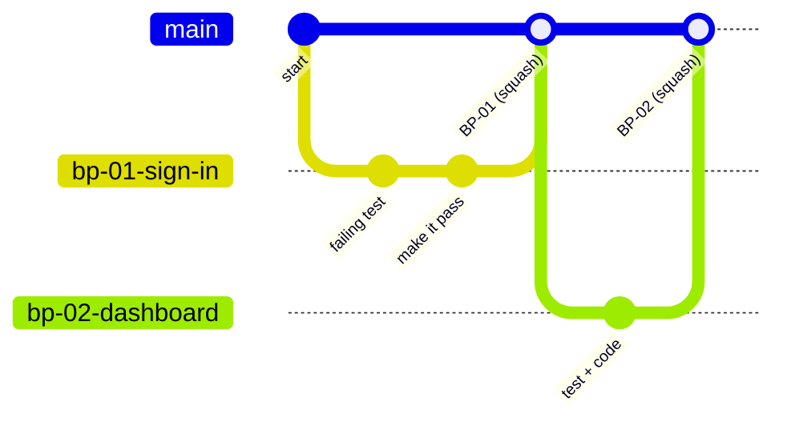

**In one sentence:** Git records every change to the project as a described save (a *commit*); branches let you work on a change without touching the stable version; a pull request is how a finished branch is reviewed and joined back.

## The pieces

- **Repository:** the project folder plus its full history, kept in a hidden `.git` folder.
- **Commit:** a save of a set of changes with a message saying why. You can always go back to any commit.
- **Branch:** a separate line of commits. `main` is the stable line; work happens on other branches.
- **GitHub:** a copy of the repository on a server, plus issues, pull requests and Actions (automation). `git push` sends commits up, `git pull` brings them down.
- **Pull request (PR):** a request to merge a branch into `main`. It shows the changes, runs the checks and collects the review.
- **Merge:** joining a branch's commits into `main`. A *squash merge* turns them into a single commit.

## One build phase, one branch

Each [build phase](/phases/f4-build-phases/) gets its own branch and pull request. While a phase is in progress, `main` stays untouched and working. If the phase goes wrong, the branch is deleted and nothing else is affected. When it is approved, the squash merge leaves one clear commit per phase in the history.

## Who does what

Claude creates the branch, commits, pushes and opens the pull request. **You** read the summary, try the change, and approve the merge: that is gate G6 in [Step 6 of the build loop](/phases/f5/step-6/).

## Sources

- [Git documentation](https://git-scm.com/doc) and [GitHub Docs: About pull requests](https://docs.github.com/en/pull-requests/collaborating-with-pull-requests/proposing-changes-to-your-work-with-pull-requests/about-pull-requests).
