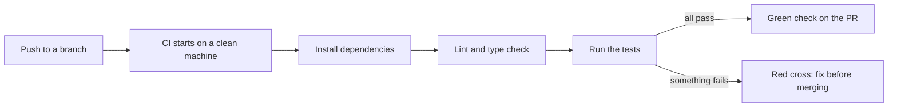

**In one sentence:** a test is a small program that checks that another piece of code does what it should; CI (continuous integration) runs all the tests automatically on every change, so a mistake is caught before it reaches `main`.

## Kinds of tests

- **Unit tests** check one function or component in isolation. Fast, many of them.
- **Integration tests** check that several parts work together (for example, the app and the database).
- **End-to-end (E2E) tests** drive the real app in a browser, like a user would. Slower, fewer of them, focused on the journeys that matter.

## Test first

In [Step 2 of the build loop](/phases/f5/step-2/) Claude writes a test that **fails**, then the code that makes it pass (*red → green → refactor*). The failing test is a precise definition of "done" agreed before any code exists, and it lets Claude check its own work instead of declaring victory.

## CI: the same checks, every time, on a clean machine

On GitHub, CI is usually a workflow file in `.github/workflows/` run by GitHub Actions. Because it starts from nothing each time, it catches problems that "work on my computer" hides: a missing dependency, a file that was never committed.

## What the green check means (and does not)

A green check means every automated check passed. It does not mean the feature is what you wanted: that is what your review and your manual test at gate G6 are for. Tests protect what already works; you judge whether the new thing is right.

## Sources

- [GitHub Docs: Understanding GitHub Actions](https://docs.github.com/en/actions/get-started/understand-github-actions).
