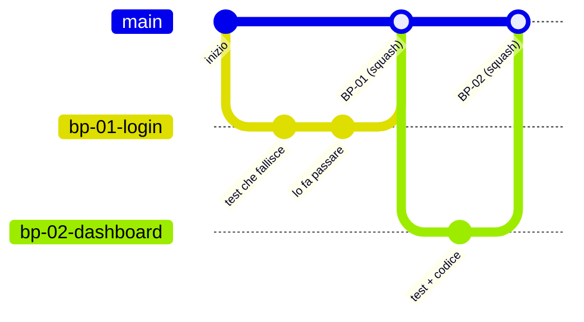

**In una frase:** Git registra ogni modifica al progetto come un salvataggio descritto (un *commit*); i branch permettono di lavorare a una modifica senza toccare la versione stabile; una pull request è il modo in cui un branch finito viene revisionato e riunito.

## I pezzi

- **Repository:** la cartella del progetto più tutta la sua storia, conservata in una cartella nascosta `.git`.
- **Commit:** un salvataggio di un insieme di modifiche con un messaggio che spiega il perché. Puoi sempre tornare a qualsiasi commit.
- **Branch:** una linea separata di commit. `main` è la linea stabile; il lavoro si fa su altri branch.
- **GitHub:** una copia del repository su un server, più issue, pull request e Actions (automazioni). `git push` invia i commit, `git pull` li scarica.
- **Pull request (PR):** una richiesta di unire un branch a `main`. Mostra le modifiche, esegue i controlli e raccoglie la review.
- **Merge:** unire i commit di un branch a `main`. Lo *squash merge* li trasforma in un solo commit.

## Una build phase, un branch

Ogni [build phase](/it/phases/f4-build-phases/) ha il suo branch e la sua pull request. Mentre una fase è in corso, `main` resta intatto e funzionante. Se la fase va male, il branch si cancella e nient'altro viene toccato. Quando viene approvata, lo squash merge lascia nella storia un commit chiaro per fase.

## Chi fa cosa

Claude crea il branch, fa i commit, il push e apre la pull request. **Tu** leggi il riassunto, provi la modifica e approvi il merge: è il gate G6 del [Passo 6 del build loop](/it/phases/f5/step-6/).

## Fonti

- [Documentazione di Git](https://git-scm.com/doc) e [GitHub Docs: About pull requests](https://docs.github.com/en/pull-requests/collaborating-with-pull-requests/proposing-changes-to-your-work-with-pull-requests/about-pull-requests).
