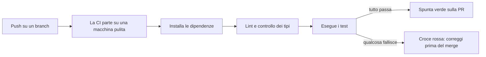

**In una frase:** un test è un piccolo programma che verifica che un altro pezzo di codice faccia ciò che deve; la CI (integrazione continua) esegue automaticamente tutti i test a ogni modifica, così un errore viene trovato prima di arrivare su `main`.

## Tipi di test

- I **test unitari** verificano una funzione o un componente da solo. Veloci, tanti.
- I **test di integrazione** verificano che più parti funzionino insieme (per esempio l'app e il database).
- I **test end-to-end (E2E)** usano l'app vera in un browser, come farebbe un utente. Più lenti, meno numerosi, concentrati sui percorsi che contano.

## Prima il test

Nel [Passo 2 del build loop](/it/phases/f5/step-2/) Claude scrive un test che **fallisce**, poi il codice che lo fa passare (*rosso → verde → refactor*). Il test che fallisce è una definizione precisa di "fatto", concordata prima che esista il codice, e permette a Claude di verificare il proprio lavoro invece di dichiarare vittoria.

## CI: gli stessi controlli, ogni volta, su una macchina pulita

Su GitHub la CI è di solito un file di workflow in `.github/workflows/` eseguito da GitHub Actions. Dato che parte ogni volta da zero, trova i problemi che "sul mio computer funziona" nasconde: una dipendenza mancante, un file mai committato.

## Cosa significa la spunta verde (e cosa no)

La spunta verde significa che tutti i controlli automatici sono passati. Non significa che la funzionalità sia quella che volevi: per questo servono la tua review e il tuo test manuale al gate G6. I test proteggono ciò che già funziona; sei tu a giudicare se la novità è giusta.

## Fonti

- [GitHub Docs: Understanding GitHub Actions](https://docs.github.com/en/actions/get-started/understand-github-actions).
