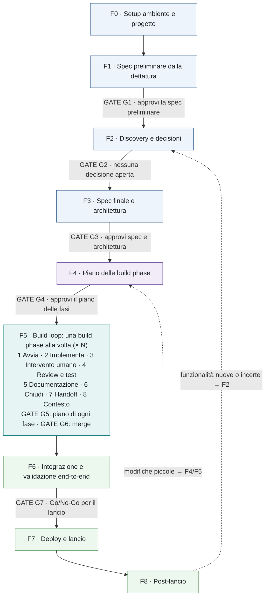

---
# Generated from indicative-playbook/AI-Assisted-Build-Playbook_IT.md by scripts/split-playbook.mjs. Edit the source, not this file.
title: "Capitolo 2 · Il workflow visivo"
description: "Il diagramma qui sotto mostra le nove fasi, gli output principali, i gate e il ciclo di ritorno dopo il lancio. Le frecce indicano le dipendenze: una fase…"
lastVerified: 2026-11-12
sidebar:
  order: 2
---

import Term from '~/components/Term.astro';

Il diagramma qui sotto mostra le nove fasi, gli output principali, i gate e il ciclo di ritorno dopo il lancio. Le frecce indicano le dipendenze: una fase parte solo quando la precedente ha raggiunto la sua Definition of Done.

## Come leggere le dipendenze

- **F0 → F1.** La dettatura finisce già in un file del <Term id="repository">repository</Term>: per questo il progetto va creato prima.
- **F1 → F2.** `/wayfinder` ha bisogno di una destinazione e di materiale grezzo da cui partire: la spec preliminare.
- **F2 → F3.** `/to-spec` sintetizza le decisioni già prese; non intervista. Senza decisioni chiuse, la spec inventerebbe.
- **F3 → F4.** `/to-tickets` suddivide la spec approvata: ogni <Term id="build-phase-bp">build phase</Term> deve rimandare a requisiti scritti.
- **F4 → F5.** Le dipendenze tra <Term id="issue">issue</Term> (*blocked by*) decidono l'ordine: lavori sempre su una fase il cui blocco è chiuso.
- **F5 → F6 → F7.** Si integra quando tutte le fasi del traguardo sono chiuse; si lancia solo dopo il Go del gate G7.
- **F8 → F2/F4/F5.** Dopo il lancio il ciclo riparte dal punto giusto in base alla dimensione della modifica (vedi Fase 8).

| Fase | Strumenti principali | Output principali |
|---|---|---|
| F0 · Setup ambiente e progetto | <Term id="winget">winget</Term> · Claude Code · gh · `/setup-matt-pocock-skills` | Repo <Term id="git-github">GitHub</Term> privato · `CLAUDE.md` · struttura `docs/` · label · <Term id="skill">skill</Term> configurate |
| F1 · Spec preliminare dalla dettatura | Wispr Flow, Win+H o `/voice` · prompt T1 · template T2 | `docs/00-brain-dump.md` `docs/01-preliminary-spec.md` |
| F2 · Discovery e decisioni | `/wayfinder` (grilling, prototype, research) · GitHub Issues | Mappa wayfinder chiusa · <Term id="decision-ticket">decision ticket</Term> risolti · <Term id="adr">ADR</Term> · `GLOSSARY.md` |
| F3 · Spec finale e architettura | `/to-spec` · T4 · T5 · ADR · revisione critica | `docs/02-product-spec.md` `docs/03-architecture.md` · spec issue |
| F4 · Piano delle build phase | `/to-tickets` · prompt T6 · issue template T7 | 10–50 issue BP-NN con dipendenze `docs/04-build-plan.md` |
| F5 · Build loop (× N) | <Term id="plan-mode">plan mode</Term> · `/implement` · `/tdd` · `/handoff` · `/compact` | Per ogni build phase: <Term id="branch">branch</Term> → <Term id="pull-request-pr">pull request</Term> con test verdi → <Term id="merge">merge</Term> su main `STATUS.md` aggiornato · issue chiusa con riepilogo |
| F6 · Integrazione e validazione <Term id="e2e-end-to-end">end-to-end</Term> | T13 · `/security-review` · `/code-review` · collaudo utenti | Integration review · matrice di tracciabilità · Go/No-Go |
| F7 · Deploy e lancio | Vercel · Supabase · GitHub Actions · Sentry · PostHog · T14 | Produzione online · dominio · monitoring · runbook di rollback |
| F8 · Post-lancio | `/triage` · `/diagnosing-bugs` · `/improve-codebase-architecture` · T15 | Release vX.Y.Z · CHANGELOG · nuove issue prioritizzate |

**Legenda.** Colori delle fasi: Definire (F0–F3), Pianificare (F4), Costruire (F5), Consegnare (F6–F8). **GATE** = Claude si ferma: serve la tua approvazione esplicita. Le frecce tratteggiate sono il ritorno dopo il lancio: modifiche piccole → F4/F5; funzionalità nuove o incerte → F2.
