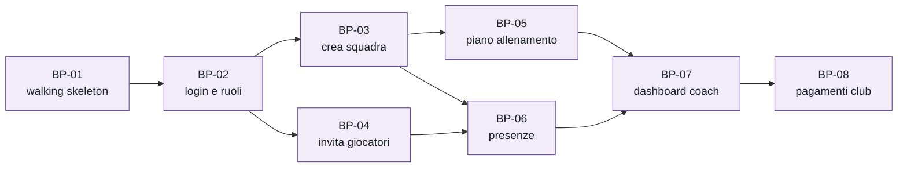

---
# Generated from content-source/playbook.it.md by scripts/split-playbook.mjs. Edit the source, not this file.
title: "Fase 4 · Suddividi il progetto in build phase"
description: "Trasformare la spec approvata in 10–50 build phase sequenziali, ognuna una issue GitHub indipendente, ordinata e con dipendenze esplicite."
lastVerified: 2026-11-12
editUrl: https://github.com/manuelecreatini/build-with-claude-code/blob/main/content-source/playbook.it.md?plain=1#L977
phase: F4
---

import Term from '~/components/Term.astro';
import WhyThisStep from '~/components/WhyThisStep.astro';
import QuizBlock from '~/components/QuizBlock.astro';
import Role from '~/components/Role.astro';

| Voce | Dettaglio |
|---|---|
| **Obiettivo** | Trasformare la spec approvata in 10–50 <Term id="build-phase-bp">build phase</Term> sequenziali, ognuna una <Term id="issue">issue</Term> <Term id="git-github">GitHub</Term> indipendente, ordinata e con dipendenze esplicite. |
| **Input** | `docs/02-product-spec.md` v1.0, `docs/03-architecture.md`, template della issue (T7) nel <Term id="repository">repository</Term>. |
| **Output** | Issue `BP-01`…`BP-NN` con label `build-phase`, collegamenti *blocked by* nativi, `docs/04-build-plan.md` con grafo delle dipendenze. |
| **Strumenti** | `/to-tickets` <Role as="pocock" />, prompt T6, `gh`. |
| **Gate** | <Role as="gate" n={4} /> approvi il piano prima che venga pubblicato. |
| **Tempo tipico** | 1–2 ore. |

<WhyThisStep>Claude lavora meglio su un compito che sta in una sessione. Fette verticali piccole, ognuna con la sua issue e la sua pull request, rendono ogni modifica revisionabile e ogni errore facile da annullare.</WhyThisStep>


## Cos'è una build phase

Una build phase è un ticket nel senso di `/to-tickets`: una **fetta verticale a proiettile tracciante**[^27]: un percorso stretto ma completo attraverso dati, logica, interfaccia e test, dimostrabile o verificabile da solo e dimensionato per una sessione di contesto pulita. Nel playbook vale l'equazione:

**1 build phase = 1 issue = 1 <Term id="branch">branch</Term> = 1 sessione = 1 <Term id="pull-request-pr">pull request</Term> = 1 risultato dimostrabile**

| Strato | Fetta orizzontale: «tutta l'interfaccia» | Fetta verticale: una capacità completa |
|---|---|---|
| Interfaccia | ✅ tutta l'interfaccia, di tutte le funzionalità | ✅ solo quella di questa capacità |
| Logica e <Term id="api">API</Term> | — | ✅ |
| Dati e schema | — | ✅ |
| Test | — | ✅ |
| **Risultato** | nulla funziona finché tutto non è finito | funziona, si testa e si mostra subito |

## Quante build phase e quanto grandi

| Tipo di progetto | Build phase tipiche\* | Note |
|---|---|---|
| Landing page o sito vetrina con form | 8–12 | Molte fasi di contenuto e SEO. |
| Strumento interno o dashboard | 12–20 | Pesano dati, permessi, export. |
| Web app o SaaS MVP | 20–35 | <Term id="autenticazione-autorizzazione">Autenticazione</Term>, ruoli, pagamenti, email. |
| Marketplace multi-ruolo, app con mobile e pagamenti | 35–50 | Valuta di dividere in più traguardi. |

\* Euristica del playbook. Oltre 50, il traguardo è troppo ampio: spezzalo (MVP, v1.1, v1.2…).

| Segnali di fase troppo grande | Segnali di fase troppo piccola |
|---|---|
| Più di 6–8 criteri di accettazione. | Nessun risultato visibile o verificabile da solo. |
| Tocca più di un percorso utente principale. | Non si può testare senza la fase successiva. |
| Il titolo contiene due capacità unite da «e». | È uno strato orizzontale («crea tutte le tabelle»). |
| Non si chiude in una sessione senza riempire il contesto. | È una modifica di una riga che non merita una pull request. |
| La pull request risultante è difficile da rivedere in 15 minuti. | Esiste solo per «preparare» qualcosa che non è ancora deciso. |

**Test rapido**: una build phase è giusta se il risultato si può mostrare a un utente in due minuti oppure verificare con un test <Term id="e2e-end-to-end">end-to-end</Term>. Eccezione: i grandi refactoring meccanici (rinominare un concetto ovunque) non stanno in una fetta verticale; `/to-tickets` li gestisce con la sequenza *expand–contract*: prima si aggiunge la forma nuova accanto alla vecchia, poi si migrano gli usi a lotti, infine si rimuove la vecchia.

## L'ordine standard

1. **BP-01 · Walking skeleton**: scaffolding dell'app, controllo dei tipi, <Term id="lint">lint</Term>[^28], strumenti di test, CI e deploy di una pagina «hello world» su un URL di anteprima. Da qui in poi ogni fase è verificabile online.
2. **Autenticazione e ruoli.**
3. **Prima fetta del percorso principale**, sottile ma completa: dati, logica, interfaccia, test.
4. **Ispessimento del percorso principale**: casi limite, stati vuoti, errori.
5. **Percorsi secondari.**
6. **Amministrazione, impostazioni, notifiche ed email.**
7. **Pagamenti**, se previsti.
8. **Robustezza**: accessibilità, prestazioni, sicurezza, analytics e monitoring.
9. **Prontezza al lancio**: pagine legali, SEO, onboarding, dati dimostrativi.



*Esempio di grafo delle dipendenze: BP-03 e BP-04 si possono lavorare in qualsiasi ordine dopo BP-02.*

## Passo 1 — Verifica il template della issue

Il file `.github/ISSUE_TEMPLATE/build-phase.md` (template T7) è stato creato in Fase 0. Contiene tutti i campi richiesti per ogni fase: numero e titolo, obiettivo, funzionalità e componenti, dipendenze, attività, moduli e file previsti, criteri di accettazione, requisiti di test, azioni umane e Definition of Done.

:::note[Una differenza voluta rispetto a /to-tickets]
`/to-tickets` evita di proposito percorsi di file e frammenti di codice nei ticket, perché invecchiano presto. Il template T7 mantiene una sezione «moduli e file previsti», ma la dichiara *indicativa*: serve a te per capire l'impatto, e Claude la conferma o corregge nel piano di ogni fase (gate G5).
:::

## Passo 2 — Genera la proposta con /to-tickets

**Claude Code**
```text
/clear
/to-tickets docs/02-product-spec.md
<incolla qui i vincoli del template T6>
```

`/to-tickets` <Role as="pocock" />:

1. raccoglie il contesto (spec, issue collegate) ed esplora il codice, se esiste;
2. cerca occasioni di *prefactoring*, cioè preparare il codice perché la modifica diventi semplice;
3. disegna le fette verticali e, per ciascuna, le dipendenze che la bloccano;
4. **ti presenta l'elenco numerato** (titolo, bloccata da, cosa consegna) e ti chiede se la granularità è giusta, se le dipendenze sono corrette, se qualcosa va unito o diviso. Itera finché non approvi;
5. solo dopo l'approvazione pubblica le issue in ordine di <Term id="dipendenza">dipendenza</Term>, con i collegamenti nativi *blocked by* di GitHub e la label `ready-for-agent`, senza modificare la issue madre.

## Passo 3 — Rivedi il piano (gate G4)

Prima di dire sì, chiedi a Claude una tabella di copertura e controlla:

**Prompt (EN) · verifica di copertura**
```text
Before publishing, show me a coverage table: every US-xxx and FR-xxx in docs/02-product-spec.md
-> the build phase(s) that implement it. Flag any requirement not covered and any build phase
that implements something not in the spec. Then list all phases that need a human action.
```

- [ ] BP-01 è il walking skeleton con CI e deploy di anteprima.
- [ ] Ogni fase ha un risultato visibile o verificabile e 2–6 criteri di accettazione.
- [ ] Ogni requisito della spec è coperto; nessuna fase fa cose fuori spec.
- [ ] Le dipendenze sono solo quelle reali (meno blocchi = più flessibilità).
- [ ] Le azioni umane (account, chiavi, pagamenti, <Term id="dns">DNS</Term>) sono esplicite e hanno la label `ready-for-human`.
- [ ] Il numero totale è coerente con la tabella delle dimensioni.

## Passo 4 — Pubblica e indicizza

Dopo il tuo sì, Claude pubblica le issue e scrive `docs/04-build-plan.md` (tabella ordinata con link e grafo Mermaid delle dipendenze). Comandi utili:

**PowerShell o Claude Code**
```powershell
gh issue list --label build-phase --state open
gh issue view <numero> --web
```

Facoltativo: crea un milestone «MVP v1» o una board GitHub Projects per vedere l'avanzamento a colpo d'occhio.

:::danger[GATE G4 · Approvi il piano delle build phase]
Approva quando la tabella di copertura è completa, l'ordine segue lo schema standard, le dipendenze sono minime e ogni fase supera il test rapido della dimensione. Nessuna riga di codice è stata scritta finché non hai approvato.
:::

:::tip[Definition of Done · Fase 4]
- [ ] 10–50 issue `BP-NN` pubblicate con template T7 completo.
- [ ] Collegamenti *blocked by* nativi impostati; frontiera iniziale = BP-01.
- [ ] `docs/04-build-plan.md` con tabella e grafo; `docs/STATUS.md` aggiornato.
- [ ] Tabella di copertura senza buchi; azioni umane etichettate.
:::

### Errori comuni

- Fasi orizzontali («database», «tutte le API», «tutta la UI»): niente si può provare fino alla fine.
- Fasi enormi («dashboard completa») che non stanno in una sessione.
- Dipendenze eccessive che rendono tutto sequenziale senza motivo.
- Dimenticare BP-01: senza CI e anteprima, ogni fase si verifica solo sul tuo PC.

<QuizBlock phase="F4" />

[^27]: **Tracer bullet** (proiettile tracciante): una porzione minima ma completa che attraversa tutti gli strati del sistema e funziona davvero dall'inizio alla fine. Mostra subito se la strada è giusta, al contrario di costruire uno strato alla volta e scoprire i problemi solo alla fine.

[^28]: **Scaffolding**: lo scheletro iniziale del progetto (cartelle, file di configurazione, pagina di partenza) generato da uno strumento. **Lint**: un controllo automatico che segnala errori comuni e incoerenze di stile nel codice, senza eseguirlo.
