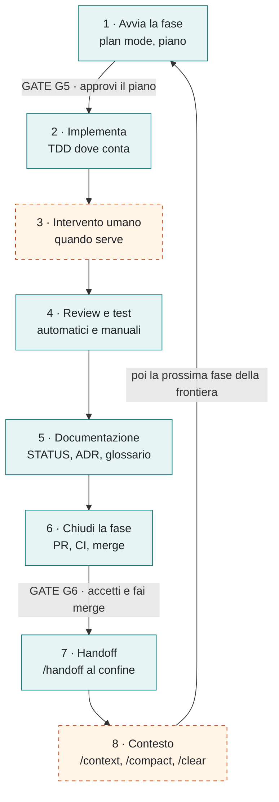

---
# Generated from content-source/playbook.it.md by scripts/split-playbook.mjs. Edit the source, not this file.
title: "Fase 5 · Il build loop"
description: "Implementare le build phase una alla volta, ciascuna verificata, documentata e integrata in main, senza perdere qualità né contesto."
lastVerified: 2026-11-12
editUrl: https://github.com/manuelecreatini/build-with-claude-code/blob/main/content-source/playbook.it.md?plain=1#L1132
phase: F5
---

import Term from '~/components/Term.astro';
import WhyThisStep from '~/components/WhyThisStep.astro';
import Role from '~/components/Role.astro';

| Voce | Dettaglio |
|---|---|
| **Obiettivo** | Implementare le <Term id="build-phase-bp">build phase</Term> una alla volta, ciascuna verificata, documentata e integrata in `main`, senza perdere qualità né contesto. |
| **Input** | Una <Term id="issue">issue</Term> `BP-NN` sulla frontiera (dipendenze chiuse), spec, architettura, <Term id="adr">ADR</Term>, `docs/STATUS.md`. |
| **Output** | Per ogni fase: <Term id="pull-request-pr">pull request</Term> unita con test verdi, issue chiusa con riepilogo, documentazione e `STATUS.md` aggiornati. |
| **Strumenti** | <Term id="plan-mode">Plan mode</Term>, `/implement`, `/tdd`, review (`/mattpocock-skills:code-review`, `/code-review`), `/handoff`, `/compact`, `/context`, `gh`. |
| **Gate** | <Role as="gate" n={5} /> piano di ogni fase; <Role as="gate" n={6} /> accettazione e <Term id="merge">merge</Term>. |
| **Tempo tipico** | 1–3 ore del tuo tempo per fase; Claude lavora più a lungo in autonomia. |

<WhyThisStep>Ripetere gli stessi otto passi per ogni fetta è ciò che rende la qualità prevedibile: piano prima del codice, test prima del merge, documentazione prima della fase successiva, contesto pulito prima della sessione successiva.</WhyThisStep>

*Al centro del ciclo c'è una build phase: **BP-NN** = 1 issue · 1 <Term id="branch">branch</Term> · 1 sessione · 1 pull request; poi si passa alla prossima fase della frontiera. Bordo tratteggiato = passi trasversali (3 e 8), che possono servire in qualsiasi momento.*

:::note[Perché l'ordine degli otto passi è diverso dal brief]
Il brief prevedeva: avvio, implementazione, intervento umano, documentazione, handoff, `/compact`, review e test, chiusura. Nel playbook **review e test vengono subito dopo l'implementazione** (passo 4), perché non ha senso documentare o passare il testimone su codice non verificato; documentazione e chiusura seguono (5 e 6); **handoff e gestione del contesto** (7 e 8) sono operazioni di confine, tra una fase e l'altra o quando il contesto si riempie. L'intervento umano (3) e il controllo del contesto (8) sono *trasversali*: possono scattare in qualsiasi momento.
:::
