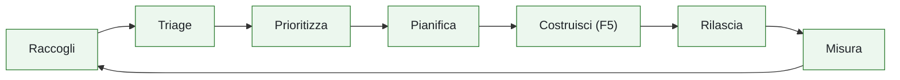

---
# Generated from content-source/playbook.it.md by scripts/split-playbook.mjs. Edit the source, not this file.
title: "Fase 8 · Post-lancio: migliorare senza rompere"
description: "Trasformare bug, feedback e richieste in miglioramenti continui, proteggendo architettura e qualità."
lastVerified: 2026-11-12
phase: F8
---

import Term from '~/components/Term.astro';
import WhyThisStep from '~/components/WhyThisStep.astro';
import QuizBlock from '~/components/QuizBlock.astro';
import Role from '~/components/Role.astro';

| Voce | Dettaglio |
|---|---|
| **Obiettivo** | Trasformare bug, feedback e richieste in miglioramenti continui, proteggendo architettura e qualità. |
| **Input** | Prodotto in produzione, monitoring, canali di feedback. |
| **Output** | Release versionate, CHANGELOG, <Term id="issue">issue</Term> prioritizzate, <Term id="debito-tecnico">debito tecnico</Term> sotto controllo, review operative settimanali. |
| **Strumenti** | `/triage`, `/diagnosing-bugs`, `/improve-codebase-architecture`, `/retro`, `/grill-with-docs`, `/wayfinder` (<Term id="skill">skill</Term> di Matt Pocock); template T15; `gh`. |
| **Gate** | <Role as="gate" n={5} /> e <Role as="gate" n={6} /> per ogni modifica; G3–G4 in forma ridotta per le funzionalità nuove. |
| **Tempo tipico** | Continuo: 30–45 minuti a settimana di review più il lavoro di sviluppo. |

<WhyThisStep>Dopo il lancio la fretta spinge a saltare il metodo. Far passare ogni modifica dallo stesso ciclo è ciò che impedisce a un prodotto online di rompersi poco alla volta.</WhyThisStep>


## Il ciclo settimanale



## Raccogliere bug, feedback e richieste

- **Issue form su <Term id="git-github">GitHub</Term>** per bug e richieste (template B4), anche per i tester esterni.
- **Link «Invia feedback» nell'app** verso un form o una email; Claude li trasforma in issue.
- **Errori automatici**: Sentry può aprire issue su GitHub; PostHog mostra dove gli utenti abbandonano.
- **Interviste con gli utenti**: registrale con uno strumento di note per riunioni; Claude può leggerne le trascrizioni tramite connettore e proporre le issue.

## Triage con /triage

`/triage` <Role as="pocock" /> porta le issue attraverso una macchina a stati di ruoli di triage, usando le label configurate in Fase 0:

`needs-triage` → `needs-info` | `ready-for-agent` | `ready-for-human` | `wontfix`

Eseguila una volta a settimana. Per i bug assegna anche una gravità con tempi di risposta (euristica): S1 in giornata, S2 entro due giorni, S3 alla prossima release, S4 nel backlog.

## Prioritizzare

Usa il punteggio <Term id="rice">RICE</Term>[^45] per confrontare le richieste e chiedi a Claude di calcolarlo nella review settimanale (T15). Ripartizione indicativa della capacità per release (euristica): 60% funzionalità, 20% bug, 20% debito tecnico.

## Da feedback a build phase senza rompere l'architettura

| Tipo di modifica | Percorso | Riparte da |
|---|---|---|
| Bug | `/diagnosing-bugs`: riproduci con un test che fallisce, minimizza, ipotizza, strumenta, correggi, aggiungi il test di <Term id="regressione">regressione</Term>. Una <Term id="pull-request-pr">pull request</Term> con label `bug`. | F5 (build loop) |
| Piccola modifica (una sessione, nessuna decisione nuova) | Issue `ready-for-agent` con il template T7 ridotto. | F5 |
| Funzionalità media (decisioni da prendere, pianificabile in una seduta) | `/grill-with-docs` → `/to-spec` → `/to-tickets` con un nuovo milestone (es. v1.1). | F3 e F4 in forma ridotta |
| Funzionalità grande o incerta | `/wayfinder` con una destinazione delimitata (es. «spec del modulo pagamenti v2»). | F2 |

**Protezioni dell'architettura**

- Ogni nuova <Term id="build-phase-bp">build phase</Term> cita gli <Term id="adr">ADR</Term> che tocca; se ne contraddice uno, prima si scrive un ADR nuovo che lo sostituisce.
- La spec si aggiorna con una pull request e una riga nel suo change log, prima di costruire.
- `/improve-codebase-architecture` <Role as="pocock" />: analizza il codice alla ricerca di opportunità per rendere i moduli più «profondi» (molto comportamento dietro un'interfaccia semplice), produce un report HTML e approfondisce con te il candidato che scegli. Matt Pocock consiglia di eseguirla ogni pochi giorni durante lo sviluppo attivo; nel ritmo post-lancio, almeno ogni due settimane.
- `/retro` <Role as="pocock" />: dopo una sessione difficile, propone miglioramenti all'ambiente dell'agente (istruzioni, controlli automatici, standard), dai più gravi.

## Debito tecnico

Il debito tecnico[^46] si tiene visibile: issue con label `tech-debt`, una quota fissa di capacità per release, e la regola citata da `/to-tickets`: prima rendi semplice la modifica, poi fai la modifica semplice. Le rifattorizzazioni preparatorie diventano build phase a sé, prima della funzionalità.

## Prestazioni

Prima si misura, poi si ottimizza: Speed Insights e Lighthouse per il <Term id="frontend-backend">frontend</Term> (obiettivi Core Web Vitals: LCP sotto 2,5 s, INP sotto 200 ms, CLS sotto 0,1), Sentry per le operazioni lente, gli advisors di Supabase per query e indici. Ogni ottimizzazione è una build phase con una metrica prima e dopo.

## Versioni e rilasci

- **Semantic Versioning**[^47]: `v1.0.0` al lancio, `v1.1.0` per nuove funzionalità, `v1.1.1` per correzioni.
- `CHANGELOG.md` in formato *Keep a Changelog*: Claude sposta le voci da `[Unreleased]` alla nuova versione.
- Release su GitHub con note generate dai <Term id="commit">commit</Term>:

**PowerShell o Claude Code**
```powershell
git tag v1.1.0
git push origin v1.1.0
gh release create v1.1.0 --generate-notes
```

Per le funzionalità rischiose usa un *<Term id="feature-flag">feature flag</Term>*[^48] (PostHog lo offre): rilasci prima a pochi utenti, poi a tutti. Cadenza consigliata: una release ogni una o due settimane, sempre attraverso il build loop.

## Il ritmo operativo

| Frequenza | Attività |
|---|---|
| Settimanale | Review operativa con il template T15 (salute, uso, feedback, triage, priorità, release). |
| Ogni due settimane | `/improve-codebase-architecture`; pulizia del backlog. |
| Mensile | Aggiornamento delle dipendenze, `npm audit`, `/security-review` sulle modifiche del mese, controllo dei costi dei servizi. |
| Trimestrale | Revisione della roadmap; nuovo traguardo con `/wayfinder` se necessario. |

:::tip[Definition of Done · Fase 8 (ogni ciclo)]
- [ ] Nessuna issue in `needs-triage` più vecchia di una settimana.
- [ ] Ogni modifica è passata dal build loop con i gate G5 e G6.
- [ ] Release taggata, CHANGELOG aggiornato, note pubblicate.
- [ ] Review operativa settimanale salvata in `docs/ops/`.
:::

<QuizBlock phase="F8" />

[^45]: **RICE**: *Reach* (quanti utenti tocca in un periodo) × *Impact* (quanto cambia la loro esperienza, per esempio da 0,25 a 3) × *Confidence* (quanto sei sicuro delle stime, in percentuale) ÷ *Effort* (quante settimane di lavoro). Più è alto il punteggio, prima si fa.

[^46]: **Debito tecnico**: le scorciatoie prese per andare più veloci (codice duplicato, test mancanti, soluzioni provvisorie) che rendono più lente e rischiose le modifiche future, come un interesse che matura.

[^47]: **Semantic Versioning (SemVer)**: numeri di versione nella forma MAGGIORE.MINORE.CORREZIONE. Si incrementa la prima cifra per cambiamenti incompatibili, la seconda per nuove funzionalità compatibili, la terza per correzioni di bug.

[^48]: **Feature flag**: un interruttore che attiva una funzionalità solo per alcuni utenti o la spegne senza un nuovo deploy. Permette rilasci graduali e ritorni indietro immediati.
