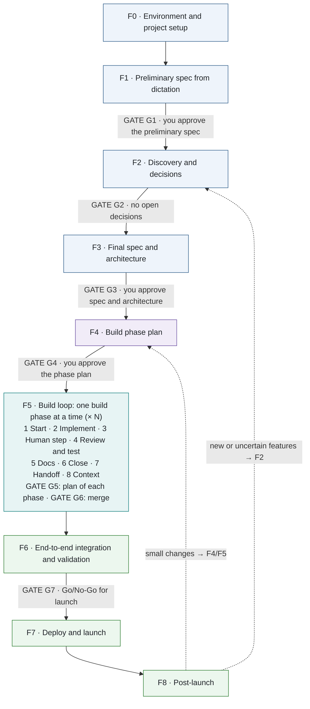

---
# Generated from content-source/playbook.en.md by scripts/split-playbook.mjs. Edit the source, not this file.
title: "Chapter 2 · The visual workflow"
description: "The diagram below shows the nine phases, the main outputs, the gates and the return loop after launch. The arrows show dependencies: a phase starts only…"
lastVerified: 2026-11-12
sidebar:
  order: 2
---

import Term from '~/components/Term.astro';

The diagram below shows the nine phases, the main outputs, the gates and the return loop after launch. The arrows show dependencies: a phase starts only when the previous one has reached its Definition of Done.

## How to read the dependencies

- **F0 → F1.** The dictation already lands in a file in the <Term id="repository">repository</Term>: that is why the project has to be created first.
- **F1 → F2.** `/wayfinder` needs a destination and raw material to start from: the preliminary spec.
- **F2 → F3.** `/to-spec` synthesises decisions already made; it does not interview. Without closed decisions, the spec would make things up.
- **F3 → F4.** `/to-tickets` splits the approved spec: every <Term id="build-phase-bp">build phase</Term> must point back to written requirements.
- **F4 → F5.** Dependencies between <Term id="issue">issues</Term> (*blocked by*) set the order: you always work on a phase whose blockers are closed.
- **F5 → F6 → F7.** You integrate when all the phases of the milestone are closed; you launch only after the Go at gate G7.
- **F8 → F2/F4/F5.** After launch the cycle restarts from the right point depending on the size of the change (see Phase 8).

| Phase | Main tools | Main outputs |
|---|---|---|
| F0 · Environment and project setup | <Term id="winget">winget</Term> · Claude Code · gh · `/setup-matt-pocock-skills` | Private <Term id="git-github">GitHub</Term> repo · `CLAUDE.md` · `docs/` structure · labels · <Term id="skill">skills</Term> configured |
| F1 · Preliminary spec from dictation | Wispr Flow, Win+H or `/voice` · prompt T1 · template T2 | `docs/00-brain-dump.md` `docs/01-preliminary-spec.md` |
| F2 · Discovery and decisions | `/wayfinder` (grilling, prototype, research) · GitHub Issues | Closed wayfinder map · resolved <Term id="decision-ticket">decision tickets</Term> · <Term id="adr">ADRs</Term> · `GLOSSARY.md` |
| F3 · Final spec and architecture | `/to-spec` · T4 · T5 · ADR · critical review | `docs/02-product-spec.md` `docs/03-architecture.md` · spec issue |
| F4 · Build phase plan | `/to-tickets` · prompt T6 · issue template T7 | 10–50 BP-NN issues with dependencies `docs/04-build-plan.md` |
| F5 · Build loop (× N) | <Term id="plan-mode">plan mode</Term> · `/implement` · `/tdd` · `/handoff` · `/compact` | For every build phase: <Term id="branch">branch</Term> → <Term id="pull-request-pr">pull request</Term> with green tests → <Term id="merge">merge</Term> into main `STATUS.md` updated · issue closed with a summary |
| F6 · <Term id="e2e-end-to-end">End-to-end</Term> integration and validation | T13 · `/security-review` · `/code-review` · user acceptance testing | Integration review · traceability matrix · Go/No-Go |
| F7 · Deploy and launch | Vercel · Supabase · GitHub Actions · Sentry · PostHog · T14 | Production online · domain · monitoring · rollback runbook |
| F8 · Post-launch | `/triage` · `/diagnosing-bugs` · `/improve-codebase-architecture` · T15 | Release vX.Y.Z · CHANGELOG · new prioritised issues |

**Legend.** Phase colours: Define (F0–F3), Plan (F4), Build (F5), Deliver (F6–F8). **GATE** = Claude stops: your explicit approval is needed. The dashed arrows are the return loop after launch: small changes → F4/F5; new or uncertain features → F2.
