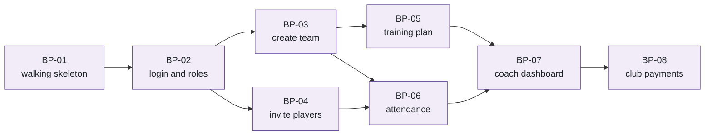

import Term from '~/components/Term.astro';
import WhyThisStep from '~/components/WhyThisStep.astro';
import QuizBlock from '~/components/QuizBlock.astro';
import Role from '~/components/Role.astro';

| Item | Detail |
|---|---|
| **Goal** | Turn the approved spec into 10–50 sequential <Term id="build-phase-bp">build phases</Term>, each an independent <Term id="git-github">GitHub</Term> <Term id="issue">issue</Term>, ordered and with explicit dependencies. |
| **Input** | `docs/02-product-spec.md` v1.0, `docs/03-architecture.md`, the issue template (T7) in the <Term id="repository">repository</Term>. |
| **Output** | Issues `BP-01`…`BP-NN` with the `build-phase` label, native *blocked by* links, `docs/04-build-plan.md` with a <Term id="dependency">dependency</Term> graph. |
| **Tools** | `/to-tickets` <Role as="pocock" />, prompt T6, `gh`. |
| **Gate** | <Role as="gate" n={4} /> you approve the plan before it is published. |
| **Typical time** | 1–2 hours. |

<WhyThisStep>Claude does its best work on a task that fits in one session. Small vertical slices, each with its own issue and pull request, keep every change reviewable and every mistake cheap to undo.</WhyThisStep>


## What a build phase is

A build phase is a ticket in the `/to-tickets` sense: a **vertical tracer-bullet slice**[^27]: a narrow but complete path through data, logic, interface and tests, demonstrable or verifiable on its own and sized for one clean-context session. In the playbook this equation holds:

**1 build phase = 1 issue = 1 <Term id="branch">branch</Term> = 1 session = 1 <Term id="pull-request-pr">pull request</Term> = 1 demonstrable result**

| Layer | Horizontal slice: "the whole interface" | Vertical slice: one complete capability |
|---|---|---|
| Interface | ✅ the whole interface, for every feature | ✅ only this capability's |
| Logic and <Term id="api">API</Term> | — | ✅ |
| Data and schema | — | ✅ |
| Tests | — | ✅ |
| **Result** | nothing works until everything is finished | it works, can be tested and shown straight away |

## How many build phases, and how big

| Project type | Typical build phases\* | Notes |
|---|---|---|
| Landing page or showcase site with a form | 8–12 | Many content and SEO phases. |
| Internal tool or dashboard | 12–20 | Data, permissions and exports weigh most. |
| Web app or SaaS MVP | 20–35 | <Term id="authentication-authorisation">Authentication</Term>, roles, payments, email. |
| Multi-role marketplace, app with mobile and payments | 35–50 | Consider splitting into several milestones. |

\* The playbook's heuristic. Beyond 50, the milestone is too broad: split it (MVP, v1.1, v1.2…).

| Signs a phase is too big | Signs a phase is too small |
|---|---|
| More than 6–8 acceptance criteria. | No result that is visible or verifiable on its own. |
| It touches more than one main user journey. | It can't be tested without the next phase. |
| The title contains two capabilities joined by "and". | It is a horizontal layer ("create all the tables"). |
| It can't be closed in one session without filling the context. | It is a one-line change that doesn't deserve a pull request. |
| The resulting pull request is hard to review in 15 minutes. | It exists only to "prepare" something not yet decided. |

**Quick test**: a build phase is right if the result can be shown to a user in two minutes or verified with an <Term id="e2e-end-to-end">end-to-end</Term> test. Exception: large mechanical refactorings (renaming a concept everywhere) don't fit in a vertical slice; `/to-tickets` handles them with the *expand–contract* sequence: first add the new form next to the old one, then migrate the usages in batches, finally remove the old one.

## The standard order

1. **BP-01 · Walking skeleton**: app scaffolding, type checking, <Term id="lint">lint</Term>[^28], test tooling, CI and the deploy of a "hello world" page to a preview URL. From here on every phase can be verified online.
2. **Authentication and roles.**
3. **First slice of the main journey**, thin but complete: data, logic, interface, tests.
4. **Thickening the main journey**: edge cases, empty states, errors.
5. **Secondary journeys.**
6. **Administration, settings, notifications and email.**
7. **Payments**, if any.
8. **Robustness**: accessibility, performance, security, analytics and monitoring.
9. **Launch readiness**: legal pages, SEO, onboarding, demo data.



*Example dependency graph: BP-03 and BP-04 can be worked on in any order after BP-02.*

## Step 1 — Check the issue template

The file `.github/ISSUE_TEMPLATE/build-phase.md` (template T7) was created in Phase 0. It contains every field each phase needs: number and title, goal, features and components, dependencies, tasks, expected modules and files, acceptance criteria, test requirements, human actions and Definition of Done.

:::note[A deliberate difference from /to-tickets]
`/to-tickets` deliberately avoids file paths and code snippets in tickets, because they go stale quickly. Template T7 keeps an "expected modules and files" section, but declares it *indicative*: it helps you understand the impact, and Claude confirms or corrects it in each phase's plan (gate G5).
:::

## Step 2 — Generate the proposal with /to-tickets

**Claude Code**
```text
/clear
/to-tickets docs/02-product-spec.md
<paste the constraints from template T6 here>
```

`/to-tickets` <Role as="pocock" />:

1. gathers the context (spec, linked issues) and explores the code, if any;
2. looks for *prefactoring* opportunities, i.e. preparing the code so the change becomes simple;
3. designs the vertical slices and, for each one, the dependencies that block it;
4. **presents you the numbered list** (title, blocked by, what it delivers) and asks whether the granularity is right, whether the dependencies are correct, whether anything should be merged or split. It iterates until you approve;
5. only after your approval does it publish the issues in dependency order, with GitHub's native *blocked by* links and the `ready-for-agent` label, without changing the parent issue.

## Step 3 — Review the plan (gate G4)

Before saying yes, ask Claude for a coverage table and check:

**Prompt · coverage check**
```text
Before publishing, show me a coverage table: every US-xxx and FR-xxx in docs/02-product-spec.md
-> the build phase(s) that implement it. Flag any requirement not covered and any build phase
that implements something not in the spec. Then list all phases that need a human action.
```

- [ ] BP-01 is the walking skeleton with CI and preview deploy.
- [ ] Every phase has a visible or verifiable result and 2–6 acceptance criteria.
- [ ] Every requirement in the spec is covered; no phase does things outside the spec.
- [ ] The dependencies are only the real ones (fewer blockers = more flexibility).
- [ ] Human actions (accounts, keys, payments, <Term id="dns">DNS</Term>) are explicit and carry the `ready-for-human` label.
- [ ] The total count is consistent with the sizing table.

## Step 4 — Publish and index

After your yes, Claude publishes the issues and writes `docs/04-build-plan.md` (an ordered table with links and a Mermaid dependency graph). Useful commands:

**PowerShell or Claude Code**
```powershell
gh issue list --label build-phase --state open
gh issue view <numero> --web
```

Optional: create an "MVP v1" milestone or a GitHub Projects board to see progress at a glance.

:::danger[GATE G4 · You approve the build phase plan]
Approve when the coverage table is complete, the order follows the standard scheme, dependencies are minimal and every phase passes the quick sizing test. Not a line of code has been written until you approve.
:::

:::tip[Definition of Done · Phase 4]
- [ ] 10–50 `BP-NN` issues published with a complete T7 template.
- [ ] Native *blocked by* links set; initial frontier = BP-01.
- [ ] `docs/04-build-plan.md` with table and graph; `docs/STATUS.md` updated.
- [ ] Coverage table with no gaps; human actions labelled.
:::

### Common mistakes

- Horizontal phases ("database", "all the APIs", "the whole UI"): nothing can be tried until the end.
- Huge phases ("complete dashboard") that don't fit in one session.
- Excessive dependencies that make everything sequential for no reason.
- Forgetting BP-01: without CI and preview, every phase can only be verified on your PC.

<QuizBlock phase="F4" />

[^27]: **Tracer bullet**: a minimal but complete slice that crosses every layer of the system and really works end to end. It shows straight away whether the road is right, as opposed to building one layer at a time and discovering the problems only at the end.

[^28]: **Scaffolding**: the project's initial skeleton (folders, configuration files, starting page) generated by a tool. **Lint**: an automated check that flags common errors and style inconsistencies in the code, without running it.
