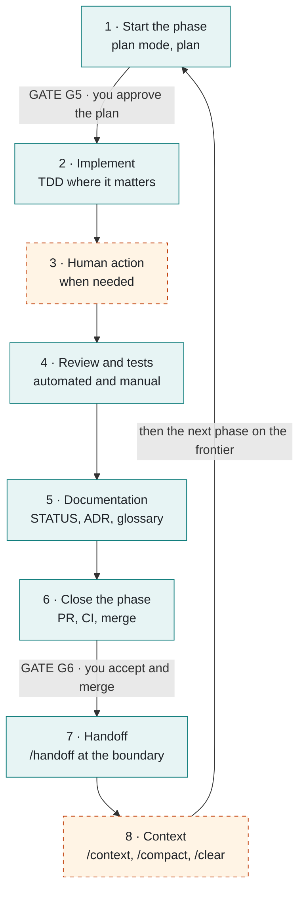

import Role from '~/components/Role.astro';

| Item | Detail |
|---|---|
| **Goal** | Implement the build phases one at a time, each verified, documented and merged into `main`, without losing quality or context. |
| **Input** | A `BP-NN` issue on the frontier (dependencies closed), spec, architecture, ADRs, `docs/STATUS.md`. |
| **Output** | For each phase: a merged pull request with green tests, the issue closed with a summary, documentation and `STATUS.md` updated. |
| **Tools** | Plan mode, `/implement`, `/tdd`, review (`/mattpocock-skills:code-review`, `/code-review`), `/handoff`, `/compact`, `/context`, `gh`. |
| **Gate** | <Role as="gate" n={5} /> each phase's plan; <Role as="gate" n={6} /> acceptance and merge. |
| **Typical time** | 1–3 hours of your time per phase; Claude works longer on its own. |

*At the centre of the loop is a build phase: **BP-NN** = 1 issue · 1 branch · 1 session · 1 pull request; then you move on to the next phase on the frontier. Dashed border = cross-cutting steps (3 and 8), which may be needed at any time.*

:::note[Why the order of the eight steps differs from the brief]
The brief had: start, implementation, human action, documentation, handoff, `/compact`, review and tests, close. In the playbook **review and tests come right after implementation** (step 4), because there is no point documenting or handing over unverified code; documentation and closing follow (5 and 6); **handoff and context management** (7 and 8) are boundary operations, between one phase and the next or when the context fills up. Human action (3) and context control (8) are *cross-cutting*: they can kick in at any moment.
:::
