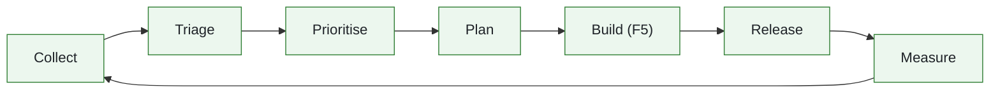

---
# Generated from content-source/playbook.en.md by scripts/split-playbook.mjs. Edit the source, not this file.
title: "Phase 8 · Post-launch: improve without breaking"
description: "Turn bugs, feedback and requests into continuous improvements, while protecting architecture and quality."
lastVerified: 2026-11-12
editUrl: https://github.com/manuelecreatini/build-with-claude-code/blob/main/content-source/playbook.en.md?plain=1#L1716
phase: F8
---

import Term from '~/components/Term.astro';
import WhyThisStep from '~/components/WhyThisStep.astro';
import QuizBlock from '~/components/QuizBlock.astro';
import Role from '~/components/Role.astro';

| Item | Detail |
|---|---|
| **Goal** | Turn bugs, feedback and requests into continuous improvements, while protecting architecture and quality. |
| **Input** | Product in production, monitoring, feedback channels. |
| **Output** | Versioned releases, CHANGELOG, prioritised <Term id="issue">issues</Term>, <Term id="technical-debt">technical debt</Term> under control, weekly operational reviews. |
| **Tools** | `/triage`, `/diagnosing-bugs`, `/improve-codebase-architecture`, `/retro`, `/grill-with-docs`, `/wayfinder` (Matt Pocock <Term id="skill">skills</Term>); template T15; `gh`. |
| **Gate** | <Role as="gate" n={5} /> and <Role as="gate" n={6} /> for every change; G3–G4 in a reduced form for new features. |
| **Typical time** | Ongoing: 30–45 minutes of review a week plus the development work. |

<WhyThisStep>After launch, speed tempts you to skip the method. Running every change through the same loop is what keeps a live product from slowly breaking.</WhyThisStep>


## The weekly cycle



## Collecting bugs, feedback and requests

- **<Term id="git-github">GitHub</Term> issue forms** for bugs and requests (template B4), for external testers too.
- **A "Send feedback" link in the app** to a form or an email address; Claude turns them into issues.
- **Automatic errors**: Sentry can open issues on GitHub; PostHog shows where users drop off.
- **User interviews**: record them with a meeting-notes tool; Claude can read the transcripts through a connector and propose issues.

## Triage with /triage

`/triage` <Role as="pocock" /> moves issues through a state machine of triage roles, using the labels set up in Phase 0:

`needs-triage` → `needs-info` | `ready-for-agent` | `ready-for-human` | `wontfix`

Run it once a week. For bugs also assign a severity with response times (heuristic): S1 the same day, S2 within two days, S3 in the next release, S4 in the backlog.

## Prioritising

Use the <Term id="rice">RICE</Term> score[^45] to compare requests and ask Claude to calculate it in the weekly review (T15). Indicative split of capacity per release (heuristic): 60% features, 20% bugs, 20% technical debt.

## From feedback to build phase without breaking the architecture

| Type of change | Route | Restarts from |
|---|---|---|
| Bug | `/diagnosing-bugs`: reproduce with a failing test, minimise, hypothesise, instrument, fix, add the <Term id="regression">regression</Term> test. One <Term id="pull-request-pr">pull request</Term> with the `bug` label. | F5 (build loop) |
| Small change (one session, no new decisions) | A `ready-for-agent` issue with a reduced T7 template. | F5 |
| Medium feature (decisions to take, plannable in one sitting) | `/grill-with-docs` → `/to-spec` → `/to-tickets` with a new milestone (e.g. v1.1). | F3 and F4 in a reduced form |
| Large or uncertain feature | `/wayfinder` with a bounded destination (e.g. "spec for payments module v2"). | F2 |

**Protecting the architecture**

- Every new <Term id="build-phase-bp">build phase</Term> cites the <Term id="adr">ADRs</Term> it touches; if it contradicts one, a new ADR that supersedes it is written first.
- The spec is updated with a pull request and a line in its change log, before building.
- `/improve-codebase-architecture` <Role as="pocock" />: analyses the code looking for opportunities to make modules "deeper" (a lot of behaviour behind a simple interface), produces an HTML report and explores with you the candidate you choose. Matt Pocock recommends running it every few days during active development; at the post-launch pace, at least every two weeks.
- `/retro` <Role as="pocock" />: after a difficult session, it proposes improvements to the agent's environment (instructions, automated checks, standards), most serious first.

## Technical debt

Technical debt[^46] is kept visible: issues with the `tech-debt` label, a fixed share of capacity per release, and the rule quoted by `/to-tickets`: first make the change easy, then make the easy change. Preparatory refactorings become build phases of their own, before the feature.

## Performance

Measure first, then optimise: Speed Insights and Lighthouse for the <Term id="frontend-backend">frontend</Term> (Core Web Vitals targets: LCP under 2.5 s, INP under 200 ms, CLS under 0.1), Sentry for slow operations, Supabase advisors for queries and indexes. Every optimisation is a build phase with a before-and-after metric.

## Versions and releases

- **Semantic Versioning**[^47]: `v1.0.0` at launch, `v1.1.0` for new features, `v1.1.1` for fixes.
- `CHANGELOG.md` in *Keep a Changelog* format: Claude moves the entries from `[Unreleased]` to the new version.
- A GitHub release with notes generated from the <Term id="commit">commits</Term>:

**PowerShell or Claude Code**
```powershell
git tag v1.1.0
git push origin v1.1.0
gh release create v1.1.0 --generate-notes
```

For risky features use a *<Term id="feature-flag">feature flag</Term>*[^48] (PostHog offers them): release to a few users first, then to everyone. Recommended cadence: one release every one or two weeks, always through the build loop.

## The operating rhythm

| Frequency | Activity |
|---|---|
| Weekly | Operational review with template T15 (health, usage, feedback, triage, priorities, release). |
| Every two weeks | `/improve-codebase-architecture`; backlog clean-up. |
| Monthly | <Term id="dependency">Dependency</Term> updates, `npm audit`, `/security-review` on the month's changes, a check of service costs. |
| Quarterly | Roadmap review; a new milestone with `/wayfinder` if needed. |

:::tip[Definition of Done · Phase 8 (every cycle)]
- [ ] No issue in `needs-triage` older than a week.
- [ ] Every change went through the build loop with gates G5 and G6.
- [ ] Release tagged, CHANGELOG updated, notes published.
- [ ] Weekly operational review saved in `docs/ops/`.
:::

<QuizBlock phase="F8" />

[^45]: **RICE**: *Reach* (how many users it touches in a period) × *Impact* (how much it changes their experience, for example from 0.25 to 3) × *Confidence* (how sure you are of the estimates, as a percentage) ÷ *Effort* (how many weeks of work). The higher the score, the sooner it gets done.

[^46]: **Technical debt**: the shortcuts taken to go faster (duplicated code, missing tests, temporary solutions) that make future changes slower and riskier, like interest that accrues.

[^47]: **Semantic Versioning (SemVer)**: version numbers in the form MAJOR.MINOR.PATCH. You increase the first number for incompatible changes, the second for new compatible features, the third for bug fixes.

[^48]: **Feature flag**: a switch that turns a feature on only for some users, or off without a new deploy. It allows gradual releases and instant rollbacks.
